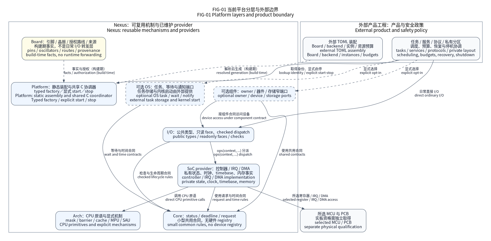

# Nexus 嵌入式通用平台

Nexus 面向工业 MCU 开发，以 C11 提供可复用的 CPU 原语、芯片集成、类型化 I/O、
可选 OS 适配和通用组件。平台采用静态实例、typed factory 与共享只读方法表；
应用取得接口后，直接使用该接口访问独立的实例上下文。

本仓库维护通用机制。产品任务、业务协议、私有 PCB、Flash 分区、调度与恢复策略由
[独立示例仓库](https://github.com/X-Gen-Lab/nexus-examples)或产品仓库维护。
示例仓库为私有仓库，需要独立访问权限。

当前源码版本号为 **0.2.1**，用于开发和 Source SDK 预览。已发布版本的固定源码和
产物以 [GitHub Releases](https://github.com/X-Gen-Lab/nexus/releases)为准；
既有 `v0.2.0` 标签保留原始预览身份。版本号、文档发布或链接成功均不建立实板资格。
接入前阅读[更新日志](CHANGELOG_CN.md)和[精确支持范围](docs/reference/platforms/support.md)。

本页的相对导航以完整源码仓库为上下文。安装后的 Source SDK 保留选定实现与工具，
不包含完整 `docs/`、`tests/` 或更新日志；阅读 SDK 对应文档时，以
`.nexus-source-sdk.json` 记录的 source commit 打开[原仓库](https://github.com/X-Gen-Lab/nexus)
的同一 revision，再阅读本页。完整离线文档使用独立文档包，不能把源 SDK 当作文档包。

## 从架构进入源码



图中的产品工程位于平台之外，OS 与组件为可选依赖。它描述模块关系，不表示每次 I/O
都经过图中所有模块；各边含义和适用范围见[图册](docs/assets/diagrams/README.md)。

| 目录 | 负责什么 | 从哪里继续阅读 |
|---|---|---|
| `core/` | 结果、绝对单调 deadline、请求借用、稳定控制身份 | [Core](core/README.md) |
| `arch/` | CPU 上下文、保存与恢复中断状态、原子端口及 Cache／MPU／SAU | [Arch](arch/README.md) |
| `soc/` | 精确芯片的启动、时钟、内存、IRQ／DMA 与私有 provider | [SoC](soc/README.md) |
| `drivers/` | 经逐芯片复核的共享硬件 IP 算法，由 SoC target 私有选编 | [Drivers](drivers/README.md) |
| `boards/` | 已审接线、晶振、初始电平、硬件选择与未知事实 | [Board](boards/README.md) |
| `io/` | 公共接口对象、检查分派、事务、流和 DMA 排空机制 | [I/O](io/README.md) |
| `os/` | 公共等待合同及裸机、Native、FreeRTOS、ThreadX 的明确适配范围 | [OS](os/README.md) |
| `components/` | 器件协议、共享资源 owner、存储、网络等可选组合 | [组件](components/README.md) |
| `tools/`、`cmake/` | 配置生成、构建、Source SDK、资源检查和交付工具 | [工具](tools/README.md)、[构建](cmake/README.md) |
| `tests/` | Native、生产寄存器模型、ARM 链接及工具边界检查 | [测试](tests/README.md) |

MCU 集成按 `soc/stm32/`、`soc/gd32/` 分组；Arm 实现在 `arch/arm/cortex_m/`，
主机设备模型在 `soc/native/drivers/`。这些目录表达源码所有权，不增加固件转发层。
公共头文件、CMake target 和配置中的 family 身份各有独立稳定边界。

## 配置、实例与运行分别做什么

```text
一份 schema-2 TOML + SoC／Board 事实
    → 严格资源校验 → 不可变 typed IR → 原子生成 bundle
    → CMake 选编 → ELF／BIN／map 与资源检查

运行：factory 查询已有接口 → 公共 API → ops(context, ...) → 选定 provider
```

TOML 选择精确 Board、时钟、后端、实例、模式和预算；JSON 维护芯片与板级事实。
CMake 是源码依赖图的权威。Kconfig、cache 宏和 `resolved.json` 不构成另一套装配入口。
Python 只在主机上校验和生成静态连接；固件硬件准入、读写、readback、停止和恢复由 C
实现。当前生成流程见[配置工具](tools/configure/README.md)。

factory 不分配、不初始化硬件、不加锁、不探测设备。新工程默认使用
`nexus_factory_strong.h`，通过按类别区分的结构引用取得接口；普通整数 ID 仅在当前
assembly 内有效，不用于持久化或通信协议。对象关系见[factory 合同](docs/explanation/factory.md)。

平台启动建立所选基础设施，不启动 scheduler、不生成产品 worker。应用提供任务、
缓冲区、队列容量、执行者和 service 进度。直接接口采用其声明的串行执行合同，
需要多任务排队时显式选择 owner 适配器。

## 使用前必须理解的生命周期

- REJECTED 不保留请求或缓冲区；ACCEPTED 后持续借用，直到调用者 acquire 观察 SETTLED。
- cancel、timeout 和排空失败不授权复用存储；QUARANTINED 继续保留借用与恢复责任。
- IRQ／notification 是重查状态的提示。DMA 完成、线上完成和最终 SETTLED 分别观察。
- SETTLED 结束 provider 访问；回收 adapter、slot、通知和观察者还需要关闭准入与 join。
- 启动 SRAM、已启 watchdog 和部分 RTC 状态可能保留不可普通回滚的责任。

完整顺序见[所有权](docs/explanation/ownership.md)、[异步 I/O 教程](docs/tutorials/async-io.md)
和[OS 停机指南](docs/guides/os-shutdown.md)。基础 C11 路径没有默认堆、注册表、
隐藏驱动任务或最大对象池；可选网络／密码组件另有明确 arena、池和执行域限制。

## 第一次构建：Native 软件验证

以下命令在仓库根目录执行，需要联网准备固定依赖、Python 3.11 及维护的宿主
C／C++、CMake、Ninja 工具。GoogleTest／GoogleMock 仅用于主机测试，固件保持 C11。
首次准备与日常离线构建是不同步骤：

```sh
python tools/dev/dev.py prepare --scope native --allow-network
python scripts/setup/install_dev_tools.py
.venv/bin/python -m pip install -r dependencies/environment-tools.txt
python tools/dev/dev.py doctor
python tools/dev/dev.py configure --preset native-debug
python tools/dev/dev.py build --preset native-debug --parallel 4
python tools/dev/dev.py test --preset native-debug
```

安装脚本建立正常 pre-commit／commit-msg 门禁。Windows 使用对应的
`.venv/Scripts/python.exe`；完整工具前提、固定版本与失败诊断见
[开发工作流](docs/guides/developer-workflow.md)和[源码取得](docs/guides/source-checkout.md)。
检查命令退出码及本次新生成的报告，不能把旧报告当作此次成功。

该路径运行主机行为合同，不会刷写开发板。MCU 构建另需锁定 ARM GNU 工具链、
精确 assembly 和已准备的依赖。当前最小 ARM／CPU runtime 的冷态依赖准备与
network 配置仍有[已记录的范围缺口 #52](https://github.com/X-Gen-Lab/nexus/issues/52)；
完整依赖已准备的本地验证不等于此冷态路径已经修复。

## 应用开发与设备接入

| 目标 | 入口 |
|---|---|
| 从 Source SDK 建立外部工程 | [SDK 教程](docs/tutorials/source-sdk.md) |
| 理解完整装配字段 | [assembly 参考](docs/reference/configuration/assembly.md) |
| 查询可用路线与解释冲突 | [配置工具](tools/configure/README.md) |
| 接入新的 Board | [板卡接入指南](docs/guides/board-porting.md) |
| 接入 provider／新芯片 | [provider 接入指南](docs/guides/provider-porting.md) |
| 维护器件与通用机制 | [组件分类](components/README.md) |
| 只复用 CPU／Core／OS | [Cortex-M runtime](docs/delivery/cortex-m.md) |
| 阅读完整架构 | [平台解释](docs/explanation/platform-architecture.md)、[源码合同](docs/explanation/source-map.md) |

Source SDK 是可移位的源码快照，消费者重新选择配置和工具链进行编译。
普通工程使用 `Nexus::Platform` 与 `nexus_add_firmware()`；安装入口可使用
`find_package(Nexus 0.2.1 EXACT CONFIG REQUIRED)`。源码接口 epoch 为 `1`，
authored assembly schema 为 `2`；版本权威为 `dependencies/platform-compatibility.json`。
SDK manifest 校验精确源码、递归依赖、许可证及实际文件，不是二进制兼容承诺。

## 当前支持与验证边界

内置 MCU family 为 STM32F103／F407／G474／H743／U575、GD32F303／F470，
每个 family 只维护其合同列出的精确型号和模式。启明 F407ZG 核心板／V4.1、
旧 V3.1、天空星 F407VE、梁山派 GD32F470 等 Board 包分别声明来源和硬件选择，
不能从文件存在推导实物、电气或全部外设已验证。

CPU 软件 profile 覆盖 M0／M0+／M3／M4／M7／M23／M33／M55／M85 九种 Cortex-M 内核，
不会自动生成 SoC、Board、向量表或设备 factory。ThreadX 另有明确的 Native／M4
范围；芯片扩展组件也不等于新增完整 SoC。能力以[派生矩阵](docs/delivery/capabilities.md)
和[当前交付](docs/delivery/README.md)为准。

**当前 MCU 实板 HIL 为 `not_executed`。** Native／模型、ARM 链接、Source SDK、
软件候选与实板验收分别建立证据。文档、版本号和历史测试不能建立当前物理时序、
电气安全、签名产品发布或 LTS 承诺，详见[资格说明](docs/reference/platforms/qualification.md)。

## 维护与文档

代码格式、80 列、四空格和反斜杠 Doxygen 风格保持现有仓库约定。新行为采用
GoogleTest／GoogleMock 或对应工具域的 TDD，保留真实失败、完整索引与正常 hooks。
日常规则见[开发规范](docs/development/workflow.md)，文档采用
[内容与图示标准](docs/design/documentation-standards.md)。

[文档首页](docs/index.md)提供任务导航及中英文站点正文；源码旁 README 以中文维护，
站点翻译使用同源 gettext catalog。设计合同、API 与执行台账各自保持唯一权威。
[历史资料](docs/archive/README.md)保留原始身份，不建立当前支持或资格。
