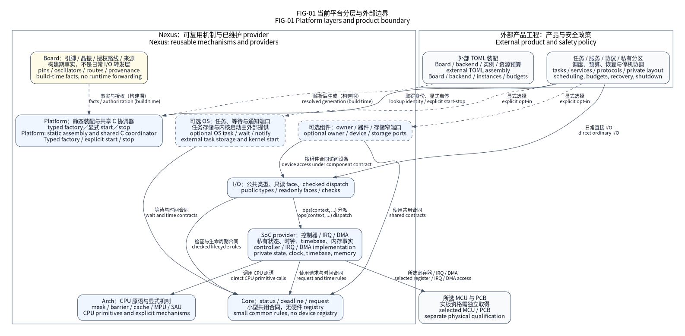

# Nexus 嵌入式通用平台

Nexus 为 MCU 提供 C11 通用机制：Core、Arch、类型化 I/O、静态 factory、可选 OS
适配和器件组件。应用任务、业务协议、私有 PCB、Flash 分区与恢复策略由外部工程维护。

[在线文档](https://x-gen-lab.github.io/nexus/) · [源码文档](docs/index.md) ·
[首次 F407 构建](docs/tutorials/first-f407.md) ·
[首次 Native 运行](docs/tutorials/first-native.md) ·
[公共示例](https://github.com/X-Gen-Lab/nexus-examples)

## 架构与源码



| 位置 | 责任 |
|---|---|
| [Core](core/README.md) | 结果、单调 deadline、请求与存储借用 |
| [Arch](arch/README.md) | CPU 原语、中断状态保存恢复与可选能力 |
| [STM32F4](soc/stm32/stm32f4/README.md) | 启动、时钟、资源及官方 HAL／LL 适配 |
| [Board](boards/README.md) | 精确料号、晶振、PCB 接线与电气条件 |
| [I/O](io/README.md) | 公共接口、检查分派和硬件无关机制 |
| [OS](os/README.md) | 可选裸机、FreeRTOS、ThreadX 与主机测试后端 |
| [组件](components/README.md) | algorithms／runtime／buses／devices／services／protocols |
| [CMake](cmake/README.md)／[工具](tools/README.md) | 配置、构建、测试与源码 SDK |

```text
schema-2 TOML + SoC／Board JSON
    → 校验与资源计划 → 不可变 typed IR → 静态 C 和连接
    → CMake 选择源码 → ELF／BIN／map

运行：typed factory → 已有只读 face → ops(context) → 选定实现
```

factory 按强类型 ID 返回已有静态接口，不分配、初始化或探测硬件。
固件保持 C11／必要汇编，硬件算法与生命周期在 C 中实现；主机配置工具生成静态装配。
应用拥有执行者、任务、缓冲区和停机顺序，平台不自动启动调度器或产品 worker。
架构与运行细节见[平台架构](docs/explanation/platform-architecture.md)和
[所有权合同](docs/explanation/ownership.md)。

## 开始使用

在完整仓库根目录执行。首次准备可联网，后续构建不隐式下载依赖：

```sh
python tools/dev/dev.py prepare --scope preset --preset stm32-qiming-baremetal --allow-network
python tools/dev/dev.py configure --preset stm32-qiming-baremetal
python tools/dev/dev.py build --preset stm32-qiming-baremetal --parallel 4
```

外部工程通过 `find_package(Nexus CONFIG REQUIRED)` 发现平台，再显式调用
`nexus_add_platform(ASSEMBLY ...)` 或 `nexus_add_runtime(ASSEMBLY ...)`。
具体步骤见 [CMake 消费指南](docs/guides/cmake-consumption.md)与
[Source SDK 使用](docs/guides/use-source-sdk.md)。

## 支持和维护

生产 SoC 为 STM32F4，按精确料号、Board、模式和后端核对
[支持范围](docs/reference/platforms/support.md)。厂商库中存在某模块不代表该模式已完成
接入。`tests/support/native/` 是显式主机测试模型，不能建立硬件能力或物理资格。

模型执行、ARM 链接、SDK 消费和物理 HIL 分别验证；实板 HIL 当前为
`not_executed`。源码版本为 **0.2.1**，发行身份以
[GitHub Releases](https://github.com/X-Gen-Lab/nexus/releases) 为准。

修改平台前阅读[开发流程](docs/development/workflow.md)、
[代码与注释规范](docs/development/coding-standards.md)和
[工程合同](docs/reference/contracts/engineering.md)。C++17、GoogleTest／GoogleMock
只用于主机测试。文档提供中英文视图，构建与翻译方法见
[文档维护](docs/development/documentation.md)。
