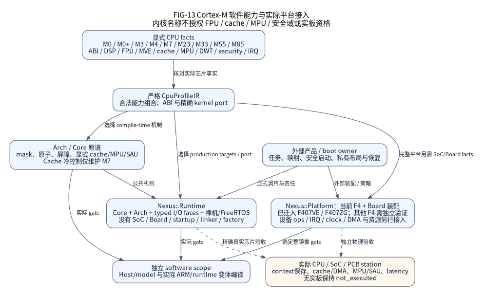

# Arch：CPU 原语与显式可选机制

Arch 为 I/O、SoC 和 OS 适配提供 CPU 局部机制。公共头在
`include/nexus/arch/`，Arm Cortex-M 实现在 `arm/cortex_m/`，宿主实现在
`native/`。CPU 事实在构建期选择唯一基础实现，没有运行时 CPU factory。
新架构需要受审实现和编译器合同，不能仅登记名称就宣称支持。

图区分当前 CPU 原语、Runtime、SoC 接入和实板范围。图源与图例见
[图册](../docs/assets/diagrams/README.md)，规范见
[CPU 契约](../docs/design/arch-contracts.md)。

## 依赖与源码入口

`Nexus::Arch` 不调用 I/O、OS 或厂商 SDK，提供屏蔽状态保存恢复、异常身份、权限、
排序屏障和可选已启用 DWT 快照。私有硬件辅助函数内联，正常 ARM 不链接模拟替身；
公共外部函数仍有普通 C 调用边界，不能宣称全部原语零调用成本。

| 入口 | 责任 |
| --- | --- |
| `arch.h`、`arm/cortex_m/nx_arch_cortex_m.c` | 屏蔽状态、上下文、屏障、周期快照 |
| `atomic.h` | 内联自然对齐 32 位发布／读改写（RMW） |
| `features.h` | 不可变受审编译能力，不探测已启用状态 |
| `cache.h`、`cache_control.h` | 范围维护、独立 M7 冷态控制 |
| `mpu.h`、`security.h`、`nonsecure.h` | MPU、SAU 和即时 CMSE 范围观察 |
| `sleep.h` | 两种显式浅睡眠操作 |
| `arm/cortex_m/private/` | 指令／MMIO 边界和统一寄存器事实 |
| `native/nx_arch_native.c` | 宿主递归排他和 C11 内存屏障 |

同一 Cortex-M 实现覆盖 M0／M0+／M3／M4／M7／M23／M33／M55／M85，包括
ARMv8.1-M Mainline 编译器配置组合。生产 SoC 的精确 STM32F4 料号、模式与运行时范围
由[支持矩阵](../docs/delivery/support.md)单独限定；CPU 原语覆盖不扩大 SoC／Board 支持。
独立 CPU 运行时选择 Core／Arch 和可选 OS，不创建 SoC、Board、启动或
factory；见 [Runtime 装配](../docs/delivery/cortex-m.md)。

## 中断状态、上下文和排序

同 CPU／线程严格逆序使用一次保存／恢复令牌。Cortex-M 保存输入 PRIMASK，
不改 BASEPRI／FAULTMASK。仅特权线程或可配置 IRQ 可以改变屏蔽状态。NMI／HardFault
不被屏蔽，不得访问受保护元数据。临界区不阻塞、分配、大块复制、调用内核或
用户回调。Arch 恢复令牌不代替内核临界区令牌或 SMP 锁。

只读快照区分 PRIMASK、BASEPRI、FAULTMASK，不是恢复令牌，不冻结 IRQ
或另一安全态。M0／M0+／M23 不读不存在的 BASEPRI／FAULTMASK。异常模式即使打断
非特权线程模式也有特权；CONTROL.nPRIV 描述线程模式。异常号只标识当前 CPU／
安全态，不能据此调用内核 ISR API 或协调另一世界。

DMB／DSB／ISB 提供不同排序保证，不证明外设或 DMA 已静止。DWT 要求显式
受审能力和特权访问；能力关闭时不产生 DWT 读取。快照不启用／
复位计数器，不是单调截止时间，回绕／频率限制见公共头。能力来自
显式 CPU 事实，不靠试读任意寄存器或暗中开启可选单元。

## 原子与存储责任

`atomic.h` 区分发布与读改写（RMW），不会静默链接 libatomic。自然对齐字的
acquire 读取和 release 写入不屏蔽 IRQ。M0／M0+ RMW 使用有界 PRIMASK 保存／
恢复排他区；参与者限同 CPU 的特权线程或可配置 IRQ。NMI、HardFault、
另一核、DMA、另一安全域不在该排他域。

其他维护核（包括 M23）用编译器无锁 RMW；独占重试不保证固定
周期上界。发布前初始化字，并保持有效直到每个读取者／写入者停止；这些
操作不自动回收请求、通知或队列。

## 浅睡眠

`nx_arch_wait_for_interrupt()` 要求特权线程模式、PRIMASK=1、
BASEPRI／FAULTMASK 清除、SCR.SLEEPDEEP 清除；执行 DSB／WFI／ISB，不改变屏蔽状态、时钟或待处理中断状态。调用者完成最终就绪状态检查并提供已启 IRQ 唤醒源。
待处理已启用 IRQ 可在 PRIMASK 屏蔽执行时唤醒 WFI，恢复屏蔽状态后再执行。

`nx_arch_idle_if_unchanged()` 要求输入屏蔽状态全清，保存 PRIMASK，以 acquire
重查对齐已发布序列，仅与调用者快照相同时睡眠，最后恢复原值。醒后
重查权威判定条件，有限截止时间另提供 IRQ 定时器。证明域限单 CPU／安全态，
排除 NMI／HardFault、DMA、SMP、另一世界发布者。Native 返回不支持。模型／
编译不建立实际定时器、时钟连续性、功耗或唤醒延迟资格。

## Cache、MPU 与安全域

`cache.h` 区分清理、失效、清理并失效、指令同步。
范围须独占完整受审的 32 B 缓存行、适合 CPU 地址空间，并排除 CPU、DMA 和其他安全域的并发使用。不向外取整、不启用 Cache、不处理无关的脏缓存行。

`cache_control.h` 单独负责 M7 冷态启停。调用者提供零初始化控制对象，屏蔽可配置
IRQ 并排除 DMA 和其他内存使用者。可信复位或此前成功的自有清理／关闭
建立冷态前提，CCR 清位不能证明外来脏行不存在。启用拒绝已有 Cache；
关闭时清理全部受审缓存组／路，由不写脏自身栈的叶函数修改 CCR。部分失败
保留 Cache／CSSELR 恢复责任。实际 O0／Os／O2 指令审查检查地址、循环、屏障；
其他 CPU 范围维护不代表已审核全局冷态控制。

`mpu.h` 分别保留 v7 格式和 v8 基址／上界／MAIR 编码器。单区域编程要求
已经屏蔽可配置中断的特权线程，且 MPU 已关闭；写前查真实 TYPE 上限及字段，
保留 CTRL、输入 RNR。内存策略和后续启用属调用者。可选 M0+ MPU 用
CMSIS 核对的 v7 格式。成功表示校验写入与屏障，不含读回或已启用
策略验证。

`security.h` 查询受审镜像状态并编码显式 SAU 区域。仅 Secure 编译器／
配置组合与受审 SAU 能力能写自有区域，要求 SAU 已关闭、特权线程模式
已置 PRIMASK。API 不改 CTRL／ALLNS、其他区域、网关或另一世界别名。
NonSecure／单状态不做 SAU MMIO 并返回不支持；IDAU、重叠、内存
权限和网关策略归外部集成。

`nonsecure.h` 用真实 CMSE 瞬时观察完整跨度的 NS 非特权读取／读写
权限；IDAU 已建立归属时不需要可编程 SAU。Native、单状态、
NonSecure 不跨域并返回不支持。成功不固定、复制、认证、排除 MMIO 或
冻结映射／DMA／总线防火墙；SoC／网关责任者另建立这些前提。

## Native、官方事实与验证

`features.h` 报告不可变受审 Cache／MPU／DWT／安全／SAU 能力，不是已启用
状态或硬件资格。Native 提供硬件不存在结果，纯编码器仍可用。CPU 机制
不提供 SoC 启动、向量表、时钟树、内存／DMA 路线、Board 接线或
RTOS FP／MVE 上下文端口，各平台分别提供和验证。

Native 用递归排他和 C11 内存屏障，不模拟 NVIC、DMA、物理时间或
信号处理安全中断。Debug／Release 对非法恢复嵌套均中止。九核 GoogleTest／
GoogleMock 编译真实 Cortex-M 算法，仅替换窄寄存器／指令边界；Cache／MPU／
Security 模型也只替换外部 CPU／MMIO 操作，覆盖变更前拒绝。Native 测试执行真实
排他、令牌嵌套和上下文查询。

CMSIS-Core v6.4.0 的 `core_cm0plus.h`、`core_cm7.h`、`core_cm23.h`、
`core_cm33.h`、`core_cm55.h`、`core_cm85.h`、`m-profile/armv7m_mpu.h`、
`m-profile/armv8m_mpu.h` 和 `m-profile/armv7m_cachel1.h` 是受审布局参考。
私有 `registers.h` 集中已用当前域地址；
`tests/contracts/arch_cmsis_layout_probe.c` 独立核对九核 MPU／SAU／Cache 字段。
编译门禁核对 CMSIS-Core 为锁定的精确版本、工作树干净，并检查真实 include 来源。生产目标保持
Nexus 接口依赖边界；共享官方 Core 不改变上下文、所有权、屏蔽恢复或可选机制合同，
也不建立新处理器／配置组合／物理支持。

`scripts/ci/arch_compile.py` 用真实 GNU ARM O2 编译声明的 CPU／FPU／MVE／安全／
DSP ABI。生产原子探针保留九个操作，按函数审查屏蔽状态、恢复屏障、
发布、独占 RMW，并以重定位关联 M0／M0+ IRQ 端口。静态指令数
不约束重试，不建立时序、唤醒延迟或 WCET。ARM Clang、SoC 启动、
Board 接线和实际 IRQ 延迟、权限迁移、DMA／Cache 一致性、
CPU 时序各有独立证据范围，物理行为仍须 HIL。
