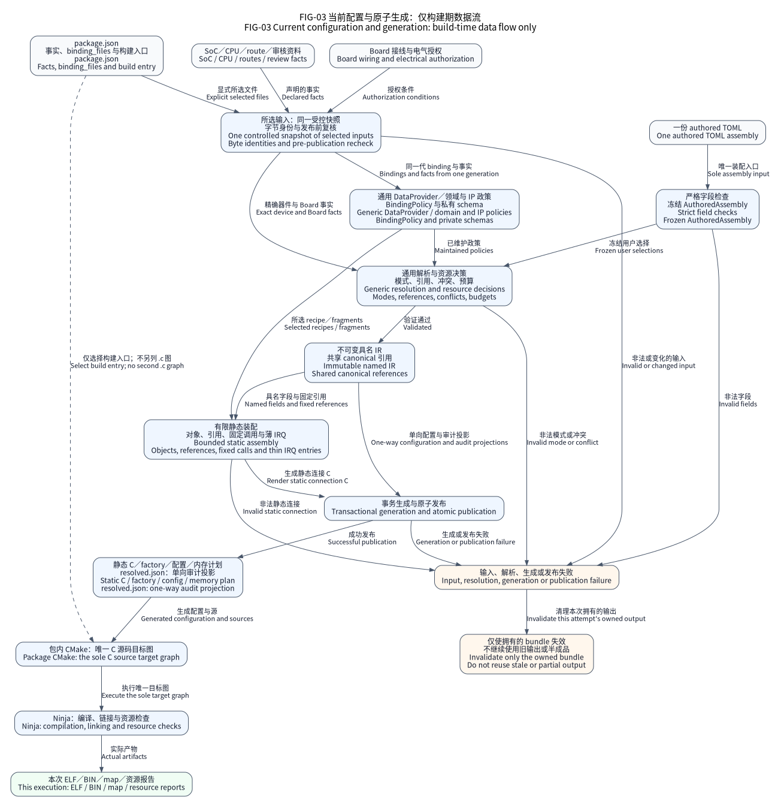

# 板级事实与接入

Board 包描述精确 SoC 与 PCB 的连接条件：来源身份、晶振、已审控制器绑定、初始安全
电平、保留资源，以及尚未确认的电气事实。它复用 [SoC 实现](../soc/README.md)，
不复制驱动或厂商 SDK，也不创建产品任务。

## 包结构与配置边界

```text
boards/<board>/
  board.json                  已审事实和允许选择的绑定
  README.md                   来源、连接与验收限制
  assemblies/                 部分包提供的显式参考装配
```

公开包通过 `board` 选择；私有 PCB 包存放于外部产品仓库，通过 `board_package`
选择。系列标识不依赖厂家物理目录名。Board 声明不能改变芯片内存几何，也不能开放
尚未维护的时钟、DMA 路由或控制器模式。

## 当前包导航

| 包 | 资料与适用边界 |
| --- | --- |
| [Native 事实](native_reference/board.json) | 宿主模型，无实物 PCB；架构边界见 [Native provider](../soc/native/README.md) |
| [启明 F407ZG V3.1](stm32f407_qiming_v31/README.md) | 原 V3.1 手册接线；不代表已确认 PCB 修订 |
| [启明 F407ZG 核心板](stm32f407zg_qiming_core/README.md) | 独立核心板原理图；选装器件必须显式声明 |
| [启明 F407ZG V4.1](stm32f407zg_qiming_v41/README.md) | 独立高配板原理图；跳线、收发器和 PHY 未知项分列 |
| [天空星 F407VE 青春版](stm32f407ve_sky_qingchun/README.md) | VE100 封装及青春版资料，不推广到 VG 高配版 |
| [梁山派 GD32F470ZG](gd32f470_liangshan/README.md) | 资料已审路线；实物 PCB 与外设电气待检查 |
| [NUCLEO-F103RB](stm32f103_reference/README.md) | 手册来源的软件参考，VCP 焊桥须实际核对 |
| [NUCLEO-G474RE](stm32g474re_hse24_reference/README.md) | MB1367 HSE24 参考及明确标注的芯片路线夹具 |
| [NUCLEO-H743ZI2](stm32h743_nucleo_zi2/README.md) | MB1364 来源参考，供电与焊桥未实物观察 |
| [NUCLEO-U575ZI-Q](stm32u575_nucleo_zi_q/README.md) | MB1549 单状态参考，option bytes 由外部启动方确认 |
| [GD32F303RCT6](gd32f303_reference/README.md) | 精确芯片封装软件夹具，不声明制造 PCB |
| [H743 外设组合](stm32h743zi_hsi_reference/README.md) | HSI32/64 的引脚组合参考，不声明实际连接器 |
| [H743 RTS/CTS](stm32h743zi_rtscts_reference/README.md) | 精确 AF 四线参考，外部连接与响应界限另行提供 |
| [U575 RTS/CTS](stm32u575zi_rtscts_reference/README.md) | 精确 AF 四线参考，不等于 Nucleo VCP 接线 |
| [U575 RTC RUN 事实](stm32u575zi_rtc_reference/board.json) | 内部 RTC 软件参考；备份域与晶振由外部 boot owner 预备，不声明实际 PCB／VBAT／Stop2 资格 |
| [U575 LPTIM2 RUN 事实](stm32u575zi_lptim_reference/board.json) | 无外部引脚的 PCLK1 单次计时参考；不建立 STOP／自主运行或实板资格 |

导航覆盖当前事实包；有独立 README 的包链接其说明，其余直接链接完整事实和所属
SoC 合同。新增包时同时核对该表，不能把有 README 的数量当作全部 Board 数量。

## 架构与接入顺序



图表示构建期事实与产物关系，不是运行时查找，也不表示实板已经通过。
先固定精确料号和最小已审路线，再依照 [Board 接入指南](../docs/guides/board-porting.md)
编写事实、选择装配、检查冲突并验证实际目标。

JSON 语法正确不证明器件已焊、连接器导通、供电兼容或物理时序成立。未检查的 PCB
修订和跳线保持未知；软件夹具不建立真实 PCB 资格。当前 MCU 实板 HIL 为
`not_executed`。
