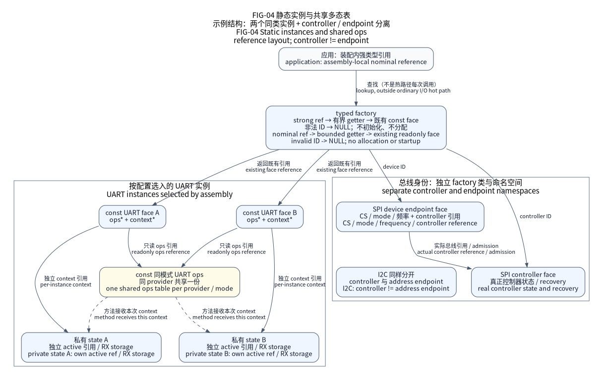

# STM32H743ZI 外设组合软件参考

本包声明精确 STM32H743ZIT6／LQFP144 的软件装配，不标识实际 PCB、SPI／I2C 器件、
已测模拟供电或安全电路。全部物理验收为 `not_executed`；原 NUCLEO-H743ZI2 参考
仍作为独立包保留。

## 选定路线与电气前提

完整外设组合使用固定 HSI32／HSI64、Cache off。SPI4 为 PE12/13/14 AF5 和低有效
PE11 CS；I2C1 为 PB8/PB9 AF4，要求外部上拉；ADC1 使用 PA3 INP15；TIM3 CH1 为
PA6 AF2；EXTI0/1 为 PA0/PA1。IWDG1 与物理 Flash 是内部路线，装配前拒绝引脚
冲突。产品角色、外接器件和 Flash region 由外部工程定义。

ADC／Flash 的 `supply_mv=3300` 是显式名义软件假设。ADC 要求实际 VDDA 为
2400..3300mV，参考电压不高于 VDDA；Flash programming 要求 VDD 保持在
2700..3600mV。I2C 标准模式假设 rise 不超过 1000ns、fall 不超过 300ns；以上电气
条件均未测量。PWM 的 inactive low 是配置输入，不是安全认证。

## 静态装配与执行

图表达静态构造和公共调用关系；本包的具体模式以选定 H743 配置为准。TOML 和芯片／
板级事实先形成不可变 IR，再生成静态 context 与 face。应用查询已有接口后直接调用
共享只读方法表，factory 不初始化硬件。Platform 持有启动和逆序清理责任，排空
失败保留实际 request、pin 和 clock 责任。

具体模式见 [SoC 合同](../../soc/stm32/stm32h743/README.md)，完整输入见
[软件装配](../../tests/contracts/h743_assembly/peripherals.toml)。本包不证明模拟精度、
真实电气时序或安全输出。
