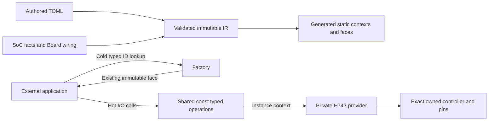

# STM32H743ZI selected peripheral software reference

This package declares an exact STM32H743ZIT6/LQFP144 software assembly. It does
not identify a PCB, attached SPI/I2C device, measured analog supply or reviewed
physical safety circuit. Every physical acceptance item is `not_executed`.
The original NUCLEO-H743ZI2 reference remains a separate package.

The fixed HSI32/HSI64 profiles use Cache off for the complete peripheral
combination. SPI4 uses PE12/13/14 AF5 and active-low PE11 CS; I2C1 uses PB8/PB9
AF4 with external pull-ups; ADC1 uses PA3 INP15; TIM3 CH1 uses PA6 AF2; EXTI0/1
use PA0/PA1. The IWDG1 and physical Flash routes are internal. Pin conflicts are
rejected before assembly. Product roles, devices and Flash regions are external.

ADC and Flash `supply_mv=3300` are explicit nominal software assumptions. ADC
requires actual VDDA2400..3300mV and reference voltage no greater than VDDA. Actual
programming requires VDD to remain within2700..3600mV. I2C timing assumes a
standard-mode rise no greater than1000ns and fall no greater than300ns. These
electrical properties have not been measured. PWM's declared inactive low is a
configuration input, not a safety certification.

The diagram shows the current static construction and call path. Factory lookup
does not initialize hardware. Platform owns startup and reverse cleanup; a
failed drain retains its concrete request, pin and clock responsibilities.

See the [SoC mode and ownership contract](../../soc/stm32h743/README.md) and
[complete software assembly](../../tests/contracts/h743_assembly/peripherals.toml).

本包是精确料号的软件引脚组合，不代表已审查PCB。SPI、I2C、ADC、PWM、EXTI及
内部Flash/看门狗均通过同一TOML、定型IR和静态factory装配，热路径直接调用共享只读
方法表。3.3V、外部上拉和输出初始电平都是明确的软件参考输入；实板、电气时序、
ADC要求实际VDDA为2.4..3.3V，Flash要求实际供电为2.7..3.6V。模拟精度和安全输出尚未验收。所有物理状态为`not_executed`。
