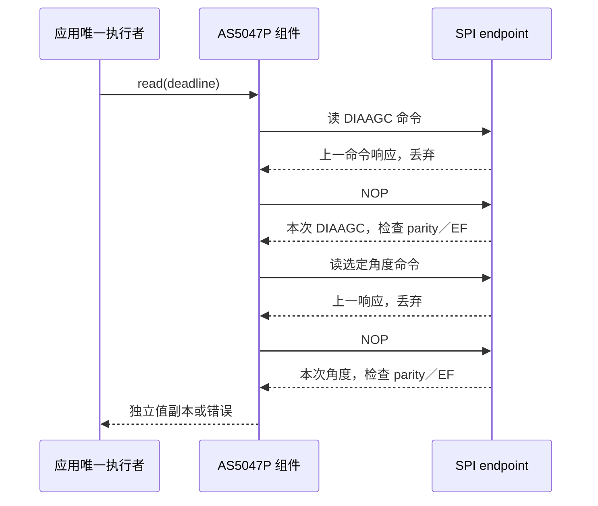

# AS5047P 只读角度组件

`Nexus::AS5047P` 使用已有 `nx_spi_endpoint_t` 的同步 polling 路径，提供初始化、
14-bit 模角度、诊断、显式 ERRFL 清除和软件停止。实例、配置、SPI owner 和时钟均由
应用提供；没有后台任务、堆、自动校零、OTP／配置写入或隐藏总线 owner。

依据为 ams 原始 **AS5047P v2-00，2021-07-22**，SPI／寄存器部分 pp11–19，
[厂商原始文档的分销商镜像](https://www.mouser.com/datasheet/2/588/asset_pdf_25493104-3419339.pdf)。
原厂旧下载地址已不可用；本 profile 固定上述已核验版本，不声称覆盖后续修订。

## 接入边界

绑定须保证 SPI mode 1、MSB-first、时钟不超过 10 MHz、CS setup／两帧间 high
至少 350 ns，以及手册的 hold 时间。公共 polling endpoint 每次两字节传输对应一个
16-clock CS 区间；组件不会在 CS 不撤回时连发两条命令。**普通 F4 SPI endpoint
本身不提供上述电气时序资格**，调用者须选择能够满足它们的实现与已审绑定；这份
器件软件 profile 不新增 Board 路线，不建立任何实板测量结论。

`compensated=false` 选择 ANGLEUNC；`true` 选择 ANGLECOM，并在初始化检查相关
设置。组件通过 factory setting 和诊断检查协议事实；器件没有本 profile 可用的
唯一芯片 ID，不能用一次读通来证明实际物料。模角度每转 16384 counts，机械零点、
方向、展开和速度估计由应用选择的算法处理。

## 状态、失败与停止

初始化检查 offset loop readiness；CORDIC overflow 拒绝发布样本，MAGH／MAGL 作为
诊断保留。诊断与角度先后读取，不能解释为同时刻的物理快照。样本时间为软件读取
完成，保留 domain／epoch 和未知物理不确定度，不冒充采样孔径或编码器边沿时间。

命令和响应使用 even parity，每次两帧读取明确丢弃旧响应。当前响应 EF、parity、
短传输、超时或时间回退会关闭采样；恢复先处理 SPI owner，再在同一绑定显式清错／
初始化。`clear_error()` 读取 ERRFL 会清除设备错误，即使后续响应失败也可能已发生；
它不自动重放角度读取。清错成功仍须重新初始化。

所有函数由同一个 task 串行调用。返回时临时 TX／RX 均已结束借用，输出只在成功时
发布。`stop()` 仅清除软件绑定，调用者先会合全部使用者；它不释放 SPI owner，也不
证明 CS 电平、供电或其他外部硬件恢复。
