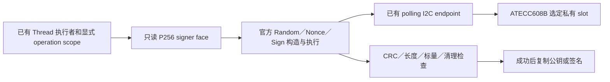

# ATECC608B 只读接入与 P256 签名

`Nexus::ATECC608B` 用已锁定 Microchip CryptoAuthLib 命令构造器和执行器实现一个精确
ATECC608B profile。公共接口只使用 Nexus 类型，私钥不进入 MCU 存储；不提供制造、
配置写入、Lock、OTP、私钥生成或导出接口。

## 选择与资源

明确调用 `nexus_add_atecc608b()`，链接 `Nexus::ATECC608B`；组件依赖
`Nexus::IOI2C` 和 `Nexus::IOP256Signer`。未选择时不准备和编译该供应商。

调用者提供一个已有的 polling I2C endpoint、就绪单调时钟、明确 signing slot、
receive poll 上限，以及电气 wake 和 delay 回调。所有操作由同一 Thread 执行者串行
完成，整个操作期间排除其他 CryptoAuthLib 使用者及冲突的总线操作。同一物理器件
只有一个 live owner 和一个选定 key；多个 slot 的 face 扩展需复用该 owner，不能
另建重复的设备会话。

workspace 大小和对齐由查询函数给出。配置、SDK device/interface、只读 signer face
和错误状态全部在调用者 arena 中。共享 `ops` 只读，每实例 context 独立。不编译
上游 basic-global-device、HAL 注册表或 packet cache，不调用堆分配器。命令 packet
使用局部固定存储；I2C polling 返回后所有 MCU buffer 都已结清。

endpoint、共享只读 ops、活动 operation scope、device 和使用中的 workspace 必须
稳定且互不重叠，输出不得覆盖这些仍需使用的绑定。组件检查公开已知对象；endpoint、
clock 和回调的私有 context 大小不透明，调用者须确保其完整存储与可变 workspace、
device 和输出互不重叠。不能把已知对象检查当成私有内存范围检查。

CryptoAuthLib 的 delay hook 没有 context 参数。因此静态装配点显式实现
`nx_atecc608b_operation_get()`，在每次完整调用期间返回 `{device, deadline}`，调用外
返回 NULL。初始化、public-key、sign 和 stop 均检查当前 scope。库不设置全局
current-device，也不建立线程局部 current-device、worker 或锁。

## 初始化与身份边界

`nx_atecc608b_init` 只执行 Info 和四个 Config block 读取，并验证：

- Info(00) 的 DevRev 精确为 `00 00 60 03`。
- Config lock 和 Data lock byte 都严格为 `00`；其他值不能当成已锁。
- 选定 slot 的 SlotLocked bit 为 `0`；未独立锁定的密钥 slot 拒绝。
- 选定 slot 为 secret、private P256，并允许 public-info 和 ExternalSign。
- 未选择的 LimitedUse、ReqAuth、ReqRandom 行为均拒绝。
- 序列号采用已审格式，复制公开的九字节身份。

DevRev 依据 Microchip **DS40002237A** 的 A／B 迁移差异表：B 为 `00006003`，
A 为 `00006002`。其他 revision 需要独立审核；不能仅凭 `0x60` 推断 B。
参考[官方差异说明](https://onlinedocs.microchip.com/oxy/GUID-91D4A0CB-3AFD-443D-B23E-4D22AD0B49DB-en-US-1/GUID-46FD2FED-DEA0-4C69-B301-DDD5359198AD.html)。

这些是读回检查，不是防伪认证或远程 attestation。硬件型号、provision、证书信任和
密钥使用授权属于产品。`read_identity` 返回初始化时的缓存事实，不声明当前新鲜度。

## 窄签名端口

`nx_atecc608b_signer` 纯查询已有 ready face，不执行硬件访问。公共端口位于
`nexus/io/p256_signer.h`：

| 类型／操作 | 合同 |
| --- | --- |
| `nx_p256_digest_t` | 调用者已经计算好的 32 字节 SHA256 摘要 |
| `nx_p256_public_key_t` | 64 字节 X‖Y，两个坐标各 32 字节大端，不含 `04` 前缀 |
| `nx_p256_signature_t` | 64 字节 R‖S，各 32 字节大端，不含 DER／ASN.1 |
| `public_key` | 只用 GenKey PUBLIC 模式导出公钥，不生成私钥 |
| `sign_digest` | 复用官方 Random seed update → Nonce MSGDIGBUF → Sign external 流程 |

每个操作共用一个有限绝对 deadline，接收尝试还有显式 poll 上限。Random、Nonce、
Sign、CRC、长度、I2C 进度、时间或 idle 清理失败均关闭签名准入，保持输出不变。
R 和 S 必须在 `[1,n-1]` 范围；这个检查不代替接收方的签名验证，不进行 low-S 规范化。
私钥来源、真实随机质量和物理计算时延仍需实际设备验证。

这里尚未提供 TLS／PSA opaque-key 后端，也不隐式计算 SHA256、处理证书或 DER。
产品可以通过该窄端口显式适配所选协议。

箭头表示当前选定软件路径；不能据图推导实物身份、随机质量或硬件资格。

## 错误与停止

参数／scope／过期 deadline 的前置拒绝不进行物理操作。开始物理访问后，失败保留
同一 device、workspace、endpoint 和回调，signer 查询返回 NULL。错误不证明设备
没有执行过命令。I2C 返回释放 MCU buffer，但设备内部状态仍可能不确定。

先关闭新调用并 join 全部 face 用户，再发布 cleanup scope，调用
`nx_atecc608b_stop`。它验证 wake 后显式发 sleep；失败保留绑定，可用独立有限清理
预算重试。时钟倒退锁存 clock fault，不能通过更大的 deadline 恢复原时间域。
停止成功只结束组件绑定，外层 I2C／Platform 的关闭仍由其原 owner 完成。

## 验证与许可

`nexus_common_atecc608b_test` 执行真实官方 builder／CRC／executor 和 Nexus I2C
分发；只模拟外部芯片的电气接口与应答。模型签名数据验证协议传输和发布条件，不
建立真实 ECDSA 硬件运算、密钥保护、熵质量或电气资格，HIL 保持 `not_executed`。

原始供应商 notice 位于 `vendors/microchip/cryptoauthlib/license.txt`，要求与
Microchip 产品配合使用。该 profile 仅针对 ATECC608B；源锁
`dependencies/cryptoauthlib.lock.json` 保存精确 commit、tree 和选中闭包。Source SDK
保留这些许可和来源记录。
