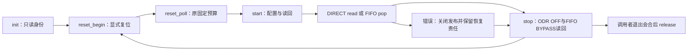

# LSM6DSOX 六轴与 tagged FIFO

本组件复用 ST 官方 `lsm6dsox-pid` v3.3.1 的 C 寄存器驱动，通过 Nexus 的同步、
完全结清端口接入 I2C 或 SPI。厂商源码保持原样，`stmdev_ctx_t` 与 SDK 类型仅在实现
内部使用。`dependencies/lsm6dsox.lock.json` 记录组织来源、精确提交、tree 和文件摘要。

## 选择与边界

| 项目 | 本次选定软件 profile |
| --- | --- |
| 身份 | `WHO_AM_I=0x6c`；不扫描总线 |
| 加速度 | 104 Hz，±4 g，输出 m/s² |
| 角速度 | 104 Hz，±500 deg/s，输出 rad/s |
| 原始更新 | 官方 BDU 与地址自增；所有配置先写入再读回 |
| DIRECT | 双 data-ready 后分别读取加速度／角速度，复制完整观察 |
| TAGGED_FIFO | 未压缩 stream，XL／GY 各 104 Hz，timestamp decimation 1 |
| FIFO 格式 | 独立 XL、GY、timestamp 标签；不把两条记录自动配对 |
| 端口 | 现有同步 I2C endpoint 或八位、mode 0/3 的 whole-CS SPI endpoint |

地址绑带、供电、电气、SPI rate 和 PCB 事实由外部工程提供。I2C 使用 7-bit 地址
`0x6a/0x6b`，不能照搬官方头文件中的 8-bit 地址常量。组件只选择上述基本采样能力；
MLC、嵌入式 FSM、sensor hub、OIS、压缩 FIFO、中断路由和其他 ODR／量程未选。
软件编译、模型与总线模拟不证明实物连接、温漂、噪声、采样精度或最大服务间隔。

依据为 [ST 数据手册](https://www.st.com/resource/en/datasheet/lsm6dsox.pdf)、锁定官方
`lsm6dsox_reg.h/.c` 的量程转换和 FIFO 定义。FIFO timestamp 原生计数名义单位为
25 µs，32-bit 会回绕；本组件保留原值，实际频率误差和时间映射由外部 owner 负责。

## 执行与生命周期

箭头表示本次 C 实现的调用／恢复顺序。应用提供唯一 task 执行者、存储、绝对 deadline
和后续调用节拍。reset 不隐藏循环等待；`reset_poll` 返回 BUSY 时继续使用原 reset
deadline。reset 完成递增 generation 并清零 publication sequence；序号只在完整输出
成功时增加，耗尽后拒绝继续发布。release／重新绑定不保留这些身份，产品负责建立新的
会话。start 证明数字配置，data-ready 证明所选寄存器已有数据，均不认证模拟稳定性。

每次官方 C 回调前后检查同一时钟和 deadline。回退或不可用的时钟形成 sticky fault，
数值更大的 deadline 不能修补其连续性。回调错误、未知 FIFO 标签、FIFO overflow 或
失败排空保留端口与外部恢复责任。stop 使用独立清理预算，观察 reset 完成后关闭两路
ODR 并置 FIFO BYPASS，实际读回成功才报告停止；它不停止 bus owner 或关闭供电。
`release` 仅清除已会合的软件绑定，不执行 I/O，也不消除未完成的物理恢复责任。

传输回调在所有返回值下结清 CPU buffer 访问。I2C 用一次 transaction 的 repeated
START 完成寄存器读取；SPI 命令和最多六字节 payload 保持同一 CS 区间。短传输报告
IO，无异步 submit 退路、隐藏工作线程或堆。重新绑定前外部 bus／设备使用者均须退出。

## 时间、标定与消费

DIRECT 的两组 BDU 读取不承诺六轴同时采样。`observed` 是读完成的 SERVICE 时间，
uncertainty 为 unknown；近期读回不能证明 aperture 或没丢样。TAGGED_FIFO 输出独立
记录，timestamp 不自动绑定到某条向量，也不与 MCU 时钟同步。每次 pop 在读取前后
检查 overrun；发现损失后停止发布，要求显式 stop/reset/start 建立新边界。

器件组件不修改硬件标定、安装坐标或姿态状态。应用可以组合
`nexus/algorithms/attitude.h` 的逐轴标定、Hamilton 四元数旋转和选定六轴比例互补融合。
正向约定为 body→world、静止 identity 时 specific-force 指向 +Z。融合显式接收 dt，
加速度模长不在所选窗口时只用 gyro；没有磁场／外部参考时 yaw 是相对值并会漂移。

公开示例仓库 `recipes/control/imu_reference.*` 给出实际消费：读取、校准、安装旋转、
融合、复制原观察与版本；generation／sequence／clock epoch 中断要求显式重建。
产品提供采样间隔的依据，示例不把 SERVICE 间隔改名为采样孔径间隔。

## CMake 与验证

显式调用 `nexus_add_lsm6dsox()` 或选择 `lsm6dsox` component profile 后才验证和编译
上游依赖；普通设备目录加载只定义选择函数。应用链接 `Nexus::LSM6DSOX` 和所需的
`Nexus::LSM6DSOXI2C`／`Nexus::LSM6DSOXSPI`，提供静态实例、端口和 config。算法
继续通过 `Nexus::Algorithms` 消费，业务源码无需包含厂商头文件。

`tests/google/components/lsm6dsox_test.cpp` 直接执行真实官方 C 与 Nexus adapter，覆盖
身份、复位、实际配置读回、SI 转换、溢出、失败停止、时钟和同步端口。姿态合同位于
`common_attitude_test.cpp`；实际示例拥有独立消费者测试。物理 HIL 保持未执行。
