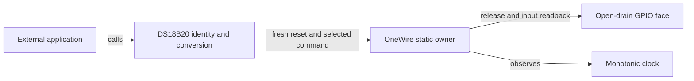

# DS18B20 software reference

`Nexus::DS18B20` implements the exact DS18B20 external-VDD protocol over
`Nexus::OneWire`. Configuration selects a CRC-valid family-`0x28` ROM, or
explicitly declares one device and Skip ROM. Skip mode reads its ROM and checks
that same identity on later operations; it never performs ROM search. Initial
Read Power Supply must confirm external VDD. There is no parasite-power fallback
or invented strong-pull-up hardware.

Arrows show calls in the current implementation. The application owns scheduling,
outer GPIO/clock lifetimes and recovery. No task, product policy, heap, factory
class or vendor type is added.

Initialize the wire, then initialize the sensor under a finite communication
budget. Initialization validates ROM identity, actual supply mode, scratchpad CRC
and resolution; its current temperature is not published as a fresh result.
Start rereads actual resolution and sends Convert T. Service returns BUSY without
wire activity until the corresponding maximum duration has elapsed:

| Resolution | Maximum conversion time |
|---|---:|
| 9 bits | 93,750 us |
| 10 bits | 187,500 us |
| 11 bits | 375,000 us |
| 12 bits | 750,000 us |

Service then uses a fresh reset/select/Read Scratchpad, checks full CRC and
configuration, rejects changed resolution, masks undefined low bits, decodes
portable signed raw sixteenths of a degree and accepts only −55..125°C. Output
is unchanged on BUSY or error. Valid 85°C is accepted after a completed conversion;
the power-on 85°C value alone is never freshness evidence. Stable external power,
identity and exclusive same-device configuration are explicit preconditions.
Busy-bit polling is not used across intervening bus transactions.

One overall finite absolute deadline covers communication, conversion waiting
and result reading. No call blocks for 750 ms. Timeout or clock/identity/CRC
failure closes software admission and ends CPU payload access. Sensor conversion
may continue autonomously: stop never claims cancellation, power-off or release
of the underlying wire owner. Stop/reinitialize only after caller joins; stop
the wire separately and resolve its retained electrical/clock fault before
releasing outer storage. Opaque context disjointness remains an assembly duty.

The supplied V4.1 baseboard schematic depicts PA15/P8/R49 with a 4.7-kΩ pull-up,
3.3-V VDD and a JTAG-TDI conflict; the separate core drawing labels PG11 as
`18B20`. These are distinct boards. Sensor fitting and actual identity remain
unverified. This component guesses neither an installed sensor nor a shared
cross-board route; any selected Board binding must enforce its reviewed wiring,
open-drain release and debug-pin policy. Physical HIL remains `not_executed`.
The official Rev 6, July 2019 document URL/hash is recorded in `references.json`;
the manufacturer PDF is not redistributed.

## 中文合同

本组件仅实现 DS18B20 外部 VDD 供电协议。必须选择 family 为 `0x28`、CRC 正确的
已知 ROM，或显式声明单器件并选择 Skip ROM。Skip 模式读取并缓存真实 ROM，后续
操作再次检查同一身份，不执行 ROM 搜索。初始化通过 Read Power Supply 确认外部
供电；不回退到寄生供电，不假设存在强上拉。

框图箭头表示当前调用关系：外部应用调用器件，器件通过 OneWire 使用 GPIO 和单调
时钟。应用负责调度、外层资源生命周期和恢复；组件没有堆分配、线程、产品策略或
新增 factory 类别。

初始化只验证身份、供电、scratchpad CRC 和分辨率，不把已有温度当作新测量。
开始转换前重新读取实际分辨率，9／10／11／12 位分别等待最多 93,750／187,500／
375,000／750,000 微秒。等待是协作式的：尚未到时返回 BUSY，不访问总线。
到时后重新复位、选择同一器件并读取 scratchpad，校验 CRC、配置和分辨率一致性，
屏蔽未定义低位，以有符号 1/16℃ 原始值返回，范围为 −55～125℃。
BUSY 和错误均不修改输出。有效转换后的 85℃ 可以返回；上电默认 85℃ 本身不能
证明完成新转换。外部供电稳定、身份稳定和同一器件配置互斥是明确前提。

一个有限绝对 deadline 覆盖通信、转换等待和结果读取；不会阻塞等待 750 毫秒。
超时、时钟故障、身份变化或 CRC 错误会关闭软件准入，但不会假装取消传感器内部
转换。器件停止不释放 OneWire 总线；必须分别停止总线并处理保留的线路／时钟责任，
之后才能释放外层存储。所有调用及配置都由同一执行者串行控制。

V4.1 底板原理图为 PA15/P8/R49、4.7kΩ 上拉和 3.3V，并与 JTAG-TDI 冲突；单独
核心板图中的 `18B20` 为 PG11。两块板不能混为一条线路。实物传感器是否安装、ROM
身份、波形和温度精度仍待验收。组件不猜测安装型号，Board 绑定须明确审查开漏、
释放电平和调试引脚策略。只记录官方文档 URL/hash，不公开复制厂商 PDF。
