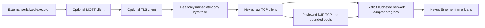

# Optional lwIP Ethernet adapter

This optional component integrates lwIP 2.2.1, commit
`1f53f34b4aa7c6583540c0f4c35142fa66616c78`, tree
`7e65d6e65cefeffa2be44be0bb0ee51136626f1d`, through the reviewed
`X-Gen-Lab/lwip` organization gitlink. Source admission does not establish a
qualified network platform, a new software candidate or physical Ethernet
acceptance. The curated source is based on upstream commit
`77dcd25a72509eb83f72b033d219b1d40cd8eb95`; its only upstream C change is
the documented sizing-condition exception in `ext/lwip/NEXUS_CURATED_SOURCE.md`.

CMake defines the explicit `Nexus::LwIP` target but does not build or link the
stack into firmware unless the external composition selects that target.
Configuration verifies the exact clean checkout, organization origin, parent
index gitlink and fixed closure of 311 source/header/license/curation-notice files through
`tools/maintenance/lwip_lock.py`. The verifier rechecks observed source bytes;
a dirty file cannot be hidden merely by an unchanged Git status. Configuration
never downloads dependencies or writes to the upstream checkout.

Source SDK consumption uses the same fixed byte closure after the existing SDK
manifest verifier has admitted the installation. It does not invent Git
metadata for an installed payload. Explicit upstream experiments may select
`NEXUS_LWIP_SOURCE` with `NEXUS_LWIP_DEVELOPMENT=ON`; those results remain
unqualified development and cannot replace the production organization origin.

## Execution and resources

The selected profile is `NO_SYS=1`, with one serialized stack owner and one
netif. The owner may be a product FreeRTOS task or a cooperative application
loop. Every raw API call, callback, adapter operation and timer operation uses
that same nonreentrant execution context. No worker, scheduler startup, OS lock,
socket API or Netconn API is created by the component.

The fixed reference profile provides Ethernet II, ARP, IPv4, ICMP, UDP and TCP.
DHCP, DNS, IPv6, VLAN delivery and IP fragmentation/reassembly are not enabled.
Optional Nexus TLS and MQTT components use the byte interface above this profile;
the lwIP built-in TLS/socket integrations are not selected. Address, mask, gateway, MAC identity, PHY observation and reconnect
policy are supplied by the external composition. The adapter does not discover
a PHY, negotiate a link or establish Board electrical facts.

The reference stack has a 16 KiB internal arena, 24 fixed 512-byte pool
payloads, four UDP PCBs, four TCP PCBs, two listening TCP PCBs, 32 TCP segments,
eight ARP entries and eight timer entries. lwIP additionally uses fixed protocol metadata;
these numbers are not the complete `.bss` size. There is no libc allocation or
unbounded storage growth. The arena is a bounded optional stack allocator, not
an allocation-free guarantee for lwIP internals. Pool/arena exhaustion remains
observable and must be handled by the product. The complete chosen ELF, not a
sum of nominal pool payloads, establishes its resource cost. Arena alignment
is eight bytes on Native64 and four bytes on the maintained 32-bit MCU ABI.

The public adapter API uses Nexus types. Generic users link `Nexus::LwIP` and
inherit neither vendor include paths nor the stack configuration macros. Only
the composition site explicitly links `Nexus::LwIPStorage` and includes
`lwip_storage.h` to allocate the exact `netif` and adapter layout.
This backend storage header depends on the pinned lwIP profile. It avoids a
maximum-size opaque object and does not enter the generic I/O interface.

## Startup, clocks and hooks

The composition initializes lwIP once with `lwip_init()` before attaching an
adapter. Stack-global pools and timers are not per-adapter objects; a second
simultaneous netif is rejected. Adapter attachment does not initialize or start
the hardware controller. The product first starts its reviewed platform and
then supplies stable frame and clock faces, TX storage and RX fragment views.

The adapter requires three explicit product hooks:

- `nx_lwip_port_now_ms()` supplies wrapping monotonic milliseconds throughout
  the lifetime of all lwIP timers. It must not silently change domains.
- `nx_lwip_port_random_u32()` supplies admitted random data. Source failure
  enters a nonreturning product fault path; no timestamp, fixed-seed or libc
  fallback is supplied. A deterministic host fixture is not MCU entropy proof.
- `nx_lwip_port_assert()` is a nonreturning invariant failure path. It must not
  reclaim DMA or borrowed storage merely because a stack assertion occurred.

The separate `nx_clock_t` in the adapter configuration supplies microseconds in
the actual MAC provider deadline domain. TX timeout must be finite and nonzero;
clock exhaustion rejects submission. A successful adapter stop does not end
global stack timers. Changing or withdrawing their clock requires the product's
complete stack shutdown/restart procedure, not a replacement numerical epoch.

## Frame ownership and progress

`nx_lwip_adapter_service()` progresses the MAC and due lwIP timers before
acquiring at most its explicit receive budget. RX overload cannot indefinitely
starve protocol timers. The receive budget bounds
acquired frames. It does not bound the total duration of arbitrary stack or
application callbacks. Choose and measure a service interval for the actual
arrival rate, pool capacity and workload.

```text
MAC RX loan -> copy into bounded pbuf storage -> exact RX release -> lwIP input
lwIP pbuf  -> copy into caller TX buffer -> MAC ACCEPTED -> observed SETTLED
```

The adapter supplies one contiguous TX buffer of at least 1514 bytes. A busy
borrow returns lwIP backpressure without overwriting that buffer. Stack pbufs
are not retained by the MAC. A successful link output means admission, not
delivery to a peer; the provider's later wire failure remains packet loss for
the selected protocol. TCP retransmission and product recovery retain their
normal responsibilities.

The adapter additionally preserves a failed final TX result until
`nx_lwip_adapter_service` reports that exact result once. An accepted transfer
may settle inline; its admission still returns `ERR_OK`. Another link output
before error observation returns `ERR_IF` without copying or admitting the new
frame. Successful inline completion remains immediately reusable without a
service round trip. Borrowed transfers still return `ERR_MEM` backpressure.
Service checks completion before and after MAC, timer and bounded RX progress;
an inline failure produced during that progress is reported in that invocation.

After acquiring a settled failure, service consumes it by preparing the existing
unborrowed request back to READY. It does not close the adapter, reset the MAC,
replay bytes or require a stop/restart merely because one packet was lost. The
product chooses whether the actual provider state needs recovery; persistent
provider health errors may still be reported independently. A settled TX error
has return precedence when the same progress call also reports a MAC/RX error;
there is no aggregate error history. The optional typed TCP facade keeps its
existing policy: BUSY/EXHAUSTED are temporary, while other network-service errors
fail that connection. Observing a frame error does not promise transparent
connection recovery. An ACTIVE or QUARANTINED request is never cleared by outcome
observation. The selected
TX path adds no error queue or per-instance field. This is an error-observability improvement;
the earlier best-effort packet-loss contract did not promise this notification.

发送结果可观察性：ACCEPTED 仍只表示接纳，不能证明线上成功。传输可以在 submit
返回前以失败 SETTLED；该次接纳仍返回 `ERR_OK`，但最终错误保留到
`nx_lwip_adapter_service` 精确报告一次。在此之前，新 link output 返回 `ERR_IF`，
不会复制或接纳新帧；成功的 inline 完成仍可直接复用，无需额外 service 往返。
仍被借用的请求继续以 `ERR_MEM` 表达背压。service 会在 MAC、timer 和有界 RX
处理前后检查结果，因此该次处理内产生的 inline 错误也会在本次返回。

service 只在 acquire 观察到 SETTLED 后消费错误，把已有且无借用的请求准备为
READY；不自动关闭 adapter、复位 MAC、重放字节，也不会因单帧丢失强制 stop／
restart。产品根据真实 provider 状态选择恢复；provider 的持续健康错误仍可独立
报告。同次处理也有 MAC／RX 错误时，已结清的 TX 错误优先返回，不提供错误历史
聚合。可选 typed TCP facade 保留既有策略：BUSY／EXHAUSTED 视为暂态，其他
network-service 错误使该连接失败；帧错误可观察不等于连接一定透明恢复。
ACTIVE／QUARANTINED 的借用不会被清除。TX 路径不新增错误队列或实例字段。这是对错误可观察性的完善，之前的
best-effort 丢包合同没有承诺这项通知。

RX fragment views are caller-owned and sized for the selected descriptor
geometry. Insufficient view capacity leaves the hardware frame queued. After
acquisition, invalid length/VLAN or pool exhaustion releases the exact loan and
returns an error. Release failure retains the token, discards only the new
software copy, closes further adapter progress and never feeds the same frame
into the stack. No held descriptors are forcefully rearmed.

## Shutdown and recovery

The product first closes its raw PCBs, application callbacks, timers, pending
queues and external observers. `nx_lwip_adapter_stop()` then closes adapter
admission, brings its netif down, retries any held RX release and requests the
actual provider stop. It detaches the netif only after provider success and
acquire-observed TX settlement.

Provider failure, BUSY or an unfinished TX preserves the adapter and every
remaining buffer/token. The caller may perform the provider's explicit
recovery, then retry stop. There is no automatic reset or replay. Successful
detachment is idempotent; it does not claim the global lwIP stack or every
connection has shut down. Keep product stack resources live until their own
callbacks and timers have exited.

## Current validation boundary

Focused GoogleTest execution links the actual pinned lwIP C implementation.
It covers ARP parsing/reply, ICMP echo reply, UDP transmit and receive, TCP SYN,
fragment copying, RX release failure, TX borrowing, stop retention, fixed pool
exhaustion, timer progress during overload, Native pointer alignment, invalid
MAC/provider identity, duplicate attachment and corrupted IPv4 input. Python
tests cover
the source lock, changed bytes, wrong commit/origin, dirty source, unsafe paths
fixed closure enforcement, changes during observation, production origin and
gitlink rejection, source-SDK scope and symbolic CMake selector rejection.

TCP client model tests additionally cover copied queue admission, receive
backpressure, peer FIN, close/abort, bounded progress, deadline and shared-pool
reclamation. The separate
[complete host network fixture](../../tests/contracts/lwip_mqtt_interop/README.md)
connects the actual lwIP/TCP/TLS/MQTT client to real Mosquitto through a test-only
transparent ciphertext relay. One TCP connection crosses software Ethernet frame
ports between two independent lwIP processes; the second crosses a nonblocking
host socket from the relay to the broker. TLS/mTLS and MQTT acknowledgements
terminate at the Nexus client and broker. The relay does not decrypt TLS or
provide a production socket adapter.

That host fixture retains separate normal and sanitizer execution identities.
Its local TCP close only detaches the client context; FIN/TIME_WAIT and global
clock retirement are separate. It aborts remaining owned PCBs, releases accepted
pbufs, settles MAC loans and stops its adapter before ending service. Network and
clock storage remain live until process exit, which retires the isolated test
stack domain. An MCU cannot infer permission to destroy its global clock or
reinitialize lwIP merely from adapter stop.

These are development results. Full software-plan and installed-SDK acceptance,
physical PHY/DMA, network performance and MCU trusted-time/entropy qualification
retain their own source-bound evidence. Model frames and a real host broker do
not prove Board wiring, physical connectivity or HIL.


## Optional copied TCP byte client

`Nexus::LwIPTCP` provides the existing readonly `nx_byte_stream_t` contract over
one official raw TCP connection. Ordinary consumers include
`nexus/network/lwip_tcp.h` and receive Nexus types. A static composition unit
explicitly links `Nexus::LwIPTCPStorage` to allocate the exact reviewed PCB/pbuf
adapter layout. The component adds no socket registry, worker or maximum opaque
object pool. Unselected firmware does not link this target.



The caller supplies zeroed client storage, a live network adapter, one positive
receive-frame budget and an IPv4 address/port. Configuration and address are
copied. `start` success accepts CONNECTING; it does not prove ESTABLISHED.
The first finite connect deadline is retained. Connection failure is sticky;
there is no implicit retry, fallback, DNS or reconnection.

One serialized NO_SYS executor owns the stack, adapters and all clients. Call
facade data/control outside raw callbacks. A shared in-call guard prevents nested
mutation across facade instances; it holds no instance registry or active-client
pointer. The network adapter, its storage, clock epoch and global stack timers
outlive every connection, including detached FIN/TIME_WAIT state. Millisecond
stack timers and microsecond API deadlines use the same unchanged time domain.

Each nonzero byte attempt may perform one explicitly budgeted network service
pass so a synchronous caller such as coreMQTT can receive packets without a
hidden thread. Held RX is consumed first, avoiding an allocation dependency while
its pbuf pool is exhausted. Timer callback cost remains subject to the selected
stack profile and its raw users; a frame count is not a hard wall-clock bound.

Writes use official `tcp_write(..., TCP_WRITE_FLAG_COPY)`. Positive partial
acceptance copies bytes into lwIP's existing bounded storage; the source may be
reused immediately. It promises queue admission, not delivery. The caller bounds
delivery using its protocol acknowledgement policy. A fatal output observed
after copied admission cannot undo acceptance; diagnostics and subsequent calls
remain failed until explicit abort. Would-block/capacity produces BUSY/count zero.

RX holds at most one accepted pbuf chain and a partial-read offset. Returning
ERR_MEM for another chain retains lwIP ownership of that refused chain. Only
bytes copied to the caller receive `tcp_recved` credit. The accepted chain is
released exactly once after complete consumption or explicit abort; the error
callback has already freed its PCB and never frees it twice. Buffered data
precedes orderly TCP FIN, and a peer half-close still permits writes. TLS makes
its separate close-notify authentication decision.

After producers join, `close` shuts write admission and waits for held/refused RX
and queued/unacknowledged TX. Its first finite deadline cannot be extended.
Timeout or BUSY retains the context. Callback references detach before official
`tcp_close`; only an error permits touching the PCB again. Success may represent
upstream deferred FIN allocation and still-running FIN/TIME_WAIT timers, so it
proves this context's final stack access rather than global/PHY drain. Explicit
`abort` discards data, detaches callbacks and frees any still-owned PCB/pbuf;
MAC frame loans remain the network adapter's independent withdrawal duty.
Products stop all known clients before draining/removing the adapter.

The fixed stack currently budgets four shared TCP PCBs, 24 shared 512-byte pool
blocks and the explicitly configured stack arena. One held chain can consume a
receive window; refused/out-of-order data also consumes shared stack resources.
Applications must schedule timely reads and progress. Capacity refusal and
connection state do not provide a physical network or performance qualification.

PCB allocation deliberately retains the pinned official reclamation policy.
`tcp_new_ip_type` uses normal priority. If its first pool allocation fails,
`tcp_alloc` first progresses pending closes, then attempts to reclaim TIME_WAIT,
LAST_ACK, CLOSING and lower-priority active connections. Other connections can
therefore receive error callbacks while a new client starts; even a subsequently
rejected start does not promise a globally unchanged stack. Local rejection
means this context retains no new PCB, pbuf or configuration reference. Products
budget the shared pool and handle every connection's error; this adapter adds no
second allocator or hidden reservation pool. The four-CLOSED-PCB rejection test
has no reclaimable victim and does not establish a universal no-reclaim rule.

## Optional RX payload loans / 可选 RX 负载借用

The [selected RX-loan contract](../../docs/reference/api/components.md#lwip-loaned-rx-contract)
defines the authoritative composition and lifetime rules. Select
`Nexus::LwIPLoanedRX` or `Nexus::LwIPTCPLoanedRX`, and use their respective
`Storage` targets only at static composition. The existing targets and their
24-block resource descriptions above refer to copied RX. One image selects
one singleton stack profile; CMake rejects a copied/loaned mixture.

Each caller-owned frame slot supplies a writable 136 B copied prefix and
custom-pbuf metadata. Only the remaining immutable `PBUF_ROM` payload tails
reference MAC bytes; raw users clone before writing. Supply nonzero exact slots
and at least `slot_count * base.rx_capacity` pieces. Reference operations and
adapter calls share the serialized NO_SYS owner. Final pbuf frees only mark
release-ready pieces; later owner service or stop performs exact MAC release.
Failed release closes admission and retains storage; stop remains BUSY while
pbuf references remain. The enhanced F407/GD470 provider's independent held
loans do not imply universal capacity or guaranteed ACK progress.

This selected profile retains two spare 512 B pool payloads, the existing
16 KiB arena and unchanged other fixed pools. External slots, pieces, prefixes,
MAC buffers and TX bytes still have explicit storage costs; TX and ICMP reply
fallback use bounded RAM. Pool counts do not prove complete SRAM fit. Selected
C11 link-only external development probes pass a 32 KiB SRAM budget on F407
and GD470 with two frame slots, four pieces, a 2048 B main stack and no libc
heap. Their measured SRAM is 24344 B and 24316 B respectively; real MAC rings
and payload buffers are not supplied by those probes. Source/installed-SDK
qualification remains separate. This option adds no DMA/cache,
PHY, throughput or physical HIL qualification.
The curated organization fork exempts only this explicit custom-RX/custom-pbuf
profile from the stock `PBUF_POOL`/`TCP_WND` sizing heuristic; all other sanity
checks stay active. The exemption does not prove stock-upstream admission.

[选定 RX 借用合同](../../docs/reference/api/components.md#lwip-loaned-rx-contract)
是装配与生命周期规则的权威来源。显式选择 `Nexus::LwIPLoanedRX` 或
`Nexus::LwIPTCPLoanedRX`，只在静态装配处使用各自的 `Storage` target。
上文既有 target 及其 24 块资源描述适用于复制 RX。每个镜像只选择一个单例协议栈
配置；CMake 拒绝混合复制与借用配置。

每个调用方自备帧槽包含可写的 136 B 复制前缀及 custom-pbuf 元数据。只有前缀后
剩余的只读 `PBUF_ROM` 负载尾段引用 MAC 原始字节；raw 用户写入前必须克隆。
显式提供非零帧槽数和至少 `slot_count * base.rx_capacity` 个 piece。
引用操作和 adapter 调用共享同一个串行 NO_SYS 所有者。最后一次 pbuf free 只标记
piece 已可归还；后续 owner service 或 stop 才精确归还 MAC 借用。归还失败关闭
准入并保留存储；仍有 pbuf 引用时 stop 保持 BUSY。增强型 F407／GD470 provider
的独立持有借用不代表通用容量或 ACK 必定推进。

此显式配置保留两个备用 512 B 池负载块，沿用既有 16 KiB arena 和其他固定池。
外部 slot、piece、前缀、MAC 缓冲区与 TX 字节仍有显式存储成本；TX 和 ICMP 回复
回退使用有界 RAM。池计数不能证明完整 SRAM 可容纳。C11 外部开发配置的链接
探针使用两个帧槽、四个 piece、2048 B 主栈且无 libc heap，F407／GD470 的
SRAM 分别为 24344 B／24316 B，均通过 32 KiB 预算。这些探针没有提供真实
MAC 环和负载缓冲区；源码及已安装 SDK 资格仍需独立验证。该选项不新增
DMA／cache、PHY、吞吐量或物理 HIL 资格。
维护的组织 fork 仅让此显式 custom-RX／custom-pbuf 配置豁免原版
`PBUF_POOL`／`TCP_WND` 容量启发式检查；其他 sanity 检查全部保留。
此豁免不能证明原版上游也准入该配置。
