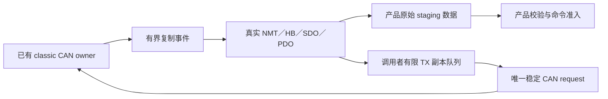

# 选定 CANopenNode 服务端

`Nexus::CANopen` 复用组织托管、精确锁定的 CANopenNode 301 实现，通过一个已有的
Nexus classic CAN owner 运行。固件为 C11，厂商类型和 OD 结构保持私有。

## 已选 profile

| 能力 | 本 profile 范围 |
| --- | --- |
| NMT | Slave；Boot-up、Pre-operational、Operational、Stopped；显式报告 reset 请求 |
| Heartbeat | 一个 producer、一个明确 peer consumer；未观察到 peer 保持 UNKNOWN |
| SDO | 一个 server，1／2／4 字节 expedited upload/download |
| PDO | 一个异步 RPDO、一个异步 TPDO；每方向总计 1..8 字节 |
| 应用对象 | 递增的 `0x2000..0x5fff` VAR，每项 subindex 0、明确字节数和写权限 |
| 错误 | 复用上游本地 error register；不选择 EMCY producer/history |

不选择 NMT master、SDO client／segmented／block、SYNC、LSS、动态 PDO remapping、
CiA402 对象字典、CAN FD 或认证。这些范围不由库库存或头文件存在推导。

通信参数和 PDO 映射在初始化时固定。SDO 中的通信对象只读；应用 staging 对象按
声明设置 SDO 写权限和 PDO 映射。当前 profile 为 little-endian 目标，数据保持显式
原始字节，不推断物理单位或产品 schema。

## 静态选择与存储

应用调用 `nexus_add_canopen()`，链接 `Nexus::CANopen`；也可以明确选择相应组件
catalog 项。未选择时不验证来源、初始化依赖或编译上游。

调用者提供：

- 已启动的唯一 CAN port 及其稳定 provider/context。
- 同一时间域的单调时钟、最大 step 间隔和有限发送 deadline。
- node ID、一个 peer ID、heartbeat 周期、SDO timeout 和每次 RX 预算。
- 排序的产品对象及稳定值存储。
- 精确容量的 TX slot 数组。
- 满足大小／对齐查询的 workspace，保存协议对象、OD 和一个 TX request。

不调用上游 `CO_new`，不使用其动态分配或全局节点对象。workspace 依赖实际 OD 条目
数量；查询是运行期函数，静态消费者应提供自己的明确 arena 预算并在初始化时核验。
CANopenNode 自身的数据状态全部属于该实例，多实例使用各自的 transport 和存储。

## 执行与数据归属

同一个 Thread 执行者串行调用 init、step、TPDO request、stop，以及应用对象访问。
RX callback 只由 `step` 在这个执行者内调用；因此选定上游 profile 不增加 OS 锁、
IRQ 回调、任务、定时线程或全局 current-device。回调重入返回 BUSY。

配置 CAN provider 接收以下标准 DATA ID：NMT `0`、peer heartbeat `0x700+peer`、
SDO `0x600+node` 和 RPDO `0x200+node`。选定 TX 使用 `0x700+node`、
`0x580+node` 和 `0x180+node`。组件不重设 bitrate、过滤器或控制器。

`step` 最多处理声明数量的 RX 事件，并推进上游真实对象。NMT／SDO／PDO 接收暂存均为
每类一个有界 mailbox；同一轮再次命中已占用 mailbox 会报告 EXHAUSTED 并关闭准入，
不静默覆盖 reset 或应用值。RPDO 长度必须恰好匹配选定映射，不发布超长帧前缀。产品在 step 返回成功后，仍须
检查状态、单位、sequence、epoch、有效期和业务权限，再把 staging 值形成完整命令。
NMT Operational 不代表机械使能或安全认证。

`request_tpdo` 只在 Operational 接纳请求，后续 step 从当前 staging 数据建立帧。
TX 队列复制帧并保留首次有限 deadline；后续 step 不延长旧帧预算。provider BUSY
保留队列，容量耗尽和过期关闭协议准入。接纳 TX 不等于线上发送完成。

## 故障与关闭

RX loss、总线关闭／bus-off、时间倒退／超间隔、队列过载和传输错误都会关闭准入。
peer 未见过保持 UNKNOWN；超时如实报告，上游 NMT 按所选错误控制转入 Stopped，
不自动重新启动。MCU reset 和 communication reset 都只报告请求，不实际执行。观察到 reset 后先关闭
准入，再结束本轮，不推进同批已经暂存的 SDO／PDO 应用写入。

`nx_canopen_stop` 丢弃未发送的队列副本，对已接受 request 发起取消并继续 service。
取消失败也继续观察可能发生的最终撤回；任何失败都保持原 identity、workspace 和
request。只有 acquire 观察 SETTLED 后，才能解除 provider 对 request 的借用。
stop 成功清空 `node.state`；外部调用者仍需 join，再回收存储并按产品流程关闭 CAN。
组件不擅自执行 CAN recover、控制器 reset 或协议重放。

## 验证和来源

`nexus_common_canopen_test` 执行真实锁定的 NMT、heartbeat、OD、SDO 和 PDO 源码。
只有外部 CAN 硬件和时钟使用 fixture，测试不复制这些协议算法。主机行为、ARM 编译、
实际总线互通和物理时延各自记录，实板保持 `not_executed`。

源锁位于 `dependencies/canopen.lock.json`；原始 `LICENSE` 和源码 notices 随所选
Source SDK 保留，采用 Apache-2.0。正式消费仍需该 SDK 的来源准入与独立集成验证。

## 可选 CiA 402 驱动对象与轴请求

`nexus_add_cia402()` 显式创建 `Nexus::CiA402`，复用上面的真实 CANopenNode
服务端。普通 `nx_canopen_init()` 的产品对象范围和存储布局保持原合同；只有
驱动专用绑定入口接纳本节列出的标准对象。未选择时不增加驱动实例、状态或 worker。

两个独立 profile 各自拥有 OD 和必要状态，没有最大模式对象池：

| profile | 公共头 | RPDO，按实际对象顺序 |
| --- | --- | --- |
| Profile Velocity，mode 3 | `nexus/components/cia402.h` | `6040h` controlword 2 B、`6060h` 请求模式 1 B、`60ffh` 目标速度 4 B |
| Profile Position，mode 1 | `nexus/components/cia402_position.h` | `6040h` 2 B、`6060h` 1 B、`607ah` 目标位置 4 B |

PV 的 TPDO 为 `6041h` statusword 2 B、`6061h` 实际模式 1 B、`606ch` 实际速度
4 B。PP 的 TPDO 前三字节相同，后四字节为 `6064h` 实际位置。每个方向都是一个
7 B 异步 PDO，不使用 SYNC、分帧私有命令或 CAN FD。

`6502h` 只公布当前选定模式；`603fh` 保存首个故障代码。两种 profile 都暴露固定
只读的 `607fh` 最大速度、`6083h/6084h` 加减速和 `6085h` quick-stop 减速。
PP 另暴露只读 `6067h/6068h` 位置窗口与时间、`6081h` profile 速度。
它们是明确选择的对象子集，不构成完整 CiA 402 认证或全部模式声明。

### 单位、绑定和状态确认

速度 LSB 对应多少 rad/s 由配置明确给出；加速度对象采用相同速度单位每秒。
PP 独立声明位置 LSB 对应多少 rad。机械侧、方向、减速器和有效标定仍由应用负责，
不能把这些 user units 当作协议统一规定的弧度缩放。

按顺序执行：

1. 初始化调用者提供的 PV 或 PP 状态和固定参数。
2. 用专用 `node_init` 绑定既有 CAN port、明确时钟、TX slots 和 workspace。
   传输配置中的 `objects/count` 保持空，避免两份 OD 权威。
3. 同一个 Thread 执行者推进 `nx_canopen_step`，随后用本次 report 和新鲜轴事实
   调用对应 `update`，把复制的 action 交给外部轴/功率准入层。
4. 停止新命令和轴动作，按实际 owner 完成退出；再停止 CANopen、会合外部使用者，
   最后 release profile。协议停止不证明机械停止或功率已断开。

action 是动作请求。statusword 和 `6061h` 根据实际轴事实更新，不因写入
controlword 或 `6060h` 就宣布已使能/已切换。硬件 enable 与 operation enable
分别确认；无准备条件、意外失去已确认使能、网络停止或有效反馈丢失会锁存故障。
fault reset 上升沿只请求恢复，满足条件且观察到故障消除后回到 DISABLED，
不会自动执行旧的 Enable Operation 或运动目标。

Halt 与 Quick Stop 也只是明确的本地请求。外部轴必须按仍然可用的反馈、供能和
能量处理能力执行；组件不操作门极、抱闸，不承诺任意条件下的机械制动。

### PP 的单点握手与真实到位

当前 PP 选择 absolute、immediate、rest-to-rest 单点。相对点、排队和运动中重规划
会明确关闭准入，不把其含义改成绝对目标继续执行。

controlword bit 4 的新上升沿复制一份完整点位，生成不回绕的局部 generation。
应用适配器真正接纳后，返回相同 epoch/generation 的确认，才置 statusword bit 12。
第一次发布之前的反馈不能确认新请求；bit 4 持续为高也不会重复发起新运动。
等待实际接纳有明确上界，等于绑定 transport 的 `maximum_step_us`。

epoch 是应用提供的会话身份，generation 是组件内部的点位身份，均不是标准 PDO
字段。重新初始化前须退出全部使用者并选择新 epoch；不能让旧确认接纳新会话。
重复的 action 仍指向同一份准入请求，不授权刷新运动有效期。

bit 10 使用实际位置、实际速度、完整连续样本及固定窗口时间计算。
轨迹 complete 或外部一个 target-reached 布尔值不能代替这些测量。
PP 的 sequence 必须连续且非零，观察时刻单调推进，间隔满足声明上界；
缺样、倒退或不可表示的位置会关闭准入，不补零误差、不累积虚假的停留时间。
此判据只针对声明的观测，不证明采样之间的全部物理行为。

### 运动授权与验证范围

PV action 是当前暂存目标的快照，不是“刚收到一条新运动命令”的事件。
调用 update、收到心跳或重复读到同一目标都不能续期。外部产品须明确采用有限任务
还是周期参考的授权协议，并保留真实接收时间；不能每次轮询便给旧目标生成新序号。
这组驱动对象不增加一个隐藏通信看门狗，也不替代独立命令监督器。

`cia402_test.cpp` 和 `cia402_position_test.cpp` 执行真实生产 C、锁定 CANopenNode
NMT/SDO/PDO 和外部 CAN 端口。它们覆盖标准对象访问、两个 7 B PDO、实际状态确认、
故障恢复、PP 握手、跨会话确认与测量停留。普通服务端的既有回归独立保留。
ARM 链接、网络实物互通、电气输出、机械到位和时延分别验证；物理 HIL 仍为
`not_executed`。
