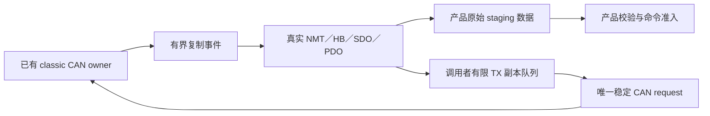

# 选定 CANopenNode 服务端

`Nexus::CANopen` 复用组织托管、精确锁定的 CANopenNode 301 实现，通过一个已有的
Nexus classic CAN owner 运行。固件为 C11，厂商类型和 OD 结构保持私有。

## 已选 profile

| 能力 | 本 profile 范围 |
| --- | --- |
| NMT | Slave；Boot-up、Pre-operational、Operational、Stopped；显式报告 reset 请求 |
| Heartbeat | 一个 producer、一个明确 peer consumer；未观察到 peer 保持 UNKNOWN |
| SDO | 一个 server，1／2／4 字节 expedited upload/download |
| PDO | 一个异步 RPDO、一个异步 TPDO；每方向总计 1..8 字节 |
| 应用对象 | 递增的 `0x2000..0x5fff` VAR，每项 subindex 0、明确字节数和写权限 |
| 错误 | 复用上游本地 error register；不选择 EMCY producer/history |

不选择 NMT master、SDO client／segmented／block、SYNC、LSS、动态 PDO remapping、
CiA402 对象字典、CAN FD 或认证。这些范围不由库库存或头文件存在推导。

通信参数和 PDO 映射在初始化时固定。SDO 中的通信对象只读；应用 staging 对象按
声明设置 SDO 写权限和 PDO 映射。当前 profile 为 little-endian 目标，数据保持显式
原始字节，不推断物理单位或产品 schema。

## 静态选择与存储

应用调用 `nexus_add_canopen()`，链接 `Nexus::CANopen`；也可以明确选择相应组件
catalog 项。未选择时不验证来源、初始化依赖或编译上游。

调用者提供：

- 已启动的唯一 CAN port 及其稳定 provider/context。
- 同一时间域的单调时钟、最大 step 间隔和有限发送 deadline。
- node ID、一个 peer ID、heartbeat 周期、SDO timeout 和每次 RX 预算。
- 排序的产品对象及稳定值存储。
- 精确容量的 TX slot 数组。
- 满足大小／对齐查询的 workspace，保存协议对象、OD 和一个 TX request。

不调用上游 `CO_new`，不使用其动态分配或全局节点对象。workspace 依赖实际 OD 条目
数量；查询是运行期函数，静态消费者应提供自己的明确 arena 预算并在初始化时核验。
CANopenNode 自身的数据状态全部属于该实例，多实例使用各自的 transport 和存储。

## 执行与数据归属

同一个 Thread 执行者串行调用 init、step、TPDO request、stop，以及应用对象访问。
RX callback 只由 `step` 在这个执行者内调用；因此选定上游 profile 不增加 OS 锁、
IRQ 回调、任务、定时线程或全局 current-device。回调重入返回 BUSY。

配置 CAN provider 接收以下标准 DATA ID：NMT `0`、peer heartbeat `0x700+peer`、
SDO `0x600+node` 和 RPDO `0x200+node`。选定 TX 使用 `0x700+node`、
`0x580+node` 和 `0x180+node`。组件不重设 bitrate、过滤器或控制器。

`step` 最多处理声明数量的 RX 事件，并推进上游真实对象。NMT／SDO／PDO 接收暂存均为
每类一个有界 mailbox；同一轮再次命中已占用 mailbox 会报告 EXHAUSTED 并关闭准入，
不静默覆盖 reset 或应用值。RPDO 长度必须恰好匹配选定映射，不发布超长帧前缀。产品在 step 返回成功后，仍须
检查状态、单位、sequence、epoch、有效期和业务权限，再把 staging 值形成完整命令。
NMT Operational 不代表机械使能或安全认证。

`request_tpdo` 只在 Operational 接纳请求，后续 step 从当前 staging 数据建立帧。
TX 队列复制帧并保留首次有限 deadline；后续 step 不延长旧帧预算。provider BUSY
保留队列，容量耗尽和过期关闭协议准入。接纳 TX 不等于线上发送完成。

## 故障与关闭

RX loss、总线关闭／bus-off、时间倒退／超间隔、队列过载和传输错误都会关闭准入。
peer 未见过保持 UNKNOWN；超时如实报告，上游 NMT 按所选错误控制转入 Stopped，
不自动重新启动。MCU reset 和 communication reset 都只报告请求，不实际执行。观察到 reset 后先关闭
准入，再结束本轮，不推进同批已经暂存的 SDO／PDO 应用写入。

`nx_canopen_stop` 丢弃未发送的队列副本，对已接受 request 发起取消并继续 service。
取消失败也继续观察可能发生的最终撤回；任何失败都保持原 identity、workspace 和
request。只有 acquire 观察 SETTLED 后，才能解除 provider 对 request 的借用。
stop 成功清空 `node.state`；外部调用者仍需 join，再回收存储并按产品流程关闭 CAN。
组件不擅自执行 CAN recover、控制器 reset 或协议重放。

## 验证和来源

`nexus_common_canopen_test` 执行真实锁定的 NMT、heartbeat、OD、SDO 和 PDO 源码。
只有外部 CAN 硬件和时钟使用 fixture，测试不复制这些协议算法。主机行为、ARM 编译、
实际总线互通和物理时延各自记录，实板保持 `not_executed`。

源锁位于 `dependencies/canopen.lock.json`；原始 `LICENSE` 和源码 notices 随所选
Source SDK 保留，采用 Apache-2.0。正式消费仍需该 SDK 的来源准入与独立集成验证。
