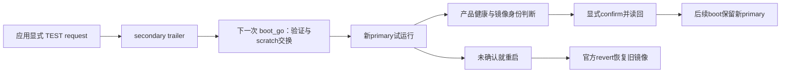

# MCUboot scratch 交换与试运行

本 profile 在同一锁定 MCUboot 2.4.0 源码上提供单镜像 scratch swap、TEST、显式
confirm 和未确认 revert。它使用真实官方 bootutil、TinyCrypt P256／SHA256 和既有
Nexus Flash region bridge；覆盖模式的 API、双 area 操作布局和永久更新语义保持独立。

## 架构与选择

| 公开 target／函数 | 职责 |
| --- | --- |
| `nexus_add_mcuboot_swap_control()` | 创建静态应用控制与三 area 装配端口 |
| `Nexus::MCUBootSwapControl` | query、TEST／PERMANENT request、confirmed、confirm |
| `Nexus::MCUBootSwapPort` | 显式 primary／secondary／scratch、clock、deadline |
| `nexus_add_mcuboot_swap_boot()` | 创建完整独立 boot 验证／交换 profile |
| `Nexus::MCUBootSwapBootStorage` | 官方 boot core、验签及必需链接配置 |

这些 helper 无参数且幂等；供应商源在显式选择时才准入。第一个选定 profile 配置上游
真实 `bootutil` target；另一个 profile 从该 target 的上游 `SOURCES`／`SOURCE_DIR`
取得同一权威源清单并独立编译。每个生成的编译上下文均有实际配置，不保留无法编译的
清单占位目标。共用 crypto source 声明，按实际 profile 分开编译。

`NEXUS_MCUBOOT_PROFILE` 兼容属性拒绝同一最终消费者混链 overwrite-only 与 scratch；
它们可以在同一构建图形成不同 executable。boot 与 TLS 的 crypto ABI 约束继续成立。
内部 target 名称属于构建实现，产品使用公开 target；受信构建代码不构成执行沙箱。



图描述已实现的软件调用和持久状态。产品拥有下载、授权、实际运行镜像识别、健康门槛、
复位与执行交接，不因 request 成功自动确认。无熵池、任务、分配器或库内 active scope。

## 精确 F407ZG 软件参考

[`layout.json`](../../../../cmake/package/verification/mcuboot_swap/layout.json)
同时派生链接范围与 C 区域；参考 Board 为启明 V4.1 的 STM32F407ZGT6。

| 角色 | Flash offset | 大小 | 物理 sector |
| --- | --- | --- | --- |
| boot | `0x00000` | 128 KiB | 0..4 |
| primary | `0x20000` | 384 KiB | 5..7 |
| secondary | `0x80000` | 384 KiB | 8..10 |
| scratch | `0xe0000` | 128 KiB | 11 |

合计 1 MiB。primary 与 secondary 各三个等大擦除扇区，scratch 一整个扇区。bridge
验证 region 的真实几何、同一非 ECC 四字节 program provider、槽等大／sector 对应、
最大三个 image sectors、scratch 容量和所有区域不重叠。无自动区域分配或格式化。

配置为 EC256、TinyCrypt、主槽校验、单镜像、8-byte trailer alignment，FIH 关闭。
在四字节 program unit 下，官方函数计算 image trailer 为 84 B、scratch trailer 为
60 B；参考为 payload 保守保留 1024 B 尾部，镜像 prefix 为 512 B，执行向量应位于
`0x08020200`。签名 header、TLV 和 trailer 均属于完整物理 slot。

参考完整 boot ELF 的 128 KiB Flash 与 32 KiB 静态 RAM 预算由维护的实际链接检查。
main stack 明确为 8 KiB。参考入口调用真实 `boot_go` 后关闭已选基础设施，保持
link／selection 参考身份；实际 MCU image jump 和产品恢复流程由产品实现。

## Scope、失败与退出

产品定义 `nx_mcuboot_swap_flash_operation()`，在完整调用及嵌套 opens 期间返回稳定、
不可变的三 area scope。所选 region、provider、clock 和 deadline 保持有效到返回；
产品串行化访问并在撤回平台前会合。旧操作 ARM ABI 保持 24 B，新三 area 操作为
32 B；没有为旧消费者增加 scratch 字段或最大分区池。

query 的 NONE 不证明 secondary 可读或镜像健康；上游对部分不可读 trailer 按空槽
处理。request 在官方 API 后读回对应 TEST／PERMANENT，失败可能已有部分持久作用。
confirmed 只解释合法 image-ok SET／UNSET，损坏标志不伪造成功；confirm 走官方
确认 API 并再次读取 SET。返回值不能替代产品对当前运行镜像及健康状态的判断。

所有 Flash 操作共用 scope 的有限绝对 deadline；失败不自动续期、重放、擦除候选、
复位硬件或确认镜像。F407 单 bank 写擦仍可能阻塞取指／IRQ，物理脉冲不可被 deadline
中止。watchdog progress 与致命断言 hook 由产品提供，不能暗中扩大操作预算。

scratch 本身会频繁擦写；产品评估更新次数、耐久、供电和复位策略。该 profile 不包含
硬件防回滚计数器、私钥存储、防故障注入资格或电气掉电认证。

## 软件验证与接入

`tests/google/components/mcuboot_swap_test.cpp` 直接执行官方 `boot_go` 与实际签名
镜像：未申请候选、TEST 后 revert、TEST 后 confirm、永久更新、损坏签名、scratch
重叠、失效 scope、copy 半写及 erase 半效应后重建。额外大镜像跨三个 image sectors，
覆盖第三 sector 的部分 program 和恢复；不是只检查 API 状态枚举。

模拟 reset 结束原 CPU 调用，再从持久字节和新的官方 boot 状态恢复；不沿用旧栈中
的 buffer 引用。模型中的断点只建立所选软件中断路径，物理 HIL 仍为 `not_executed`。
全部签名夹具使用上游公开已知测试密钥；产品必须替换信任根。SDK 只消费公开验签根，
无需测试私钥或签名解释器。

源码参考入口：

```sh
cmake -S tests/contracts/mcuboot_swap_link -B build/mcuboot-swap -G Ninja \
  -DNEXUS_PLATFORM_ROOT="$PWD" \
  -DCMAKE_TOOLCHAIN_FILE="$PWD/cmake/toolchains/arm-gcc.cmake"
cmake --build build/mcuboot-swap --target mcuboot_swap_reference
```

安装 SDK 可使用同一 `cmake/package/verification/mcuboot_swap` 入口。测试专用
`NEXUS_VERIFY_MCUBOOT_MIXED=ON` 故意在同一消费者加入覆盖控制，必须被 CMake 的
profile 兼容检查拒绝。独立消费者不能通过混链两个 profile 改变已有 Flash owner。
