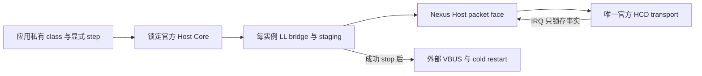

# ST USB Host Core 私有桥接

`st-usb-host` 显式选入锁定的 ST Host Core；`Nexus::STUSBHost` 通过
`nexus_add_st_usb_host()` 按需建立。未选择时不准备 Host middleware，class、hub
策略和枚举业务不隐式进入固件。官方 Handle 和 class 回调记录只出现在
`private/usb_host_stack.h`，公共 transport 使用 `nexus/io/usb_host.h`。

应用提供一个静态 stack、每个所选逻辑 pipe 的 slot、明确容量的 staging、有限
timeout，以及串行特权 Thread 的显式 `step` 调用。桥接复制每实例 class 记录，
不使用堆、运行期 registry、全局 active-context、隐藏任务或 OS 适配。只在真实
packet SETTLED 后推进官方 Core；NAK 由上层下一步明确重试，完整传输共享同一
绝对 deadline。每次 packet 在复制或准入前调用 transport 的
`nx_usb_host_storage_requirements`，按实际 capacity／alignment 检查调用者提供的
staging；OUT 只显式补零所查询的尾部，包括需要存储的零长 packet。桥接不假定
1024 B 最小容量或四字节对齐，不自动扩大存储；缺少查询或预算不足直接报告失败。
IN staging 覆盖所选传输要求，短包只复制实际确认的字节。

完整 URB 在首次尝试提交时建立一个绝对 deadline；已接纳后的后续分包和 BUSY
重试继续使用它，不按 packet 重新延长 timeout。绝对预算耗尽后不再读取下一段
调用者数据；已经借出的 packet 仍由原 transport 排空。ISO 每次使用 DATA0，
不沿用 bulk／interrupt 的交替 toggle，也不接受把 ISO 设为 DATA1。

SETUP 使用 DATA0，成功后控制 DATA 从 DATA1 开始；后续 packet 的 toggle 来自
调用者保存的协议状态。transport 对控制 DATA 使用锁定官方 LL 的显式 PID 入口，
避免 HCD 的便捷接口把每个控制 IN 都强制为 DATA1。零长度 packet 同样有明确的
staging 和借用边界。官方 Core 忽略的 LL 错误由桥接锁存，不能用 Core 的 OK
覆盖提交失败。

连接、断开和速度来自实际 transport snapshot。断开先停止并会合所有旧 channel，
再允许 Core 重置；重连由应用的明确 cold-restart 回调重新取得 controller。关闭
必须先证明请求、FIFO、DMA 地址和 IRQ 引用全部撤回，才关闭 VBUS 或释放 class
状态。失败时保持所有原存储和清理责任，继续 `step` 或 `close` 观察实际排空。
供电撤回返回 BUSY 后，重试只推进该撤回，不再次访问已经停止的 HCD。class 的
DeInit 在真实 drain 后执行一次；已停止后的 ClosePipe 只清理软件 slot。提供 class
记录时，Init、DeInit、Requests 与 BgndProcess 必须齐全，初始化先检查这些 Core
必需回调，再接触 transport 或 VBUS。

`tests/contracts/st_usb_host_assembly` 编译真实 Core、私有接线和实际 F407 HCD。
它的 VBUS 回调拒绝开启未知开关；这份软件链接参考不虚构 PCB、电源、PHY reset、
晶振精度或物理枚举证据。GoogleTest 使用真实官方 Core，替换外部 transport 边界；
ARM ELF 证明静态装配和资源预算。物理 HIL 为 `not_executed`。

官方 Core 的 `USBH_Delay` 同样使用 Core time；有限无进展预算、时间后退或
非有限 deadline 会进入不返回的 park，不把失败等待当作成功。该 work budget 不建立
新时钟或实际超时校准，原 transport、VBUS、class 和 packet 责任继续保留。

## 可选的周期准入

`config.periodic = NULL` 保留原来的显式单包提交方式，不分配周期状态。选择该功能时，
调用者提供与 `slot_count` 相同数量的 `nx_st_usb_host_periodic_t` 数组，并让它与
config、slot、class、staging 和 transport 存储分离，保持有效直到成功 close。
维护中的 ARM／Native ABI 每个记录为 12 字节；原 slot 不增加状态或缓冲。

class 在打开 idle pipe 后调用 `nx_st_usb_host_stack_periodic`，明确传入实际
descriptor 的 `bInterval`：FS interrupt 是 1–255 个 frame，LS interrupt 是
10–255 个 frame；FS ISO 与 HS 周期端点使用 1–16 的指数编码。只接纳与实际 root
速度一致的直接连接端点；不推断 hub 路径、split 或 HS 高带宽 multiplier。
当可选数组存在时，周期端点必须先取得这项准入，每个 URB 最多一个 MPS。
同一次 open 的 descriptor 绑定保持不变；重复配置返回 BUSY，直到成功 close、
reopen 或 reset，防止每次传输前重新配置而绕过原来的间隔。

准入对所有已选端点按同一次机会同时出现的最坏情况计费：payload 按最大 bit
stuffing 计算，增加 64 byte-times 的协议／周转开销和 1 µs host 余量；总额不得
超过 FS／LS frame 的 900 µs 或 HS microframe 的 100 µs。不同 interval 也全部
相加，不做 phase packing。这是一项保守的软件预算；不能保证 class 调用、CPU、
FIFO 或真实总线一定及时，实际失败仍由原 HCD packet 路径报告并排空。

STM32 FS／HS 的 HFNUM 虽有 16 位字段，实际在 `0x3FFF` 后回绕。所选实现只使用
这 14 位事实：FS／LS 每 tick 为 1 ms，HS 为 125 µs。显式 `step` 与提交时的
snapshot 推进饱和剩余计数，支持最长 32768 ticks 的 descriptor interval。
调用者必须在每次完整计数回绕前继续 step，包括没有 URB 的空闲期，即 FS／LS
少于 16.384 s、HS 少于 2.048 s。漏采完整回绕只会延后下一次准入，不用 Core time
补造 SOF，也不补发错过的机会。

尚未到期的提交返回 BUSY，既不借用数据，也不创建等待队列。已接纳的提交才重装
间隔；底层拒绝不会消耗本次机会。部分 ST ioreq 包装函数忽略 LL 的返回值，因此
idle 新尝试会清除前次完成长度；提前提交显示 NOTREADY／零长度，不能把前次 DONE
当成本次成功。已有 active packet 的状态不被另一次调用覆盖。close／reopen／reset
仅在相应真实退出成功后撤回周期状态，排空失败继续保留原借用责任。

该机制限制显式提交机会，不创建周期 worker、独立 HCD 或完整 USB 调度器；
class 仍负责何时请求数据和如何处理 NAK、漏期及应用背压。当前不增加 Host split、
自动 OTG 或物理周期精度资格，HIL 仍为 `not_executed`。
