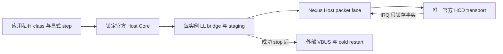

# ST USB Host Core 私有桥接

`st-usb-host` 显式选入锁定的 ST Host Core；`Nexus::STUSBHost` 通过
`nexus_add_st_usb_host()` 按需建立。未选择时不准备 Host middleware，class、hub
策略和枚举业务不隐式进入固件。官方 Handle 和 class 回调记录只出现在
`private/usb_host_stack.h`，公共 transport 使用 `nexus/io/usb_host.h`。

应用提供一个静态 stack、每个所选硬件 channel 的 slot、四字节对齐 staging、有限
timeout，以及串行特权 Thread 的显式 `step` 调用。桥接复制每实例 class 记录，
不使用堆、运行期 registry、全局 active-context、隐藏任务或 OS 适配。只在真实
packet SETTLED 后推进官方 Core；NAK 由上层下一步明确重试，完整传输共享同一
绝对 deadline。IN staging 覆盖完整 MPS，短包只复制实际确认的字节。

SETUP 使用 DATA0，成功后控制 DATA 从 DATA1 开始；后续 packet 的 toggle 来自
调用者保存的协议状态。transport 对控制 DATA 使用锁定官方 LL 的显式 PID 入口，
避免 HCD 的便捷接口把每个控制 IN 都强制为 DATA1。零长度 packet 同样有明确的
staging 和借用边界。官方 Core 忽略的 LL 错误由桥接锁存，不能用 Core 的 OK
覆盖提交失败。

连接、断开和速度来自实际 transport snapshot。断开先停止并会合所有旧 channel，
再允许 Core 重置；重连由应用的明确 cold-restart 回调重新取得 controller。关闭
必须先证明请求、FIFO、DMA 地址和 IRQ 引用全部撤回，才关闭 VBUS 或释放 class
状态。失败时保持所有原存储和清理责任，继续 `step` 或 `close` 观察实际排空。
供电撤回返回 BUSY 后，重试只推进该撤回，不再次访问已经停止的 HCD。class 的
DeInit 在真实 drain 后执行一次；已停止后的 ClosePipe 只清理软件 slot。提供 class
记录时，Init、DeInit、Requests 与 BgndProcess 必须齐全，初始化先检查这些 Core
必需回调，再接触 transport 或 VBUS。

`tests/contracts/st_usb_host_assembly` 编译真实 Core、私有接线和实际 F407 HCD。
它的 VBUS 回调拒绝开启未知开关；这份软件链接参考不虚构 PCB、电源、PHY reset、
晶振精度或物理枚举证据。GoogleTest 使用真实官方 Core，替换外部 transport 边界；
ARM ELF 证明静态装配和资源预算。物理 HIL 为 `not_executed`。

官方 Core 的 `USBH_Delay` 同样使用 Core time；有限无进展预算、时间后退或
非有限 deadline 会进入不返回的 park，不把失败等待当作成功。该 work budget 不建立
新时钟或实际超时校准，原 transport、VBUS、class 和 packet 责任继续保留。
