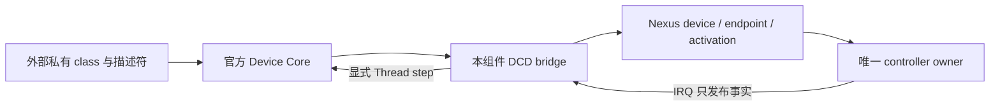

# ST USB Device Core 私有桥接

本组件把锁定的官方 Device Core 接到已有 Nexus USB device、endpoint、profile 与
activation face。`nexus_add_st_usb_device()` 只在显式调用或选择 `st-usb-device` 时
核验并编译官方 Core 的三个 C 文件；未选择时不准备供应商源码，不编译协议 class。
`Nexus::STUSBDevice` 不建立设备实例、任务、堆、运行期名称 registry 或自动角色切换。

## 接线和生命周期

应用的私有接线 TU 使用 `private/usb_device_stack.h`。官方 Handle、Class 与
Descriptors 记录只存在于这条私有边界，公共 I/O face 保持 Nexus 类型。应用提供
可写的 Core state、每个精确选中方向一个 slot、独立对齐 staging、有限 timeout、
描述符回调表和 class 状态。官方 Core 会修改配置描述符的类型字节；这类描述符必须
使用稳定可写的应用存储，回调表自身可在 ROM 中。Init、DeInit、Setup 与 FS config
回调必须齐全；选中 HS 还要求 HS config、qualifier 与 other-speed config 回调，避免
官方 Core 的标准请求分派到空函数。class 的协议、设备身份、业务寄存器和分配策略
不由组件决定。

冷态 factory 查询和组件 initialize 不发现 USB 设备。initialize 连接已经启动且由
同一执行者独占、地址为零的 DCD；不把已经地址化的控制器当作默认 Core 会话接管。
同一 EP0、event ring 和 endpoint 不可再交给 USBControl、
另一个 Core 或另一线程。所有 Core/class 回调只在特权、未屏蔽中断的串行 Thread
执行。没有全局 active-context；每个 LL 调用从其私有 Handle 的 `pData` 找回 owner。

每个原始 class payload 持续有效，直到成功完成其 LL 操作；任何失败后保留 Core 与
class 数据，直到显式 close 成功。
真正提交给 DCD 的请求和 staging 从 ACCEPTED 一直借用到 acquire-observed SETTLED。
取消、超时、reset、新 SETUP、拒绝关闭源与迟到 IRQ 都不撤销这些借用。step 先结清
旧 packet 引用，再调用官方 Reset/Setup；需要 class deinit 的 reset/reconfiguration
先会合相关方向。close 是外部 owner 的显式停机指令：先证明 DCD 完全停止、每个请求
已结清，再执行官方 Core/class DeInit。失败时保留所有状态、描述符和 class context。

## Packet 和控制阶段

EP0 使用官方 Core 自己的分包和 ZLP 决策。`LL_Transmit(len > MPS)` 只提交当前首包；
每次真实 SETTLED 后才回调 Core，由 Core 安排下一包。非零方向可聚合一个有限序列，
使用同一绝对 deadline，在完整传输或真实短 OUT 后只通知 class 一次。EP0 从处理
SETUP 到 STATUS 使用同一预算，不在 Core 逐包回调时延长。接收只把已确认
字节复制到调用者；尾字节不溢出，DMA staging 不借用未声明的额外字节。
Core 的 OUT 尾包会传入 `MAX(remainder,MPS)`；bridge 按真实剩余范围验证和借用，
不把相邻对象当作接收容量。

Core 在多包 DATA_IN 中提前要求零长度 OUT0，bridge 只保存该意图，直到真实最后
IN packet 已确认且 Core 进入 STATUS_OUT 才提交。当前 DCD 的严格阶段合同不提供
即时 premature STATUS OUT 回调；提前到达的状态包由下一 SETUP 或有限 deadline 的
取消/排空恢复，不能声称已完整维护该提前中止路径。正常多包控制传输由真实 Native
DCD 回归验证。ST Core 的保护性 EP0 STALL 使用普通 endpoint stall，不能把它解释成
整体 SETUP 拒绝。SET_ADDRESS 只向同 epoch 的 DCD 暂存，地址提交仍由 STATUS_IN
的真实完成负责。

ULPI 的高速和全速回退使用各自显式选中的 profile 与描述符；官方 `pConfDesc` 对应
同一选中速度。已经观察到的速度和后续 ENUMERATED 事实必须与该 profile 一致；
不一致返回 STATE，调用者负责停止并选择正确配置，不静默扩大 endpoint MPS。

Core 忽略的 LL 错误会保存在 bridge 的首次失败字段中；返回 OK 不能掩盖拒绝提交、
拒绝激活或撤回失败。丢失 event 关闭继续准入，不重放 payload、不虚构 reset 或新卡。
挂起和恢复传递实际事件，有限超时不使用 USB SOF 作为时钟。

## 验证边界

GoogleTest/GoogleMock 链接实际官方 `usbd_core.c`、`usbd_ctlreq.c` 和 `usbd_ioreq.c`，
只替换 Nexus DCD 边界；另有真实 Native DCD 的阶段回归。ARM 消费夹具编译私有接线、
真实 Core、实际 provider 和生成配置。这些是软件证据，不证明枚举、电气、线速、主机
兼容性或物理 HIL；未操作真实设备。

锁定的 Core 不调用 `USBD_LL_Delay`，bridge 不提供空操作替身。外部 class 若依赖
额外平台 hook，须由应用显式提供并独立验证，不由选择本组件隐式启用。
