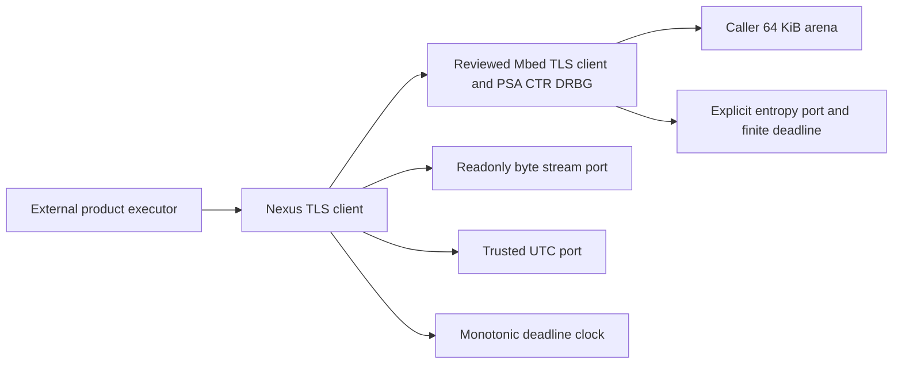

# Explicit bounded TLS client

`nexus_add_tls()` creates the optional `Nexus::TLS` target from the organization's
exact Mbed TLS 4.1.1 / TF-PSA-Crypto source lock. Defining the helper configures
and links nothing. Native Google contracts explicitly call it; products call it
when selecting this component. There is one fixed profile and one serialized
PSA owner. No worker, socket discovery, default trust, operating-system entropy
fallback or per-connection allocator reset is added.

The public `tls.h` header uses Nexus types. Ordinary consumers link `Nexus::TLS`
and inherit neither supplier include paths nor supplier configuration macros.
A static composition translation unit explicitly links `Nexus::TLSStorage` to
include `storage.h`, which exposes the exact reviewed backend layout and profile.
Keep that choice local to composition; application logic continues using
`Nexus::TLS`. Allocate
one zeroed runtime, one zeroed session, one aligned 65536-byte arena and one
512-byte TX stage. These are in addition to transport/lwIP memory and stack;
64 KiB is an allocator limit, not the total subsystem RAM budget.

The product supplies DER trust, a hostname and an optional matched client
certificate/key pair. Initialization copies credentials and hostname into the
arena. Runtime, transport, its immutable methods/opaque context, clocks and TX
stage remain live through session abort. Opaque callback state must be disjoint
from runtime/session/arena/stage; the component validates known spans but cannot
infer the size or internal references of an opaque context.

Start the runtime once, initialize a session, repeatedly call `handshake_step`
under its first finite deadline, and admit application bytes only after success.
`try_write` copies at most 512 bytes immediately. Success means accepted bytes,
not peer delivery. The caller may immediately reuse its source buffer. Explicit
`service` drains the stable stage; WANT retries retain the exact backend pointer
and length. A shorter new read/write attempt does not spend an older stage's
later deadline: it returns BUSY without I/O, and the owner explicitly services
that accepted write. Automatic progress uses the write/close effective minimum;
new write admission rechecks its own deadline after a successful older drain.
Calls within one MQTT operation can share the same finite deadline and continue
partial progress. Timeout/failure retains storage for explicit abort. Reads never
retain caller output. Authenticated close-notify is EOF; raw transport EOF is a
sticky truncation error. `close_step` drains accepted data and sends the local
alert; transport closure and peer application acknowledgement remain external.

Join facade users, abort the session, then stop the runtime. Abort during any
executing BIO, entropy or clock callback returns BUSY and frees nothing; the
outer executor retries after return. Abort never resets PSA. Runtime stop rejects
live sessions, frees PSA and then wipes its entire arena. No other code may use
PSA or replace global Mbed TLS allocator/time hooks in this ownership domain.

Monotonic absolute deadlines bound admission, retry and entropy waiting; a
synchronous fixed-size cryptographic operation cannot be preempted by this
component. The caller schedules progress and supplies a clock that advances in
the same domain throughout callbacks. Trusted UTC is a separate explicit port:
unknown, invalid or failing reads close admission. Handshake steps use a coherent
UTC snapshot and recheck validity at date callbacks and after the library step.
First handshake publicly reseeds PSA within the finite entropy budget.
The official millisecond-time port reads this same owned monotonic clock;
certificate UTC conversion uses the selected libc's reentrant `gmtime_r` with
caller storage. Valid certificate calendars are 1970..9999 and must fit the
selected `time_t`. No vendor system clock or allocating `gmtime` fallback is
selected. The reviewed ARM newlib `gmtime_r` has no heap dependency.

The profile disables default standard-library platform functions: allocation
before explicit arena ownership fails, and library text-formatting hooks have no
implicit stdio fallback. Allocator invariant failures enter Nexus's existing
platform fault observer and then park if it returns; they never call libc
`exit` or release owned memory. Products may provide the separately reviewed
nonreturning fault action described by the Core contract.

The entropy port produces raw, health-admitted source bytes. It is not a DRBG.
The fixed profile uses the official entropy-driver API followed by the library's
conditioning and CTR DRBG. The runtime rejects default/unknown source quality;
`FULL_SOURCE` explicitly asserts the full entropy credit required by this
upstream API. A declaration or software health check never establishes physical
min-entropy. Products must review the source and any conditioning before making
that assertion; host fixtures do not qualify F407 RNG or any other hardware.

Current software scope is TLS 1.2 client, ECDHE-ECDSA P-256, AES-128-GCM/SHA-256,
DER credentials, mandatory peer verification and 1024-byte records with maximum
fragment negotiation. There is no server product API, TLS 1.3, renegotiation,
session resumption, multi-session concurrency, PEM/file loading, TLS certificate
policy or revocation service. Peers and chains must fit this explicit profile;
this is not a general Internet TLS configuration. PQCP/MLDSA, built-in platform
entropy and external-raw-RNG bypass are disabled in the actual preprocessed
profile. Official lwIP `altcp_mbedtls` is not used because its legacy private
header assumptions are incompatible with Mbed TLS 4.1.

The isolated Native evidence includes real mutual TLS against a second process,
partial BIOs/WANT, copied write/echo, close-notify, bad hostname, wrong root,
expired certificate, trusted-time loss, entropy failure, fixed deadlines,
truncation, output alias rejection, callback join and sequential-session reuse.
It establishes host behavior for the exact bytes and profile. MCU memory/link
budgets, physical entropy quality, PHY/HIL, throughput and power remain separate
qualification work.
