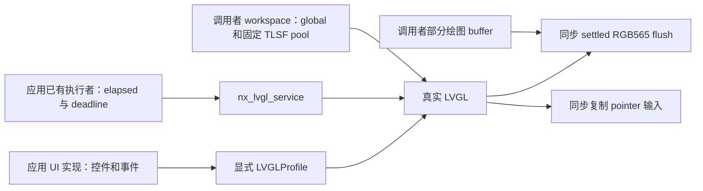

# 显式 arena 的 LVGL 显示桥接

本组件选择组织托管的 LVGL `v9.3.0`，提供真实 RGB565 软件渲染、label／button、
ASCII 8 像素字体与可选 pointer 输入。其他控件、复杂阴影／圆角、文件系统图片、
GPU、XML、桌面驱动和 OS 后端均未选择。普通构建不准备或编译未选 GUI。

## 选择与内存

显式调用 `nexus_add_lvgl()`，普通业务链接 `Nexus::LVGL`，只包含公共
`nexus/components/lvgl.h`。实际 UI 实现单元链接 `Nexus::LVGLProfile` 并包含
`nexus/components/lvgl_profile.h`，取得现有 display 后使用官方控件 API。供应商类型
限定在这个单元，业务控制、参数和数据处理继续使用 Nexus／应用类型。

应用提供一个清零 `nx_lvgl_t`、对齐 workspace 和独立 RGB565 tile。workspace 查询
包括精确私有 global 与 32 KiB TLSF 池；大小随真实 ABI 计算。静态 arena 使用产品
明确预算，启动时用 `nx_lvgl_workspace_bytes()` 核验，查询不是 C 文件作用域数组
长度。workspace／tile 对齐至少满足 `nx_lvgl_workspace_alignment()`。

`LV_ENABLE_GLOBAL_CUSTOM` 把上游 global 放在该 workspace，`LV_MEM_POOL_ALLOC`
只返回同一 caller pool，没有 libc heap、默认最大对象池或内部 task。选定上游全局
模型只允许一个 live GUI owner；第二个实例返回 BUSY。supplier assertion／pool
耗尽按既有 `nx_fault_observe` 观察后 fail-stop，不能将任意复杂页面视为可恢复准入。
应用检查 widget 创建结果和完整 UI 资源预算，包含上游内部的有界子分配。

单个 240×4 RGB565 tile 为 1,920 字节；单个 240×20 tile 为 9,600 字节。实际
workspace、Flash、stack 和传输状态另计，不自动生成整屏 framebuffer。

## 执行与失败

同一普通任务负责 init、控件操作、service、stop 和全部回调。应用显式提供同一
逻辑 epoch 的 elapsed milliseconds，每次 0～1000 ms；内部 UI timer 由
`nx_lvgl_service` 推进，不自建系统 tick 或 worker。

每次 service 使用一个有限绝对 deadline，原样交给所有 flush／input 回调。渲染和
用户事件同步执行，deadline 不能抢占 CPU，也不建立控制环 WCET。控件代码不能越过
service 擅自推进底层；未准入的上游刷新会锁存 STATE，真实面板端口不被调用。

flush 仅接纳完整、同步 settled 的 RGB565 tile，回调任何返回均结束源借用，随后才
向 LVGL 报告 buffer 可复用。error 不等于物理显示完成，GUI 会关闭推进；原面板
UNCERTAIN binding 与恢复责任仍由原器件 owner 持有。未来异步 DMA backend 必须
另有完整借用／完成适配，不能直接使用这个同步合同。

input 返回一份完整坐标和 pressed；EMPTY 保留上一份，错误或越界关闭 GUI 推进。
ILI9341／XPT2046 消费可参考外部示例仓库 `recipes/ui`，触摸校准复用已有实测转换。

退出先关闭 UI 命令、join 所有 widget／事件调用者，再执行 `nx_lvgl_stop`。回调或
渲染中 stop 返回 BUSY；成功后全部 native widget 指针失效、workspace／tile 引用
退出。随后应用独立停止实际 display、touch、bus 与 Platform。

## 来源与验证

精确来源见 `dependencies/lvgl.lock.json`。CMake 只编译固定源码列表；锁文件保留
实际头闭包、MIT 原文和 TLSF 的 BSD-3-Clause 原文，不编译未选择的库存模块。
`tests/behavior/components/ui/lvgl_test.cpp` 执行真实上游分配器、控件、timer、软件 renderer
与退出，模型只提供 settled display/input 边界。独立消费者、ARM 成本和物理显示
行为各有独立证据，软件测试不建立刷新率或 HIL 结论。
