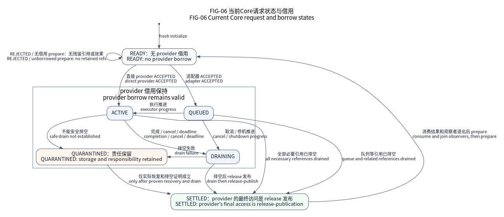

# Core：请求、时间与生命周期合同

Core 提供调用者持有存储的 C11 请求准入、完成状态、稳定控制身份、单调绝对
截止时间和可选观察。公共头在 `include/nexus/core/`，实现在 `src/`。
它不依赖设备、Arch、OS 或厂商 SDK，没有堆、全局注册表或隐藏执行线程。
I/O 具体实现、责任者和等待适配在这些基础合同上组合具体行为。



图表示当前辅助函数的迁移及调用前提，不承诺每个具体实现都有恢复 API。
图源与范围见[图册](../docs/assets/diagrams/README.md)。

| 入口 | 责任 |
| --- | --- |
| `src/request.c`、`include/nexus/core/request.h` | 请求、结果发布、稳定槽位／代次 |
| `src/time.c`、`include/nexus/core/time.h` | 截止时间与 32 位时钟扩展 |
| `src/request_observer.c` | 可选复制观察，不接管执行或回收 |
| `src/fault.c` | 默认无状态的弱故障观察 |
| `src/stack_observation.c` | 已静止栈的有界只读观察 |
| `src/silicon.c` | 获取 I/O 资源前的精确硅版本准入 |

## 请求、唯一执行者与回收

REJECTED 不保留引用。接受后的链路借用请求和缓冲区，直到 acquire 观察
SETTLED；release 发布 SETTLED 是具体实现最后一次访问请求／有效数据。
取消、超时不撤销借用；排空失败时，QUARANTINED 存储保持有效。等待者观察
锁存状态，唯一执行者推进操作；队列适配器拥有外层请求，必要时使用独立内部
具体实现元数据。

首次只初始化未发布存储。`nx_request_prepare` 只重置 READY 或已消费结果的
SETTLED 实例代次；它无法发现适配器借用、控制命令或观察者，责任者
必须先等待退出它们。准入和推进由一个串行执行者完成；原子状态通过 release／acquire 形成可观察的判定条件，不是多生产者准入锁，也不依赖通知必达。

完整关闭顺序：

1. 关闭新准入，停止新增控制命令和观察绑定。
2. 保持唯一执行者取消并排空硬件／IRQ／DMA／延后引用。失败保留
   QUARANTINED 请求和有效数据；超时或观察者拆除引用均不允许回收。
3. 发布 SETTLED 前撤销全部具体实现引用，预先捕获独立存活的唤醒目标。
   待发通知不得继续保留请求，结清后不再访问请求／有效数据。
4. acquire 观察并消费结果；另行确认排队中的控制命令，等待退出任务、诊断、
   完成观察者以及已执行中的调用，在适配器保护区下拆除侧车。
5. 释放稳定槽位，之后才准备／重新绑定／回收存储。停止依赖前还须等待退出
   其他所有使用者。

适配器串行保护稳定槽位绑定／查找／释放。代次在该稳定槽位生命周期内
区分实例代次，不是全局通信 ID。`UINT64_MAX` 是最后可用代次；下一次绑定
拒绝且不改稳定槽位／输出。耗尽稳定槽位必须退休，旧命令仍可能访问时不能清零。
替换存储或重启责任者前，先等待退出全部控制者／观察者并撤回旧引用。

[UART／SPI 集成测试](../tests/google/io_owner_diagnostic_pipeline_test.cpp)
使用真实 Native 具体实现与责任者，验证排空失败、恢复结清、观察者拆除引用
后才允许具体实现停止。`core_lifecycle_test.cpp` 检查完整合法迁移矩阵、
准备拒绝、最后可用代次。C 合同的真实线程回归不靠唤醒提示观察发布；
这些测试不授权并发准入或无保护区的稳定槽位操作。

## 时钟域与有限等待

`nx_clock32_t` 要求唯一执行者、稳定非零频率和不中断计数器。最大观察间隔
严格小于 `2^32 / frequency_hz` 秒；1 MHz 时是 4294.967296 秒。一整圈后的相同
快照与完全未推进无法区分，辅助函数不能检测漏圈。预算包含空闲阶段、屏蔽状态区间、
Flash 维护、睡眠和责任者最坏延迟。成功时一起提交计数扩展与输出；非法参数、
别名或耗尽不改二者，输出须与完整扩展状态分离。

物理时钟另有受审溢出／推进服务合同，通用扩展不能证明具体实现就绪状态。
停止、重启、换源、改频产生新域；撤销旧域前等待退出全部截止时间使用者。
数值相等也不使旧截止时间继续有效；这是生命周期规则，不在每个请求强制
保存代次。终端时钟故障保留借用，并执行所选具体实现保留责任停机。

真正有限的等待在准入前调用 `nx_deadline_finite_after(now, duration, &end)` 并
处理失败：拒绝非有限 now 或到哨兵值的求和，失败不改 end，零 duration 合法。
`nx_deadline_after` 仍有饱和为无限等待的明确语义。二者不读时钟、不证明就绪，
零时间值也不构成启动确认。

## 可选观察与故障捕获

请求观察者提供复制诊断视图，不是另一执行者。间隙／迁移计数
仅是采样观察，不是 IRQ 延迟、WCET 或全部中间迁移。稳定槽位比观察者
活得更久；调用者串行保护采样与请求复用／稳定槽位释放。辅助函数
拒绝输出与已知控制对象重叠，完整请求／有效数据／外部上下文跨度和
存活期仍由调用者保证。

弱 `nx_fault_observe` 默认无状态。产品可写一个有界 C11 覆盖函数，保存到
自有调试器可见记录。下面仅是最小片段，不包含时钟、任务名称或
动态指针：

```c
#include "nexus/core/fault.h"

static volatile struct {
    nx_fault_domain_t domain;
    nx_result_t reason;
    unsigned line;
} terminal_snapshot;

void nx_fault_observe(nx_fault_domain_t domain, nx_result_t reason,
                      const char* file, unsigned line) {
    (void)file;
    terminal_snapshot.domain = domain;
    terminal_snapshot.reason = reason;
    terminal_snapshot.line = line;
}
```

记录仅供终端停机后尽力取证，不保证并发读者看到一致快照，也不保证嵌套故障安全。`volatile` 不是锁或
release／acquire 协议。产品选择可写内存及保留条件。
钩子不能修复坏栈、建立安全输出、释放借用或依赖时钟、内核、传输层；
不改输入屏蔽状态，返回后终端路径仍保持停机。真实 FreeRTOS 保留责任停机测试检查
钩子、保留请求和 PRIMASK／BASEPRI／FAULTMASK。默认 Core 不加入
快照、队列、工作线程或记录。

## 栈观察与内存放置

`nx_stack_observe` 要求外部静止租约：责任者已停／等待退出，读取期间不能
在该栈运行或进入异常。提供原始涂色低地址区，排除活动栈帧、
当前 SP 和独立预算的异常／上下文预留区。启动建立 MSP 涂色
来源，辅助函数不推测。不得涂写仍在执行的栈，也不得为无界扫描长时间屏蔽 IRQ。
成本受字节数约束；预留区或等于涂色的写入可能隐藏使用，结果不是已证明
栈峰值。`tests/google/stack_observation_test.cpp` 覆盖边界、只读、
别名，OS 栈快照另行负责任务上下文规则。

放置宏每个声明仅作用一个静态变量定义，且装配已选区域：

| 后缀 | 复位初始化 | 调用者责任 |
| --- | --- | --- |
| DATA | 从 Flash 拷贝初值 | 同时预算加载／运行 |
| BSS | 清零 | 不提供非零初值 |
| NOINIT | 不拷贝、不清零 | 每次读前初始化或验证 |

选择 ADDSRAM／TCM／CCM／SRAM1／SRAM4 对应宏，无隐式后备实现。启动／链接器
测试和 ELF 检查拷贝／清零跨度、对齐、GC、预算。NOINIT 不保证复位／
掉电保留。除非精确 SoC 合同授权所选总线主设备，TCM／CCM 按仅 CPU 处理；
放置不授予 DMA 可达性、Cache 一致性、对齐或借用权限。
默认主栈和普通存储布局保持原选择。

## 精确硅版本与验证

可选冷态 `nx_silicon_preflight` 在调用者建立合法权限／MMIO／安全
后、取得 I/O 资源前读取来源一次，不启时钟、不修硬件。策略、严格排序的
精确修订号规则与审核来源 SHA256 一起维护；摘要标识审核输入，
不是认证或勘误规避措施已应用证明。构建提供经过审核的已应用规避措施位掩码；
明确观察到的修订号数值零合法。

`allow_unreviewed` 不绕过禁止的修订号、缺少观察、设备组／密度
不符或缺少勘误规避措施。完成拒绝会复制原因但不授权启动；来源读取失败保留输出。
设备组／密度不证明封装／PCB／物理资格。
`silicon_admission_test.cpp` 使用真实预检和显式模拟身份来源检查这些区别。

`tests/contracts/core_contract_test.c` 执行发布、准入、时间回绕和终态不变量。宿主结果不证明 MCU 中断排序或 WCET；
完整范围见[资格说明](../docs/delivery/qualification.md)。
