# Nexus 平台图册

本图册保留15类必需视图、两张补充图与本轮 I/O 架构视图 FIG-16，
另加入 IO-24 的 FIG-17/18 目标图源、IO-36 的 FIG-21 Native 装配／生命周期图，
以及 IO-31 的 FIG-22 G474 命名 GPIO 状态／所有权图。FIG-23–26 依次描述
五项有界软件机制的所有权、U575 保留时钟与 Stop2 所有权及状态、
UART TX 复制代理的 kernel 所有权与退出、I3C 核心借用与整总线证明。
FIG-27 另述同一 Stop2 owner 的选定 SRAM4/LPDMA 有限复制及复合退出。主图登记见
[图清单](diagram-index.csv)，维护规则见
[图示标准](../../design/documentation-standards.md)。图有精确current/reference/target身份，
不可从图源存在、渲染成功或软件流程推断硬件和外部发布已执行。

原15类主图及两张补充图的代码依据保持`0111c8d3b9c7b37d258b9c401070305b13b6f3a1`。
FIG-16 描述 `c4249e98` 基线之后的 I/O 增量机制，其具体源码链接和执行状态见
[本轮架构说明](../../design/io-evolution.md)与42项台账，不能继承原候选资格。
文档工具的实际结果另见执行记录。图源为可编辑 DOT，输出为本地 SVG；标签、
线型和文字共同表达关系，不只依赖颜色。

当前每张图均提供中英文视图；新增 FIG-17/18 的渲染与审查须分别取得
实际记录。页面按所选语言使用本地SVG。节点、箭头、属性与
范围仍由同一canonical DOT维护；`labels.json`只维护完整标签译文，不能改变拓扑。
各语言DOT/SVG应与原图配对检查；缺失译文、陈旧输出和非法资源使门禁失败。
SVG采用Graphviz Cairo字形路径输出，使离线读者无需安装中文字体；每图附title、
desc和正文alt/caption。生成主机需要锁定Graphviz、Cairo及Noto Sans CJK SC，
最终工具身份与自动检查结果由文档交付记录绑定。源码语义、实际浏览器桌面/窄屏/
放大/打印与离线包验收分开记录。原15主图和2补充图保留各自已完成的审查；新增
FIG-16/17/18 的内容、图示和翻译审查状态单独记录，不能从渲染成功推断。浏览器与正式包
验收另按实际执行记录判断，这些状态不建立 HIL 或公开部署资格。

修改标签后显式使用已准备的锁定工具生成语言视图，然后执行完整检查：

```sh
python -m tools.documentation.diagram_localization --write \
    --tool-prefix /absolute/path/to/prepared-doc-tools
python tools/dev/dev.py docs check --full \
    --tool-prefix /absolute/path/to/prepared-doc-tools
```

`localized/en/`和`localized/zh_CN/`是派生资产。生成成功只证明渲染；标签语义、
真实浏览器和离线资源闭包分别审查，原图代码依据与历史执行身份保持不变。

## FIG-01 全平台分层与外部边界

**身份：current。范围：产品外置；可选组件与OS；运行访问和构建事实逐边区分。**

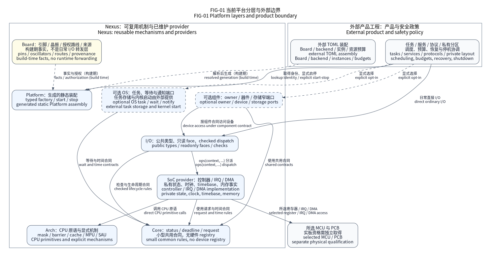

应用拥有任务、调度、恢复和停机协调。Board参与构建期授权；factory取得身份后日常I/O通过face进入provider。Arch按编译目标选择，没有CPU factory或强制OS转发。虚线为显式可选关系或构建期事实，实线标签说明调用/合同。

依据：[当前架构合同](../../delivery/architecture.md)、[根CMake](../../../CMakeLists.txt)、[静态装配生成](../../../tools/configure/bindings.py)、[平台运行补充图](platform-runtime.svg)。
[可编辑DOT](platform-architecture.dot)；实施关联：DOC-43。

## FIG-02 选定编译目标依赖

**身份：reference。范围：H743 baremetal IRQ UART；准确PUBLIC/PRIVATE/INTERFACE/OBJECT关系。**

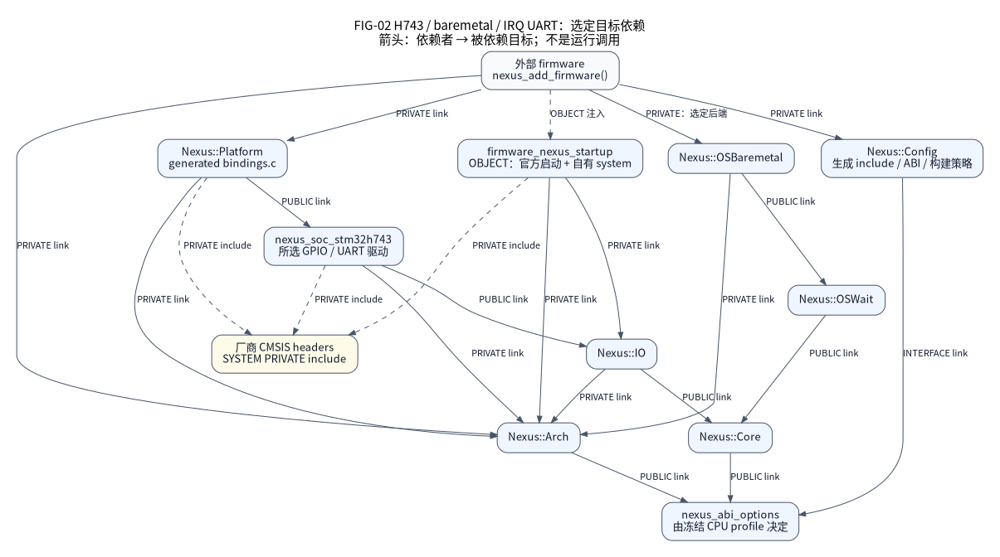

参考tools/configure/assemblies/nucleo-h743-baremetal-uart.toml的选定目标。箭头从依赖者指向被依赖目标；虚线明确PRIVATE include或OBJECT注入。统一warnings、配置选项边和GC策略省略；它们仍由真实CMake管理。厂商headers只进入实现/启动私有范围，配置生成的bindings也按私有include规则消费SDK；可选组件不在本装配中。

依据：[根目标图](../../../CMakeLists.txt)、[firmware helper](../../../cmake/platform/Firmware.cmake)、[IO targets](../../../io/CMakeLists.txt)、[Arch targets](../../../arch/CMakeLists.txt)、[OS targets](../../../os/CMakeLists.txt)、[H743 target](../../../soc/stm32h743/CMakeLists.txt)、[ABI/Config目标](../../../cmake/platform/Options.cmake)。
[可编辑DOT](build-targets.dot)；实施关联：DOC-44。

## FIG-03 配置与原子生成

**身份：current。范围：构建输入/产物链，生成失败使owned bundle失效。**

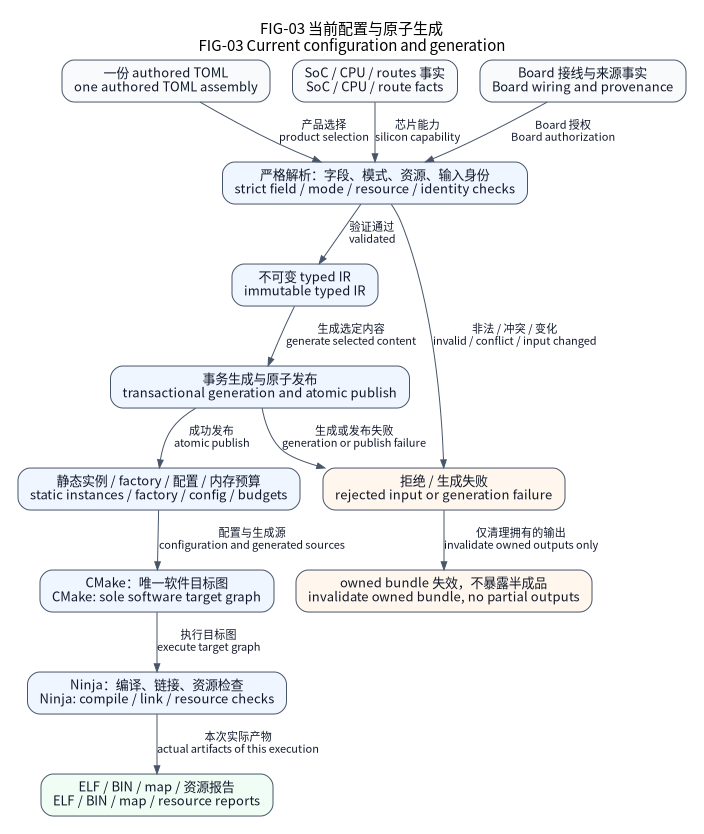

边表示构建时输入和产物传递，不表示运行时调用。严格解析不能修复非法字段、冲突或陈旧输入；失败只撤回拥有的输出，不清理未拥有目录，也不暴露半成品。ELF/资源报告不构成实板资格。

依据：[配置器](../../../tools/configure/configure.py)、[不可变IR](../../../tools/configure/ir.py)、[bundle事务](../../../tools/configure/bundle.py)、[构建合同](../../design/build-system.md)。
[可编辑DOT](configuration-generation.dot)；实施关联：DOC-45。

## FIG-04 factory与静态实例

**身份：reference。范围：按需选入的两同类实例示意；同模式ops共享，controller/endpoint独立。**

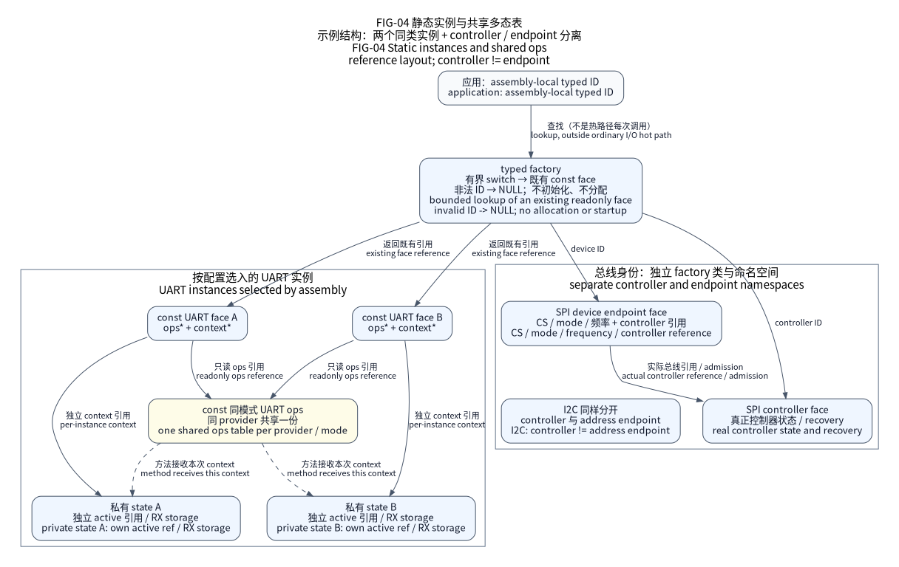

结构图展示由生成器支持的按配置实例布局，不声称每块PCB均授权这些组合。同provider同模式实例共享readonly ops，各自context/state/storage独立。不同provider或模式可使用不同ops；调用方法接收本次context。controller和endpoint有独立factory命名空间，endpoint不冒充控制器。ID只在当前assembly有效，默认uint16_t typedef不提供语言级跨类防混用。

依据：[typed factory生成](../../../tools/configure/factory.py)、[face/state装配](../../../tools/configure/bindings.py)、[SPI公开接口](../../../io/include/nexus/io/spi.h)、[Native provider](../../../tools/configure/providers/native/bindings.py)。
[可编辑DOT](factory-instances.dot)；实施关联：DOC-46。

## FIG-05 显式启动停机与失败撤回

**身份：current。范围：生成生命周期骨架；每个SoC私有启动/清理保持具体合同。**

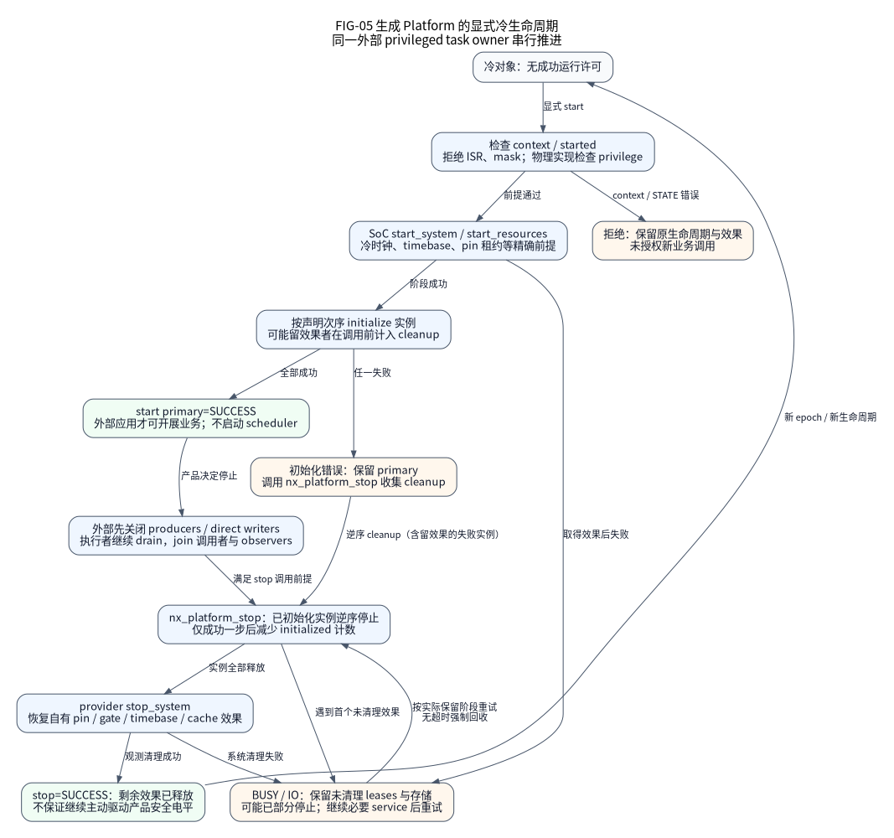

外部唯一执行者串行调用start/stop。start不启动调度器；失败的primary、cleanup、remaining_effects分别保留。已取得效果者参与逆序cleanup，停止可能先成功释放部分实例再返回BUSY/IO。不能把BUSY视为仍然完整运行，也不能因timeout回收存储。具体start_system失败可能在其私有路径中完成清理或保留失败阶段，重试必须满足该provider合同，不能把图视为统一恢复API。

依据：[生成的start/stop](../../../tools/configure/bindings.py)、[GPIO冷租约](../../../tools/configure/gpio_phase.py)、[H743冷生命周期](../../../soc/stm32h743/README.md)、[当前平台合同](../../delivery/architecture.md)。
[可编辑DOT](platform-lifecycle.dot)；实施关联：DOC-47。

## FIG-06 Core请求状态与借用

**身份：current。范围：Core helper允许的迁移与调用前提；不承诺各provider恢复API。**

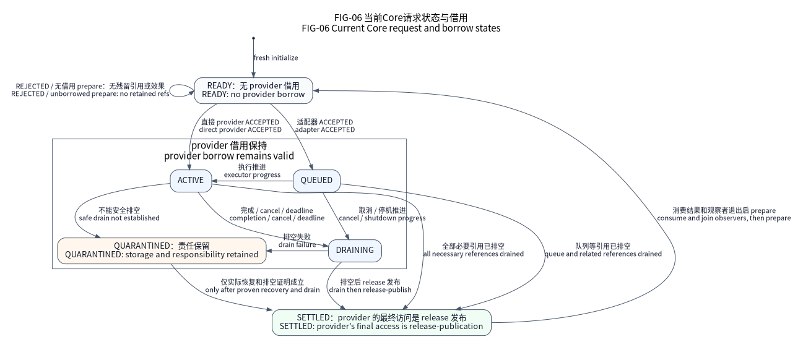

REJECTED/ACCEPTED是admission结果而非request状态。ACCEPTED后保持request/buffer借用，cancel/deadline只启动终止进度。provider先排空全部必要引用，再以release发布SETTLED作为对request的最后一次访问；调用方以acquire观察。相关adapter/observer另需退出。QUARANTINED到SETTLED仅在实际恢复和排空证明成立时合法，不能通过initialize强行重置借用对象。

依据：[request公开合同](../../../core/include/nexus/core/request.h)、[实际Core迁移](../../../core/src/request.c)、[owner最终发布](../../../components/bus_owner/src/bus_owner.c)。
[可编辑DOT](request-lifecycle.dot)；实施关联：DOC-48。

## FIG-07 UART与SPI有限DMA时序

**身份：reference。范围：F407 USART1/SPI1精确有限DMA；Task/IRQ/DMA完成与失败路径。**

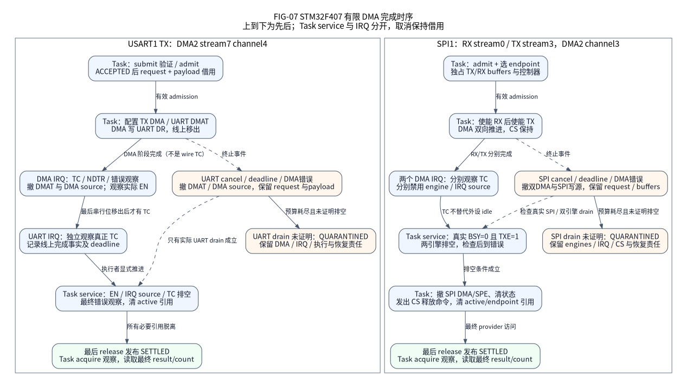

上到下为先后，并区分Task、DMA IRQ和UART IRQ。UART DMA TC不替代最后串行位的TC；SPI两个DMA完成不替代BSY=0/TXE=1。最终排空与错误观察、引用撤回都先于SETTLED。CS节点描述软件命令，未证明电气电平或物理时序。取消/错误分支仍需同样的实际排空条件；失败保持QUARANTINED借用。不把NDTR推导为可靠wire字节数，也不推广为GD32 reset语义。

依据：[F407 UART DMA](../../../soc/stm32f407/drivers/uart_dma.c)、[F407 SPI DMA](../../../soc/stm32f407/drivers/spi_dma.c)、[DMA排空合同](../../../io/include/nexus/io/dma.h)、[多控制器合同](../../design/multiple-dma-controllers.md)。
[可编辑DOT](dma-completion.dot)；实施关联：DOC-49。

## FIG-08 wait wake与外部退出

**身份：current。范围：ready-arm-ready-wait-ready与实际执行/join责任。**

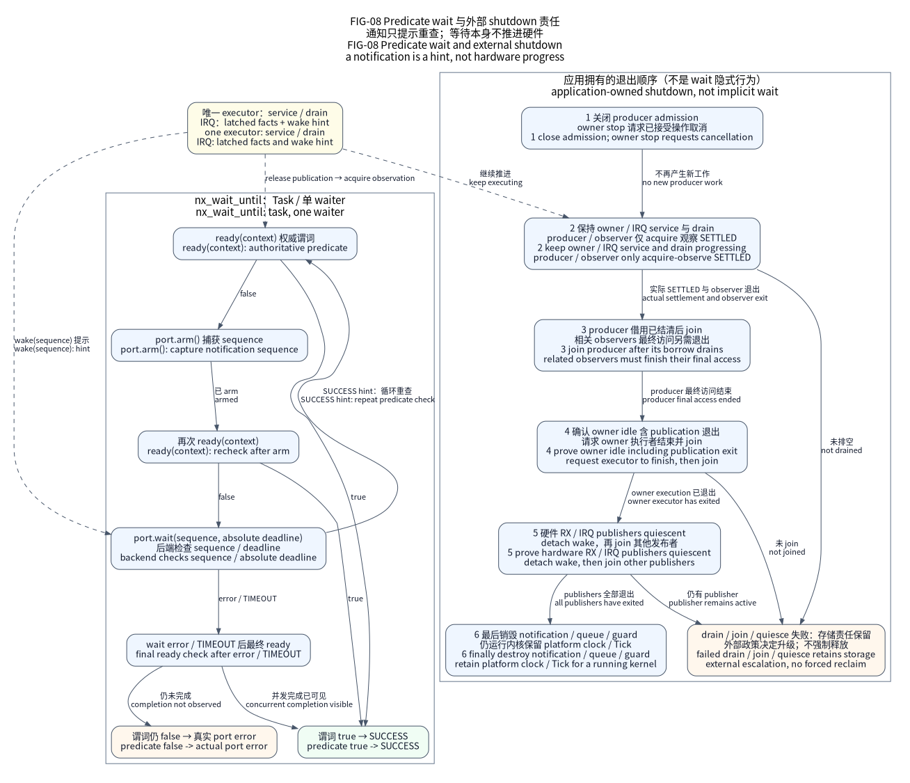

nx_wait_until只检查谓词并等待提示，不service硬件或创建worker。arm后再次检查避免lost wake；TIMEOUT后最终谓词为true仍返回SUCCESS。通知端口要求单一waiter。外部shutdown先关闭admission并请求cancel，保持owner/IRQ推进drain。producer借用结清后join；确认owner idle包含publication退出，再结束并join执行者。随后停止硬件RX/IRQ publishers、detach wake并join其他发布者，最后销毁OS同步存储。相关observers最终访问另需退出；仍运行的内核不得提前撤回clock/Tick，失败存储继续保留。

依据：[wait合同](../../../os/include/nexus/os/wait.h)、[生产wait算法](../../../os/wait.c)、[owner接口](../../../components/bus_owner/include/nexus/components/bus_owner.h)、[OS生命周期](../../../os/README.md)。
[可编辑DOT](wait-wake-shutdown.dot)；实施关联：DOC-50。

## FIG-09 H743内存DMA与Cache

**身份：reference。范围：H743ZIT6有限USART3 TX；AXI SRAM完整32-byte lines。**

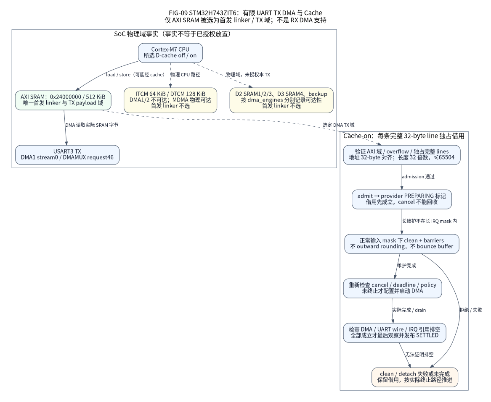

选定TX DMA仅授权AXI SRAM 512 KiB；其他物理域和dma_engines可达事实不自动授权placement或供电。Cache-on要求完整32-byte lines独占，最大65504 bytes；Cache-off接受1..65535 bytes。PREPARING借用先成立，clean在调用方正常mask下进行，完成前不能取消回收。图不实现或声明H743 RX DMA；未来RX需要独立前置及排空后维护合同。可信复位或此前成功自有clean/disable才建立冷cache前提，CCR关闭位不能认领外国dirty状态。

依据：[精确物理域](../../../soc/stm32h743/soc.json)、[H743 provider范围](../../../soc/stm32h743/README.md)、[TX DMA实现](../../../soc/stm32h743/drivers/uart_dma.c)、[cache范围合同](../../../arch/include/nexus/arch/cache.h)、[冷cache合同](../../../arch/include/nexus/arch/cache_control.h)。
[可编辑DOT](h743-memory-cache.dot)；实施关联：DOC-51。

## FIG-10 Source SDK独立消费

**身份：current。范围：实际公开入口和consumer；搬移完整prefix，Native run/ARM link分开。**

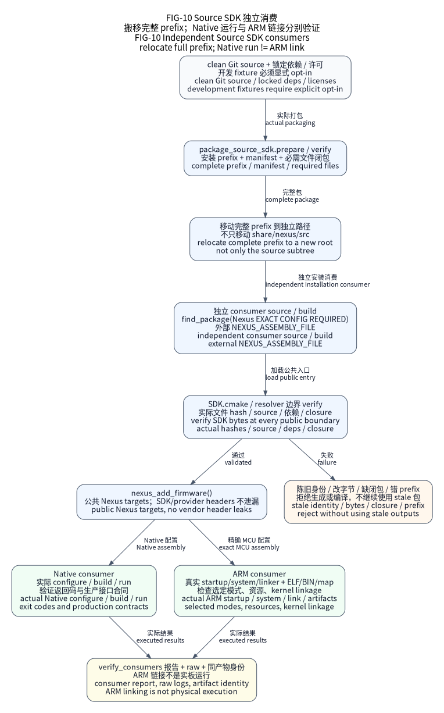

打包、搬移、verify与consumer执行是独立步骤。安装prefix必须整体移动，SDK子树不能单独替代包闭包。find_package与resolver边界读取实际字节身份，fixture opt-in不绕过checksum。Native consumer实际运行；MCU consumer建立编译/链接/资源证据，不声明上板执行。parent target不得受到平台宏或厂商include污染。

依据：[Source SDK打包与verify](../../../cmake/package/package_source_sdk.py)、[真实独立consumers](../../../cmake/package/verify_consumers.py)、[resolver SDK验证边界](../../../tools/configure/sdk.py)、[CMake SDK入口](../../../cmake/platform/SDK.cmake)。
[可编辑DOT](source-sdk-consumer.dot)；实施关联：DOC-52。

## FIG-11 软件与HIL证据关系

**身份：current。范围：实际scope evidence独立取得；HIL tooling不是物理测量。**

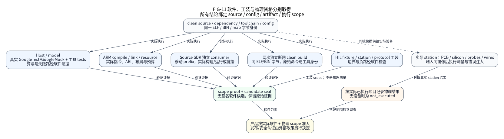

Host/model、ARM/link/resources、SDK消费、两次断网复现和HIL工装各自必须有实际执行记录，并绑定同source/config/artifact。候选封存重新验证scope proof和原始字节。实际station测量另外绑定PCB、silicon、fixture及同镜像；无设备为not_executed。软件候选不自动提升为产品release、安全认证或LTS。

依据：[资格合同](../../delivery/qualification.md)、[candidate scope校验](../../../tools/evidence/candidate.py)、[真实proof验证](../../../tools/evidence/proof.py)、[断网复现](../../../tools/evidence/reproduce.py)、[HIL工装](../../../tools/hil/README.md)。
[可编辑DOT](qualification-evidence.dot)；实施关联：DOC-53。

## FIG-12 文档SDK与证据发布恢复

**身份：reference。范围：交付流程参考；公开发布/下载需真实receipt，不从流程图推断发生。**

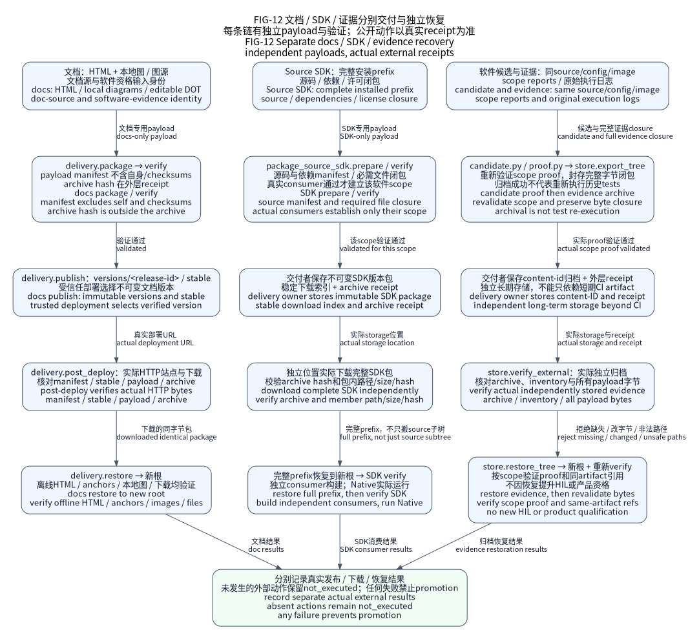

文档、SDK、软件候选保持独立payload与资格。manifest的outputs只列payload，不含自身/checksums/archive；archive hash由外层receipt记录。不可变release-id不覆盖旧目录，stable不表达全部HIL通过。SDK/candidate/evidence使用现有字节验证与恢复机制，文档发布工具按实际CLI结果验收。独立恢复检查路径、size、hash与适用consumer，不把归档成功视为重新执行全部历史tests。公开发布、下载、长期存储由真实外部receipt证明，流程存在不能替代。

依据：[文档实际封存与恢复](../../../tools/documentation/delivery.py)、[文档交付合同](../../design/documentation-system.md)、[Source SDK闭包](../../../cmake/package/package_source_sdk.py)、[候选封存](../../../tools/evidence/candidate.py)、[scope proof](../../../tools/evidence/proof.py)、[归档与独立恢复](../../../tools/evidence/store.py)。
[可编辑DOT](release-recovery.dot)；实施关联：DOC-54。

## FIG-13 Cortex-M能力分层

**身份：current。范围：九核CPU软件层、Runtime、真实SoC与实板范围分开。**

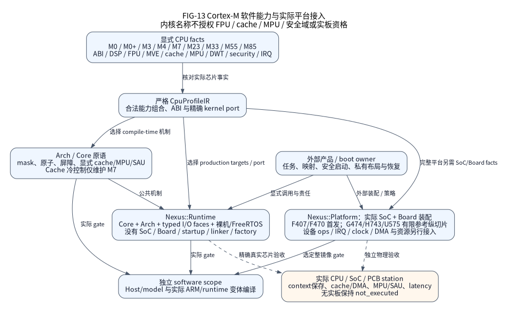

CpuProfileIR显式选择合法ABI和optional feature，不从内核名推导能力。Runtime没有SoC/Board/startup/linker/factory；整平台另需精确provider和资源。当前M7冷cache控制不推广至其他带cache内核。图中的软件gates表示必须实际取得范围内证据，不继承历史counts；真实context保存、coherence、特权和波形仍需物理验收。

依据：[九核软件合同](../../delivery/cortex-m.md)、[CPU解析器](../../../tools/configure/cpu.py)、[Runtime CMake入口](../../../cmake/platform/Runtime.cmake)、[Arch源码目标](../../../arch/CMakeLists.txt)、[整平台支持范围](../../delivery/support.md)。
[可编辑DOT](cortex-m-capabilities.dot)；实施关联：DOC-55。

## FIG-14 U575同步双域参考

**身份：reference。范围：独立TZEN1无OS同步GPIO；不改变TZEN0默认provider。**

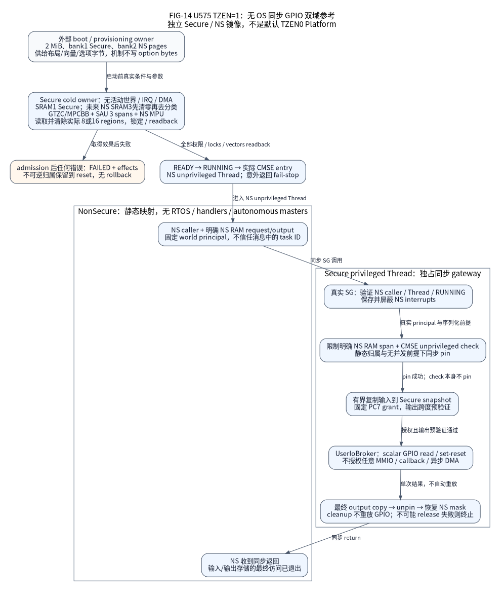

boot owner供给并在执行前建立实际option-byte/镜像布局前提，机制不写option bytes。GTZC/SAU/NS MPU是不同边界，NSC fetch检查Secure MPU，不能用CMSE观察替代bus firewall或pin。参考要求无NS handlers、RTOS和自主masters，固定world principal只允许同步scalar GPIO。取得不可逆效果后的失败只能保留到reset；SG的同步pin来自静态映射和无并发条件。实际8/16 MPU region观测仅属于此参考，不修改TZEN0 provider的exact-eight tuple。全部物理隔离尚未执行。

依据：[双域权威合同](../../design/u575-trustzone-contract.md)、[生产冷owner](../../../soc/stm32u575/security.c)、[真实配对镜像fixture](../../../tests/contracts/u575_trustzone)、[UserIoBroker](../../../components/user_io_broker/README.md)、[CMSE公开观察合同](../../../arch/include/nexus/arch/nonsecure.h)。
[可编辑DOT](u575-security-domains.dot)；实施关联：DOC-56。

## FIG-15 连续RX与可见丢块

**身份：reference。范围：F407 USART1连续RX；预置FIFO贷款、loss和停止责任。**

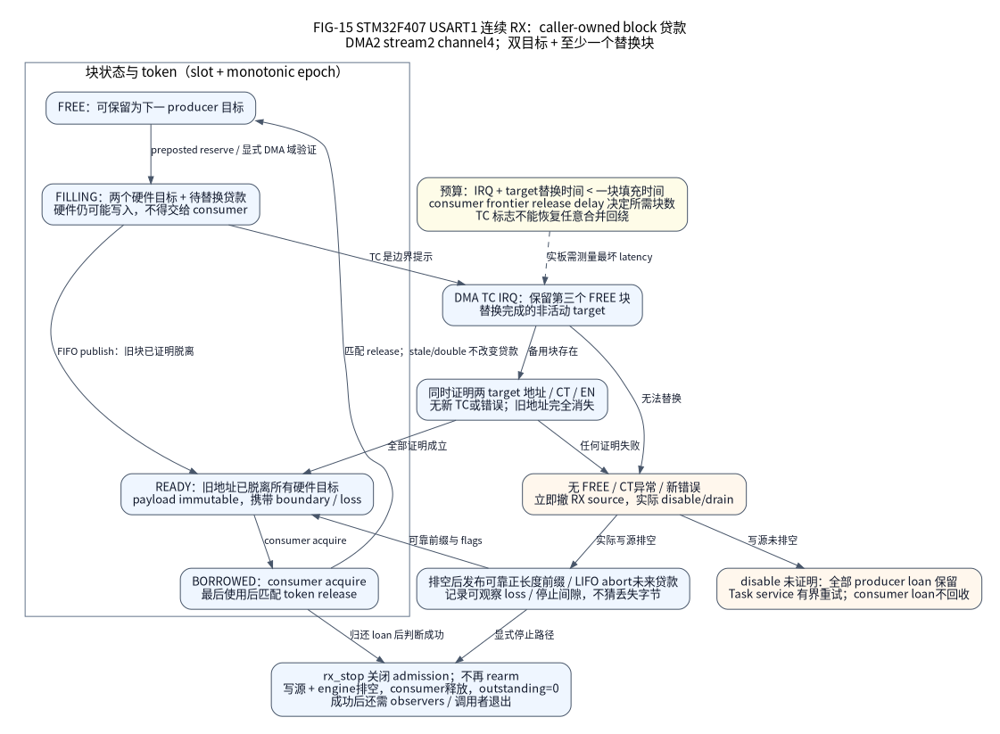

preposted producer和普通producer不得混用。旧块在两个hardware targets中完全消失并证明CT/EN/新flags后才能FIFO发布；失败撤源并LIFO撤未来贷款，BORROWED consumer块不被覆盖。缺spare、IDLE和恢复可有间隙，lost_blocks是已观察边界而非精确遗漏wire字节。TC标志不能数任意多次合并回绕，实际IRQ/换址延迟必须小于一块fill时间。stop关闭admission、保持drain，outstanding=0后仍需调用者/observer退出。ADC首发trigger blocks由service显式rearm且有块间间隙，本图不声称连续ADC。

依据：[UART DMA/连续贷款合同](../../design/uart-dma-rs485.md)、[stream状态合同](../../../io/include/nexus/io/stream.h)、[容量与观察合同](../../design/io-observation-recovery.md)、[F407 RX DMA实现](../../../soc/stm32f407/drivers/uart_receive.c)、[ADC显式rearm](../../../soc/stm32f407/drivers/adc_stream.c)。
[可编辑DOT](continuous-stream.dot)；实施关联：DOC-57。

## FIG-16 当前 I/O 装配与执行

**身份：current。范围：本轮软件机制；精确模式与验证状态由 IO-01–42 台账维护。**


上部箭头表达 authored TOML、SoC/Board 事实、typed IR、原子 bundle 与 CMake 的
构建关系；下部箭头表达查找、调用和复制观测。factory 只返回既有引用，日常 I/O
通过 face 直接进入 provider。硅片准入、traits 和时间戳辅助均显式可选；准入结果
不自动启动硬件，checked service 不证明请求已经结束。应用拥有执行推进与停机。

可选 USB EP0 packetizer 沿同一显式调用路径组合包层 face：应用拥有 outer request，
调用者提供 adapter 存储，组件维护两个固定 inner packet 槽；provider 保留已准入
包的临时借用。ROM profile
只是生成的只读选定事实。inner DATA ACK、outer STATUS ACK 与地址提交分别观察，
借用不随 epoch 更新或取消而撤销；OUT0 恢复需外部 controller owner 授权。
本图不展开 USB 协议阶段，精确边界见 [USB FS device 合同](../../design/usb-device.md)。

依据：[本轮 I/O 架构](../../design/io-evolution.md)、
[typed IR](../../../tools/configure/ir.py)、
[选定 traits](../../../tools/configure/io_traits.py)、
[硅片准入](../../../core/include/nexus/core/silicon.h)、
[观测合同](../../../io/include/nexus/io/observation.h)。
[可编辑 DOT](io-evolution.dot)；实施关联：IO-01/02/03/09/11/12/21。

## FIG-17 H743 Flash RAM 边界目标设计

**身份：target。范围：仅选定 STM32H743ZIT6 V 修订／Cache off；源已集成，生产 ELF 闭包
与完整软件退出尚未完成，实板 HIL 未执行。**


构建边表达单份 TOML 经不可变 IR 选入生命周期与 face；运行边分别表达查找、调用、
复制结果与真实 MMIO 观测。factory 仅返回既有 face。忙区间内全部执行、输入、
向量、栈及诊断必须留在已准入 RAM；guard 只约束 CPU。虚线所示其他 bus master
撤回／join 由外部维护调用者负责，不表示平台创建 worker 或已停止硬件。

目标依据：[RAM 维护目标合同](../../design/h743-flash-ram.md)、
[既有 H743 provider 范围](../../../soc/stm32h743/README.md)、
[IO-24 原始退出条件](../../design/io-evolution-execution.csv)。
[可编辑 DOT](h743-flash-ram-architecture.dot)。新增图的渲染、语义独立审查、双语
输出检查、实际浏览器与软件／实板资格须分别记录，不能从草稿存在推断。

## FIG-18 RAM 维护结清目标设计

**身份：target。范围：选定 V 修订／Cache off 的同步物理脉冲；这是协议阶段，
不新增公共 request enum，不证明有界返回时间。**


每条边表示有条件的控制流。触发前已有临时效果的拒绝必须先证明回退；触发后
TIMEOUT 只锁存结果，不撤销脉冲，也不返回 Flash handler。双 Bank 真实空闲后，
仍须证明 LOCK、TIM2 时间域／epoch 及精确 MPU／VTOR 恢复；CPU bridge 的精确恢复由实际 ARM 指令流另行证明。永久 busy 持续留在
RAM 排空环；无法证明恢复则留在不返回 RAM fail-stop，不暗示自动复位或喂狗。
所有返回的 RAM 路径，包括触发前 VTOR 发布拒绝和 guard／deadline 拒绝，都必须
先通过共同返回门：双 Bank 空闲、guard 无保留效果、完整保存的目标控制值与 LOCK
已读回证明；必要时先锁定空闲目标，再恢复 VTOR。

目标依据：[RAM 维护目标合同](../../design/h743-flash-ram.md)、
[Arch 合同](../../design/arch-contracts.md)、
[当前软件与物理资格边界](../../delivery/qualification.md)。
[可编辑 DOT](h743-flash-ram-lifecycle.dot)。图中返回条件仍需实际
生产 ELF、真实 provider 测试与物理 station 分别建立证据。

## 补充视图

[运行时访问补充图](platform-runtime.svg)和[DOT图源](platform-runtime.dot)分开
表达factory lookup与直接I/O，不替代FIG-01完整分层。

[原文档系统目标图](documentation-target.svg)和[DOT图源](documentation-target.dot)
保留原规划的构建输入关系；其target身份只表示方案来源，不建立当前工具、公开
部署、SDK或实板资格。现行交付与恢复按FIG-12及实际执行记录判定。

## FIG-21 Native RTC/LPTIM 装配、借用与重新开放

**身份：current；虚线硬件分支为 target。范围：所选 Native 日历／有限计数实例，
普通 TOML 经现有 IR／provider／factory／Platform 装配，显式生命周期与真实排空。**

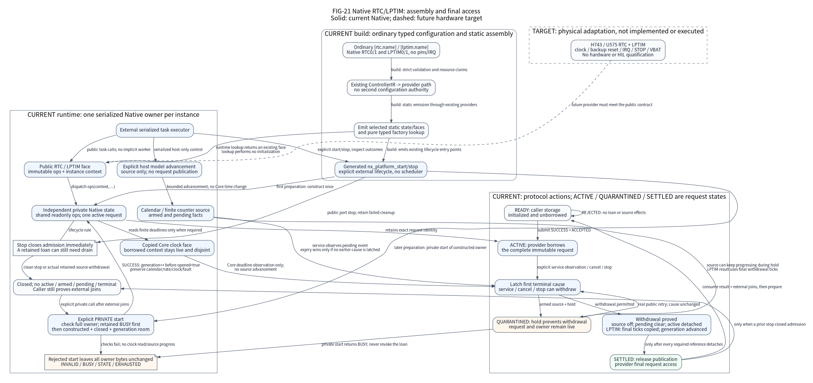

构建边、运行调用和请求源推进均有独立标签。factory 只返回已有接口面；生成的
Platform 首次准备构造一次，后续对已构造 owner 调用私有 start。stop 先关闭准入，
撤源失败仍保留请求和 owner；私有 start 优先拒绝保留责任。真实撤源并完成外部 join
后，重新开放先推进代次再开放准入，保留日历、速率、时钟与外部故障。模型推进不
发布请求结果。虚线硬件适配需要独立 SoC／时钟／备份域／IRQ／STOP／VBAT 合同，
不表示已有物理驱动或 HIL 通过。

依据：[RTC/LPTIM 说明](../../explanation/rtc-lptim.md)、
[公共 RTC](../../../io/include/nexus/io/rtc.h)、
[公共 LPTIM](../../../io/include/nexus/io/lptim.h)、
[Native 实现](../../../io/native/rtc_lptim.c)、
[Native 装配](../../../tools/configure/providers/native/bindings.py)。
[可编辑 DOT](rtc-lptim-lifecycle.dot)；实施关联：IO-36。软件开发证据与 main／SDK／
候选／实板资格分别判断，不能从该图或渲染成功推断。

## FIG-22 G474 命名 GPIO 状态与保留租约

**身份：current。范围：STM32G474RET6／GPIOA／baremetal／hse24-pll170 的显式 DEFAULT／SLEEP；软件 Board PA5，不表示物理安全或低功耗资格。**

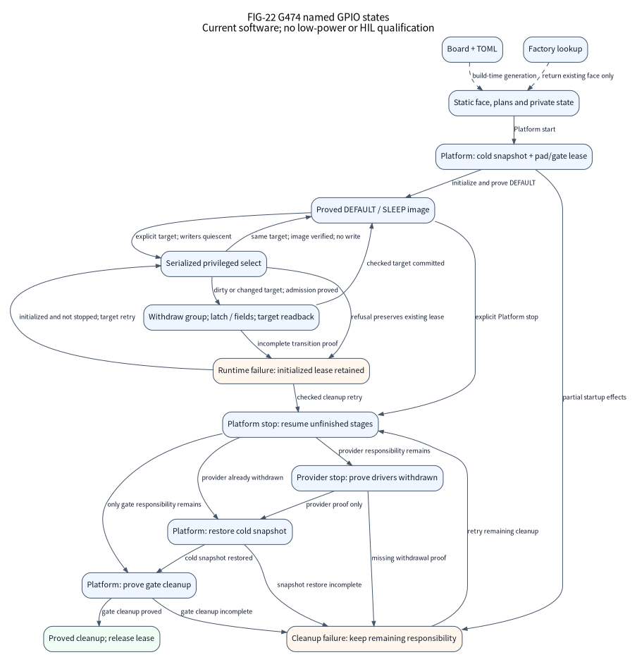

构建箭头只表示 Board/TOML 到不可变计划与静态对象的生成；factory 箭头只返回既有 face。运行选择不转让 pad 所有权。失败可能保留部分寄存器效果；重试目标或检查 stop 不能丢弃 lease。provider stop 成功后，Platform 仍须独立证明冷快照与 gate 清理；失败继续保留。图不表达 AF、wake、retention、深睡或实板结果。

依据：[GPIO pin-state 说明](../../explanation/gpio-pin-states.md)、[公共接口](../../../io/include/nexus/io/pin_state.h)、[G474 provider](../../../soc/stm32g474/drivers/pin_state.c)、[冷态租约生成](../../../tools/configure/gpio_phase.py)。
[可编辑 DOT](gpio-pin-states.dot)；实施关联：IO-31。
