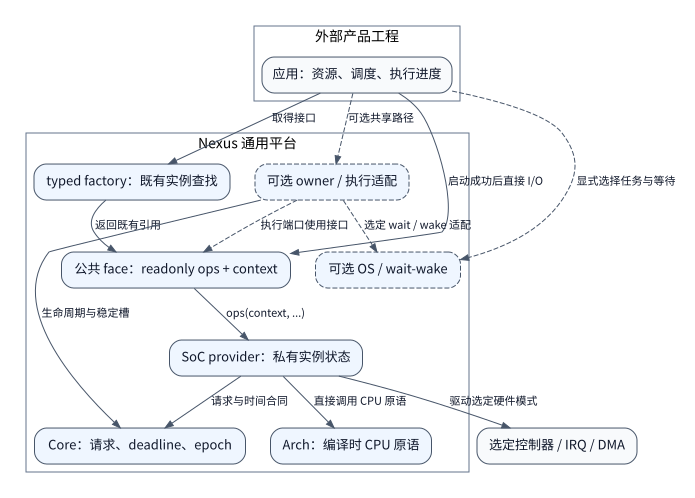

# Nexus 文档参考图册

图源为可编辑DOT，输出为本地SVG。维护登记见 [图清单](diagram-index.csv)，
内容规则见 [图示标准](../../design/documentation-standards.md)。当前只提供四个
参考视图，完整15类图册按DOC-43至DOC-57逐项交付，不从参考图存在推断完成。

本次本地渲染使用Graphviz 2.42.4和Noto Sans CJK SC。SVG经XML导出移除DOCTYPE，
已检查禁止元素与外部href，并通过PNG预览核对中文和标签。桌面浏览器、窄屏/
放大、打印与跨主机字体验收仍待执行；新站点图链和工具锁尚未实施。

2026-10-14独立审查记录：docs_diagram_standards_review核对四组DOT/SVG配对，
逐边对照下列源码和合同；FIG-01/03/06为source_reviewed，FIG-12为
design_reviewed。docs_content_standards_review核对正文、模板、58项依赖与
迁移映射；工作包排程和完整图册退出条件已收敛。图源误写发现已修复，并重新
渲染四图核对源/输出一致性。这些记录不关闭DOC-43至58，不建立硬件资格。

## FIG-01 当前运行时访问与外部边界

这是运行时访问视图，不是完整CMake依赖或初始化顺序图。每条边标明调用、返回
引用或可选适配关系；虚线带“可选”含义。Board事实参与构建，见FIG-03。
factory不在每次字节I/O路径中，Arch按编译目标选择。

代码依据：929a3bd684152fc3d49717bbd51497f554e5e8d5。参照
[factory生成](../../../tools/configure/factory.py)、
[Arch目标](../../../arch/CMakeLists.txt)、
[owner执行](../../../components/bus_owner/src/bus_owner.c)及
[当前架构合同](../../delivery/architecture.md)。
[DOT图源](platform-runtime.dot)。

## FIG-03 当前配置与生成

边表示构建时输入和产物传递，不表示运行时调用。拒绝/失败使拥有的输出失效，
不清理未拥有目录，不把半成品发布为有效配置。ELF和资源检查不构成实板资格。

代码依据同FIG-01。参照 [配置器](../../../tools/configure/configure.py)、
[bundle事务](../../../tools/configure/bundle.py)和
[构建合同](../../design/build-system.md)。
[DOT图源](configuration-generation.dot)。

## FIG-06 当前Core请求状态与借用

边表示Core helper允许的迁移及其调用前提。REJECTED/ACCEPTED是admission结果，
不是独立request状态。借用框中的存储继续保留。SETTLED只有在provider最终访问
和必要引用排空后release发布；调用方acquire观察，相关adapter/observer另需退出。

图中QUARANTINED到SETTLED只表示实际恢复和排空已经证明时的结束条件，不承诺
每个provider均有恢复API。取消/deadline不自动释放；DMA TC也不等于SETTLED。
已借用对象不能通过initialize强行重置。

代码依据同FIG-01。参照 [请求合同](../../../core/include/nexus/core/request.h)、
[实际状态迁移](../../../core/src/request.c)和
[owner最后发布](../../../components/bus_owner/src/bus_owner.c)。
[DOT图源](request-lifecycle.dot)。

## FIG-12 目标文档构建与交付链路

这张图是目标设计，尚未实现新CLI、MyST、翻译、工具锁和发布链。边表示目标输入
与产物流，不表示现有工具已执行。软件和HIL记录分别读取，不因文档生成升级资格。
后续还需补SDK与证据档案的独立发布/恢复视图。

设计依据：[文档系统规划](../../design/documentation-system.md)和
[内容与图示标准](../../design/documentation-standards.md)。
[DOT图源](documentation-target.dot)。
