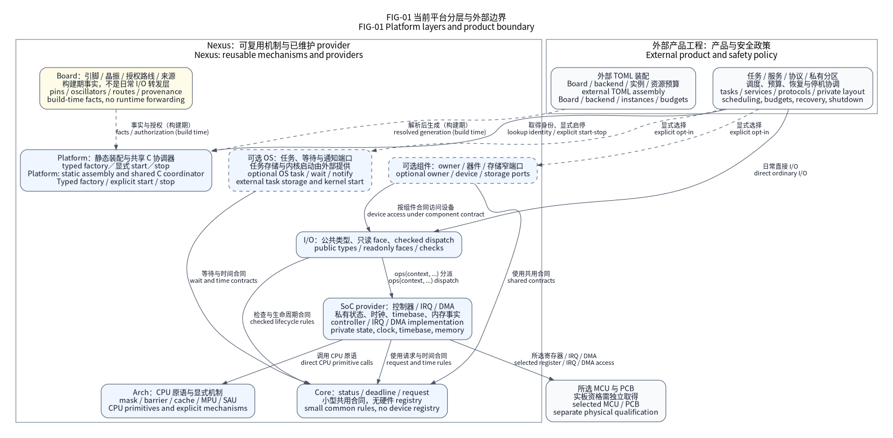

# 当前系统架构

Nexus 提供静态 C11 通用机制。当前生产 SoC 入口只有 `soc/stm32/stm32f4/`；
[精确支持](support.md)区分五个已审料号、四个 F407 Board 和新增内部 CRC 软件参考。
系列源码复用不等于每个模式都已执行。厂商依赖保留，只有实际选中闭包进入准备、
校验、编译与 SDK。

本页以固定源码
[`a2b74d82`](https://github.com/X-Gen-Lab/nexus/tree/a2b74d826dc1545aa8f51b5fcbc05fcd1cc2c984)
及 [PR #61](https://github.com/X-Gen-Lab/nexus/pull/61) 为既有基础，另行记录本轮架构
迭代。既有接口、一次局部修复和整个工作包完成是不同状态；本页不授予新的软件候选
或芯片支持范围。

图表达通用职责和构建／调用关系，本轮 MCU 入口为 F4。可选 OS 与组件不是每次 I/O
的强制中间层；物理验收另行取得。

## 目录、状态与资源

| 位置 | 责任与所有者 |
|---|---|
| `core/` | 结果、单调 deadline、请求与借用规则、整平台启动、停止、暂停与恢复协调 |
| `arch/` | 编译期 CPU 原语、中断状态保存恢复和明确能力 |
| `io/` | 公共类型、检查分派与硬件无关机制 |
| `soc/stm32/stm32f4/` | 精确芯片事实、启动、时钟、IRQ／DMA、私有控制器状态与 HAL／LL 适配 |
| `soc/stm32/stm32f4/drivers/ip/` | 仍被 F4 使用的私有硬件算法，无额外运行时注册 |
| `boards/` | 四个 F407 板卡的实际接线、晶振、安全电平及未知项 |
| `os/` | 可选任务、等待、通知及明确后端合同 |
| `components/` | 器件协议、owner、存储、网络等显式可选机制 |
| `tests/support/native/` | 显式测试模型、Board 与装配，不是生产 SoC |
| `tools/`、`cmake/` | 配置、唯一源码图、测试、SDK 与交付 |
| 外部产品 | 任务、队列、预算、私有分区、恢复与安全政策 |

完整导航见[源码定位](../explanation/source-map.md)。顶层共享 MCU `drivers/` 已归入
F4，目录移动本身不改变指令数或资源成本。

## 构建与运行

一份 schema-2 TOML 和只读 SoC／Board JSON 经严格校验、资源计划和不可变 typed IR
生成原子 bundle。CMake 选择已声明的实际源码与链接依赖；生成器不维护平行源码图。

本轮 F4 输入先由 `variants.<part>.device` 选择唯一 device profile，再组合不重叠
controller groups；不可变 `DeviceView` 分开表达物理 `ControllerFacts` 和软件
`ControllerModes`。配置与查询共用所选事实，家族展示与 Host-only 审核索引不反向
授权单颗器件。具名资料 profile 只在中央主机模块校验受审身份与适用性，不增加
MCU registry，详见[接入指南](../guides/provider-porting.md)。

根 CMake 只消费 provider 声明的 `NEXUS_SYSTEM_PRIVATE_INCLUDES`，不再硬编码 F4
IP 私有目录；芯片、模式和供应方源码仍由唯一目标图选择，外置 provider 不自动继承
无关 F4 头。构建连接没有增加运行时层，详见[构建合同](../design/build-system.md)。

每个固件选择精确器件宏和启动文件。厂商头、Handle 和可变 provider 状态私有；
生成器按选中实例定容配置、状态、buffer、只读 face 与强类型 factory。

运行中 factory 只返回已有接口。日常 I/O 通过 `ops(context, ...)` 直接进入 F4
实现，硬件操作优先复用官方 HAL／LL。不会因共享源码引入最大池、动态注册表、
默认堆或隐藏 worker。应用负责串行执行者、服务进度和 scheduler 启动。

## 生命周期与失败

F4 C 实现维护资源准入、取得、收条、硬件撤回和 readback。部分取得失败必须处理
当前步骤已经产生的效果，再逆序撤回前序步骤；失败释放保留实际责任。

默认静态装配通过 Core 私有 `platform_lifecycle_impl.h` 使用手写 C 协调器。
公共 `nx_platform_lifecycle_start/stop/suspend/resume` 以运行期参数调用同一实现。固定装配的配置、
可选 owner 和诊断在同一编译单元可见，编译器可以裁剪恒定分支和不再需要的回调表；
产品仅包含公共接口，不增加运行时转发层或第二份算法。
全部 controller 准入先于硬件效果；随后依次建立 System、共享资源与 controller。
失败按逆序撤回，在首个释放拒绝处保留剩余责任，后续 stop 只重试未完成部分。
primary、cleanup、remaining effects 和调用期诊断独立保留，不以清理成功覆盖原始失败。
F4 的 System／DMA／SYSCFG／pins／CAN／Ethernet 共享责任由其私有 C 协调器处理。

暂停先由调用者 join 借用者，再逆序排空 controller 和共享资源；失败停在
SUSPENDING 并保留前缀，不能直接 resume。只有完整 SUSPENDED 才按原 plan 重取
资源和 controller；恢复失败逆序回滚，System 与原配置责任仍保留。自主 RTC 等
域通过同一 owner 的显式 suspend/resume hook 保留，不由通用协调器直接写硬件。
暂停本身不进入低功耗；STOP 的独立电源机制恢复后建立新 Core epoch，应用与 OS
重新建立 deadline，不能把暂停代次当作时间转换。详见
[System 合同](../design/f407-system-power.md)。

ACCEPTED 后借用请求与 buffer，直到 acquire 观察 SETTLED。DMA 完成、线上完成、
IRQ／callback 撤回和最终发布分别证明；timeout／cancel 不提前释放借用。
QUARANTINED 保留存储与恢复责任，观察者和 adapter 还需独立 join。

启动外部 SRAM、已启 watchdog 和保留 RTC 状态不能套用普通关闭。HAL 与自写
实现也不能各自独立推进同一个 live controller 行为域。

## 当前实现与后续边界

Board／SoC 不再保留 Python 插件。默认主机工具仍使用 Python 校验与生成静态对象、
只读 plan、按索引选择的固定 typed call 和薄 IRQ 入口；启动、停止、回滚与诊断控制流
由手写 C 维护。既有 `nx_lifecycle_*` 可撤销资源事务与整平台协调器职责不同，不要求
为统一外观把全部驱动改接同一组 ops。

协调状态保留身份、16-bit 前缀、重入保护和暂停阶段，当前 M4 ELF 为 12 字节；超过 65535 个物理
controller 的 plan 在任何 owner 回调前拒绝。它不改变日常 I/O 热路径；实际资源、
模型行为、ARM 链接和
物理测量各自验收，不能从源码迁移推导整平台通过。

其他 F4 型号需要精确内存、封装、时钟、DMA、IRQ 与硬件 profile；官方 HAL 覆盖
不建立 Nexus 全系列资格。当前软件验证绑定本次执行，旧记录不继承；物理 HIL 为
`not_executed`。精确边界见[支持](support.md)与[资格](../reference/platforms/qualification.md)。

## 本轮架构迭代任务

以下保留已接受的 WP01–WP12 和 IO01–IO20 原始任务编号，替代用旧批次编号推断
当前进度。它是本架构页的人工审查表，不建立另一套配置输入、台账引擎或发布流程。
每个工作包分别说明既有基础、本轮增量和退出条件；只关闭有对应源码与实际执行
证据的子任务，不用一个 GREEN 或公共 API 存在关闭整包。

本轮保持静态 C、共享只读 ops、单一硬件执行者及 ACCEPTED→SETTLED 借用合同。
全部 `vendors/` 保留。应用、产品策略和私有 PCB 继续在外部；实板与远端 Actions
按用户要求暂缓，本地软件门禁仍是必需条件。源码、模型、ARM、SDK、文档和物理
资格继续分开，见[验收边界](qualification.md)。

### 工作包、当前状态与退出条件

下表区分已有实现、集成收口与后续实现／交接。已有实现限定为所列精确器件与
已声明模式的源码和合同；F407 模式回归不自动扩展到新增料号。集成收口表示机制
已存在，需要最终同一源码的执行、测量或独立核对。后续项按具体缺失行为、器件、
IP 推进。当前未宣布整个 F4 全功能或十二包全部完成；实板暂缓不等于已有软件
机制未实现。

| 工作包 | 保留的原始子任务 | 当前状态与退出条件 |
|---|---|---|
| WP01 基线 | BL01 固定源码、支持和消费者；BL02 空／单／多实例／DMA 代表配置；BL03 资源、ABI、身份基线；BL04 合同与任务映射 | 实现已有：BL01、BL02、BL04。集成收口：BL03。 固定源码、20 项消费者策略及空／单／多实例／DMA 代表装配均已有；本页保留合同映射。BL03 仍须以最终相同输入、工具和 ABI 汇总资源身份，不能把历史测量重标为新候选。 |
| WP02 精确事实 | FT01 统一宏、头和 startup；FT02 控制器／IRQ／DMA 事实去重；FT03 精确器件与封装；FT04 内存与 DMA 域；FT05 具名勘误 profile；FT06 独立手册／SDK 核验 | 实现已有：FT01、FT02、FT03、FT04、FT05、FT06（当前五料号事实）。精确宏／startup、封装／内存／DMA 域、67 项共同 controller 与 ETH／DCMI 差异组、具名资料 profile 和独立手册／SDK 核验已有。IRQ enum／number／handler 分别核对，AF 表与封装交集有正负例；当前 ARM CRC 和开发 SDK 不授予全部模式或 PCB 资格。 |
| WP03 配置 | CF01 统一器件视图；CF02 模式合同；CF03 去首／次 controller 特判；CF04 严格诊断与原子 bundle；CF05 工程模板与接入说明 | 实现已有：CF01、CF02、CF03、CF04、CF05。DeviceView、模式合同、严格诊断／原子 bundle 与模板已有。CF03 删除 SPI peer 选择和 UART preload 特判，同一 C cold 路径保存 IRQ 优先级、失败 CR／GPIO／gate 和正常 pin owner；实际 SPI 34＋10、UART wire 12 项回归分别绑定源码。最终完整工具域与候选仍待集成，不把局部通过当全模式资格。 |
| WP04 接口与成本 | IF01 强类型 factory 默认；IF02 迁移重复数字入口；IF03 公共接口／可选扩展；IF04 只读资源配置；IF05 配置／状态测量；IF06 编译期特化成本 | 实现已有：IF01、IF02、IF03、IF04。集成收口：IF05、IF06。 默认强类型 factory、常规 SDK face／metadata 查询迁移、公共 Nexus 接口及只读连接已有，跨类别误传有 C11／C++17 正负例。底层 scalar switch 保留为唯一实现。IF05、IF06 仍须以同构装配比较状态、配置、Flash／RAM／ABI 和反汇编成本。 |
| WP05 共享资源 | RS01 共享 IRQ 优先级；RS02 TIM／ADC／CAN／USB 共享域；RS03 DMA 范围、单位、宽度与 FIFO；RS04 取消、迟到 IRQ、失败排空；RS05 部分收条逆序释放；RS06 连续流预算与背压 | 实现已有：RS01、RS02、RS03、RS04、RS05、RS06。 共享 IRQ／硬件域、DMA 可达性与单位、借用排空、部分收条和有界连续流已有。DAC pending、SDIO 方向化计数／FIFO／IRQ 退出及有限 grace 修正有实际分组证据。新模式仍须覆盖自身冲突、迟到事件、拒撤和耗尽，失败不提前归还存储。 |
| WP06 Core／OS | OS01 有限 deadline；OS02 启动、停机与换域；OS03 临界区与屏障；OS04 默认 Platform 入口；OS05 裸机推进／RTOS 静态对象；OS06 布局与尺寸 | 实现已有：OS01、OS02、OS03、OS04、OS05、OS06。有限预算、停机换域、mask／屏障、同一 Platform 协调器及静态 RTOS 已有。本轮继续闭合串行／HAL／Ethernet 的有限排空、RS485 最低 hold 故障保留与 UART 配置归还后幂等 stop；实际布局与整程序有证据。新增候选仍须统一门禁，不授予全部 CPU／后端组合。 |
| WP07 系统 | SY01 时钟、供电与 Flash latency；SY02 回退实际频率；SY03 启动、CCM、外部 SRAM；SY04 STOP／Standby；SY05 恢复时间桥接；SY06 故障记录与恢复 | 实现已有：SY01、SY02、SY03、SY04、SY05、SY06。 静态 ClockPlan 与实际 HCLK 回退、pre-C／CCM／外部 SRAM、受约束 STOP／Standby、显式 deadline bridge 和首故障记录均已有。桥接使用独立 elapsed bounds，不自动恢复 OS 任务或继承旧 deadline。继续保持实际回读、失败收条和新时间域，产品恢复及物理验证独立。 |
| WP08 驱动 | DR01 完整模式 HAL／LL；DR02 拆无关外设依赖；DR03 同 IP 行为复用；DR04 I/O 全清单；DR05 删除已有可靠替代的旧实现 | 实现已有：DR02、DR03、DR05。集成收口：DR01。后续实现／交接：DR04。 无关外设头隔离、同 IP 共享 C／只读 ops，以及有可靠替代的旧入口收敛已有。DR01 继续按完整模式审查官方库复用与直接访问理由，不机械替换所有寄存器操作。DR04 仍需下表明确的新模式与新 IP，沿既有接收、错误、取消和排空合同扩展。 |
| WP09 Board／组件 | BD01 原理图与安全电平；BD02 未知 PCB／跳线显式；BD03 组件使用公共 endpoint；BD04 中间件按需 | 实现已有：BD01、BD02、BD03、BD04。 四份独立 Board 事实与安全电平、显式未知 PCB／跳线、公共 endpoint 器件组件及按需中间件已有。当前不扩大接线或实装声明，不猜测未知事实。未选择的中间件不进入产物，组件不含厂商寄存器；实板暂缓不阻塞这些软件机制。 |
| WP10 构建／SDK | BU01 根 CMake 去 F4 私有目录；BU02 模式／IP 选编；BU03 私有 SDK 配置／callback ABI；BU04 SDK 精确器件闭包；BU05 外部消费者 | 实现已有：BU01、BU02、BU03、BU04。集成收口：BU05。provider 私有 include、模式／IP 选源、私有 SDK／callback ABI 与五料号精确头／startup 选择已有。模型无变化重写修复是独立构建优化，不替代 BU02。新增三料号开发 SDK 实际消费不等于最终 clean-source 候选；BU05 仍须由最终包完成既定 20 项消费者。 |
| WP11 家族扩展 | FM01 F405／F407／F415／F417 差异复用；FM02 缺失外设／封装负例；FM03 其余 F4 按 IP 扩展；FM04 新 IP | 实现已有：FM01、FM02（F405ZG／F407VE／F407ZG／F415ZG／F417ZG）。后续实现：FM03、FM04。共同 IP、ETH／DCMI 差异、独立 IRQ／AF／资料核验及缺失外设／封装负例已有；新增型号以 HSI16／内部 CRC 软件参考取得 ARM 与开发 SDK 证据，不声明实体 PCB 或全部模式。其他 F4 和新 IP 仍需逐项接入。 |
| WP12 验证／交付 | QA01 合同与差异测试精简；QA02 真实 TDD；QA03 ARM、资源与编译上下文；QA04 完整正常门禁和审查；QA05 文档、图、示例与矩阵；QA06 软件候选与版本 | 实现已有：QA02。集成收口：QA01、QA03、QA04、QA05、QA06。 真实 TDD 约束与本轮实际 RED／GREEN 记录已有。测试保留审查、最终 ARM／资源、正常完整门禁、双语文档／SDK 及候选身份仍须收口，继续复用现有工具。HIL 合成记录测试属于工装验证，不是实板执行；保留原始失败，不缩减正式计划或重标资格。 |

### I/O 覆盖与未完成边界

这里按原任务覆盖全部二十类 I/O；具体可选择模式仍以[精确支持](support.md)、
[派生能力](capabilities.md)及各领域合同为准。本表不增加第二份能力事实，不把一次
协议或 DMA 修正解释成该类所有功能已经完成。

| 编号 | 类别 | 既有基础与本轮边界 |
|---|---|---|
| IO01 | GPIO／EXTI | 已有输入、输出、IRQ 事件与 EMR 硬件事件；封装、电气、PC13／LSE 和 Board 授权继续受约束，本轮未关闭全类复核。 |
| IO02 | UART／USART | 已有选定格式、线模式及轮询／IRQ／DMA。本轮统一 UART idle cold 规则、RX／duplex 不可变资源与别名准入，有限排空及重复 stop 不再访问已归还配置；RS485 无法证明最低 hold 时保留 DE／outer loan。全部控制器／格式组合仍按模式验收。 |
| IO03 | SPI | 已有主／从、帧事务与 DMA。SPI1／2／3 DMA 统一 cold prepare／close，不再根据 peer 存在选择算法；优先级、失败 CR 恢复、CS／pin owner 有实际回归。有限 framed drain／tail 已修正，新增模式仍需自身尾部与取消证据。 |
| IO04 | I2C | 已有 master、target 与 SMBus 的选定合同；器件事实、时钟、首／次实例和异常恢复仍须统一核对。 |
| IO05 | TIM | 已有计数、PWM、捕获、编码器及有限波形；共享时基、触发、break 与 DMA burst 不能由单一实例的通过值代替。 |
| IO06 | ADC | 已有单次、scan、注入和多 ADC 模式。本轮补充完整 provider／事实／buffer 的别名拒绝及有限 warmup／drain；SUCCESS 表示接纳，借用后的故障继续保留退出责任。regular／injected 并行、自动注入和循环多 ADC 仍未提供。 |
| IO07 | DAC | 已有 CPU／触发／DMA 和波形路径；本轮跨 request 的 pending／underrun 恢复增量已有 C 模型、ARM 和独立审查，不能据此关闭整个 DAC 类别，也不承诺模拟无毛刺或持续保持输出。 |
| IO08 | I2S／音频 | 有限与连续 blocks 已在基线；外部 clock 上界、service 预算、补充 buffer 与 RX loan 的独立 join 仍是调用方责任，不计为本轮新完成项。 |
| IO09 | CAN | 已有 CAN1／2 classic、邮箱和共享 filter domain；共享依赖、bus-off 与恢复仍按具体模式验收，不授予 CAN FD。 |
| IO10 | SDIO | 已有 SD／MMC 与 SDIO functions。本轮完成 RX PFCTRL／TX 精确计数与 FIFO／IRQ join、memory CMD18／25＋CMD12／13 及静态 ClockPlan 的 RM／勘误联合分频；默认与低 PCLK2 实际程序及 ARM 对象通过。HS／DDR／HS200、linked candidate 和物理资格不在此通过范围。 |
| IO11 | FSMC／FMC | 基线仅提供已声明的 F407 FSMC 内存／设备模式；FMC 及其他器件的能力不从名称相近推导。 |
| IO12 | USB Device | 已有 FS／HS、PIO／DMA 和受约束端点。本轮增加同 epoch 提前 STATUS OUT 与 DATA IN 并存；wire 关闭不撤内存借用，packetizer／ST Core 先双方向 join，禁止旧 IN 续包。实际最终整程序与候选仍按新源码收口；remote wake／高带宽 ISO 未接入。 |
| IO13 | USB Host／角色 | 基线已有 host 和显式角色、reset／resume 保持合同；不扩为自动 OTG 协商，也不以模型证明 VBUS／PHY／实物枚举。 |
| IO14 | Ethernet | 基线已有 raw／增强帧、MII／RMII 与计划驱动的 MDC／PTP；计数分辨率不是物理精度或网络同步资格。 |
| IO15 | DCMI | 已有 RAW／JPEG snapshot 与 RAW blocks；本轮补充配置、引脚事实和恢复 snapshot 与控制／DMA 存储的别名拒绝。连续 JPEG 仍无装配模式；帧事件不保证精确图像边界或帧数，摄像头接线尚未物理验证。 |
| IO16 | RTC | 基线已有日历、备份、晶体 PC13 静默及 INIT／tamper 勘误；timestamp／tamper 需要明确 bypass 事实，不把四板晶体配置解释成外部时钟输入。 |
| IO17 | Flash 维护 | 基线已有精确几何、不可逆维护及显式 recover；本轮不把旧修复再计完成，不自动回滚、重放或替代 POR。 |
| IO18 | 监督／故障 | 已有 IWDG／WWDG、CSS、复位与故障观察机制；安全输出、真实复位、掉电及产品恢复仍分别验收。 |
| IO19 | RNG／CRC／身份 | 已有 RNG、固定 CRC 字序列与实际身份查询；新具名勘误 profile 不扩大器件范围，UID 不作为秘密，REV_ID 准入不证明 PCB 或封装。 |
| IO20 | 其他 F4 IP | SAI、LTDC、DMA2D、QSPI、CRYP、HASH 的完整 provider 尚未接入当前生产范围；须经 FM03／FM04 选择精确器件、模式和硬件域后逐项实施。 |

任务结果只在该子项的退出条件满足后更新。未完成项保留原编号和边界，后续改动
继续进入现有源码、合同、测试和 CMake／SDK 路径；不以新增目录、空壳测试或另一套
通用注册机制代替实现。
