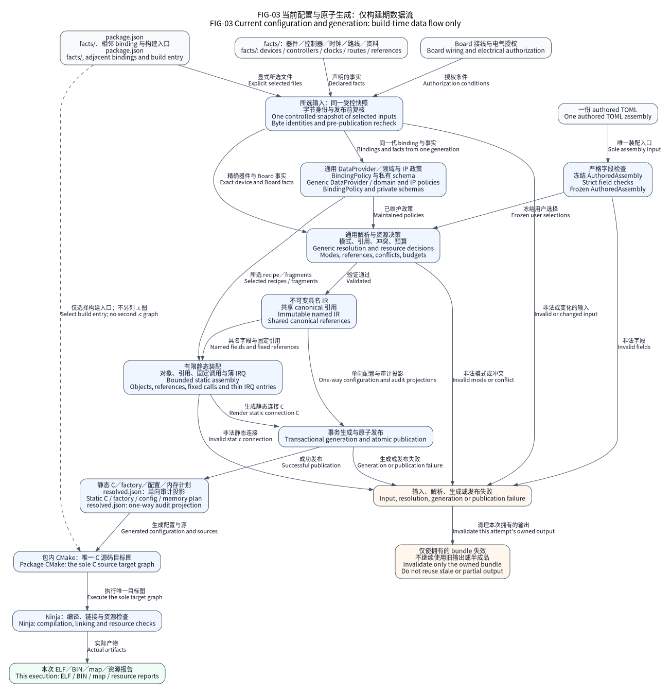

# 构建入口、目标依赖与接入边界

本页维护应用、SoC 和组件接入同一生产目标图的合同，以及本轮 B1–B9 的 44 项任务。
重构基线为 `bfde3b9a`。下述接口是本轮实施合同；源码实现、实际验证和物理 HIL 分别记录。
旧 BR 计划与计时见[固定前序源码](https://github.com/X-Gen-Lab/nexus/blob/bfde3b9ace6cbb3f3b7344dcd779532b5ef4ba40/docs/design/build-architecture.md)，不继承为本轮资格。

## 应用入口

Preset 在 `project()` 前选择 Ninja、工具链、SDK 和独立构建目录。工具链定位编译器与
binutils；平台随后验证并应用 CPU、FPU 和 ABI，不能在启用语言后更换编译器。每个构建
目录只有一个装配和工具链；同装配可以创建多个镜像，不同装配使用独立目录。

```cmake
cmake_minimum_required(VERSION 3.31)
project(controller LANGUAGES C ASM)

find_package(Nexus CONFIG REQUIRED)
nexus_add_platform(
    ASSEMBLY "${CMAKE_CURRENT_SOURCE_DIR}/assembly.toml"
)
nexus_add_firmware(controller
    SOURCES src/main.c
    LIBRARIES Nexus::Log
)
```

`find_package()` 定位并验证 SDK、检查版本和提供 API，不解析装配、不生成绑定、不创建
生产目标。`nexus_add_platform()` 显式创建唯一平台，第二次创建明确拒绝。独立 CPU
Runtime 使用 `nexus_add_runtime(ASSEMBLY ...)`，应用负责启动与板级集成；它不能与
Platform 在同一构建图中混用。重复发现同一 SDK 不重复装配，也不跳过实际身份检查。

`nexus_add_runtime()` 只创建可复用库。应用拥有 startup、链接脚本和最终 executable；
MCU 自建 executable 必须显式调用 `nexus_apply_firmware_policy(target)`，再链接
`Nexus::Runtime`。单独链接 Runtime 不自动选择运行库或 `-nostartfiles`。

源码 checkout 的 `Nexus_DIR` 指向其 `cmake/`，安装 SDK 指向 prefix 下的
`lib/cmake/Nexus/`。两者使用同一公共 API 和生产图。应用不需要修改平台测试开关，
也不需要编写 `add_subdirectory` 与 `find_package` 分支。应用模块继续使用原生
`add_library()` 和 `target_link_libraries()`；`Nexus::ABI` 提供必要二进制约定，
`Nexus::OS` 表示已选后端，应用不拼接内部目标名称。

## 配置、目标与镜像



箭头表示构建期输入和生成关系，不表示运行调用或物理资格。解析器从 TOML、Board 和
SoC 事实构造不可变 typed IR，原子生成静态 C、factory、内存计划和选择投影。CMake
决定翻译单元和依赖，Ninja 执行目标图；配置工具不维护第二份 C 源码列表。

| 位置 | 拥有的责任 |
| --- | --- |
| 根 `CMakeLists.txt` | 平台开发工程、维护默认值、显式测试与 workload |
| `cmake/Nexus.cmake` | 公共 API，加载时不创建装配 |
| `cmake/platform/` | 唯一生产图、私有装配上下文、目标策略、Provider 合同和镜像 |
| `cmake/package/` | 安装包、字节身份、导出和真实消费验证 |
| `cmake/toolchains/` | 编译器、binutils 与交叉编译环境 |
| `soc/<vendor>/<family>/` | 芯片事实、驱动、System、私有 SDK 和启动要求 |
| `components/` | 叶组件源码及公开／私有依赖 |
| `tools/configure/` | 严格解析、资源校验、不可变 IR 与静态连接 |

生产图在私有目录作用域装配。应用的全局 flags、输出目录、测试开关和缓存配置由应用
管理。装配元数据、编译使用要求和 Provider 私有实现分别传递，不将完整选择集合变成
所有消费者的公共宏。

## Provider、组件和策略

Provider target 发布 `NEXUS_STARTUP_SOURCES` 和 `NEXUS_STARTUP_USAGE_TARGET`，
分别表示启动与 System 源绝对路径，以及 Provider 拥有的启动编译要求目标。
`Nexus::Platform` 用 `NEXUS_PROVIDER_TARGET` 指向实际 Provider。Firmware 读取
固定合同，为每个镜像创建独立 startup OBJECT，并私有链接 startup usage。

厂商头、器件宏和 HAL 配置只影响实际消费者。不能无条件共享不同镜像的启动 OBJECT，
也不能通过公共 `INTERFACE_SOURCES` 将厂商源注入应用编译。启动对象、弱符号与
archive 的链接顺序保持明确。F4 保留主要 archive；驱动直接声明 HAL、DMA 和公共
机制，System 自己声明编译要求，不读取兄弟模块先前写入的开关。

普通组件在叶目录定义目标和依赖，应用直接链接，无需进入 TOML 枚举。确实需要静态
绑定或供应商选择的组件共用一份登记，描述逻辑 ID、CMake 入口和公共 target；配置
合同仍由所属绑定维护，叶目录负责创建。登记不列 C 源码图，公共装配不特判组件名字。轻量目录
保留显式加载；选中重依赖才准备对应供应商。

具体模式在包边界映射为公共 API／机制需求，通用 IO CMake 只消费公共需求，仍由
CMake 选择 `.c`。新增 MCU 复用现有模型时不修改公共调度器；新公共语义或新架构仍须
扩展对应合同。ABI 对互相链接的对象一致；优化、IPO 和 launcher 作用于实际目标；
严格诊断面向自有代码；运行库、`-nostartfiles` 和链接脚本属于最终 image。

## 增量、失败与身份

普通 C 变更由 Ninja 和编译器依赖触发相关编译。TOML、选中事实和生成器变化重新配置；
内容相同的生成文件保留时间戳。无变化构建不重新 configure、编译或链接。预算或检查器
变化复查已有 ELF；布局变化触发链接。删除 BIN、map 或资源报告后，直接构建原固件
目标仍恢复声明的产物。[固件规则](../../cmake/platform/Firmware.cmake)

配置拒绝或中断使拥有的旧生成结果失效。链接失败或取消撤销旧 BIN 和资源报告。SDK
发现后发生内容变化，后续装配仍要检出。验证只在实际同步边界复用，不持久缓存成功
结论，不以全局布尔值替代字节身份。源码冲突、预期 revision 和开发 fixture 准入保持
严格。ccache 默认关闭，启用后仍保持 SDK 只读；Sanitizer 只用于明确选择的主机范围。

## 本轮任务与退出条件

本页任务定义实现与验收合同。验收由同一冻结源码的实际门禁、消费者、独立审查和
同步收条判定。源码实现与执行状态分别记录；目标存在和历史结果不能代替新源码的
实际验证。

### B1 固定合同

- **B1.1** 固定发现、装配和固件 API，文档、模板与实现一致。
- **B1.2** 固定单装配、单工具链、重复调用和来源冲突的拒绝规则。
- **B1.3** 区分元数据、编译要求与私有选择，应用无需读取完整 `NEXUS_*` 集合。
- **B1.4** 固定 Provider 启动合同与策略传播方向。
- **B1.5** 固定配置、链接和验证失败后的输出失效责任。

### B2 统一入口

- **B2.1** 提取唯一生产图，开发工程和外部工程共同使用。
- **B2.2** 实现显式 `nexus_add_platform(ASSEMBLY ...)` 并拒绝第二次创建。
- **B2.3** 包发现不解析 assembly，不创建 generated、Provider、测试或 workload。
- **B2.4** 源码 checkout 与安装 SDK 提供同一公共 API。
- **B2.5** Runtime 和 Platform 的公共层装配只维护一份。
- **B2.6** 迁移消费者后删除旧隐式装配和安装包代理路径。

### B3 Provider 启动合同

- **B3.1** 启动源归 Provider target，删除多组父作用域回传。
- **B3.2** Provider 发布 startup usage，私有 include 和定义由 SoC 拥有。
- **B3.3** 按固定合同独立创建每个镜像的 startup OBJECT。
- **B3.4** 删除根入口对启动私有字段的搬运。
- **B3.5** 已选后端提供 `Nexus::OS`，固件不拼接内部名称。

### B4 F4 包内依赖

- **B4.1** 清点跨驱动共享变量，确定唯一拥有者与消费路径。
- **B4.2** 驱动直接声明 SDK、DMA 和辅助实现需求，不修改兄弟模块开关。
- **B4.3** System 自身声明启动要求，不依赖驱动文件执行顺序。
- **B4.4** HAL 对象只在器件、ABI、配置头和回调一致时复用。

### B5 组件

- **B5.1** 区分普通库与需要生成绑定或供应商选择的组件。
- **B5.2** 装配组件只维护一份登记，配置校验和 CMake 定位共同消费。
- **B5.3** 创建行为归叶目录，删除中央组件名称分支。
- **B5.4** 所属目标声明绑定依赖，根入口不引用组件私有目录。
- **B5.5** 未选供应商不初始化、不编译，缺少选中依赖明确失败。

### B6 目标策略

- **B6.1** 提供稳定 `Nexus::ABI` 供应用自建库使用。
- **B6.2** 运行库、启动链接要求和链接脚本只附着最终 image。
- **B6.3** 以实际命令验证优化、IPO 和 launcher 生效。
- **B6.4** 自有严格诊断与厂商编译范围隔离。
- **B6.5** ccache 和 Sanitizer 仅影响显式目标，不写入安装 SDK。

### B7 公共 IO 需求

- **B7.1** 清点通用 IO 中的模式判断并确定所属包边界。
- **B7.2** 在已有 typed IR／投影中表达公共需求，不生成源码图。
- **B7.3** 通用 IO 按公共需求连接目标，具体模式规则由包拥有。
- **B7.4** 验证空选择、多控制器、多模式和去重，保持未选代码裁剪。

### B8 应用与文档

- **B8.1** 迁移 starter 和示例，删除开发开关及重复导入分支。
- **B8.2** Preset 负责工具链、SDK 和构建目录，TOML 保持硬件意图权威。
- **B8.3** 更新架构、SDK、接入说明、框图和完整中英文译文。
- **B8.4** 删除无消费者旧入口及过时测试，保留等价故障覆盖。

### B9 验证与交付

- **B9.1** 真实消费者验证发现无装配副作用、重复创建和来源冲突。
- **B9.2** 验证 Provider、启动对象、策略和应用可见性隔离。
- **B9.3** 验证源码、事实、预算、缺失产物、失败和取消的增量行为。
- **B9.4** 执行源码、搬迁 SDK、只读 SDK、Runtime、F4 及 C／C++ 消费路径。
- **B9.5** 有限对照 configure、编译、链接和验证耗时，解释资源与身份差异。
- **B9.6** 最终源码冻结后完成门禁、独立审查、两仓来源对齐和 GitHub 同步。

先完成 B1，B3 与 B6 可并行，再接 B2；B4 在 Provider 合同稳定后实施，B5 与 B7 在
装配入口稳定后实施，最后完成 B8 和 B9。测试随功能增量执行，完整交付绑定最终冻结
源码，不在每个内部重排步骤重复整个平台矩阵。

验收看新增 MCU 的公共修改面、应用要理解的内部内容、实际编译与链接范围，以及热
构建是否执行额外工作。既有组件加载曾测为 14–17 毫秒，保留显式加载；历史计时不能
证明新源码性能。时间结论必须说明样本、工具链、并行预算和实际范围。

## 参考边界

[Zephyr 构建阶段](https://docs.zephyrproject.org/latest/build/cmake/index.html)区分配置和执行，
[ESP-IDF 组件依赖](https://docs.espressif.com/projects/esp-idf/en/stable/esp32/api-guides/build-system.html#component-requirements)
区分公开与私有要求，[CMake 3.31 目标模型](https://cmake.org/cmake/help/v3.31/manual/cmake-buildsystem.7.html)
提供依赖传播。Nexus 使用这些边界，保留 TOML、静态 factory 和唯一生产图；产品任务、
应用策略与物理验收不属于本轮构建重构。
