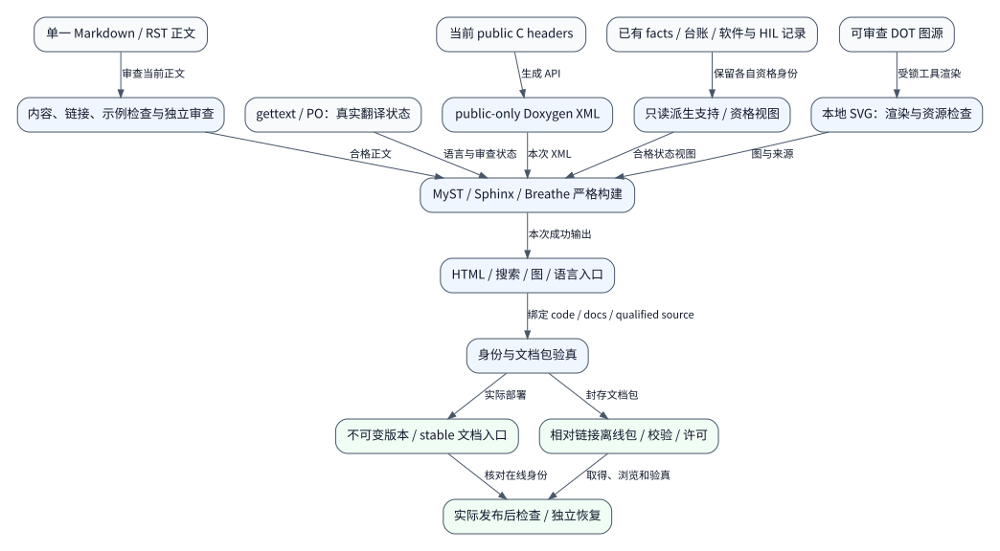

# Nexus 文档系统架构与交付规划

本方案把现有维护合同、公共 API、使用说明和交付证据组织为一个按读者任务导航、
版本明确、可离线取得的文档系统。正文使用现有 Markdown 和公开头文件；站点继续
采用 Sphinx、Doxygen、Breathe，增加 MyST。产品代码和策略仍在外部仓库。

站点、CLI、依赖锁、正文、翻译和图册已按本方案实现。实际构建、发布和恢复
以 [58 项实施台账](documentation-system-execution.csv)及对应执行证据为准；
[迁移映射](documentation-migration.csv)记录当前内容的去向和保留规则。
这份文档不修改既有平台支持、软件资格或实板状态。
新增和修改文档遵守 [内容与图示标准](documentation-standards.md)及
[页面模板](documentation-templates.md)。[完整优化清单](documentation-improvements.md)
从同一台账派生；[参考图册](../assets/diagrams/README.md)区分当前与目标视图。

## 1. 目标和边界

文档首先帮助应用开发者正确使用平台，其次帮助接入者扩展平台，最后帮助维护者
和验收人员判断变更与证据。读者能够完成一次明确任务，不需要先遍历实施历史。

- 应用使用当前静态实例、typed factory 和 C 多态接口。
- 默认配置是一份 authored TOML，SoC/Board 事实使用维护的 JSON。
- 接入说明保留上下文、deadline、借用、排空和失败恢复条件。
- 生产支持、软件测试、ARM 链接、候选和 HIL 状态分别表达。
- 文档、源码、配置和已验证基线都有明确身份。
- 一处维护规范内容，其他页面引用、包含或派生，不复制一套合同。
- 内部链接、搜索和离线包覆盖当前正文；历史资料具有可见边界。

文档系统不创建产品应用、任务、私有 PCB、Flash 分区、安全升级或恢复策略。
教程引用 X-Gen-Lab/nexus-examples 的固定版本；平台仓库只保留通用测试夹具和
验证所需代码。文档发布不把软件模型或链接结果升级为实板资格。

## 2. 首页从读者任务进入

| 读者 | 首页路径 | 完成结果 |
| --- | --- | --- |
| 应用开发者 | 固定源码 → 使用 SDK → 选择 Board/OS → 配置实例 → factory 取得接口 → I/O → 停机 | 可构建的外部工程和正确的资源生命周期 |
| 平台接入者 | 新 Board → 新 SoC/provider → 通用器件/组件 → 模型/ARM/HIL | 明确范围、资源和验证的接入切片 |
| 维护者 | 固定源码 → 安装工具 → TDD → 评审 → 依赖升级 → SDK/文档交付 | 可追溯变更和可恢复交付 |
| 验收人员 | 支持矩阵 → 精确配置 → 软件记录 → 候选 → 实板状态 | 针对具体基线的资格判断 |
| 旧版用户 | 配置迁移 → 接口迁移 → 所有权变化 → 重验证 | 不依赖旧 API 的新消费工程 |

教程只走一条经过验证的路径；操作指南解决一个目标；参考给出精确规则；解释
说明原理与取舍。首页侧栏保持两层，复杂域通过索引页展开。搜索默认排除历史
教程和大型原始证据，搜索结果显示当前版本、页面类别、实际正文语言和翻译状态。
正文摘要优先描述读者任务和技术内容；源码身份与资格边界单独显示，避免重复
免责声明占据搜索摘要。首次操作统一引用
[固定源码与递归依赖指南](../guides/source-checkout.md)，不默认 GitHub 分支与
所读文档版本一致。

## 3. 内容权威和派生关系

| 内容 | 权威来源 | 网站处理 |
| --- | --- | --- |
| 公共声明及单 API 合同 | core/arch/io/os/components 的 public headers | Doxygen/Breathe 生成，指南链接符号 |
| CPU/芯片/路由/Board 事实 | SoC/Board JSON、生产 resolver、来源审查 | 复用既有能力派生工具，附人工限制说明 |
| 跨 API 生命周期和执行顺序 | 当前系统合同正文 | 直接纳入站点，不从教程反推规范 |
| 配置语法和拒绝规则 | 生产配置器、typed IR、配置合同 | 完整示例实际解析，片段明确标记 |
| 工程与风格要求 | AGENTS、既有风格文件和工程合同 | 保留现有约束并连接操作步骤 |
| 实现支持范围 | 生产实现/选择与 reviewed facts、人工边界 | 一个权威支持入口，其余页摘要并链接 |
| 已执行资格 | 精确源码的结果索引与原始 receipts | 展示 scope、配置、工具和产物身份 |
| 工作计划与退出条件 | 各专项 CSV 台账 | 派生任务视图，不生成重复状态数据库 |
| 内部文件组织和维护定位 | 源码相邻 README | 保留局部入口，公开部分包含或版本化链接 |
| 历史方案和计数 | docs/archive | 独立历史入口，不建立当前资格 |

芯片具备外设、provider 实现模式、Board 授权接线、软件执行和 HIL 通过，是不同
事实。派生表只读取已经定义的 authority，不另建一套芯片能力或资格规则。
一个 CSV 的 implemented 不自动映射成 accepted；多个台账重叠，不能相加为
项目完成百分比。旧记录保留原编号、原退出条件和失败尝试。

## 4. 目标目录与渐进接入

```text
docs/
├── index.md                      任务入口、版本与资格边界
├── tutorials/                    首次完成一个可验证流程
├── guides/                       使用、接入、取消/排空、故障处理
├── reference/
│   ├── api/                      Core/Arch/I/O/OS/Components
│   ├── configuration/            TOML、facts、IR、预算、CLI
│   ├── platforms/                CPU/SoC/Board 精确支持切片
│   └── contracts/                当前有效系统合同
├── explanation/                  架构、factory、所有权、资源和取舍
├── status/                       支持、当前资格、HIL、发布、台账视图
├── development/                  风格、TDD、评审、依赖与文档维护
├── design/                       活跃方案、决策和原始专项台账
├── delivery/                     保留原路径的执行记录与结果索引
├── locale/                       gettext/PO 翻译
├── assets/                       本地图片、图源和样式
├── sphinx/                       迁移期配置与 API/RST 包装页
└── archive/                      历史资料，不进入默认站点搜索
```

第一步把 Sphinx source root 改为 docs/，配置迁移期仍放 docs/sphinx/conf.py。
MyST 使现有 design/delivery Markdown 成为真实文档页面，并进入导航和搜索。
先接入正文和修复入口，再按映射移动可变内容；不先大批移动再修引用。

toctree 是唯一导航编排，README 是仓库入口。第一阶段可直接导航旧路径，后续
保持稳定 page ID 并维护小型 URL redirect 表。相对链接按源文件实际位置解析，
移动时检查所有引用和显式 anchor。目录重组与规范意义变化分别评审。

以下材料保留源路径：

- 三份已有 delivery results JSON 和对应执行记录。
- 六份原专项执行 CSV，以及本方案的新文档系统台账。
- archive 的原内容、编号和历史资格。
- 被工具当作输入的合同，直到实际引用与门禁同时迁移通过。

当前状态页引用这些来源或派生视图，不重写历史 receipts。外部归档仍使用原字节
和 member 定位。新路径不能伪造原源码执行或改变旧档案的身份。

## 5. 技术选择

| 决策 | 选择与理由 |
| --- | --- |
| 站点 | 复用 Sphinx，已有严格 CI 和 C API 交叉引用 |
| 正文 | Markdown/MyST，RST 继续用于 API 指令和过渡页 |
| API | public-only Doxygen XML + Breathe，保持已有注释风格 |
| 翻译 | 单正文源 + Sphinx gettext/PO，一条翻译链 |
| 导航 | toctree 和模块索引，不建立独立内容数据库 |
| 状态 | 复用能力派生、结果索引、CSV 和 identity 工具 |
| 主题 | 先沿用现有主题；内容/搜索合格后再独立评估 |
| 图示 | 可编辑DOT + 本地SVG，Graphviz受锁；可用Sphinx内置graphviz扩展 |
| 交付 | 相对链接的 HTML 包和 manifest，不依赖 CDN |

本轮不切换 MkDocs 或 Docusaurus，不引入额外前端运行时来完成基础导航。
已有 MyST/Sphinx 功能不足时，再以实际失败样例评估扩展。不要为每篇文档维护
第二份目录表、能力表或通用 snippet DSL。

站点排除 docs/archive、Doxygen 生成输出、_build、原始日志、大型归档和软件
fixture 产物。状态页提供可读摘要和下载索引，原始证据不批量成为搜索页面。
源码相邻 README 不复制为第二份合同；若包含，须验证原相对链接的重定位。
其他源码链接使用当前站点绑定的 Git revision，避免固定开发分支漂移。

## 6. 页面和 API 组织

新公共页使用标准 MyST front matter，保持少量维护字段：

```yaml
id: guides.cancel-and-drain
type: how-to
audience: consumer
source_language: zh_CN
```

id 用于页面身份与迁移检查，不会自动生成 MyST 可引用 anchor。公共 anchor 使用
标准 MyST 显式 target 或 Sphinx label，路径调整后保留并实际构建验证；旧 URL
由 redirect 处理，不另建引用框架。版本、更新时间、源码链接和验证状态从实际
Git/执行输入派生，不要求作者手填多个时间戳或复制源码 hash。
旧页在迁移时逐批补字段，不通过默认值伪造其语言或验证状态。

| 页面类型 | 必需内容 |
| --- | --- |
| tutorial | 目标、精确前提、固定配置、完整步骤、预期结果和清理 |
| how-to | 单一任务、上下文、最短步骤、失败处理和适用边界 |
| reference | 字段/符号、范围、单位、拒绝条件与权威来源 |
| explanation | 问题、机制、取舍、边界，链接规范合同 |
| status | source/config/scope、实际执行状态与证据定位 |

API 从一个总 doxygenindex 改为 Core、Arch、I/O、OS、Components 模块入口。
每个设备页先连接公共合同与调用顺序，再进入自动生成符号。不要手抄函数声明。

factory 单独解释：查找返回已生成静态对象，日常 I/O 直接通过 face 调用 provider。
示例使用实际生成的 nexus_factory.h；默认 ID、strong-ID 和可选能力记录各有
精确配置和执行证据。公开头文件与每次装配生成的接口不能混为全平台恒定 API。

## 7. 双语与图示



图为目标设计，不代表已实现。箭头表示输入/产物传递；软件和HIL只读记录，文档
构建不产生平台资格。来源与完整说明见 [FIG-12](../assets/diagrams/README.md)。

每篇正文只有一份 canonical source，记录原始语言。所有当前页面提供完整中文和
英文正文；中文原文也通过同一 gettext 链生成英文。混合语言合同可使用原文语言
的已审查 catalog，翻译其中另一语言的说明，不复制另一份规范源。
API 标识符、配置键、错误码、CSV、JSON 和原始日志保持原字节或语义。

gettext/PO 是唯一翻译链。翻译审查绑定原文版本；原文变化后，受影响翻译进入
stale 或 fuzzy，不能因 language=zh_CN/en 构建成功而记录翻译完成。
状态只有 reviewed、stale、missing、original，按页派生并在页面可见。

翻译门禁分别用中文原文和英文原文验证 en/zh_CN round-trip、缺译 fallback、
stale/fuzzy。标记依据实际正文语言和审查状态，不能被构建 locale 覆盖。

所有当前页面的可见规范正文需完成独立语义审查且无未处理 fuzzy。快速检查核对
原文摘要和审查标记，严格构建还核对新提取的完整消息集合；缺译或过期时失败。
开发预览仍准确显示实际语言和缺译状态。历史归档保留原翻译范围，不建立新资格。

图示保留可审查源，输出本地资源。首批不依赖在线 Mermaid/CDN、外部字体或脚本。
新增渲染器需要独立工具锁和实际验证；图的箭头、生命周期和支持边界随正文评审。
离线包检查图像、搜索、导航与双语入口，不只检查首页存在。
完整15类必需图及视觉、源码和失败路径约束由内容与图示标准定义。

## 8. 示例与文档门禁

代码示例优先从真实 fixture 或固定 external example literalinclude，不维护一套
无法编译的手抄实现。完整使用教程需实际消费当前 Source SDK；声明硬件命令时
注明工具、板卡和连接前提，普通文档构建不刷写或访问设备。
external example 先取得固定 revision/hash 的本地输入并记录许可证，Sphinx 只读
该输入，不在构建时联网取得最新版或执行外部仓库脚本。

完整 TOML 使用生产 resolver。Board/CPU JSON 通过实际接入路径验证，不能只
做 JSON syntax check。部分示例有明确 fragment 原因，保留语法检查，但不计为
完整可执行配置。现有 nexus-toml-fragment 约定继续使用。

维护的 shell/CMake 流程只由明确审核的 fixture 执行，不能从任意 Markdown 自动
提取并执行命令。完整片段、示意片段和执行报告的范围分别呈现。

| 层级 | 验证 | 触发 |
| --- | --- | --- |
| 快速源检查 | 格式、元数据、page ID、内部文件/anchor、导航可达 | commit/CI |
| 配置示例 | 完整 TOML 与 JSON 的实际 resolver、片段原因 | 相关变更 commit/CI |
| 可执行示例 | 真实 Native/ARM/SDK consumer 和失败路径 | 相关行为变更 CI |
| 公共 API | 既有注释合同 + Doxygen/Breathe 严格构建 | API/文档 CI |
| 全站 | MyST/Sphinx 严格引用、导航、搜索、翻译状态、资源 | CI/发布 |
| 外部链接 | 有限 timeout/retry，分开报告404与网络不可达 | 定期/发布 |
| 发布后 | 实际站点身份、关键页、旧URL、资源与下载 | 实际部署后 |

commit 快速检查默认离线，不每次重跑固件全平台资格。新增文档工具与 gate 使用
Python unittest 的实际 RED→GREEN；新增 C 行为测试用 GoogleTest/GoogleMock，
示例消费用现有真实构建。纯正文调整运行相应文档检查，不增加镜像实现的测试。

## 9. 一个工具入口

统一工具入口如下，安装工具与实际验收见文档维护指南：

```text
python tools/dev/dev.py docs check
python tools/dev/dev.py docs test
python tools/dev/dev.py docs build --language zh_CN
python tools/dev/dev.py docs build --language en
python tools/dev/dev.py docs preview
python tools/dev/dev.py docs package
python tools/dev/dev.py doctor --target docs
```

dev.py 保持薄路由，文档模块复用现有 process runner、超时、退出码和 identity。
docs.py/.sh/.ps1/.bat 转为转发或明确迁移提示，不各自维护生成规则。

- check 验证受维护的源文档和实际配置片段，不建立平台资格。
- build 在新输出根执行 Doxygen 与 Sphinx；统一 -n -W --keep-going。
- preview 服务已成功生成的目录，不隐式安装或替换依赖。
- package 验证成功输出和身份后封存，不自动发布平台或产品。
- doctor 区分缺工具、版本不符和未执行资格。

真实失败码、详细诊断和原始日志必须保留。输出目录受 ownership 控制，不能覆盖
输入；旧 XML/HTML 不能作为新构建成功的输入。重复构建隔离输出和翻译缓存。
Breathe XML 路径由本次输出根注入，不能继续固定读取 docs/api 的旧结果。

文档 Python 传递依赖和 wheel hash 形成独立闭包；首次支持 Linux x86_64 的已
执行 Python tuple。Doxygen 输入也固定版本及字节身份；Doxygen的HAVE_DOT=NO
不表示文档图链不使用Graphviz。图渲染的Graphviz和实际字体一并进入闭包。
干净环境实际执行 require-hashes 安装，不用 lock 的存在
替代安装结果。其他主机资格独立记录。

## 10. 版本和发布身份

文档 manifest 复用既有 identity 和证据定位结构。下表映射当前 schema-2 字段，
完整格式以[唯一交付合同](../reference/documentation-delivery.md)和生产打包器为准：

| 字段 | 来源与意义 |
| --- | --- |
| `version` | 严格 loader 读取唯一人工维护的兼容性 JSON；CMake 派生同值，不另写版本常量 |
| `code_source.commit`、`code_source.tree` | 被文档描述的实际代码源码 |
| `documentation_source.commit`、`documentation_source.tree` | 本次正文、配置和翻译源码 |
| `qualification_references[].source` | 显式选入的每份原候选源码；不继承为文档 HEAD 资格 |
| `qualification_references[].candidate`、`configuration_sha256`、`artifacts`、`qualified_scopes` | 经原 verifier 核对的候选定位、摘要和精确范围；默认列表为空 |
| `tool_versions` | 实际工具、安装回执及依赖锁身份，不由版本字符串推断执行 |
| `languages` | 实际构建的locale数组；逐页翻译审查状态记录在构建结果中 |
| `files` | 成功payload的`path`、`bytes`、`sha256`；不列manifest/checksums/archive/外层receipt |

三种源码身份不能互相覆盖。文档更新可引用经过验证的旧代码记录，不把该记录
重新标记为当前 HEAD 已执行。若描述的代码与资格不同，页面显示各自来源和边界。
原方案起点 docs HEAD 7abde0e4 与 qualified code cc6a065c 保持历史身份。
当前 schema 2 显式引用多份原候选，schema 1 仅保留原包的只读验证／恢复。
工具实现变化按新源码执行门禁，不改写已有证据字节。

版本 URL 结构如下；具体已发布版本以实际发布记录为准：

```text
/dev/<documentation-commit>/<language>/
/versions/<release-id>/<language>/
/stable/<language>/
/versions/<release-id>/api/
```

release-id 唯一绑定文档 manifest；相同 platform_version 的文档修订也不能覆盖
已发布不可变目录。stable 只是已验收软件 SDK 文档入口，不代表全部 HIL 已通过。
HIL 未执行允许按真实状态发布软件文档，不能发布虚构的实板支持。

PR 首阶段通过有身份的 CI artifact 预览。发布使用受信任部署作业和已验证输出，
不在高权限上下文执行外部 PR 源码。版本站点和 stable 指针只有实际部署后才能
记为 published；工作流存在或 build 成功都不是公开发布证据。
发布前的外链报告绑定本次输入，分别记录坏链与网络不可达；必需源码、规范和
下载入口未验证时不能报告交付通过，非必需引用的限制明确保留。

旧 /en、/zh_CN、/api 入口逐项处理。旧 HAL/OSAL/Kconfig 页转向标明版本的
历史或迁移页，不能把同名旧函数静默重定向为不同合同的新接口。

## 11. 离线包、下载和恢复

```text
nexus-docs-<release-id>/
├── index.html
├── en/
├── zh_CN/
├── api/
├── downloads/                 小型索引和独立下载说明
├── manifest.json
├── checksums.txt
└── licenses/
```

HTML、图、搜索和内部链接全部相对化，不依赖 CDN。公开定位不要求原 workspace
路径；历史 receipts 的绝对路径保留原样，新增归档/member导航提供取得步骤。
大型原始档案单独发布，不默认装入整个网站；缺少可下载对象时明确记录 local-only。

manifest 绑定输入与payload；checksums 覆盖payload和manifest，不包含自身。
外层 archive hash 放在独立 receipt，不形成包内自引用。使用既有归档/校验工具，
不建立第二个平台候选状态机。HTML 包只证明文档交付，不替代 SDK/MCU/HIL。
HTML 可以显示输入身份，不能嵌入覆盖自身的最终 manifest hash；manifest 与
checksums 都不进入 `manifest.files`，避免间接形成自引用。

CI artifact 用于预览，长期发布必须有稳定位置、保留策略和校验。实际从独立根
取得并恢复，浏览关键页并验真；异地故障域恢复依赖真实存储，未执行不标完成。
时间/路径造成的可消除差异可以规范化，但字节复现结论必须由实际双构建建立。

## 12. 实施工作包与排程

D1至D6是工作包分类，不表示必须依次完成的六个时间阶段。实际执行顺序以
台账的dependencies有向无环图为准；预估工期须在工具和内容范围确认后另行记录。
术语基线DOC-21与图工具/离线规则DOC-25先于依赖它们的正文和图示交付。
DOC-58逐图审查可以并行推进，但最终关闭必须等待全部15类图及相关检查完成。

| 工作包 | 内容范围 | 交付与退出条件 |
| --- | --- | --- |
| D1 | 入口、权威与正文规则 | 修正入口/样例/证据导航；确认所有正文去向和保留路径 |
| D2 | 站点、架构与API | MyST/source-root、唯一导航、模块API与当前合同可搜索 |
| D3 | 教程、接入与执行机制 | SDK/异步/接入/停机/迁移任务路径经真实consumer验证 |
| D4 | 双语、图示与读者审查 | 关键双语页、翻译状态与离线图示；读者任务走查 |
| D5 | 工具、门禁与CI | 统一CLI、门禁、工具锁、CI/preview真实负路径 |
| D6 | 发布、恢复与迁移收尾 | 版本/离线包、实际发布检查、独立恢复与迁移收尾 |

基础规则先确认，工具与正文并行，发布依赖成功构建、身份、关键内容、翻译
状态及完整图册审查；平台 main/版本集成是实际发布的外部依赖，不能从本方案
推断已合入或部署。所有维护责任由 Codex 承担，必要独立评审由其他 agent 执行。

每个 DOC 编号分别记录 implementation_status、validation_status 和 exit_condition。
原专项台账不重新编号。本文档系统台账与既有48项构建台账、对话中的48项全项目
优化建议不同；全项目建议需另建独立台账，不混入文档完成度。

## 13. 最终交付检查

完成文档系统必须同时满足：

1. 当前正文、公共API、支持、资格和历史的权威来源明确，页面无重复规范。
2. 使用、接入、维护和验收任务有完整路径；必需配置和consumer实际执行成功。
3. 所有受维护页面可达可搜索，内部引用无断链，旧URL具有准确版本边界。
4. 全部当前页面中英文正文实际审查通过；预览的原文/stale/missing 状态保持真实。
5. 本地/CI使用相同严格规则，故意错误、缺工具、失效输入真实失败并保留诊断。
6. API、factory、TOML、ThreadX、DMA和参考平台口径与生产选择一致。
7. 文档、代码、资格与工具身份可读可验证；历史执行和HIL状态保持真实。
8. 干净环境生成的离线包可独立浏览验真，下载与实际站点身份匹配。
9. 发布和恢复有实际结果；未建立的主机、存储或硬件资格继续保留条件。
10. 全部15类必需图及两张补充图完成图文、视觉及离线审查；历史规划中的四个
    图的身份与验证范围分别记录，未声明支持的配置和后续扩展仍明确标注边界。

## 14. 相关入口

- [当前设计和原始台账](README.md)
- [当前交付和精确源码](../delivery/README.md)
- [SDK版本与接口代际](source-compatibility.md)
- [工程手册](engineering-handbook.md)
- [当前文档构建说明](../sphinx/README.md)
- [文档系统实施台账](documentation-system-execution.csv)
- [迁移映射](documentation-migration.csv)
