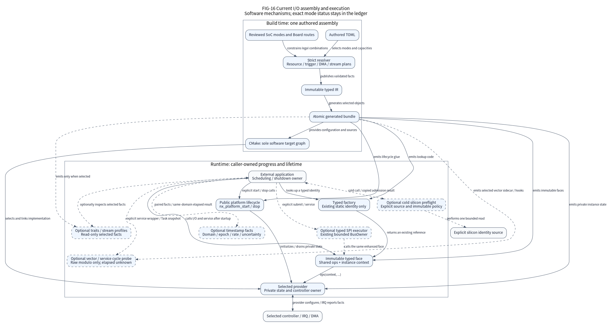
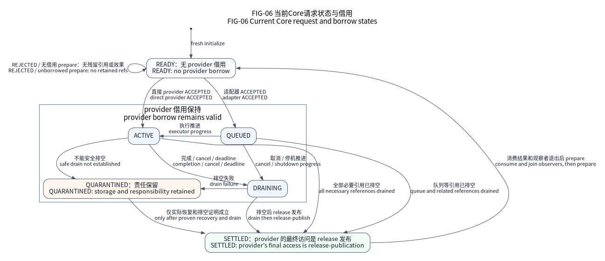

# Ethernet frame loans and the MAC hardware clock

The optional `eth_frames` face adds complete scatter-gather frames, one in-band
VLAN C-tag and MAC hardware-event timestamps. It selects independent provider
state, eight-word descriptors and caller-owned storage. The existing `eth` face
keeps its contiguous untagged-frame contract, four-word descriptors and existing
operations table. Selecting one does not expand the other.

The production implementation is owned by `soc/stm32/stm32f4/` and currently
selects exact STM32F407VET6/ZGT6 MII and STM32F407ZGT6 RMII facts.
The selected static ClockPlan supplies HCLK from 25 through 168 MHz. The seventeen-pad MII A/B/C route includes both PHY clock inputs,
CRS, COL and RX_ER; it does not inherit any PCB wiring. It does not imply full
STM32F4 family coverage or authorize the VE package's missing PG pins. Native is
an explicit C hardware model under `tests/support/native/`, enabled only for host
tests. Public contracts, the MAC engine, the F407 binding, static factory
composition and the canonical ARM image have separate software checks. Physical
RMII, PHY behavior, bus timing, timestamp accuracy and station HIL remain
`not_executed`.

## Assembly and hardware ownership

The maintained normal assembly contract uses an authored
`eth_frames.mac` controller to select `rmii-vlan-sg-ptp` or `mii-vlan-sg-ptp`,
a reviewed matching route, MAC address, exact TX/RX ring sizes, RX-buffer size,
IRQ policy and
finite initialization/drain budgets. The factory contract returns the existing static
`nx_eth_frames_port_t` through `nx_factory_eth_frames(NX_ETH_FRAMES_ID_MAC)`.
Lookup must perform no hardware access, allocation or initialization. The paired
MDIO face addresses the same physical owner through its separate public type.
The canonical `cmake/package/verification/io_evolution/f407zg-eth-frames.toml`
fixture exercises this complete composition using a software-only pin contract.
It does not qualify a fitted PHY or any of the four maintained F407 boards.

Platform owns the System clock lease, pins, RMII selection and MAC/TX/RX/PTP
clock gates. The provider manages its MAC, DMA, PTP counter and IRQ inside that
lease. Old raw Ethernet and enhanced frames cannot own the same MAC concurrently.
A product supplies PHY reset, address, power, autonegotiation/link observation,
network stack, packet classification and shutdown policy outside this repository.

Startup establishes the selected System ClockPlan before MAC access. The F407
provider checks fresh source readiness, actual source status, PLL factors,
AHB/APB dividers, RMII selection and the separate PTP gate. Merely requesting PLL
selection or declaring a configured frequency cannot authorize 16 MHz fallback
or a different actual divider. RM0090 requires Ethernet AHB at least 25 MHz. External RMII REF_CLK at 50 MHz does not establish HCLK or the
PTP input clock.

MDC division follows the reviewed HCLK ranges in RM0090. Fine PTP update
uses a 20 ns increment above 50 MHz, 40 ns above 25 MHz and 80 ns at
25 MHz; each choice keeps the accumulator ratio representable. The addend is
rounded from the actual leased HCLK and the selected increment. Snapshot
resolution reports that increment. These are nominal digital counter facts,
not measured PHY clock accuracy or network synchronization.

The provider rejects foreign/live descriptor tables before reset. Descriptors
and packet storage must be in the reviewed F407 main-SRAM DMA domain: 128 KiB
at 0x20000000. CCM is excluded. Software metadata may use other CPU-accessible storage. The
hardware descriptor stride is 32 bytes; the ST HAL descriptor type has additional
software backup words and is not used as the hardware stride. Official headers
supply reviewed layout/mask definitions; vendor C runtimes, descriptor pools,
mutable global cursors and HAL tick initialization are not selected.

## Complete frames and VLAN handling

A TX request contains immutable `nx_eth_fragment_t` views. Preparation validates
all lengths, pointer overflow and the complete L2 header across fragments before
changing request storage. Empty fragments reject. One EtherType 0x8100 C-tag is
accepted; its TCI remains in the payload. Nested tags, 0x88A8 and length-coded
802.3 frames reject. Untagged frames contain 14..1514 caller bytes; tagged frames
contain 18..1518, excluding preamble, hardware padding and hardware FCS.

The selected mode performs no tag insertion or stripping. PCP/DEI/VID policy,
access-port/trunk policy and VLAN membership belong to the product. Hardware
padding/FCS remain enabled. `checksum_offload` explicitly selects hardware
checksum processing and defaults to false. Raw Ethernet keeps offload disabled.

TX preparation selects `CHECKSUM_NONE`. The READY owner may select IP-header,
payload with caller pseudo-header seed, or full hardware pseudo-header insertion.
Only the first scatter-gather descriptor receives CIC bits; timestamp selection
and all fragments retain their existing whole-frame borrow. An unselected mode
or invalid checksum choice rejects before OWN publication. Hardware format/error
writeback controls success; the driver supplies no software checksum fallback,
packet repair or IP-stack policy.

RX checksum observations require both selected IPC processing and actual last
descriptor ESA. The loan retains explicit IPv4/IPv6, header/payload error,
bypass and payload-type facts; absent or malformed writeback stays unknown.
Checksum-error dropping is disabled so the consumer receives these hardware
facts. L2/DMA errors retain the existing whole-frame discard behavior. Altering
checksum metadata invalidates release identity, just like altering a timestamp
or geometry. Native ingress/egress does not invent computed IP checksums.

| Fact | TX | RX |
|---|---|---|
| Unit | One complete L2 frame | One complete L2 frame |
| Hardware storage | One descriptor per supplied fragment | As many ring buffers as the received frame needs |
| First/last facts | Software metadata selects FS and LS before publication | Actual FS/LS writeback delimits the frame |
| FCS | Inserted by hardware | Excluded from views, including a four-byte FCS spanning two buffers |
| Buffer availability | Complete chain is admitted before any first OWN | A held descriptor is never rearmed or overwritten |
| Result | `transferred` is full caller length on proven MAC success, otherwise zero | All-or-nothing view capacity; no partial public frame |

Admission first checks every fragment, DMA range and free descriptor. Rejection
leaves request and OWN state unchanged. After acceptance the provider records a
PREPARING reservation, programs variable descriptor work without masking IRQs,
then publishes the first OWN only after all following descriptors are ready.
An IRQ cannot interpret a CPU-owned PREPARING descriptor as completed traffic.
Each IRQ advances at most one TX descriptor and one RX descriptor. Intermediate
TX writeback is not whole-frame wire completion; the actual last descriptor
provides the final status and optional capture.

RX acquisition produces one `nx_eth_frames_rx_loan_t` plus caller-provided fragment
views. Too few views return `OVERFLOW` without dequeuing the frame or changing
outputs. Views exclude FCS even when the FCS consumes the whole tail descriptor.
The token retains every hardware descriptor until exact release. Copying a token
creates no additional loan. Stale, foreign, semantically altered and repeated
releases reject. Structure padding is not token identity.

## Borrow, cancellation and recovery

Accepted TX borrows the complete request, fragment array and every payload until
acquire-observed `SETTLED`. A descriptor returning OWN does not release a fragment
independently. RX bytes remain immutable while the complete-frame loan is held.
The view array itself is an unretained output and may be reused after acquisition.
Provider output storage must remain disjoint from provider state, rings, control
objects and all active request/payload loans.

The MAC has controller-wide TX withdrawal. Cancelling one pending request closes
TX admission and drains other pending TX too; it does not invent per-frame abort
support. Actual completed transmission may win cancellation. Timeout, cancellation
and a failed drain never revoke a borrow. Failure to prove engine/MAC/FIFO quiet
leaves requests `QUARANTINED` with their payload addresses retained.

The STM32 ES0182 control-write workaround uses a finite volatile Device-read guard
based on the leased HCLK. The guard exceeds four internal TX/RX clocks at the
slowest supported 10 Mbit/s rate, including RMII's internal REF_CLK/20 divider.
Four HCLK readbacks or the fastest possible 80 ns lower bound are insufficient.
The guard applies to affected control writes, not packet poll/W1C writes. The
provider applies this F407-specific workaround using the selected HCLK.
FIFO empty must be observed before issuing FTF;
flushing a nonempty FIFO cannot manufacture cancellation proof.

Stop closes new admission/acquisition and withdraws MAC/DMA/IRQ references before
releasing storage. Held RX and captured wake publishers return `BUSY`. An optional
wake sink remains borrowed until publishers exit; notification is a hint, not the
completion predicate. The caller separately stops and joins external producers,
consumers, waiters and observers before reclaiming their storage.

Explicit recovery belongs to the exclusive MAC owner. It rejects held RX or live
publishers before issuing reset. Only acknowledged reset may detach incomplete TX
and settle it with its locked failure cause. A reset timeout retains ownership;
there is no automatic reset, retry or replay. Successful reset records an RX gap
and advances the MAC clock epoch. Stop/start preserves RX-token incarnation and
clock-epoch counters so old identities cannot become valid again.

## Timestamp meaning

Every time fact uses the existing `nx_io_timestamp_t`. The assembly contract allocates one
nonzero 32-bit domain from its namespace of real counters; applications cannot
make unrelated counters comparable by assigning the same local device ID.

The selected clock uses digital nanosecond rollover, the HCLK-derived subsecond increment
and fine update. Its accumulator input is HCLK, with addend 1278264076 at the
selected 168 MHz. This value and the stated units are not measured oscillator
accuracy. The counter is not UTC, TAI or a synchronized network clock.

| Observation | Source | Value |
|---|---|---|
| Valid TX last-descriptor or RX last-descriptor capture | `HARDWARE_EVENT` | Extended nanosecond ticks from the MAC |
| Coherent current MAC-counter read | `SERVICE_OBSERVATION` | Same domain, epoch and 1e9 ticks/second |
| Consumer obtains an RX loan | `ACQUIRE_OBSERVATION` | Separate `acquired_us` in the core monotonic domain |
| Missing/corrupt capture | `UNKNOWN` | No usable event measurement |

Capture validity comes from actual TTSS/TSV writeback. A valid zero capture is a
real zero event. Missing validity never reuses a previous descriptor capture.
All-ones or malformed raw capture records a separate corruption flag and an
UNKNOWN stamp, without replacing it with acquisition time. Unknown uncertainty
remains explicit; zero uncertainty is not invented.

Coherent counter reads retry a seconds rollover. Natural 32-bit seconds wrap is
extended without changing epoch. Reset/restart changes epoch. The owner rejects
counter regression within one epoch, ambiguous observation/capture gaps and
64-bit tick overflow rather than assuming how many wraps elapsed. Timestamp
comparison requires matching domain, epoch and rate. Products explicitly
establish event pairing and any cross-clock mapping.

## Validation and remaining physical work

The maintained external MMIO model distinguishes visible register readback from
internal latching, models W1C separately from read-only DMA process state, and
refuses engine withdrawal/reset when fault controls request it. Native ingress
and egress are explicit complete-frame events: they do not automatically service
or settle the provider. Each model instance has its own counter and DMA identity.

The Native source validates active loans under the same exclusion as provider
settlement. A deterministic final-access regression lets the real provider settle
an accepted request and lets its consumer legally protect the reclaimed page;
an old unprotected reader faults. This establishes that software boundary and
does not substitute for physical DMA or complete concurrent-system qualification.

The F407 binding is `soc/stm32/stm32f4/drivers/ethernet_frames.c`; the engine is
`soc/stm32/stm32f4/drivers/ip/legacy_mac/eth_frames_mac.c`. Current GoogleTest
cases under `tests/google/ethernet_frames_*` cover public, engine, F407, Native
and factory contracts. Factory tests exercise real System/GPIO/provider code
against one clock/timer oracle and explicit DMA-visible addresses. Test counts
and linked costs must come from the current commit's execution and ARM artifacts;
historical cross-family totals retain their fixed source identity and do not
establish current candidate acceptance.

Station evidence remains separate: verify PHY clock/reset, routes and electrical
levels, both link rates, DMA traffic under load, control-write timing, VLAN
preservation, error/drain/reset, PTP capture and measured clock accuracy on actual
boards. No board is connected in this environment. Protocol stacks, PHY/PCB
policy, time synchronization and application products remain external consumers.
