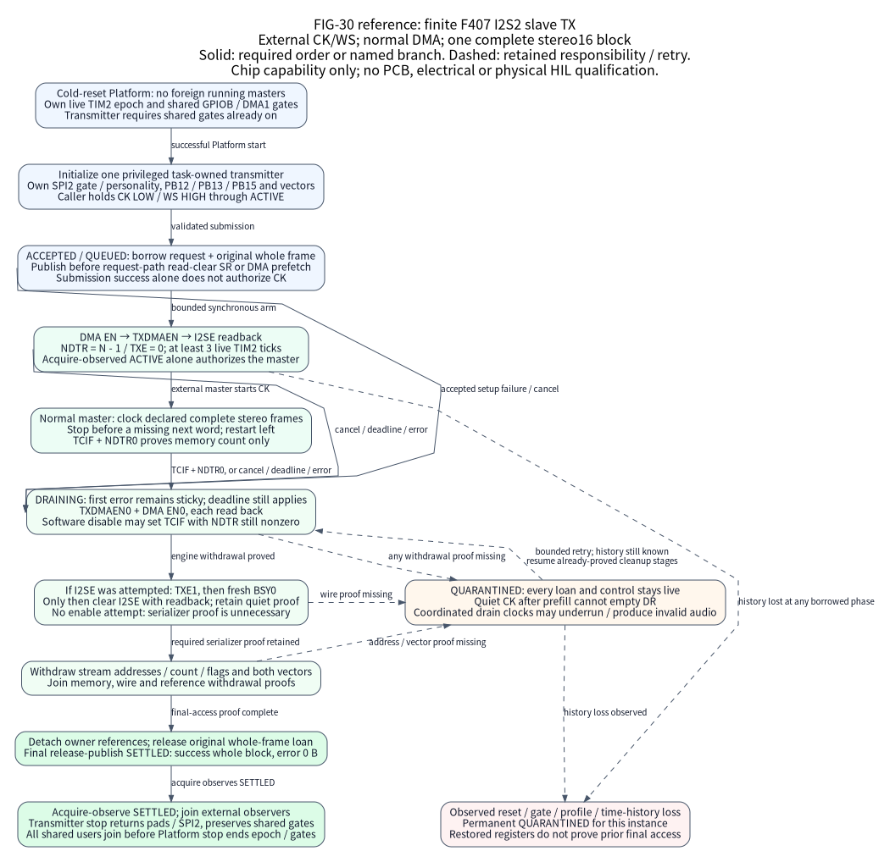

(f407-i2s2-slave-tx)=

# Finite I2S2 slave TX on STM32F407

Use this exact baremetal role to transmit one caller-owned stereo16 frame block
from an STM32F407VET6 or STM32F407ZGT6 under an independently controlled external
I2S master. One task owns the transmitter, the external-clock handshake and
failure drain. The implementation supplies finite normal DMA and explicit final
access; the product supplies samples, rate, codec, master and recovery policy.
Physical HIL is `not_executed`. IO-41 remains `in_progress`; continuous audio,
SAI and PDM remain open.

## Select one physical role

The authored role is `[i2s2]` with
`profile = "slave-tx-stereo16-pb12-pb13-pb15"`. It resolves through the same
validated hardware IR and resource plan as other controllers. A selected SPI2
personality, pin, DMA stream or vector conflict is rejected before generation.
Omitting the role leaves it unselected; it creates no audio owner or target.

| Resource or format | Exact selection |
| --- | --- |
| Chip and clock | STM32F407VET6 or STM32F407ZGT6; baremetal; `hse8-pll168`; live 1 MHz TIM2 |
| Wire | Philips I2S; two 16-bit channels and 16-bit slots; samples leave MSB first |
| Pads | PB12 WS input, PB13 CK input, PB15 SD output; AF5 |
| Engine | DMA1 Stream4 channel0; normal, direct, memory-incrementing 16-bit transfers |
| Exclusive vectors | DMA1 Stream4 and SPI2; sources remain disabled and no IRQ service is installed |
| Payload | One plane, zero offset, contiguous nonempty rows with `stride == row_bytes` and no padding; left then right 16-bit little-endian samples |
| Block size | 4..131068 B, divisible by four; 2..65534 DMA halfwords |
| DMA memory | Entire aligned source span in main SRAM `[0x20000000, 0x20020000)`; CCM is excluded |

For this stereo16 I2S format, `nx_frame_layout_audio` describes successive
audio frames as rows. Keep that canonical layout: a multi-frame block may
have multiple contiguous rows. The provider checks nonempty rows,
`stride == row_bytes` and a bounded `rows * row_bytes == layout.bytes`, then
takes a view covering the actual row geometry. The DMA count and settlement
cover the complete block; there is no per-row loan or completion.

`nx_frame_layout_t` records storage geometry; it does not configure the wire
or validate audio format metadata. The caller still supplies the declared
little-endian stereo16 samples. Other audio-layout helper formats do not
become supported transmitter formats.

The maintained VE input is below. The
[ZG input](../../tools/configure/assemblies/qiming-i2s2-slave-tx.toml) selects
the corresponding exact Board package with the same role.

```{literalinclude} ../../tools/configure/assemblies/sky-i2s2-slave-tx.toml
:language: toml
```

The component target is `Nexus::F407I2S2SlaveTx`, defined by
[its CMake file](../../components/f407_i2s2_slave_tx/CMakeLists.txt) only for
the validated selection. A consumer explicitly links it and constructs one
stable readonly face with shared operations and separate zero-initialized owner
storage. Factory lookup does not create or start an audio owner. The firmware
owner storage is 88 B, excluding caller-owned request, stream, frame and payload
storage. No task, allocation, queue or replay worker is created.

The role uses external CK/WS; it does not enable PLLI2S or generate an audio
clock. Chip AF capability does not establish a PCB route. The assembly supplies
the exact part/package identity: device-group and Flash-density reads cannot
authenticate an F407 or distinguish its physical package. The caller must meet
DS8626 voltage, I/O, load and CK/WS/SD timing requirements and provide adequate
DMA refill margin. This software defines no measured external-clock rate or
additional characterized PCLK-to-CK ratio.

## Keep Platform and transmitter ownership separate

The selected normal Platform startup assumes cold reset with no foreign running
peripheral or bus master. It establishes the fixed clock and TIM2 epoch and
holds GPIOB/DMA1 gates for the Platform lifetime. Clock-gating does not prove
that a retained DMA engine is reset; attachment to unknown gated or running
HAL state is unsupported.

Transmitter initialization requires both shared gates already on. It owns the
SPI2 gate, the SPI2/I2S2 personality, its selected pad fields and both vectors
until successful transmitter stop. It never opens or withdraws GPIOB/DMA1
gates, resets the whole DMA controller or changes neighboring stream/pin state.
Platform tracks its attempted gate additions before writes, preserves
preexisting gates and retains cleanup responsibility if rollback fails.

One privileged unmasked task serializes initialization and every method.
Concurrent Platform stop, reset/reclock/debugger writers and competing DMA,
vector or pin owners are excluded. Failed calls do not authorize storage reuse.
Stop and join the transmitter and every other shared-domain user, including
external HAL users, before Platform stop withdraws its added gates or ends the
TIM2 epoch. Old deadlines cannot cross Platform stop/restart.

## Accept the frame before arming the master



**FIG-30 is a reference lifecycle for this exact role.** Solid arrows show
required order or a named branch; dashed arrows show retained responsibility
and bounded retry. It is based on the public header, provider and selected
System implementation linked below. It establishes neither physical clock
silence nor hardware qualification.

1. Hold CK continuously LOW and WS HIGH before initialization and submission,
   and keep them there until acquire-observed ACTIVE. Register pin reads sample
   instants; the caller's master coordination establishes the continuous quiet
   interval. Each normal restart begins with the left channel.
2. Start Platform successfully, then initialize fresh transmitter storage with
   the stable face and a positive `poll_limit`. Initialization can retain
   cleanup responsibility on IO; keep its storage live and call stop.
3. Build the complete contiguous frame with the ordinary stream/frame helpers
   and acquire its original `nx_frame_dma_loan_t`. Initialize and prepare the
   request with an absolute deadline in the current live TIM2 epoch, and assign
   that loan to its `source`. Controls must be correctly aligned, live and
   disjoint from every full-capacity pool slot, including unused payload tails.
4. Submit through the face. Rejection retains no request or frame reference and
   introduces no submission hardware effect. `NX_SUCCESS` means ACCEPTED: the
   exact whole-frame loan and request are borrowed. The provider publishes
   QUEUED before the first read-clear SR observation or possible DMA prefetch.
   Initialization separately owns cleanup before its SR reads.
5. Submission runs bounded arming synchronously. It programs the full halfword
   count, enables DMA, then TXDMAEN, then I2SE. ACTIVE requires observed I2SE
   enable, one prefetched DR halfword (`NDTR = N - 1`, `TXE = 0`) and at least
   three actual 1 MHz TIM2 ticks after enable readback. `BSY = 0` is not an arm
   prerequisite. A CPU polling count is not elapsed time. The return state may
   already be ACTIVE or DRAINING; QUEUED and ACCEPTED alone never authorize CK.
6. Only acquire-observed ACTIVE authorizes the master to clock the declared
   complete stereo frames. The master must stop before requesting a missing
   next word. The same task calls `service` to observe completion, errors and
   deadline expiry and to progress drain. No provider IRQ advances the request.

An SR read clears UDR/FRE, so each request-path observation occurs after
acceptance and preserves any fault as the first operation error. A later clean
read or late DMA completion cannot turn that error into success. The absolute
deadline covers the whole operation, including wire and final address/vector
withdrawal. Arming observation-budget exhaustion can also produce TIMEOUT; it
does not prove that a particular duration elapsed. `poll_limit` bounds each
observation loop and never guarantees progress by an external master.

## Prove final access before releasing storage

| Observation or stage | Required action and remaining responsibility |
| --- | --- |
| Normal `TCIF` and `NDTR = 0` | Memory-count completion only. Keep the request and frame borrowed. Software DMA disable can also set TCIF with a nonzero count. |
| Cancel, timeout or failure | Preserve the first error and enter DRAINING; every error/cancellation reports zero transferred bytes. |
| Engine withdrawal | Clear TXDMAEN and DMA EN with readback before relying on serializer drain. A failed clear retains the borrow. |
| Any I2SE enable attempt | Observe `TXE = 1`, then a separate fresh `BSY = 0`, before clearing I2SE with readback. An ignored enable write is still an attempted enable. |
| No I2SE attempt | An accepted early setup failure may prove engine and reference withdrawal without waiting for serializer flags. |
| Serializer already proved quiet | Preserve that proof across later cleanup retries; do not demand TXE again from disabled I2S. |
| Reference withdrawal | Clear stream configuration, addresses/count and flags; withdraw and prove disabled, not pending and inactive vectors. |
| Every proof joined | Detach provider references, release the original whole-frame loan, then release-publish SETTLED as the final request access. |
| Missing proof | Retain QUARANTINED storage. A drain-loop bound can return BUSY; timeout, TC or a zero DMA count never substitutes for final access. |

Acquire-observe SETTLED before reading the terminal result or reusing the
request and frame storage. Successful completion reports the full submitted
byte count. Error and cancellation report zero; a DMA count cannot establish
serialized audio bytes. Join external observers before their own storage is
reused. While stop has not closed admission, successful request settlement
keeps the initialized transmitter ready for another separately prepared block;
it does not release its physical role.

With CK idle after prefill, DR cannot empty. Cancellation therefore retains the
loan until the product coordinates enough drain clocks for the actual TXE and
fresh BSY proof. This error drain may underrun or produce partial/invalid audio;
it does not promise a complete stereo frame. Keep the first failure and restart
later only at the left channel. Continuing `service` or `stop` through the same
owner can retry a stalled-clock cleanup while its hardware/time history remains
known.

Observed reset, shared-gate/clock-profile loss or invalid time history while
borrowed permanently quarantines this instance and its loan. Restoring
reset-looking registers cannot establish prior final access. There is no reset
or recovery API that revokes that borrow. A product owns the response to an
unrecoverable controller/master failure.

`stop` closes admission and requests cancellation. Repeat it after service has
proved any outstanding cleanup. Only successful transmitter stop returns the
selected pads/SPI2 personality and SPI2 gate; shared GPIOB/DMA1 gates remain for
Platform users. Failed stop retains every unfinished borrow and owned effect.

## Assess the current evidence

Normal ARM builds passed for the selected VE and ZG I2S2 configurations and the
omitted default. Scoped Native and selection tests, SDK/release checks,
retention checks and both corrected caller-face audits also passed. One
relocated, nonpublishable development Source SDK passed export, rename,
verification, a public C11 consumer link, the selected-image audit and
reverification; this covered one VE image. The
[source-bound evidence](../../tools/testing/evidence/f407-i2s2-20261020/README.md) records
full-image resources rather than isolated driver cost. This is partial
development evidence: it does not qualify the full v10 matrix, clean main,
formal/OCI delivery or physical HIL. The API and full-site build receipts and the final commit gate must be
assessed separately. Original strict Wshadow and harness-setup failures
are retained separately from functional TDD.

The normal public-consumer source is
[f407-i2s2-slave-tx.c](../../cmake/package/verification/io_evolution/consumers/f407-i2s2-slave-tx.c).
It links public construction and whole-frame ownership paths; linking does not
execute those calls. It is not an external clock source or a completed hardware
tutorial. No physical execution or valid audio result is claimed. Continuous
DBM, gapless replay, SAI/PDM, other formats/pads/parts/backends and physical HIL
remain open under IO-41.

The hardware sequence follows RM0090 Rev22 sections 28.4.6–28.4.8 and
10.3.13–10.3.14, with DS8626 electrical requirements and the pinned ES0182
scope. The SPI-only BSY erratum workaround is not substituted for the I2S
shutdown sequence. Source identities are maintained in
[the F407 reference manifest](../../soc/stm32f407/references.json).

See the [public contract](../../components/f407_i2s2_slave_tx/include/nexus/components/f407_i2s2_slave_tx.h),
[real provider](../../soc/stm32f407/drivers/i2s2_slave_tx.c),
[selected System lifecycle](../../soc/stm32f407/private/stm32f407_system.h),
[frame ownership contract](../../io/include/nexus/io/frame_stream.h) and
[qualification boundaries](../delivery/qualification.md).
