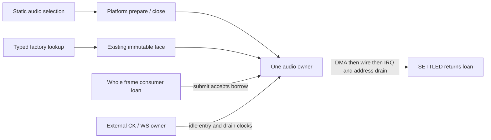

(f407-i2s2-slave-tx)=

# Finite I2S2 slave TX on STM32F407

Select `[audio.sound]` to transmit one whole stereo16 frame loan through the
standard audio factory and Platform lifecycle. The maintained VE and ZG
assemblies use software reference Board packages with explicit chip routes.
They establish no fitted codec, PCB wiring or qualified external master.
Physical HIL remains `not_executed`.

## Select the static audio owner

The [VE input](../../tools/configure/assemblies/sky-i2s2-slave-tx.toml) and
[ZG input](../../tools/configure/assemblies/qiming-i2s2-slave-tx.toml) select
`I2S2`, `slave-tx`, Philips format, 16-bit samples and 16-bit slots. The standard
typed IR claims SPI2's personality, PB12/PB13/PB15, DMA1 Stream4 channel0,
DMA1 Stream4 IRQ and SPI2 IRQ. Conflicting SPI, pad, stream or vector owners
are rejected before generation.

```{literalinclude} ../../tools/configure/assemblies/sky-i2s2-slave-tx.toml
:language: toml
```

| Resource | Selected behavior |
| --- | --- |
| Pads | PB12 WS input, PB13 CK input, PB15 SD output; AF5 |
| DMA | DMA1 Stream4 channel0, normal direct halfword transfers |
| Memory | Complete aligned read-permitted SRAM span; CCM is excluded |
| Storage | One plane, offset zero, nonempty contiguous rows without padding |
| Block | 4..131068 bytes, divisible by four, left then right halfwords |
| Clocks | External CK/WS; no PLLI2S or MCLK acquired in this slave mode |

`nx_frame_layout_audio` can describe successive stereo frames as contiguous
rows. The provider verifies that the row extent equals both `layout.bytes`
and the complete consumer loan length. Layout describes storage; the static
assembly selects wire format. No sample conversion is performed.

Platform startup prepares the selected owner and installs its thin IRQ
connections without starting DMA or I2SE. `nx_factory_audio(NX_AUDIO_ID_SOUND)`
returns that existing immutable face. There is no caller-created hardware owner
or additional initialization authority. The public path is exercised by the
[SDK consumer](../../cmake/package/verification/io_evolution/consumers/f407-i2s2-slave-tx.c).
The broader I2S2/I2S3 format, receive, duplex and master-clock contract is in
[the F407 capture/audio implementation notes](../../soc/stm32/stm32f4/capture_audio.md).



## Coordinate the external master

One privileged unmasked task serializes audio methods and the external-clock
handshake. Before submission, Philips WS must be high and CK at the selected
idle polarity. The product supplies the codec, sample rate, external master and
electrical timing required by DS8626.

`submit` accepts a prepared `nx_audio_request_t` with `tx` pointing to one exact
`nx_frame_dma_loan_t`; `rx` is null. Rejection retains no request or payload
references and makes no hardware changes. Acceptance borrows the complete
request, control and payload until acquire-observed `SETTLED`.

Keep CK/WS idle while explicitly calling `service`. Slave TX reaches `ACTIVE`
only after DMA has prefetched one DR halfword, TXE is low, at least three actual
microsecond ticks and three peripheral clocks have passed, and idle CK/WS
still holds. Frozen time or a lost channel boundary cannot authorize the master
to begin clocking. Start the separately owned master only after observing
`ACTIVE`. IRQs latch completion and errors; no worker or scheduler is created.

## Drain before returning storage

DMA TC and NDTR zero prove memory transfer progress. Final access additionally
requires TX requests off, DMA disabled, a fresh TXE observation followed by a
fresh BSY-clear observation, I2SE disabled with readback, both actual IRQ observers
withdrawn, and DMA addresses cleared. A later refused address or IRQ withdrawal
retains the already established wire proof while preserving the borrow.

Cancellation and an absolute deadline initiate drain. If the external master
stops while DR or the shift register contains a word, drain can remain blocked.
The request becomes `QUARANTINED`; failed stop never authorizes reuse. A failed
DMA-request setup before any I2SE attempt can clean up without inventing a TXE
proof. An unconfirmed I2SE enable attempt retains the possible wire duty.

Platform close first revokes new admission, then cancels and joins the current
request. Refused wire, DMA, IRQ, address or resource withdrawal prevents Platform
from ending the System/time domain. The owner preserves shared DMA1 gates,
neighboring streams and pads; it never resets the shared DMA controller. A
clock/reset/timebase history loss permanently quarantines the old borrow.
Restarting the clock does not recreate its completion history.

## Software evidence and limits

The maintained host program exercises the real C11 owner at independent MMIO,
IRQ, time and memory boundaries, including cancellation, failed stop, late IRQ,
geometry, exact loan identity, counter bounds and inaccessible settled controls.
ARM fixtures link both exact parts through the public factory and Platform path.
These checks establish software behavior and selected linking only. External
clock timing, codec operation, electrical limits and concurrent DMA throughput
require physical execution.
