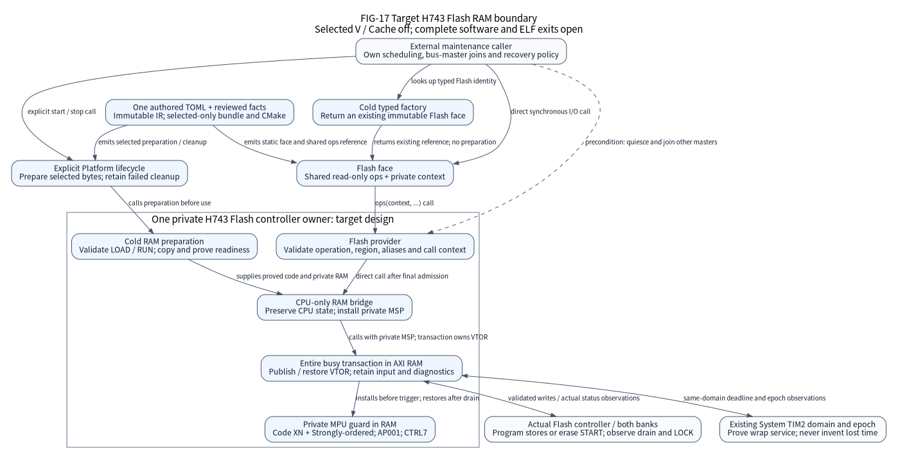
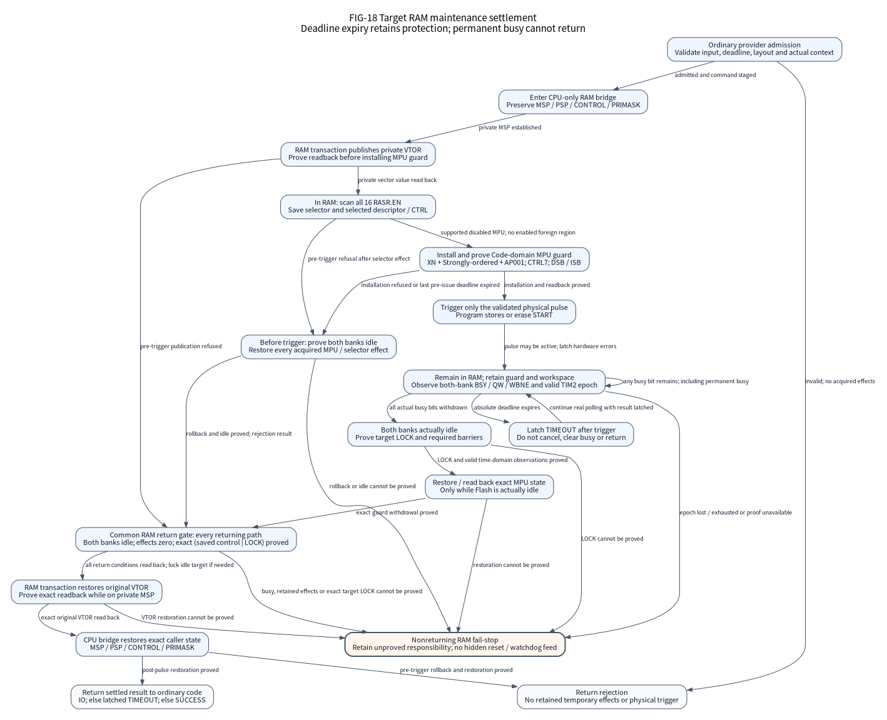

(design-h743-flash-ram)=

# H743 Flash maintenance from a private RAM execution pod

This page specifies the selected STM32H743ZIT6 V/cache-off RAM maintenance
boundary for synchronous program and erase. The ordinary selected link requires
explicit data-operand closure and a byte-checked assembly return gate before an
image is admitted. These checks retain the caller, C/ABI and external-owner
preconditions below. The figures keep their **target IO-24** identity until the
original implementation and evidence exits are satisfied. This page does not
establish a software candidate or physical qualification. Physical HIL is
`not_executed`.

The public Flash face still exposes physical geometry and synchronous operations.
The selected provider now requires cold RAM preparation; it has no fallback that
executes a physical pulse through the former ordinary Flash-resident path.
Existing image/control-alias guards, programming timing and clock ownership
remain prerequisites. Source integration or a successful link alone cannot
establish the entire IO-24 exit.

Flash admission requires V revision `0x2003` for every selected Flash profile,
including fixed HSI32/64 and HSI64/PLL384; unknown cuts are rejected. This
restriction and the selected RAM workspace do not extend to the other peripheral
providers or to assemblies without Flash. Their existing profile contracts
remain authoritative.

## Keep one controller owner and a cold factory

FIG-17 is the **target** architecture and its required ownership boundary; it does
not claim that all implementation and production-ELF exits have passed.
Solid arrows describe the explicitly labelled lookup, call or copy relationship.
The dashed external precondition is a caller responsibility, not a platform task.
The factory returns an existing immutable Flash face; it performs no MMIO,
allocation, execution-pod copy or maintenance. Once acquired, ordinary I/O enters
the selected private provider through the face's shared read-only operations.

| Owner | Responsibility in the target design |
| --- | --- |
| Generated Platform lifecycle | Select only the required private workspace and code; order preparation and reverse cleanup; retain failed cleanup responsibility |
| H743 Flash provider | Validate the physical operation, region, source and destination; stage command/input for the single execution owner |
| Private RAM owner and bridge | Prove copy/layout/context, install a private stack and RAM vectors, preserve CPU state and keep the entire busy transaction in RAM |
| Private MPU guard | Temporarily own the selector, selected descriptor and control changes; prove installation and exact restoration |
| Existing System | Own the monotonic TIM2 domain and epoch; RAM maintenance must preserve that contract |
| External maintenance caller | Serialize calls as the single execution owner; quiesce and join other bus masters and users, provide freshly erased consumer regions and choose watchdog/recovery policy |

There is no second Flash owner, runtime registry, heap, mandatory OS lock, hidden
worker or automatic watchdog feed. Application tasks, update policy, partitions,
authentication and reset policy remain in external repositories.

The [public Flash contract](../../io/include/nexus/io/flash.h) requires one
execution owner and no concurrent program/erase calls. The external caller owns
that scheduling; an active-state check does not provide a hidden concurrent lock.

The generated Platform owns exactly one existing private Flash workspace and
its embedded MPU guard. Public consumers select Flash in the authored TOML,
obtain the immutable face through `nx_factory_flash`, and use the ordinary
Platform start/stop lifecycle for preparation and cleanup. They do not supply a
workspace or include private SDK types. Cold construction rejects a foreign
workspace before copying or publishing ownership; admission, external-buffer
checks and cleanup retain the same fixed binding. The physical binding also
requires the official FLASH, TIM2 and SCB identities and the unswapped physical
Flash base. This adds no RAM storage, allocator or runtime registry.

## Prepare bytes and context before making Flash busy

Cold preparation must validate the selected load/run ranges, copy the audited
code/literals into admitted AXI SRAM and verify the resulting layout before
publishing readiness. Private vectors, stack, command, deadline operands,
workspace and terminal diagnostics must remain in admitted RAM throughout the
busy interval. Selected RAM cannot overlap submitted buffers, executable/load
bytes, vectors, control MMIO, current System state or other private metadata.
Half-open range checks must reject overflow and partial aliases before access.

Public reads, the program path's erased-region precheck and every programmed
flashword readback inspect the current `SNECCERR`/`DBECCERR` sticky flags in both
banks. An observed flag reports `IO`; these physical-data read checks do not
acknowledge it with W1C. This includes events already latched on entry: the
status cannot identify their source or establish recovery from a DBECC exception.
Corrected data may compare equal, so an observed event must be reported before
an all-FF input no-op or a subsequent pulse can hide it. This does not remove the
separate target-bank W1C phase in erase/pulse preparation.

The final call must re-observe actual privileged Thread context, masks, Cache
state and floating-point state; successful cold preparation alone does not prove
the later call context. Entry requires PRIMASK, BASEPRI and FAULTMASK to be zero;
an IRQ call or live lazy FP context is inadmissible. The deadline must be finite
in the existing System TIM2 domain; `NX_DEADLINE_NEVER` is unsupported. The bridge
preserves distinct MSP and PSP, CONTROL including FPCA, and incoming PRIMASK.
Before C runs, it captures incoming MPU CTRL, RNR and region15 RBAR/RASR in
r8-r11, with selector ownership and verified rollback. Selected C instructions
must not write those capture registers. The C transaction publishes and reads
back RAM VTOR before guard installation. After C cleanup, the assembly gate
checks hardware against the protected captures and restores the linker-known
original vector; only then may the bridge restore the caller's exact CPU state.

At bridge entry, the caller must own at least 260 readable/writable bytes below
the incoming MSP and below the active Thread stack pointer: 36 bytes for saved
registers plus a conservative 224 bytes for two nested extended exception frames
and alignment. This reserve is additional to ordinary provider C frames. It
covers transitions before private MSP/RAM VTOR take ownership and after they
withdraw. The private-stack ELF bound separately includes its exception reserve;
it does not prove an arbitrary incoming application stack extent. Original
NMI/HardFault aliases must retain the admitted nonreturning default behavior.
During the RAM window, both handlers name the fixed workspace directly and
remain in the nonreturning RAM diagnostic path.

The source/ELF closure must include actual instructions, veneers, literals,
direct and indirect calls, handlers, terminal paths and compiler-generated
helpers. A section name, C attribute, caller-authored `ram_safe` flag or unused
matching literal is insufficient. Firmware remains C11; test machinery does not
become a firmware dependency.

The normal firmware link for a selected H743 Flash assembly now invokes the
automatic RAM audit. It checks the complete copied pod and workspace against the
actual ELF sections and LOAD segments: the RX run range has one matching Flash
load range, their bytes agree, and the vector, stack and workspace extents are
disjoint from the pod and wholly in writable RAM. The immutable Flash image guard
must contain the actual linked endpoints and cover every file-backed LOAD. These
checks are part of the normal link, rather than only synthetic checker fixtures.
Changing a guard byte in a real firmware ELF is rejected by the same audit.

The audit decodes actual CPU-bridge, return-gate and programming-leaf bytes,
RAM direct control flow and literal residency. Every selected explicit read and
store must resolve to the exact owned workspace/System fields, an allowed MMIO
register and width, a proved stack slot or an in-pod literal. Unknown operands
are rejected. Staged commands, source words and saved command fields cannot be
rewritten by RAM C code. The sole dynamic write base is isolated in the checked
programming leaf: each invocation performs eight fixed staged-word reads and
eight ascending 32-bit stores, with no read through the destination. A bounded
call/CFG analysis permits at most one such invocation per transaction and rejects
positive-count cycles.

The conservative private-stack bound uses emitted compiler `.su` records and
exception reserve. Register/stack/call joins preserve finite alternatives,
including Unknown; exhausted alternative or operand-product bounds reject the
image. Stack-address analysis follows actual direct-call inputs and outputs,
fixed push/pop slots and stack-passed arguments. Register-offset SP loads and
explicit spills of stack-derived pointers fail closed. The layout report
separates copied bytes, workspace bytes and their combined static RAM extent;
alignment outside those extents belongs to the ordinary resource report. These
are selected byte/address and protocol checks under explicit compiler AAPCS,
C object-lifetime and exclusive-ownership preconditions. They do not establish
general C memory safety, measured stack use, timing or physical behavior.

## Protect the CPU from Code-domain speculation

Cache-off is necessary for this reference, but it is not a branch-predictor-off
proof. PM0253 Rev6 describes speculative Normal-memory and branch-target reads;
CCR.BP is read-only and always one, and BPIALL is not implemented. DSB completes
prior explicit accesses; it does not disable later prediction. AN4838 Rev11
section 3.4 recommends using MPU memory attributes to prevent speculative
prefetch. The target therefore combines the audited explicit-access closure with
a temporary Code-domain memory-type guard.

The first admitted implementation requires the actual unified 16-region MPU.
An enabled incoming MPU, unsupported TYPE, or HFNMIENA without ENABLE is rejected.
Disabled CTRL values 0 and 4 are preserved exactly. **CTRL=0 does not prove that
all descriptors are disabled:** all 16 RASR.EN values must be observed. An enabled
foreign descriptor is rejected before policy writes. Scanning RNR is itself an
owned selector effect and must be rolled back on every returning path; a refused
rollback retains responsibility in RAM.

| Selected region 15 field | Target value |
| --- | --- |
| Base and half-open extent | 0; `[0, 0x20000000)` |
| SIZE / SRD / ENABLE | 28 / 0 / 1: 512 MiB, every subregion enabled |
| XN / AP | 1 / 001: no instructions; privileged read/write |
| TEX / C / B / S | 0 / 0 / 0 / 0: Strongly-ordered, implicitly shared |
| RASR | `0x11000039` |
| CTRL | 7: ENABLE, PRIVDEFENA and HFNMIENA |

XN prohibits Code-domain instruction fetch; Strongly-ordered replaces the Normal
memory type that permits speculative reads. AP001 permits the eight explicit
CPU stores needed to program one 32-byte flashword. AP000 would prevent those
stores and is therefore unsuitable for the unified program/erase path. AP001
also permits explicit reads: the independently audited RAM graph must exclude
them. This is not a blanket no-bus-access permission check.

The owner saves the exact observed CTRL and RNR before the first selector
write. After selecting region15 and observing that selection, it captures the
corresponding RBAR/RASR before the first descriptor write. The bridge's independent r8-r11 captures prevent the
final return gate from treating mutable guard state as its own integrity proof.
RBAR readback includes the selected region number, so base comparisons mask the
real register fields. Disabled descriptor fields need not be zero and must
survive restoration. Readback and DSB/ISB prove guard installation before any
program store or erase START. HFNMIENA retains that policy in NMI/HardFault.
The final assembly gate independently checks restored CTRL, selected descriptor
and selector against its captures. Every temporary selector effect is recorded
before a write and cleared only after exact restore/readback. No ordinary
Flash-resident Arch or vendor MPU helper may be called during this window.

## A deadline expires; a physical pulse does not cancel

FIG-18 shows protocol stages, not a new public request enum. Every arrow is a
guarded control-flow transition. The returning path requires the following
sequence; the terminal path has no edge back to ordinary code.

1. Reject invalid input or a deadline already expired before trigger. Prove
   rollback of every acquired pre-trigger selector/protection effect while both
   banks are idle. Every C transaction return, including rejected vector
   publication and guard/deadline refusal, reaches the assembly gate on private
   MSP. It proves both banks idle, zero retained guard effects, the exact saved
   target control plus LOCK, and restored MPU hardware before restoring VTOR.
   An unproved condition enters RAM fail-stop.
2. Stage a validated command and input, enter the RAM bridge, install RAM vectors
   and prove the MPU guard before starting the physical operation.
3. Perform only the explicit validated program stores or erase START. Observe
   real BSY/QW/WBNE for both banks and retain all command/workspace ownership.
4. If the absolute deadline expires after trigger, latch `TIMEOUT` and continue
   actual RAM polling. Do not clear busy bits, withdraw protection, release
   storage or jump to a Flash error handler to manufacture settlement.
5. After both banks are actually idle, prove target LOCK, complete the required
   barrier and restore/read back MPU state in C. The assembly return gate then
   independently checks that hardware against the protected captures, restores
   and reads back linker-known `g_pfnVectors`, and completes DSB/ISB. The bridge
   may restore the exact caller context and return to ordinary code only after
   this gate succeeds.
6. Report the settled result. Hardware failure reports `IO`; otherwise a latched
   expiry reports `TIMEOUT`, and successful completion reports `SUCCESS`.

Permanently busy hardware never reaches the returning path. It remains in the
RAM drain path with protection and storage retained. Unprovable lock, protection,
vector or time-domain state likewise takes a nonreturning RAM fail-stop path.
The bridge, its protected captures and the final hardware gate are checked from
actual ARM bytes; a named C return function or a zero software ledger alone
cannot authorize return. A host watchdog may observe and terminate its isolated
test process; that is not device drain or product recovery. This design promises
no hidden reset, watchdog service, RTOS progress or bounded wall-time return.

The selected deadline uses the existing TIM2 domain and epoch. Any wrap extension
must have an actual supported service/pulse bound; one pending UIF cannot count
an arbitrary number of masked wraps. A lost or exhausted epoch cannot resume
deadline consumers with a plausible zero. RTOS/SysTick compensation and product
time recovery require their own reviewed contract. Long masked Flash maintenance
does not inherit the short Arch critical-section latency contract.

## CPU protection does not quiesce the system

This MPU guard constrains the CPU. It neither stops DMA1/2, MDMA, Ethernet, USB,
display engines and debug access nor joins their late IRQ or publication paths.
Before calling maintenance, the external owner must withdraw and join every
master that can access the busy Flash domain, including descriptors and input
sources, or supply an independently proved disjoint plan. Address ranges alone
do not prove that a worker or bus master has stopped.

The same caller must choose how its product tolerates masked interrupts,
watchdog expiry, power failure and a nonreturning fault. The platform does not
select these policies or infer them from a Board reference. This design does
not admit Cache-on programming, enabled foreign MPU regions, bank swap,
option/OTP writes, every H7 cut, bootloader adoption or runtime clock changes.

## Keep cost and evidence tied to the actual bytes

Selected-only source and instance generation must keep unselected images free
of the RAM pod, workspace and calls. Actual selected/unselected ELF comparison
must separately report Flash LOAD/footprint, copied executable bytes, static RAM,
alignment padding and the real call/exception stack requirement. An array size
or host `sizeof` is not linked cost, measured stack use, throughput or WCET.
This page makes no measured cost, stack high-water, throughput or WCET claim.

The selected PLL384 peripheral reference is authored once in
[h743-high-peripherals.toml](../../tools/configure/assemblies/h743-high-peripherals.toml).
The maintained catalogue, normal preset, generated host factory and installed
Source SDK consumer use that same input. Moving its source authority does not
change its V-cut, baremetal, Cache-off or `poll-word` restrictions.

The existing `performance.yml` qualification-only path accepts this canonical
input with an explicit `gpio` workload and exact source SHA. That workload starts
the selected Platform and exercises GPIO; it does not fetch the public Flash face.
RAM-pod retention alone therefore does not prove retention of every public Flash
operation. The installed public Flash consumer and exact linked retention checks
remain separate evidence. A successful future run can establish only its actual
source, image and reproduced scope; it does not close the full IO-24 exit or
change physical HIL from `not_executed`.

| Evidence required before software exit | Boundary |
| --- | --- |
| Real GoogleTest/GoogleMock RED then GREEN | Actual provider/bridge boundary, failures, late drain and instance isolation; no mock implementation |
| Normal TOML/generated lifecycle and factory tests | One authored assembly, immutable IR, real selected-only constructor and retained cleanup |
| Actual emitted ARM firmware and closure report | Copied bytes, decoded calls/literals/register flow, guard values, no premature return, vectors/stack/time and image/control aliases |
| Selected and unselected ARM resource checks | Exact emitted source graph, retention and separate RAM/Flash costs |
| Clean SDK, full gates and candidate evidence | Exact source/configuration/dependencies/tools; no reuse of older commit results |
| Physical station execution | Real silicon/PCB/electrical conditions, speculative traffic, pulse timing, power loss, watchdog and interrupt behavior |

Synthetic checker fixtures establish only their checker behavior. Host register
models do not measure the real branch predictor, bus contention or IRQ latency.
The physical RAM functions and exception entries name the existing generated
workspace, existing System epoch and official MMIO identities directly. The
assembly return gate consumes the C result and protected MPU captures; it checks
drain, LOCK, restored protection and the fixed original vector before caller
restoration. Byte-defined checks reject missing/reordered reads, comparisons,
barriers or failure branches rather than trusting a function name or argument.

A passing selected audit establishes its bounded explicit-operand and return
protocol proof under the stated caller, compiler and ownership preconditions.
It is not a general C interpreter, speculative-bus measurement or hardware
qualification. Missing production proof remains an open exit. The
[IO-01–42 ledger](io-evolution-execution.csv) remains the implementation-status
authority; per-profile execution, source identities, SDK checks and remaining
software-candidate obligations belong in delivery evidence.

The implementation is split between [cold preparation and admission](../../soc/stm32h743/drivers/flash_ram_owner.c),
the [CPU bridge and assembly return gate](../../soc/stm32h743/drivers/flash_ram_enter.S),
[RAM vector publication](../../soc/stm32h743/drivers/flash_ram_transaction.c),
the [MPU transaction](../../soc/stm32h743/drivers/flash_mpu.c) and
[physical pulse/time observations](../../soc/stm32h743/drivers/flash_ram.c).
Their private workspace and checked C/assembly prefix are declared in
[the RAM contract](../../soc/stm32h743/private/stm32h743_flash_ram.h).
These links locate current work; they do not substitute for the required
execution and production-ELF evidence.

Primary references are PM0253 Rev6 sections 2.3 and 4.6–4.8, AN4838 Rev11
section 3.4, RM0433 Rev9's Flash maps/read-while-write rules and ES0392 Rev15
section 2.1.2. The source-identity record and selected provider evidence must
accompany the implementation review. See also the [H743 provider scope](../../soc/stm32h743/README.md),
[V-only clock contract](h743-high-clock.md), [I/O evolution](io-evolution.md),
[Arch contract](arch-contracts.md) and [qualification boundary](../delivery/qualification.md).
