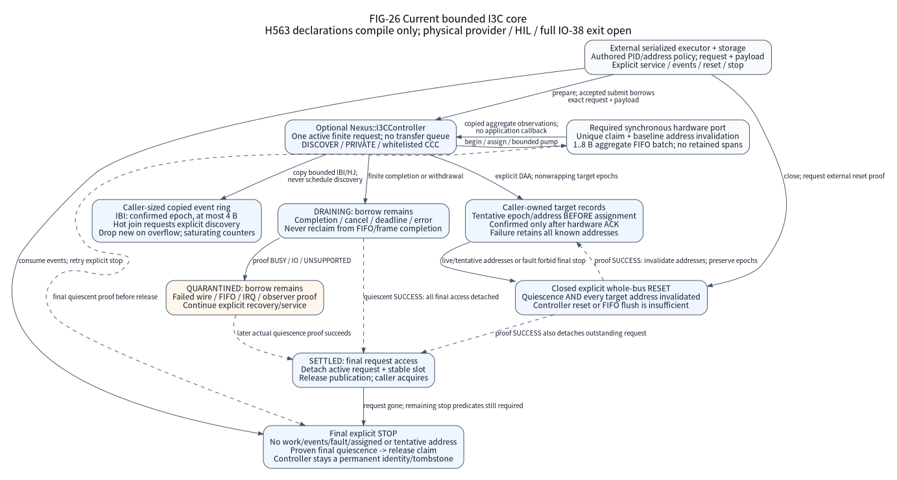

# Bounded I3C controller core

This contract explains how an external controller port uses the optional
`Nexus::I3CController` C11 core for explicit discovery, finite SDR transfers and
copied IBI/hot-join events. The core has no hardware provider for a currently
supported Nexus chip. STM32H563 is a compile-only reference, with physical
initialization, wire drain, reset proof and PCB routing still unimplemented.

The public contracts are
[request and endpoint API](../../components/i3c_controller/include/nexus/components/i3c_controller.h)
and
[caller storage and port contract](../../components/i3c_controller/include/nexus/components/i3c_controller_storage.h).
The caller supplies one controller object, a PID/address policy table, target
state records, an event ring, request metadata, payloads, a monotonic clock and
one immutable hardware operations table. There are no workers, object pools,
implicit discovery or OS locks. One serialized thread executor calls every API;
these APIs do not establish concurrent or IRQ access safety. Every hardware
leaf and injected clock callback must be non-reentrant and must not call the
core, invoke application code or mutate retained core storage.

(fig-26-i3c-core-lifecycle)=

FIG-26 describes the [current implementation](../../components/i3c_controller/src/i3c_controller.c).
Solid arrows label software calls, copied observations or retained state; dashed
arrows label required external proofs. The hardware port is an injected contract,
not an implemented H563 provider. There is one active request and no software
transfer queue; the bounded FIFO work belongs to the external controller port.

## Assembly and operation

The existing component graph exposes an optional static library. External CPU
Runtime consumers select the component explicitly; the Runtime does not generate
a SoC, Board, physical instance or factory. A future physical typed factory may
return an existing controller object; it must not discover a target or substitute
an endpoint for a controller. Caller-authored 48-bit PIDs and conservative dynamic
addresses are policy, not runtime names or factory IDs.

Construction validates representable, aligned and separate controller, target,
event and policy storage, duplicate PIDs/addresses, every required port leaf and
a service batch of 1..8 B before claiming hardware. Rejection retains no storage
or hardware ownership. The port must uniquely claim the controller, IRQs, clock
and pins. Successful claim also asserts an independently established baseline
proof that every target dynamic address is invalidated, including targets that
stayed powered across MCU reset. The caller establishes that proof before
construction; a missing proof rejects without attempting reset or retaining
ownership. Its context and supplied storage must outlive every observer. The caller must
keep complete port/clock context spans separate from all request, payload and
output storage; the core has no declared context extents with which to prove
those aliases.

1. Initialize unused request metadata with `nx_request_initialize`, then prepare
   an explicit DISCOVER, PRIVATE or supported CCC request. Use an absolute
   deadline in the injected clock domain; `NX_DEADLINE_NEVER` is explicit.
2. Submit the request. A rejection leaves the caller's request and output ticket
   unborrowed and unchanged by admission. Successful admission borrows request
   metadata and payload; TX data remain immutable.
3. Call `nx_i3c_service` from the same executor. One call performs one aggregate
   FIFO/event observation with at most the selected batch capacity, or one
   quiescence proof. The port cannot retain command/span pointers or call the
   application. `transferred` counts bytes handed to/from the FIFO, not proven
   target side effects; errors never trigger replay.
4. Read results only after acquire-observing SETTLED. Cancellation and timeout
   request withdrawal and preserve the borrow. Frame completion first enters
   DRAINING. Only actual wire, FIFO, IRQ and port-observer quiescence permits the
   core to detach all references and release-publish SETTLED as its final request
   access. Failed proof enters QUARANTINED; keep request and payload alive and
   continue explicit recovery/service.

PRIVATE transfers contain 1..65535 B. The CCC whitelist permits ENEC/DISEC writes
and direct GETMWL/GETMRL/GETPID/GETBCR/GETDCR/GETSTATUS reads with their defined
lengths. Address mutation, HDR, controller handoff and legacy I2C are excluded.
The core does not interpret product registers or own external recovery policy.

## Discovery identities and reset

DISCOVER is finite and explicit. Each observed PID must match the authored table.
Before requesting an assignment, the core increments that target's nonwrapping
epoch and records its address as tentative. Only the subsequent hardware
assignment acknowledgement confirms the endpoint. An observation can acknowledge
the preceding target and announce the next identity; the core confirms first.
Unknown, duplicate or malformed identities and incomplete assignments fault
admission. Epoch exhaustion rejects a new incarnation rather than wrapping.

A partial DAA failure, cancellation, deadline, controller reset or failed drain
must retain every confirmed and tentative dynamic address. It must not clear the
table or reuse an address that may still be held by a target. Closed admission is
required for `nx_i3c_reset`. Its external port proof must establish both wire/
FIFO/IRQ/observer quiescence and invalidation of **every target's dynamic
address**. A peripheral reset or FIFO flush alone cannot return SUCCESS. A failed
proof retains all requests and records. Successful proof invalidates endpoint
records while preserving their epoch counters; old endpoint and cancellation
identities cannot address a later incarnation. Reopen requires an idle,
unfaulted controller.

## Copied events and shutdown

IBI data contain at most four copied bytes. The confirmed BCR must advertise
IBI capability in bit1; bit2 requires 1..4 B including the mandatory data byte
(MDB), otherwise the event contains zero data bytes. Accepted IBI events carry
the exact confirmed endpoint epoch. Unknown-address, tentative, unadvertised, malformed or oversized IBI observations
increase a saturating rejection counter. A hot-join event has no endpoint and
requests caller-controlled discovery; it never creates an object or starts work.
The caller chooses the positive ring capacity and consumes events explicitly.
Overflow drops only the new event, preserves queued events and increments a
saturating overflow counter. There is no timestamp or loss-free delivery claim.

Close prevents admission while keeping active loans, address records and events.
Stop closes and withdraws active work, returns BUSY while requests or events
remain, and returns STATE while faulted or assigned/tentative addresses remain. In that state, the caller must
explicitly obtain the whole-bus reset proof before final stop; final proven
quiescence then permits release of the physical claim. The
controller storage is a permanent identity/tombstone after stop and cannot be
reconstructed; it and copied ticket/endpoint storage must remain valid until
external controls have joined. Product code owns scheduling, service frequency,
recovery decisions and the final shutdown sequence.

Construction checks duplicate identities/addresses in O(target_count²). DAA and
IBI lookups scan the explicit target count; ring operations are O(1). Each service
pump handles at most the selected 1..8 B batch, one IBI and one hot-join
observation. Caller storage grows with target count, event capacity and exact
request/payload sizes. These are software bounds, not measured wire latency.

## STM32H563 compile reference and evidence boundary

The [compact source and execution evidence](../../tests/evidence/i3c-controller/README.md)
retains the pinned official facts, exact source identities and raw development
records. H563 has one I3C1 peripheral; its control/status FIFOs contain two words
each and TX/RX FIFOs eight bytes each. The hardware target table has at most four
IBI slots. ES0565 Rev 8 requires `NOARBH=0` and the documented SDA pull-up
preparation for 1 ms before controller enable. These facts constrain a future
port; they do not provide a reviewed quiescence or all-target reset algorithm.

The public Cortex-M33 Runtime consumer checks C11/API/link closure only. Compiling
pinned CMSIS/HAL/LL declarations does not establish a physical implementation,
full H5 family support, a board route, voltage/timing qualification, full-speed
operation or real IBI timestamps. Currently supported Nexus chips lack I3C, and
no existing SoC capability is changed. Physical HIL remains `not_executed`.

Host GoogleTest/GoogleMock cases exercise the actual C core while mocking only
hardware and clock leaves. Development RED/GREEN execution logs bind source hashes and raw
results; the ordinary complete-index gates, SDK closure and ARM consumer must
run after integration. Development execution does not establish a clean software
candidate, reproducibility or physical qualification. The original
[IO-38](io-evolution-execution.csv) exit remains open and unchanged.
