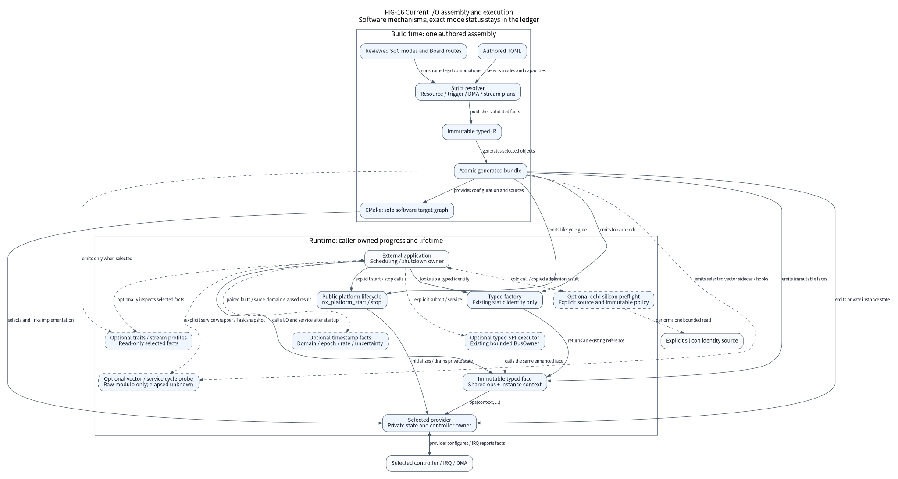

(io-evolution)=

# I/O evolution: static resources and explicit data contracts

Use this page to extend an I/O mode without adding hidden execution, ambiguous
units or a second resource owner. It describes the current iteration's software
mechanisms and their boundaries. The [42-item execution ledger](io-evolution-execution.csv)
owns implementation, software and hardware status; this page does not replace
that ledger or declare the iteration complete. The current [GPIO pin-state
explanation](../explanation/gpio-pin-states.md) describes the exact selected G474
images, retained cold lease and independent provider/Platform cleanup; wake and
retention remain separate work. The sealed `c4249e98` candidate
retains its original scope. New code must establish its own execution evidence.

## Assembly and execution have different responsibilities

**FIG-16 is a current mechanism view, not a hardware qualification diagram.**
The upper group shows build-time facts and generated objects. The lower group
shows runtime calls. Solid arrows carry their written meaning; dashed arrows
mark an explicitly optional mechanism. No arrow creates a scheduler, worker,
global device registry or implicit hardware discovery.

One authored TOML assembly selects reviewed SoC modes and Board routes. The
strict resolver checks fields, capacities and resource constraints before
publishing immutable typed IR and an atomic generated bundle. CMake remains
the only software target graph. An invalid input does not select a convenient
fallback or leave a usable partial configuration.

The generated factory returns an existing static face by typed identity. Lookup
does not allocate, initialize hardware, read silicon, acquire locks or start
tasks. After explicit startup, ordinary I/O calls the face's shared read-only
operations table with the instance's private context. Applications own execution
progress, scheduling and shutdown. Optional enhanced faces share their intended
controller owner; a second face does not grant a second hardware executor.

The diagram's source contracts are [factory and instances](../explanation/factory.md),
[ownership](../explanation/ownership.md), [configuration generation](build-system.md),
the [typed IR](../../tools/configure/ir.py) and the public headers linked below.
The [editable DOT](../assets/diagrams/io-evolution.dot) owns diagram topology;
locale labels do not change its edges.

## Describe resources before generating instances

The resource, trigger and DMA plans are compiler output. They let reviewers see
why a selected combination is legal; they do not program an additional hardware
mode or create a runtime resource manager.

| Plan | Responsibility | Boundary |
| --- | --- | --- |
| [Resource graph](../../tools/configure/resource_graph.py) | Physical IP aliases, personalities and hierarchical claims | Existing controller-exclusive modes remain exclusive; compatible sharing needs exact reviewed facts |
| [Trigger graph](../../tools/configure/trigger_graph.py) | Event source, route, sink, startup ordering and stop responsibility | Existing Timer-to-ADC-to-DMA routes are projected as facts; a new graph edge is not a new trigger provider |
| [DMA topology](../../tools/configure/dma_topology.py) | Separate execution lanes from requests; validate descriptor spans, memory, Cache and security facts | Validating a descriptor chain does not implement linked-list DMA execution |
| [I2C timing](../../tools/configure/i2c_timing.py) | Check explicit clock and electrical bounds using exact arithmetic | The calculated unstretched-master rate is not measured bus speed or an allowance for unsupported filter settings |

Startup dependencies must form a directed acyclic graph. A runtime event chain
may contain an explicitly autonomous cycle, but its declared stop owner must own
the whole cyclic component and its stopping action must cut every cycle. This
is a configuration proof about supplied facts, not proof that silicon has stopped.
IRQ, DMA, bus and request drain still follow their provider contracts.

Do not infer that two timer channels can share a controller merely because their
pin assignments differ. Common base frequency, update events, trigger outputs,
break inputs, reset and clock ownership can still conflict. Likewise, two typed
interfaces for one physical IP do not create two independent peripherals.

## Bind declared stream budgets to the actual pool

An optional [stream profile](../../io/include/nexus/io/stream_profile.h) binds
immutable capacity assumptions to one selected continuous UART or ADC face.
The [resolver](../../tools/configure/stream_profiles.py) generates this constant
only when the assembly authors a profile. Factory lookup returns that existing
profile; it neither creates a pool nor starts acquisition. Unprofiled entry
points retain their own contracts and do not implicitly enforce this profile.

The current F407/F470 double-buffer modes require two hardware targets, one
replacement and enough additional blocks for the declared FIFO-frontier release
delay. The calculation rounds retained blocks up and checks integer overflow,
the 32-bit address extent and the 16-bit DMA counter. Target-replacement latency
must be strictly shorter than a block's declared fill time. UART units are
bytes; ADC units are complete scans containing one `uint16_t` per selected
channel. ADC resolution bits do not change this storage width.

Cold profile admission checks the caller's actual block count, equal capacities,
existing loans, state and payload/control disjointness before invoking the
original provider. Pool users must already be joined. Alias checking is bounded
by the configured pool and is quadratic; it adds no checks to the IRQ or steady
data path. The application still owns pool storage, consumer release order and
execution progress. Rate, release delay and IRQ latency are authored assumptions,
with `physical_qualified = false`. Exhaustion stops and reports a gap. It does
not create UART backpressure, lossless transport or preservation of ADC samples
that would have occurred while the trigger was stopped.

## Optional traits report selected behavior

The existing `factory.capabilities` switch controls generated read-only trait
objects. [Selected I/O traits](../../tools/configure/io_traits.py) describe a
reviewed provider and mode, including formats, limits, abort scope, continuity,
timestamp origin and DMA policy. Turning the switch off emits no new trait
objects. It does not change the two-pointer base face or add mutable device state.

A continuity value such as `double_buffer` or `rearm_gap` describes a mechanism,
not demonstrated throughput. A Cache line requirement describes the selected
provider policy, not proof that a particular clock profile enabled Cache. CAN
mailbox counts are provider-specific facts. Traits grant neither Board wiring
authorization nor physical qualification and cannot override admission checks.

Controller and endpoint records describe their own interfaces. Do not apply a
parent controller's byte-SPI or ordinary-I2C limits to an enhanced endpoint.
A per-request word-width marker does not mean unlimited length. Check the
selected face, count units and provider limit before allocating caller storage.

## Cold silicon admission is an explicit step

[Silicon preflight](../../core/include/nexus/core/silicon.h) reads one explicit,
bounded source in caller-serialized cold Thread context. It copies device-group,
revision and Flash-density observations and compares an immutable policy. It
does not discover devices, enable clocks, change option bytes or retain a loan.
The default platform does not invoke this optional helper automatically.

A device group and Flash density cannot prove an exact orderable part, package
or PCB. Revision rules bind a reviewed source digest and required workaround
mask; the helper does not authenticate that source or prove a workaround was
implemented. Unknown revisions require rejection or an explicit unreviewed
policy. That policy cannot bypass a blocked revision, missing observation,
device or density mismatch, or missing required workaround.

The caller decides whether to start hardware after admission. Reading a revision
does not establish electrical behavior, errata coverage for every mode or HIL.

## Use units that match the selected data path

The enhanced contracts are separate typed interfaces. Their existence does not
change the limits of the ordinary byte interfaces or enable a mode in every
provider. Current generated selection and execution status remain in the ledger.

| Mechanism | Units and ownership | Current boundary |
| --- | --- | --- |
| [UART frame description](../../io/include/nexus/io/uart_format.h) | Data bits exclude parity; stop and flow settings are explicit | Provider and reviewed Board routes must admit the combination; changing a format is a cold operation |
| [UART words](../../io/include/nexus/io/uart_word.h) | Each `uint16_t` carries a nine-bit value; counts and transferred prefixes are words | Independent Native, STM32F407 and GD32F470 IRQ paths; DMA and other providers do not inherit this interface |
| [SPI whole-CS transaction](../../io/include/nexus/io/spi_transaction.h) | Up to 16 segments, one common 8/16-bit word width, complete-word prefix | Synchronous polling extension with explicit provider limits; existing byte-span and finite DMA contracts remain separate |
| [Segmented SPI DMA](../../io/include/nexus/io/spi_dma_transaction.h) | Words; explicit TX/RX addresses and caller-owned fixed cells; one width across at most 16 segments | Independent asynchronous request contract; provider integration and software verification remain specific to the selected mode |
| [Long I2C messages](../../io/include/nexus/io/i2c_long.h) | Bytes; one START per message; a later message causes repeated START | Enhanced messages allow up to 65,535 bytes; ordinary messages retain their existing limit and require no additional face |
| [ADC integer format](../../io/include/nexus/io/adc_format.h) | Explicit signedness, byte order, storage width, padding and scan order | Layout validation and decoding do not add injected conversion, wider acquisition or synchronized ADC hardware |
| [PWM group](../../io/include/nexus/io/pwm_group.h) | A complete fixed-base duty/trigger batch in declared timer ticks | A coherent staged batch is not an observed update; generated selection, analog wiring and ADC synchronization are separate exits |

UART word requests retain the ordinary ACCEPTED-to-SETTLED borrowing rule. A
cancel or deadline never returns the request or payload early. The owner keeps
servicing wire completion and drain; failure to prove drain retains QUARANTINED
storage. Byte UART buffers and state do not become nine-bit buffers implicitly.

F407 and F470 RX-only DMA modes now use a compact receive owner with ordinary
IRQ TX. Only a duplex DMA mode embeds the separate TX-DMA extension. Both reuse
the same receive loan algorithm and shared read-only public operations layout;
there is no stored optional implementation pointer or runtime TX-provider
selection. RX-only operation does not acquire or withdraw the unrelated TX-DMA
lane. Duplex vectors decode their real outer owner and its separate components.
The receive pool excludes the complete duplex object, including its extension.

RX and TX admission exclude both the TX payload and the complete TX request
descriptor from every future RX target, in both admission orders. Stopping first
closes admission and drains RX producer and consumer loans, then drains selected
TX memory and wire activity, and finally withdraws the UART and RX vector.
Failed drain retains the corresponding storage and responsibility. Actual linked
ELF comparisons determine Flash and RAM savings; host `sizeof` expectations alone
do not establish MCU costs or an unchanged instruction path.

The separate H743 `dma-duplex-continuous` selection combines continuous RX
with finite TX DMA on one USART3 owner. Its exact V/HSI64/baremetal reference
uses AXI SRAM with Cache off or on; requests and the complete RX pool remain
disjoint and borrowed through their respective drain. The existing
`rx-dma-continuous` selection retains IRQ TX. See the
[H743 provider contract](../../soc/stm32/stm32h743/README.md#selected-continuous-rx-and-finite-tx-dma-duplex)
for the three-vector, cold-restart and retained-taint boundaries. Neither
selection expands to RTOS, PLL384 or D2 RAM.

The synchronous whole-CS interface validates every segment and data span before
hardware use. A null TX pointer
means repeated dummy words, a null RX pointer means discard, and both may be null
for clock-only phases. All segments share one asserted CS interval. Polling
return releases the synchronous borrow only after CS is released and either wire
drain or provider reset is proven; timeout cannot preempt an in-flight word.
An error never replays earlier command phases. The asynchronous segmented
interface has a separate admission, descriptor and cancellation contract.

The STM32F407/GD32F470 segmented DMA mechanism is a service-driven finite chain.
Hardware DMA moves one segment, then the owner proves its drain before service
arms the next. CS stays asserted across segments, but SCK gaps are permitted;
this is not hardware linked-list DMA or a gapless transfer guarantee. The request,
all descriptors, all spans and explicit fixed dummy/discard cells stay borrowed
until acquire-observed SETTLED. Intermediate completion, cancel and timeout do
not release them. Caller-driven service remains necessary; wake attachment and
recovery capabilities cannot be inferred from the base SPI port.

The optional [segmented SPI owner](../../components/bus_owner/include/nexus/components/spi_dma_owner.h)
adapts this enhanced face to the existing bounded BusOwner queue. Caller-supplied
slots and epochs remain the queue authority; no worker, payload copy or second
controller owner is added. One uniquely scheduled executor services the inner
request. Only after acquire-observed inner SETTLED does it detach private
descriptor references and allow outer settlement. Queue time counts toward the
outer deadline. Failed drain retains inner and outer borrows; late cancellation
cannot replace an earlier terminal result.

An owner binding must prove that the endpoint's actual provider controller
matches the selected enhanced controller. Matching a common sequence table and
logical parent pointer alone is insufficient. The Native word model supplies an
independent backend and checks its actual model-controller identity; it models
8/16-bit words, fixed cells, selected CS, faults and retained drain rather than
forwarding to a byte-SPI implementation. A model's controller identity is a
software identity, not observed silicon. Family hooks, generated owner bindings,
publisher handoff and each target's execution evidence remain separate checks.
Join publishers and observers before reclaiming their storage; an empty queue
or a stopped transfer alone is not publisher join.

I2C hardware reload advances a long message without inserting another address
phase. STOP and successful bus-idle observation precede successful return.
On failure, the returned byte count records provider progress, including writes
handed to TXDR before their wire ACK is known. The count does not authorize replay.
Cancellation or failure does not justify replaying an acknowledged prefix or
silently performing bus recovery. The enhanced face and base I2C interface share
one executor. Timing inputs must include their reviewed clock and electrical
bounds; a calculation is not a measurement of rise time or clock stretching.
After physical STOP and bus idle are proved, refused STOP-flag or CR2 cleanup
reports IO and preserves the actual progress count. The controller retains fault
responsibility and rejects new admission until explicit recovery; already-drained
caller storage may return.

ADC decoding reads only consumer-owned or acquired, producer-detached storage.
It handles one-to-four-byte integer samples without allocating, retaining a
pointer or performing calibrated voltage conversion. The consumer must first
join producer/DMA access. Declared regular/injected groups and trigger identities
describe an already supported mode; they do not start conversion or turn a
software observation into a sample-aperture timestamp.

The G474 `shared-fixed-pwm` selection gives two ordinary PWM factory faces one
physical TIM3 owner: CH1/PA6 and CH2/PA7 AF2, with a common fixed 170 MHz kernel,
tick and period. The two existing declarations derive one cold construction,
two readonly channel references, compatible base claims and exclusive lane/pad
claims. There is no authored share flag, runtime registry, timer IRQ or DMA.
Each set changes only its own CCR preload. A channel joining a running peer
adopts the current phase without UG or counter restart; independent calls do
not provide coherent group start or a full first pulse. Channel stop preserves
the peer and establishes its own declared inactive GPIO level; only the last
lane stops CEN. The lifecycle caller quiesces both channel users before final
Platform stop. Physical close precedes outer pin/clock release, retaining
cleanup responsibility if reset, inactive-level or restoration proof fails.
The [canonical software reference](../../cmake/package/verification/io_evolution/g474-pwm-shared.toml)
requires the complete pair and excludes other whole-TIM3 or PA6/PA7 owners.
Its Board choices do not establish PCB wiring, electrical safety or HIL.

PWM group commit stages one coherent shadow batch; `SUCCESS` does not prove the
timer already applied it. A partial hardware-write failure must withdraw output
and retain fault responsibility. Clearing a break does not enable output. The
ordinary G474 PWM-group provider does not supply PCB pin selection, analog
threshold measurements or a power stage, and does not itself create a
synchronized ADC session. A selected software reference now generates exclusive
TIM1/COMP1 construction, fixed
PA8/PA9/PA10 PWM pads and PA1/PA4 comparator pads. Its cold lifecycle owns the
selected clock/reset, safe levels, comparator setup and settling, shared break
vector and reverse cleanup. Partial cleanup failure retains responsibility.
The separate [finite coupled PWM/ADC owner](pwm-adc.md) now binds one fixed
TIM1/ADC1/COMP1/DMA window without independently startable PWM-group or ADC
subfaces. Neither selection establishes a fitted PCB route or analog accuracy.

Separate concrete G474 providers implement TIM5 CH1 capture on PA0 and TIM3
two-input quadrature counting on PA6/PA7. Capture publishes raw 32-bit counter
facts and explicit overcapture/loss under its bounded ring contract. Encoder
reports a raw 16-bit count; it does not extend wrap, supply an index input or
estimate speed. Separate
[capture](../../tests/contracts/g474_control_assembly/timer-capture.toml) and
[encoder](../../tests/contracts/g474_control_assembly/encoder.toml) software
references now generate their own static faces, typed getters and cold
pin/clock/vector lifecycle with whole-timer ownership and source/vector drain.
Startup starts neither a capture session nor encoder counting. The application
supplies the capture ring and explicitly starts and stops each session. Failed
source/vector or storage drain retains cleanup
responsibility. These exact selections do not inherit PWM-group capabilities,
synchronize ADC apertures or establish external wiring. Product control and
recovery policies remain external.

## Preserve a single owner for H743 Flash timing

The selected fixed-HSI32/64 Flash path checks actual clock, requested and observed
voltage scale, Cache state and Flash programming-delay fields before a program
or erase pulse. Read latency alone does not satisfy the programming contract.
An optional cold timing owner changes the reviewed Flash field only with both
banks idle, verifies readback and retains its saved state until reverse cleanup
has safely restored it. The generated Flash assembly selects this owner; a build
without Flash does not acquire it. Product erase regions and recovery policy
remain outside this repository.

This is a bounded programming-timing correction for the selected existing clock
profiles. It does not enable a new high-speed clock, change option bytes, qualify
all silicon revisions or establish physical Flash endurance. The separate
selected [V-only HSI/PLL384 reference](h743-high-clock.md) now implements distinct
CPU/bus/kernel clock domains and a cold clock/voltage/Flash lifecycle. Its joint
owner replaces the fixed-HSI Flash timing owner for that high profile; support
does not extend to unreviewed cuts, Cache-on execution or physical qualification.

The selected V/cache-off Flash implementation now requires the
[private RAM maintenance boundary](h743-flash-ram.md): cold copy/readiness,
one selected workspace, a CPU-only stack bridge, RAM-owned VTOR and a temporary
MPU guard. Deadline expiry after trigger only latches the result; actual both-bank
drain, LOCK and protection/vector restoration precede any return. Production-ELF
closure and complete software exits remain open, so IO-24 stays `in_progress`.

## Observe time without inventing timing guarantees

[Timestamp facts](../../io/include/nexus/io/observation.h) distinguish hardware
events, IRQ observations, service observations and acquire observations. A
caller supplies extended ticks, a domain, an epoch, an exact stated tick rate
and explicit uncertainty knowledge. The domain owner extends counter wrap and
changes epoch after discontinuity, reset or rate change.

Elapsed-time comparison requires matching domain, epoch and rate, ordered ticks
and a representable uncertainty bound. It does not synchronize clocks, convert
time domains, access a hardware clock or prove that two facts refer to causally
paired events. Unknown uncertainty is different from a known zero bound.

The optional timestamp budget evaluator consumes these same facts in O(1)
work. It reports `WITHIN` only when the complete error interval fits the
inclusive maximum, `EXCEEDED` only when its lower bound exceeds that maximum,
and `UNKNOWN` otherwise. A successful comparison does not by itself mean
within budget. The public timestamp contract owns the exact units and errors.

Checked UART/SPI/I2C service reports an invalid face or an absent service method.
`SUCCESS` establishes one dispatch only. It does not establish progress, health,
SETTLED, wire completion or permission to reclaim storage. The ordinary service
context, serialization and lifetime rules still apply, with no hidden worker.

The optional [raw cycle probe](../../io/include/nexus/io/cycle_probe.h) brackets
one selected vector or one explicit typed service call with real Arch counter
snapshots. The initial generated path accepts `probe = true` inside
`[uart.NAME.irq]` only for a reviewed F407/F470 IRQ-word UART selection. It adds
one sidecar per physical vector and
a pure typed getter for that sidecar. Unselected macros evaluate no arguments,
create no sidecar and add no provider state or operations-table fields. The
optional library is linked only when selected; linked ELF checks establish the
actual default and selected cost.

The exact F407 Qiming USART1 and GD470 Liangshan USART0 word references now
have linked probe-off/on evidence. OFF retains none of the optional observer's
sidecar, probe/counter helpers, probe getter or observed-service symbols; ON
brackets exactly one original provider IRQ dispatch. Their original provider
state sizes remain unchanged. The links also retain the explicit service
wrapper; they are not runtime I/O captures.

A readable counter pair is a raw modulo-2^32 difference, including probe cost
and preemption. Multiple wraps, reset and clock-epoch continuity are unknown;
`elapsed_known` is always false. The probe neither enables nor resets DWT.
Unavailable samples and same-sidecar reentry are counted, and diagnostic totals
saturate instead of wrapping. Different nested vectors require distinct
sidecars. This is neither elapsed-time validation nor IRQ arrival latency,
exclusive execution time or a passed budget.

Privileged Task snapshot saves and restores the incoming local interrupt mask
for a bounded statistics copy. A task producer must use that same executor or
be joined before reading; masking local IRQs does not join another preempted
Task, core or security state. Reclaim joins all tokens, producers and readers.
Typed UART-word and segmented-SPI service wrappers dispatch the original service
once even when observation is unavailable. Observation failure never stops
drain or releases a QUARANTINED borrow. Consumers must prove private state and
borrowed storage disjoint from the optional observer. Raw probe samples cannot
be promoted to validated timing budgets without independent continuity proof.

The [HIL measurement protocol](../../tools/hil/README.md) uses schema 2 for
measurement runs, contexts and traces. Cycle measurements require actual DWT
endpoints, a live owner/epoch, admitted independent capture-clock facts and a
CPU-frequency envelope covering that counter epoch and capture interval. This
envelope must include actual oscillator tolerance, calibration and drift. A
nominal rate or authored wrap limit cannot replace it. This does not change the separate
SoC, OS or selected-mode raw protocols. IO-05 is implemented within this selected
software scope; physical execution remains `not_executed`.

## Prepare exact HIL protocols without promoting software facts

The existing [HIL workload planner](../../tools/hil/workloads.py) now contains
four additional exact protocols. Selection inspects resolved controller and
endpoint facts; a chip's advertised peripherals do not select a workload.

| Protocol | Required selected mechanism | Additional station obligations |
| --- | --- | --- |
| `uart_word_wire` | IRQ 9N1 word face and word RX profile | MCU/FPGA peer with native nine-bit hardware and raw bit-8-preserving captures; waveform and load/TC/settlement order |
| `spi_dma_whole_cs_segments` | Enhanced DMA face and same-controller `spi-dma-transaction` endpoint | CS/SCK/data waveforms, fixed-cell tests and independent memory/wire drain facts |
| `i2c_v2_long_timing` | G474/H743/U575 long endpoint and authored AF50..260 ns/DNF0 timing projection | Measured clock, rise/fall and voltage; 255/256/257/511/512-byte boundaries; TXDR progress separate from wire ACK |
| `pwm_group_comp_break` | Exclusive generated G474 TIM1/COMP1 and its exact five-pad route | Analog limits, passive loads, coherent commits, break latch, safe stop and IRQ join |

Plans remain `prepared_unbound` and every physical case remains `not_executed`.
The authoring template leaves instrument identities and limits null. Full
workload and station admission still require a separately selected, reviewed
8N1 byte smoke console. An eight-bit USB serial adapter cannot validate nine-bit
words; a word-only or no-console software fixture does not satisfy that station
contract. Actual instruments, positive workload amounts, waveform acquisition,
numeric limits and equipment execution remain necessary. No new acquisition
schema, hidden hardware action or qualification follows from these selectors.

## Cost and validation stay visible

Build-time resource plans do not impose a runtime graph walk. Optional traits
are constant data. Separate enhanced faces keep the simple path independent;
their selected provider state, buffers and code still cost space and must be
measured in an actual linked image. Segment validation depends on descriptor
count, and silicon-policy validation depends on rule count. Do not infer cycles,
worst-case latency or zero memory growth from an interface diagram.

The following static observations bind clean source
`bacdc5b8a5d64baebb92517e770d0abac28421b8`, baremetal and `-Os`, with zero heap
and a reserved 2048-byte MSP. The metadata reference selects Qiming
STM32F407ZGT6, HSE8/PLL168, UART1 IRQ bytes at 115200 baud with a 32-byte RX ring.
B enables traits but permits garbage collection; C uses the same compiled
objects and explicitly retains the traits getter. A disables traits and also
links to 8012 Flash bytes, but its different comparison profile is rejected by
the strict A/B comparison; equal totals do not override that rejection.

| Exact link treatment | Flash load / footprint bytes | Reserved SRAM bytes, including MSP |
| --- | --- | --- |
| F407 byte UART traits, B→C | 8012→8052 (+40) | 2256→2256 (+0) |
| F407 word UART whole probe selection, OFF→ON | 7636→8356 (+720) | 2248→2288 (+40) |
| GD470 word UART whole probe selection, OFF→ON | 9228→9952 (+724) | 2220→2260 (+40) |

The metadata delta is one 24-byte readonly trait record and its 16-byte getter;
it adds no reserved SRAM and leaves the ordinary UART producer objects
unchanged. It does not establish whole-system runtime equivalence. The word
references use 9N1, 115200 baud, 32-word RX and priority 5; F407 uses HSE8/PLL168,
GD470 HXTAL25/PLL200. Their 40-byte SRAM delta is a 36-byte sidecar plus four
bytes of alignment padding. Provider state remains 56/48 bytes, and face/ops
stay readonly.

Probe ON includes the sidecar/getter/snapshot fixture and an explicitly retained
service wrapper. These are whole optional-selection costs; the actual comparison
profiles differ, so they are neither a strict same-profile comparison nor an
isolated pure-IRQ cost. No I/O traffic was run. IRQ/service duration, arrival
latency, WCET, energy and physical HIL remain unmeasured or not executed.

The original command receipts, raw logs, ELF/map artifacts, independent reviews
and failed attempts are retained once under
`tools/testing/evidence/io-linked-cost/`. Its `portable-index.json` identifies
each unchanged package envelope, member manifest and compact archive. Use the
existing evidence-store verify/restore commands with the indexed archive path;
these records describe the pinned source above, not qualification of a later
commit.

| Evidence | What it establishes | What it does not establish |
| --- | --- | --- |
| Metadata and resolver tests | Rejection and generated-plan behavior for supplied facts | New hardware execution or a reviewed PCB route |
| GoogleTest/GoogleMock and register models | Executed production-code contracts under the stated host model | Real IRQ latency, electrical timing, uninterrupted throughput or power |
| ARM ELF, map and resource checks | Actual compilation, linking, retention and static budgets | Runtime correctness or measured stack high-water marks |
| Fresh offline builds and candidate verification | Their exact clean source, SDK and same-artifact software scope | Qualification of later commits or physical hardware |
| Physical station execution | The exact Board, firmware, wiring and measured conditions | Automatic qualification of a family, package or unrelated mode |

The current iteration's physical status remains `not_executed` until a station
runs the applicable checks. Applications, protocol policy, product partitions,
control algorithms and recovery policy remain in external consumer projects.

## Work that is still a separate implementation

The ledger retains the exits for broader linked-list DMA selections, broader
high-throughput H743 configurations, U575 general peripheral LPBAM, broader or
continuous synchronized control groups, advanced Ethernet/USB, external storage,
TrustZone services, multicore transport, audio and frame devices. A public type,
validated topology or model does not complete these exits. Each mode needs its
own provider, reviewed route, failure and ownership tests, ARM/SDK checks,
resource costs and physical evidence where applicable. Finite
[U575 UART GPDMA TX](u575-uart-gpdma.md), its separate
[hardware-chain TX selection](../../soc/stm32/stm32u575/README.md#optional-usart1-finite-hardware-chain-tx), the [joint PWM/ADC window](pwm-adc.md), selected
[G474 CAN FD modes](can-fd.md) and the separately selected
[finite SRAM4/LPDMA1 channel-0 Stop2 copy](u575-stop2-copy.md) now have specific
software paths; those selections do not complete the broader exits or establish
external wiring, measured performance or HIL. The finite GPDMA chain implements
actual hardware node fetch and descriptor/payload drain for one contiguous SRAM1
source. That GPDMA selection does not select noncontiguous scatter/gather,
circular chains, RX DMA or autonomous low-power execution. The separate SRAM4
copy uses the same concrete Stop2 owner for AlarmA14, independent WUT escape and
compound RTC/DMA/IRQ/gate/clock final release; general peripheral LPBAM and the
full IO-32/SOC-35 exits remain open.

The dedicated [single-tuple LPTIM1 LPBAM reference](u575-lptim1-lpbam.md)
adds one finite SRAM4 CCR1/RCR=0/ARR update under that same concrete Stop2 owner.
The first word uses hardware request13 with BREQ1 and reserved DREQ0; two fixed
continuation LLIs write RCR and ARR last. Explicit start/stop retains partial
preparation and failed-drain responsibility. Fresh write-OK and all final-access
proofs are necessary for success; success establishes synchronized register
writes, not complete waveform playback. There is no GPIO route or physical HIL
result, and general peripheral LPBAM and the original IO-32/SOC-35 exits remain
open.

Use [platform integration contracts](integration-contracts.md),
[the lifecycle matrix](io-lifecycle-matrix.md),
[software qualification](../reference/platforms/qualification.md) and
[the 42-item ledger](io-evolution-execution.csv) when reviewing or delivering a
change. Update that single ledger with actual evidence; do not replace pending
work by a broad claim that the platform supports an entire MCU family.
