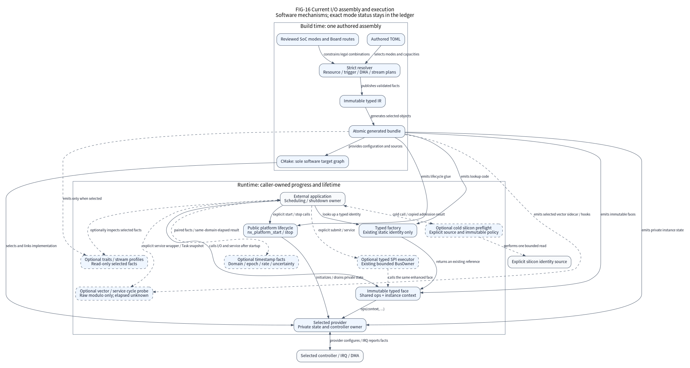

(io-evolution)=
# Static I/O resources and explicit data contracts

Extend an I/O mode without hidden execution, ambiguous units or a second
resource owner. Current MCU integration is the F4 package; exact supported modes
remain listed in [current support](../delivery/support.md). Public generic
mechanisms and host models do not grant another chip or hardware mode.

## Assembly and execution have different responsibilities

TOML selects reviewed modes and Board routes. The resolver checks fields,
capacities and conflicts, produces immutable typed IR and publishes one atomic
bundle. CMake remains the sole software target graph. Invalid input neither
selects a fallback mode nor leaves a usable partial configuration.

Factory lookup returns an existing static face; it does not allocate, read
silicon, initialize hardware or start tasks. Ordinary I/O dispatches through
shared readonly ops with the instance context. Applications own scheduling,
service progress and shutdown. Multiple faces do not create multiple owners of
the same physical controller.

## Describe resources before generating instances

| Plan | Responsibility | Boundary |
| --- | --- | --- |
| Resource graph | Physical aliases, personalities and hierarchical claims | Separate pins do not authorize sharing a timer or controller |
| Trigger graph | Sources, routes, sinks and explicit stop owners | A graph edge does not implement a trigger mode |
| DMA topology | Lanes, requests, reachable memory and exact descriptors | A validated topology does not implement every DMA engine |
| Timing | Explicit clocks and electrical bounds | A computed rate is not a measured physical waveform |

These are build-time proofs about supplied facts. Runtime hardware withdrawal
still requires the concrete C implementation. Clock, reset, shared filter and
timer-domain dependencies remain held until their users can actually exit.

## Bind stream budgets to actual storage

Selected continuous UART and ADC profiles bind declared rates, service bounds
and exact pools. Hardware targets, replacement blocks and consumer retention
must fit actual capacity and integer ranges. These declarations are assumptions,
not measured latency or a lossless guarantee.

The application supplies all storage and joins pool users before reconfiguration.
A producer never overwrites READY or BORROWED blocks. If replacement or service
progress is insufficient it stops and reports loss. Cancellation and timeout do
not revoke a loan; failed drain preserves quarantine and cleanup responsibility.

## Keep units and ownership explicit

UART uses bytes or the selected word format; ADC block counts use complete
scans; frames carry their reviewed layout and stride. Validate size arithmetic,
alignment and payload/control aliasing before retaining references. DMA memory
completion, peripheral wire completion and request settlement are distinct.

Optional traits describe the selected implementation, not the chip's complete
marketing feature set. A controller, endpoint and companion interface retain
their own typed identities. Querying a capability does not prove initialization,
readiness, resource ownership or physical qualification.

## Validate one selected implementation

Tests execute the production C with external hardware boundaries modeled.
Exercise rejection, cancellation, overflow, late events, actual withdrawal,
instance isolation and error recovery. ARM linking checks the selected ABI,
vectors and real memory layout; SDK checks independent consumption.

Measure resource changes under identical toolchain and configuration. Physical
IRQ latency, throughput, stack high-water and power require an actual station.
Unexecuted measurements stay unexecuted. The original cross-family increments
and ledgers retain their original evidence at
[the fixed prior source](https://github.com/X-Gen-Lab/nexus/tree/8e147fc2c812d81ab6596e0d1a6bc8908d30ac18/docs/design),
without becoming current F4 support claims.
