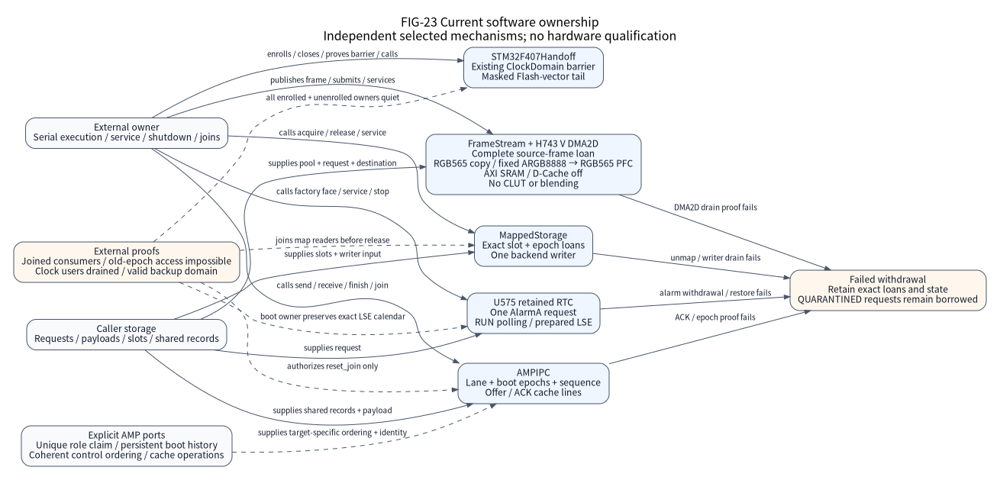

(io-extension-boundaries)=
# Mapped storage, AMP, image handoff, RTC and frame boundaries

This page explains five bounded software increments and their assembly and
ownership contracts. It helps integrators select the exact mechanism and retain
storage through failure. These implementations do not complete the original
IO-32/37–42 or SOC-33–35 exit conditions. Physical HIL remains `not_executed`;
software development results do not establish a clean software candidate.

## Selection and source identity

| Increment | Public assembly | Current software scope |
| --- | --- | --- |
| Mapped ownership | `Nexus::MappedStorage`; Native-only `Nexus::NativeMappedStorage` | Caller-owned read slots and one writer; coherent Native NOR bytes |
| AMP epoch/cache core | `Nexus::AMPIPC` | Explicit unidirectional lanes, caller-owned shared records and hardware ports |
| Running-image tail handoff | `Nexus::STM32F407Handoff` | Exact STM32F407VET6/ZGT6 baremetal Platform only |
| Retained RTC AlarmA | Normal U575 Platform/factory; `u575-rtc-run.toml` | TZEN=0, MSIS4, baremetal, prepared retained LSE calendar, RUN polling |
| Frame layouts and DMA2D | `Nexus::IO`; optional `Nexus::H743FrameDMA2D` | Common frame contracts; exact H743 V, D-Cache off, RGB565 copy or fixed ARGB8888-to-RGB565 PFC in AXI SRAM |

Optional component targets are linked explicitly through
`nexus_add_firmware(... LIBRARIES ...)`. They do not create factory entries or
discover hardware. RTC uses the maintained
[assembly](../../tools/configure/assemblies/u575-rtc-run.toml) and
`nx_factory_rtc(NX_RTC_ID_CALENDAR)`. Its pinless software reference Board has
unknown PCB identity and does not establish an LSE crystal route. The DMA2D
public consumer is an explicit component fixture, without TOML/factory routing.

## Ownership and progress

(fig-23-io-extension-ownership)=

FIG-23 is a current software architecture figure. The external owner supplies
storage, serializes each executor, advances service and joins users. Dashed edges
show required external ports or proof. No arrow implies automatic enrollment, a hidden
worker or one mechanism invoking another. The source basis is the public headers
and implementations linked below; the figure establishes no hardware result.

Accepted asynchronous requests borrow their metadata and buffers until
acquire-observed `SETTLED`. Rejected admission retains no new borrow or residual
hardware effects. Cancellation and deadlines request withdrawal; the caller must
continue the required service. Failed drain retains `QUARANTINED` storage and
recovery responsibility. The provider detaches actual references before its final
release-publication. Consumers, controls and observers must also be joined before
their own storage is reused. See the
[shared lifecycle contract](../explanation/ownership.md).

### Mapped ownership and coherent Native NOR

The [public face](../../components/mapped_storage/include/nexus/components/mapped_storage.h)
and [owner](../../components/mapped_storage/include/nexus/components/mapped_storage_owner.h)
use exact instance/slot/epoch loans. Copying a token creates no new loan; epochs
never wrap. A live supported CPU/XIP/DMA-read loan excludes every PROGRAM/ERASE
writer to the entire aperture. All command, cache and DMA writers must use the
sole backend. Consumers join before release; failed final unmap retains the exact
loan and blocks writers. Stop permanently closes admission and waits for all maps
and the writer without revoking them.

Writer admission checks geometry, alignment, overflow and aliasing against owner,
slots, backend context and aperture before effects. Accepted PROGRAM retains its
input until settlement; partial effects remain visible and are never replayed.
After backend recovery, continued service can retry failed drain. The
[Native backend](../../components/mapped_storage/include/nexus/components/native_mapped_storage.h)
preserves caller bytes, programs only 1-to-0, erases to `0xff` and mutates at most
the configured byte quantum per service call. It accepts coherent CPU reads only.
Physical QUADSPI/serial memory, SDMMC, XIP/cache/DMA qualification and resource
factory assembly remain open.

### AMP epoch/cache lanes

The [AMP API](../../components/amp_ipc/include/nexus/components/amp_ipc.h) and
[caller-storage constructor](../../components/amp_ipc/include/nexus/components/amp_ipc_storage.h)
use separate offer and ACK cache lines, exact peer/local boot epochs and a
nonwrapping slot sequence. One serialized privileged Thread executes each lane
role. The caller supplies storage, coherent acquire/release control access,
cache clean/invalidate and a unique hardware-role claim. The configured power-of-two
cache granule is 1..64 B and divides 64 B. The claim port rejects a reused or
non-increasing local boot epoch, including after normal join. Authoritative nonzero
boot-epoch history must survive CPU/whole-device resets and fail closed at exhaustion.

Accepted send retains its payload until an acquire-observed exact
epoch-pair/sequence ACK or explicit proof that the old peer's CPU, DMA, IRQ and
observers can never again access the exact lane/payload under that execution epoch.
Elapsed timeouts never release a loan; observing a changed peer epoch faults
and closes the lane. Restoring an old shared word cannot reopen it. Receive invalidates descriptors and payload before producing a
readonly view. The caller joins readers before `finish`; a valid `finish` consumes
that view even if ACK cache clean or epoch validation fails, while local state
remains retained for retry
or recovery. `close` blocks admission; `join` waits for ACKs and finished views;
`reset_join` additionally requires exact peer-stop proof. There is no cancel or
blocking-wait API. Exact multicore target, cache attributes, atomicity and resource
partition are unselected; single-core H743 is not an AMP target.

### F407 masked tail handoff and clock barrier

The [handoff component](../../components/soc/stm32/stm32f407_handoff/include/nexus/components/stm32f407_handoff.h)
reuses the existing ClockDomain barrier. Initialize once, explicitly enroll every
owner, close admission, cancel/drain/join all users, stop the actual Platform and
release exact leases. An empty foreign domain, stale epoch or retained lease
rejects. The domain cannot discover unenrolled users or other bus masters.

The caller enters privileged MSP Thread with `PRIMASK=1`, `BASEPRI=FAULTMASK=0`
and `CONTROL=0`. It must establish stopped System, HSI16/reset buses, no active
FP/lazy context or MPU, no enabled/pending/active SysTick/NVIC source, no live
peripheral/DMA gate and idle Flash with `ACR=0` (ART/prefetch disabled).
Rejection preserves masks and writes no
MMIO; reading SysTick CTRL consumes COUNTFLAG. The 98-entry Flash vector table is
512 B aligned and fits the exact generated/observed 512 KiB or 1 MiB density.
MSP is 8 B aligned in `(0x20000000,0x20020000]`; Thumb PC's first halfword lies
in physical Flash. Shared device ID `0x413` cannot establish exact-part/PCB identity.
The caller excludes NMI/HardFault, debugger and other masters throughout transfer.

Successful tail transfer never returns: it sets VTOR, disables CP10/11 with
barriers, clears CONTROL/PSP, replaces MSP and branches while masked. Main SRAM
persists until target startup. The target accepts masked entry and resets
controllers before enabling gates; no source deadline survives. Image selection,
authentication, partitions and recovery stay external. Live RTOS/FPU adoption,
H743/cache handoff, DVFS and deep-STOP continuity remain open.

### U575 retained LSE calendar in RUN

The [RTC provider](../../soc/stm32/stm32u575/drivers/rtc.c) requires an external boot
owner to preserve a valid 24-hour BCD calendar, `BYPSHAD`, prescalers 127/255,
actual LSE 32768 Hz, `RTCSEL=LSE`, `RTCEN`, `LSERDY`, `RTCAPBEN`, `PWREN` and
`DBP`. Boot hands over locked WPR; it remains locked between calls with no other
writer. Calibration, shift, binary mode, another RTC owner and a live RTC vector
reject. Accepted service briefly unlocks WPR with CA/53, checks the protected
write and unconditionally relocks with FF. The provider does not write calendar,
RCC, PWR or TAMP, enable an IRQ or repair/reset the backup domain.
Year-00 provenance remains external; INITS cannot
prove it. `set` returns `UNSUPPORTED`.

ES0499 Rev12 sections 2.2.3 and 2.2.16 identify oscillator-stop limitations for
LSE drive codes 00/01 on revision X; Table 3 marks these limitations repaired on
W/U. This reference does not qualify a silicon revision, so its crystal-mode
profile requires `LSEBYP=0` and conservatively admits only `LSEDRV=10/11` on
every revision. It never writes either field. Section 2.2.1 separately requires
external boot and Board owners to exclude PC13 transitions for crystal LSE on
this LQFP part. LSE bypass is unaffected by section 2.2.1 and is outside this
selected profile. GPIO reads cannot prove that electrical condition, and this
software reference declares no PCB route or measured oscillator behavior.

Reads try at most eight coherent SSR/TR/DR pairs and preserve output on invalid
or unstable data. Natural year 99-to-00 rollover preserves the domain; successful
reopen advances a nonwrapping 64-bit domain. AlarmA borrows one request. Core
monotonic deadlines remain independent of calendar time. One service phase per
call disables ALRAE with readback and a 100 µs Core-time crossing guard, clears
and observes ALRAF, then restores saved alarm registers with readback before
detaching and settling. Failed disable/clear/restore retains quarantine. Foreign
clock/configuration drift permanently retains responsibility for external
recovery. This mode provides no Stop2, LPDMA, VBAT-continuity or wake qualification.

### Complete frames and fixed H743 DMA2D formats

The [frame contract](../../io/include/nexus/io/frame_stream.h) binds a copied,
checked layout to an existing `nx_stream` pool. Audio layouts retain full stored
slots, including inactive SAI slots; PDM uses byte-interleaved lanes and complete
eight-frame groups. Planar layouts accept up to four disjoint checked stride
intervals. These are data contracts, not SAI/DCMI providers. Publication requires
complete frame bytes. Empty acquisition increments a saturating underrun counter
without choosing silence/repeat policy. DMA-view release requires actual engine,
IRQ and peripheral detachment facts and exact control identity/epoch.

The [DMA2D component](../../components/soc/stm32/stm32h743_frame_dma2d/include/nexus/components/frame_dma2d.h)
has one caller-owned executor and no queue. It admits exact H743 V ID `0x20030450`,
D-Cache off and exclusive cold DMA2D. The two request formats are RGB565 copy
(the zero value) and fixed ARGB8888-to-RGB565 pixel format conversion (PFC).
Unknown formats are rejected; CLUT, blending, other formats and IRQ operation
remain unsupported. Both surfaces must occupy AXI SRAM
`[0x24000000,0x24080000)`. No Board connection or physical result is inferred.

`x` and `width_bytes` always count source bytes. Source addresses, x, widths and
strides align to two bytes for RGB565 or four for ARGB8888. ARGB8888 input on
this little-endian MCU stores B, G, R, A bytes; RGB565 discards alpha with no
channel or byte swap. Output addresses and strides align to two bytes; output
row bytes equal `width_bytes / source_pixel_bytes * 2`. Destination stride and
capacity remain bytes. With `LOM=0`, foreground and output offsets count their
own format's pixels: source padding divided by four for PFC or two for copy,
and output padding divided by two. Each pixel gap is at most `0x3fff`; bits
15:14 are ignored in pixel mode despite the 16-bit register field (RM0433 Rev9,
sections 18.5.5 and 18.5.20). Width is at
most `0x3fff` pixels and height at most `0xffff` rows. Successful request results
report output bytes without stride padding. Arithmetic, AXI spans and hardware
bounds are checked before acceptance.

Destination writes and every ownership control must be disjoint from every
source-pool slot's full capacity, including frame tails and other free slots.
Admission scans the bounded pool in O(n), comparing seven fixed controls per
slot. Acceptance borrows the request, exact live source-frame loan and output;
the selected source slot remains immutable through final access. Rejection
leaves the original source loan with its caller. Submit `SUCCESS` means
ACCEPTED, including a subsequent setup/readback failure; such a failure keeps
all borrows until service proves drain. The first observed failure remains
latched across cancellation and recoverable cache/IRQ guard restoration.

Successful completion requires TC and START-clear. Cancel/error drain instead
requires START/CLUT/IRQ withdrawal without requiring TC. START and ABORT writes
preserve the selected mode. START is a read/set bit: writing zero has no
effect. ABORT requests hardware withdrawal without reasserting a previously
cleared START. The provider releases the loan only after the hardware proof
and clearing FGMAR/OMAR/NLR. Failed proof retains every borrow in quarantine;
continued service can recover an actual drain. If an active owner observes its
required RCC gate off or DMA2D reset asserted, transfer history is uncertain
and quarantine is permanent: restoring registers to zero cannot revoke the
borrow, and service, stop or reinitialization cannot reclaim it. An unobserved
reset pulse is not detectable; exclusive gate/reset ownership remains a
mandatory precondition. System-level recovery stays external. Stop closes
admission and returns `BUSY` for active work; only after all loans settle does
it reset the controller and withdraw its owned gate. These software and ELF
checks establish no PFC throughput, latency or HIL result.

## Validation and remaining exits

Maintained regressions are
[mapped storage](../../tests/google/mapped_storage_test.cpp),
[AMP](../../tests/google/amp_ipc_test.cpp),
[handoff](../../tests/google/stm32f407_handoff_test.cpp),
[RTC](../../tests/google/u575_rtc_test.cpp),
[frame layouts](../../tests/google/frame_stream_test.cpp) and
[DMA2D](../../tests/google/h743_frame_dma2d_test.cpp).
They exercise software contracts and external hardware models; they do not
establish electrical, retained-power, multicore or station behavior. Exact
execution and frozen-source identities belong in the
[compact development evidence](../../tools/testing/evidence/io-extensions-20261020/README.md)
and delivery records. The original
[I/O](io-evolution-execution.csv) and [SoC](soc-refinement-execution.csv) ledgers
retain their full exits and authoritative status. No exit is narrowed by this page.
