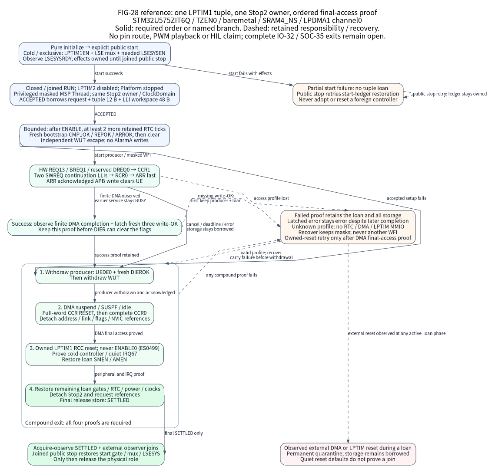

# U575 single-tuple LPTIM1 LPBAM across Stop2

This reference targets STM32U575ZIT6Q TZEN0 baremetal: one fixed SRAM4 tuple
updates LPTIM1 CCR1, RCR and ARR through LPDMA1 channel0 while the same concrete
Stop2 owner controls sleep and final release. General LPBAM and the original
[IO-32](io-evolution-execution.csv) and [SOC-35](soc-refinement-execution.csv)
exits remain open. Board output routing is unknown; physical HIL is
`not_executed`.

ES0499 section 2.17.3 warns that modifying an interrupt bit in DIER clears its
corresponding status flag. Success therefore captures fresh kernel write
acknowledgements before producer withdrawal changes DIER. The software model
conservatively permits any DIER write to clear all three write-OK flags; this
is a defensive test envelope, not a silicon measurement.

Link `Nexus::U575Stop2Lptim1`; it brings `Nexus::U575LpdmaLptim1` and retained
time. WUT-only, SRAM4-copy and LPTIM1 are mutually exclusive compile-time modes
of the same static Stop2 owner and RUN ClockDomain. Default images select none
of the new targets. No heap, worker, queue, dynamic MMIO plan, runtime registry
or new factory is introduced; vendor types remain private.

FIG-28 separates calls, hardware requests and final-access proofs. The
{ref}`figure contract <fig-28-u575-lptim1-lpbam>` is separate
from WUT-only FIG-24 and memory-copy FIG-27; no arrow establishes a pin route or
physical Stop2 residency.

## Prepare the exact owners

Select the maintained [assembly](../../tools/configure/assemblies/u575-lptim1-lpbam-stop2.toml).
Its selected SRAM4/LPDMA1 reset startup and the externally prepared LSE RTC
provenance remain required. Keep the 16 KiB nonsecure SRAM4 window at
`0x28000000..0x28003fff` powered and retained, with SRAM4EN and LPDMA1EN live
through every join. Runtime recovery must not rescue lost SRAM4 by changing
its power-down fields.

The existing [retained-clock and Stop2 profile](u575-retained-time.md) requires
TZEN0, unswapped Flash, effective MSIS4/MSIK4, equal buses, true Range4 and caches
off. All LPDMA channels/vectors start quiet; no other channel may run. The whole
LPTIM1 controller is exclusive, initially reset/cold, with its access gate off
and kernel mux at reset. No external timer writer, IRQ user or reset may share
it. RUN LPTIM2 must already be disabled and joined.

Use the [receiver API](../../components/stm32u575_lpdma_lptim1/include/nexus/components/stm32u575_lpdma_lptim1.h)
and [Stop2 API](../../components/stm32u575_stop2/include/nexus/components/stm32u575_stop2_lptim1.h)
as declaration authorities. One privileged Thread serializes calls; copied
faces retain the same physical identity. No ISR or concurrent writer controls
these objects. Keep every owner, clock and face alive through stop and joins.

## Storage and the single-tuple bound

| Selected object | Exact cost or constraint |
|---|---|
| Immutable SRAM4 tuple | 12 B, four-byte aligned; `CCR1<ARR`, `RCR=0`, `1023<=ARR<=65535` |
| Generated continuation workspace | Separate 48 B, four-byte aligned; exactly two LLIs |
| Caller-owned ARM32 receiver | 104 B, including the added 16 B start-effects ledger |
| Existing SRAM4-copy receiver | Unchanged at 88 B ARM32; no new ledger in that mode |
| Shared LPTIM1 ops table | 16 B read-only on ARM32; no per-instance copy |

The full tuple and workspace extents must be disjoint SRAM4 spans, separate
from request, owner, face, clock, snapshot and other control storage. Callers
provide no destination, raw DMA instruction or tuple count. A second tuple
would need proof that each preceding asynchronous register write was accepted
before reuse; a large ARR cannot bound arbitrary bridge delay. Repetition is
outside this API. Host64 receiver storage is 136 B; old copy remains 120 B.

## Start, borrow and execute

1. Initialize ordinary retained time with
   `wake_owner=nx_stm32u575_stop2_identity()`, then initialize Stop2 and the
   receiver. No AlarmA-copy initializer is used. Receiver initialization is pure;
   explicit public `start` prepares access in unmasked privileged Thread.

2. Start acquires LPTIM1EN, LPTIM1SEL=LSE and only a needed LSESYSEN,
   observing LSESYSRDY while preserving oscillator/calendar provenance. It writes
   no timer register. Partial failure retains its ledger and physical reservation;
   keep storage live and call public `stop` until restoration succeeds. Products
   need no private RCC preparation writes.

3. Initialize the request base, take a successful retained sample and prepare
   metadata with the tuple, workspace and an absolute retained-domain deadline or
   NEVER. Prepare neither borrows nor touches tuple/workspace; keep tuple contents
   unchanged. Value admission occurs before ACCEPTED. Rejection changes no request
   byte and retains no new reference; old TIM2 deadlines are never converted.

4. Close and drain the exact RUN barrier, disable/join LPTIM2 and stop
   Platform. Enter with privileged MSP Thread, CONTROL0, PRIMASK1 and
   BASEPRI/FAULTMASK0; keep masks and RUN admission closed through recovery. Use
   4096..65536 RTC/16 escape ticks and a positive per-phase `poll_limit`.
   ACCEPTED borrows request, tuple and the full workspace until acquire-observed
   SETTLED and external observer joins, even if later setup fails.

After observed CR.ENABLE, a new successful retained sample anchors a bounded
wait for at least two additional 256 Hz RTC ticks, checking the request deadline.
An arbitrarily short first tick still leaves one full 128-LSE-cycle interval,
exceeding two counter cycles. Poll counts alone prove no time. PRELOAD1, one
CC1E setup and initial CCR1=0/RCR=0/ARR=1023 require fresh CMP1OK/REPOK/ARROK;
those initial flags must then be cleared and observed clear before DMA.

The first 32-bit CCR1 write waits for request13 `lptim1_ue_dma` with BREQ1,
SWREQ0 and reserved DREQ0. Two generated software-requested LLIs write RCR then
ARR last, using fixed noncontiguous destinations and no destination increment.
ARR's acknowledged APB write clears UE; the final link is zero and completion
is at the last LLI. WUT escapes independently; no AlarmA register or GPIO is
configured. Success means synchronized register writes, not a full PWM period.

## Prove success, isolate and join

Success latches both finite DMA completion and fresh CMP1OK/REPOK/ARROK before
UEDE0 or any DIER withdrawal write can clear those flags. A quiet flag after
DIER is not that proof. Each admission and completed owned isolation clears
the saved proof within the existing 16 B ledger. Error or partial cancellation
need no write-OK for unissued writes; master isolation and owned reset can
terminate such a request with error.

Without a terminal DMA state or prior failure, public `service` returns BUSY
and leaves UEDE enabled so the pending hardware request can still occur. A
pending IRQ is only a hint. If concrete Stop2 cleanup cannot prove completion,
it retains the loan and records an error for explicit recovery.

After finite DMA completion, an incomplete bounded fresh write-OK proof
latches `NX_ERROR_IO` and returns BUSY while retaining producer and loan on
that call. The next public `service` or concrete `recover` takes the error
drain path even if those flags never arrive. This is failure to prove kernel
receipt, not an elapsed deadline inferred from poll counts.

WUT, deadline, cancel and recovery errors enter the first-failure ledger
before producer withdrawal. A TC arriving between that decision and the DIER
write may increase the observed transfer prefix; it cannot upgrade the
terminal error to success. Public `service` never publishes SETTLED; the same
concrete Stop2 owner must complete its final detach.

With a valid access profile, withdraw UEDE and observe fresh DIEROK before
another DIER write, then require suspend/SUSPF/idle for an enabled DMA channel
or observed idle for an already completed channel. Prove full-word RESET and
the entire CCR equal to zero. Clear channel addresses, links, flags and IRQ
references before resetting exclusively owned LPTIM1 through RCC. Never clear
CR.ENABLE: ES0499 section 2.17.1 requires reset shutdown. Preserve unrelated
gates, mux fields and RTC/LSE provenance; owned reset must not erase any
external controller state.

Unknown access profiles permit no RTC/LPTIM/DMA MMIO and retain effects and
storage. Concrete Stop2 recovery retries without WFI. Owned reset failure is
retryable only after DMA final-access proof; observed external DMA or LPTIM
reset during an active loan permanently quarantines it until actual external
system reset. Deassertion or quiet reset defaults cannot release that loan.

Cancel/deadline never revoke storage. Only after peripheral, DMA, IRQ, loan
gates, RTC/WUT, power and clock restoration does Stop2 detach references and
release-publish SETTLED as its final request access. Public-start claims remain
reserved until joined public `stop` restores them, including stop requested
during a loan. Reopen RUN and restart Platform only after all effects drain;
old Core TIM2 deadlines remain invalid.

## Sources and verification boundary

[Production receiver](../../soc/stm32u575/drivers/lpdma_copy.c) and
[concrete Stop2](../../soc/stm32u575/stop2.c) share invariants through typed
compile-time profiles; the two public request/ops types remain distinct. The
[maintained public C11 consumer](../../cmake/package/verification/io_evolution/consumers/u575-lptim1-lpbam.c)
is the source integration reference. The complete installed-SDK consumer plan is
defined by the [maintained transport policy](../../tools/release/transport.py);
historical v7/v8 results do not qualify additions. Full integrated gates,
relocated SDK, offline reproducibility and candidate acceptance require their
own evidence.

Focused production-C GoogleTest models pass 24 cases in debug and 24 with Os,
including conservative DIER flag loss, early service, missing
acknowledgements, partial cancellation, late TC and proof reuse. Legacy
memory-copy receiver31 and coupled17 cases remain green. A selective strict
C11 Cortex-M33 development relink recompiles the receiver and Stop2 units and
reuses the pinned startup, public consumer and unchanged dependency libraries.
These checks establish no complete SDK or candidate qualification.

RM0456 Rev7 anchors are sections 18.3.3/Table148 (request13), 18.3.4/Table149
(BREQ), 18.8.11 (reserved DREQ), 58.4.11/13 (write-OK/enable delay), 58.4.20–21
(CCR1→RCR→ARR/UEDE), 58.5 (LPTIM2 disabled before Stop2), 58.7.8 (DIEROK), and
11.8.48–49 (LSE mux/system gate). ES0499 Rev12 sections 2.17.1–3 govern reset,
repeat/APB constraints and DIER flags; RCR0 and LSE≤PCLK exclude the odd-repeat
profile. Physical waveform, retention, residency, accuracy, wake and power
checks remain `not_executed`; no original IO-32/SOC-35 exit is promoted.
