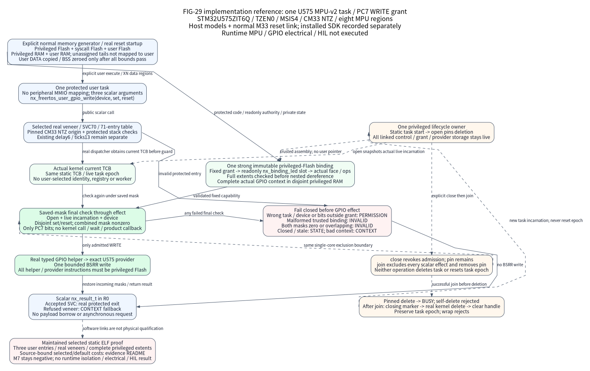

# U575 MPU-v2 scalar GPIO WRITE authority

This implementation reference selects STM32U575ZIT6Q TZEN0, MSIS4, one security
world, FreeRTOS MPU-wrapper-v2 and the actual Cortex-M33 eight-region port. One
protected task may WRITE GPIOC PC7 through one immutable grant. Software evidence
now includes real C host models, a normal M33 reset link and one relocated
development-SDK consumer with the maintained static ELF gate. Runtime MPU
exception behavior and electrical HIL are not executed. It establishes no M7 MPU
support or general user-device gateway.

Link the selected `Nexus::U575MpuGpio` target through the maintained
[assembly](../../tools/configure/assemblies/u575-mpu-gpio-write.toml). The ordinary
profile keeps the pinned 70-entry syscall numbering and delay/tick services.
Only `user_io="gpio-write"` selects the 71-entry derivation, new slot 70 and
protected task pin/epoch fields. Resource claims apply only to measured compiled
contexts and actual images; the [source-bound evidence](../../tools/testing/evidence/u575-mpu-gpio-20261020/README.md)
keeps selected/default scope and historical phases explicit.

The {ref}`figure contract <fig-29-u575-mpu-gpio>` distinguishes actual calls,
protected authority, saved-mask exclusion and lifecycle responsibility. No arrow
creates a worker, dynamic handle registry, user MMIO mapping or asynchronous
request protocol.

## Five explicit memory domains

The maintained normal memory generator accepts five explicit, nonempty,
32-byte-aligned reservations. Their Flash and RAM sums may be less than the
physical capacity; the remaining tail stays unassigned, rather than becoming
user memory. Overflow, overlap, malformed sizes and insufficient privileged
MSP/static budget are rejected before generation. These are software reference
reservations, not a product partition policy.

| Domain | Reference reservation | Contents and access |
|---|---|---|
| Privileged Flash | 24 KiB | Vectors, ordinary code/rodata, kernel, public I/O helpers and concrete provider; user execution forbidden |
| Syscall Flash | 256 B | Real pinned FreeRTOS veneers, including selected SVC70; narrow user-executable entry region |
| User Flash | 1 KiB | Explicit user entry and all three Nexus user wrappers; executable, read-only |
| Privileged RAM | 8 KiB | Kernel/TCB, protected syscall stack, authority, provider state and MSP |
| User RAM | 2 KiB | Explicit user stack and user DATA/BSS; data mappings are XN |

The actual reset path must validate the exact part/security identity before
copying user DATA and zeroing user BSS from the strong linker spans. The new
bounded initializer validates every range before any store. Ordinary vendor
startup still initializes privileged DATA/BSS; no runtime linker or pathname-based
partition substitutes for this normal graph. The assembly does not select SRAM4
or the baremetal Stop2 owners.

## Bind the one trusted authority

Use the declarations in the [authority header](../../os/freertos/include/nexus/os/freertos_mpu_gpio.h),
[protected task header](../../os/freertos/include/nexus/os/freertos_mpu.h) and
[user entry header](../../os/freertos/include/nexus/os/freertos_user.h). Define
exactly one immutable `nx_freertos_mpu_gpio_binding` in privileged Flash. It names
a disjoint privileged-RAM task/control pair and a read-only grant. The grant names
the read-only generated `nx_binding_led` pointer slot, logical LED device and
mask `0x80`; it never accepts a user pointer as authority.

Before reading nested fields, the implementation checks full object extents,
alignment and the five linked ranges: binding, grant, pointer slot, face and ops
must fit privileged Flash; task, control and the complete concrete provider
context must fit disjoint privileged RAM. The SoC validator requires the actual
initialized GPIOC PC7 output provider and exact ops identity. Metadata bounds do
not themselves prove every instruction's MPU permissions: the final normal ELF
must also place the complete helper/provider function extents in privileged Flash.

One privileged lifecycle owner serializes task start/delete and authority
open/close/join. Binding, grant, task metadata, control and provider remain valid
for the linked image lifetime; open through join also forbids GPIO stop or
reconfiguration. Only cold startup zero-initializes the metadata. The task's monotonic epoch
survives deletion; join clears only the captured task epoch. Task-epoch wrap
rejects rather than reusing an incarnation. NMI, HardFault, DMA and another
security world never write these objects.

## Enter through the real protected port

Start the statically provided restricted task, then open the fixed authority
before allowing its user calls. Open checks the actual live task handle equals
its selected static TCB and snapshots that task epoch while pinning deletion.
There is no caller-provided principal, lookup table or borrowed pointer argument.

The user calls `nx_freertos_user_gpio_write(device, set, reset)`. Its real veneer
enters SVC70 through the pinned protected call stack/origin checks. The dispatcher
obtains the actual `xTaskGetCurrentTaskHandle()` before entering the saved-mask
boundary, then rechecks open phase, live TCB/epoch, device and grant through the
single real `nx_gpio_port_write()` effect. The selected provider performs exactly
one bounded BSRR write. No kernel API, wait, allocation or product callback runs
inside that effect boundary; the scalar result returns in R0.

Unknown device, wrong current task or bits outside `0x80` return PERMISSION.
Zero combined masks or overlapping set/reset return INVALID; closed/stale
incarnations return STATE; invalid privileged metadata returns INVALID; an
unsupported context returns CONTEXT. These rejections perform no GPIO effect.
READ, toggle, arbitrary pointers, user MMIO, DMA, IRQ and copied/asynchronous I/O
are outside this API. Delay and tick-read remain separate services 6 and 13;
the final ELF must prove all three Nexus user entries and their actual veneers
are in the permitted execution regions.

Lifecycle controls require privileged Thread and a scheduler that is running
or not yet started, never suspended. FAULTMASK and BASEPRI must be zero except
the selected port's canonical bootstrap BASEPRI before scheduler start. Service
requires a running scheduler and zero BASEPRI. Incoming PRIMASK is saved and
restored. This single-core exclusion is insufficient for an unmodeled writer;
products must preserve the exact single-owner assumptions.

## Close, join and delete explicitly

Close revokes new effects but retains the task pin. Join requires closed state
and the same live incarnation, enters the saved-mask exclusion, removes the pin
and detaches the authority's handle/task epoch. No scalar effect can straddle
that single-core boundary. Join does not delete the task, stop GPIO or reset
the task lifetime epoch. A failed close/join retains the obligation and storage.

Task deletion while pinned returns BUSY. After join, the lifecycle owner may
delete the other task; self-delete is rejected. A protected closing marker is
set before the real kernel deletion outside the IRQ guard, preventing reopen
during deletion. The owner then clears the handle under a second guard while
preserving the task epoch. Products still own user quiescence, task stack lifetime,
scheduler startup, safe outputs and eventual provider/platform stop.

## Evidence and remaining exits

Executable tests preceded production changes and exposed actual authority,
task, provider-context and startup failures. The reviewed removal of an unexposed
control counter retains the actual task epoch: its final model result is a
behavior-preserving refactor GREEN, not a new behavioral RED. The maintained
Native CMake target runs the final cases. Configuration and pinned-port checks
retain default and unsupported-profile coverage. The
[public consumer](../../cmake/package/verification/io_evolution/consumers/u575-mpu-gpio.c)
uses the normal firmware graph, including real reset startup. The
[source-bound evidence](../../tools/testing/evidence/u575-mpu-gpio-20261020/README.md)
records exact source phases, raw execution, compiled ABI facts, resources and the
single relocated development-SDK consumer; it does not claim the complete current
SDK transport plan passed.

The selected ELF gate checks complete five-domain ranges, immutable authority
pointers, protected objects, compiled task/control sizes, actual slots 6/13/70,
three user wrappers and real veneers. Its explicit supported GNU Os startup
shape checks actual reset/identity/user-initialization calls and DATA/BSS bounds;
unrecognized shapes fail closed. These static layout, opcode and call facts do
not execute protected SVC entry/exit. Runtime MPU faults, task switching, actual
PC7 output, interrupt latency and HIL are not executed. The general IO-39/SOC-36
exits, other devices, multiple tasks/grants and M7 MPU remain open; a typed
interface or host model does not close them.
