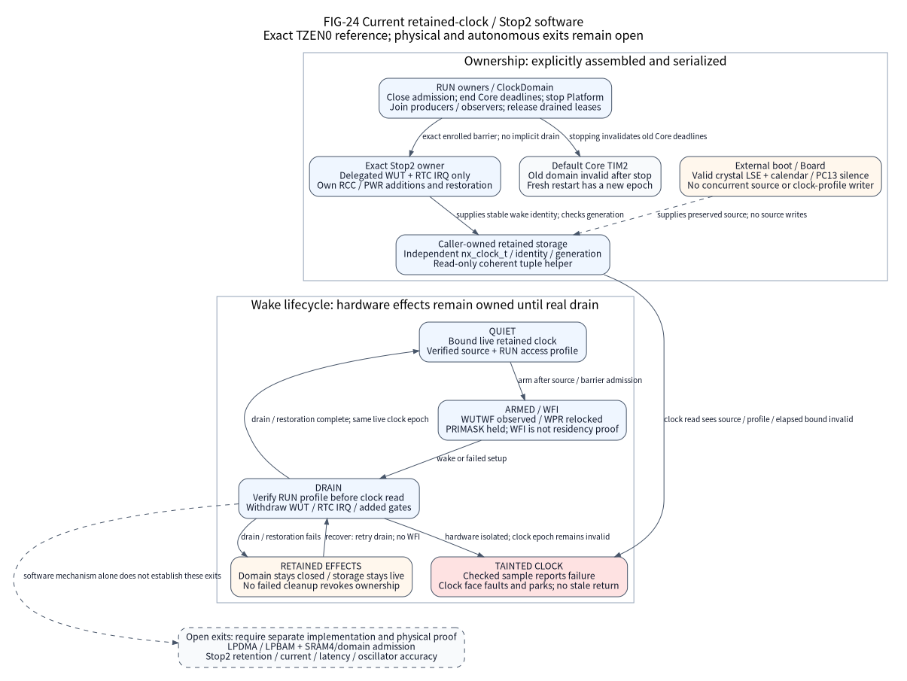

# U575 retained elapsed-time domain

`Nexus::U575RetainedTime` provides an explicit elapsed clock for the exact
STM32U575ZIT6Q TZEN0 baremetal reference. It reads an externally prepared retained
RTC without changing hardware. It does not enter a power mode, restore clocks,
provide LPBAM or prove physical Stop2 continuity. The original
[IO-32](io-evolution-execution.csv) and [SOC-35](soc-refinement-execution.csv)
exits remain open; physical HIL is `not_executed`.

(fig-24-u575-retained-stop2)=


FIG-24 describes the WUT-only reference, separate from the explicitly selected
[finite SRAM4 copy](u575-stop2-copy.md) in FIG-27. It separates the independent
RTC domain from the drained RUN domain. Solid arrows name current calls,
admission or cleanup transitions; dashed arrows name external source premises
and exits outside this WUT-only scope. Hardware drain does not repair a tainted
clock. The separately selected Stop2 owner supplies WUT and restoration; the
read-only clock component alone supplies neither. No arrow establishes physical
residency or automatic enrollment.

## Select one RTC owner

Use the public
[retained-time header](../../components/stm32u575_retained_time/include/nexus/components/stm32u575_retained_time.h)
and link `Nexus::U575RetainedTime` explicitly. The optional target exists only
for U575 baremetal single-state builds with no polling AlarmA `[rtc.*]` factory
selection. It is not a generated factory, global Core clock replacement or
runtime registry. Vendor types stay private; state uses one zero-initialized
caller-owned `nx_stm32u575_retained_time_storage_t`.

For a source consumer, select the maintained
[empty assembly](../../tools/configure/assemblies/nucleo-u575-baremetal-empty.toml),
add Nexus as a subdirectory and link the component:

```cmake
set(NEXUS_ASSEMBLY_FILE "/path/nexus/tools/configure/assemblies/nucleo-u575-baremetal-empty.toml")
add_subdirectory("/path/nexus" nexus)
nexus_add_firmware(product SOURCES main.c LIBRARIES Nexus::U575RetainedTime)
```

The [public C11 consumer](../../cmake/package/verification/io_evolution/consumers/u575-retained-time.c)
shows explicit construction, a face read, a checked sample after Platform stop
and joined clock stop. This link fixture supplies no oscillator setup or PCB
facts. A Board and boot owner must independently establish the source below.

## Prepared source and access boundary

External boot owns a valid raw BCD 24-hour calendar, `PRER=127/255`, `BYPSHAD=1`,
32768 Hz crystal LSE, `RTCSEL=LSE`, `LSEON`, `LSERDY`, `RTCEN` and `RTCAPBEN`.
`LSEBYP=0` and drive codes `LSEDRV=10/11` define this conservative profile.
ES0499 Rev12 sections 2.2.3 and 2.2.16 affect revision X; Table 3 marks W/U
repaired. This reference does not qualify a silicon revision. Section 2.2.1
requires external boot and Board owners to exclude PC13 transitions for crystal
LSE on this LQFP part; GPIO reads cannot prove electrical silence. No PCB route,
fitted crystal, drive adjustment or oscillator measurement is asserted.

The caller serializes all lifecycle calls in privileged Thread mode. Initialize
and stop require unmasked Thread; sample and wake validation permit incoming
PRIMASK 0 or 1 and preserve it. Handler mode, BASEPRI and FAULTMASK are excluded.
Before each tuple pair, the shared helper checks the selected effective MSIS
range 4, ready MSIS source, equal buses and RTC APB gate. This conservative
MSIS4 profile supplies nominal PCLK 4 MHz, above seven times 32768 Hz. RM0456
Rev7 section 63.3.12 discusses that seven-times ratio under shadow mode; the
selected BYPSHAD reader instead follows its repeated complete-tuple procedure.
The selected profile does not establish a general RTC-write frequency rule.
Exclude concurrent clock profile writers. A separate power owner verifies the
restored access profile before post-wake RTC access. This component owns no RCC
restoration.

Initial alarms, WUTE/WUTIE, RTC status flags or a live RTC IRQ reject before
object publication, including when WUT delegation is requested. Binary mode,
shift, calibration, source/gate drift or a foreign calendar configuration is
excluded. Raw year-00 provenance is external; INITS cannot prove it. Reads need
neither DBP nor unlocked WPR. The implementation writes no RTC, RCC, PWR, TAMP,
backup, GPIO, interrupt or protection field.

## Elapsed samples and independent deadlines

Initialize copies configuration and returns a separate `nx_clock_t`. Its zero
point is the first coherent calendar tuple. Samples extend raw 256 Hz ticks
through a 36525-day, 100-year cycle using RTC leap arithmetic, including natural
99-to-00 rollover. The tuple reader is shared with the existing RUN AlarmA
provider: at most eight complete matching SSR/TR/DR pairs, BCD/range validation
and unchanged output on failure. No UTC century or leap-second model is implied.

A successful snapshot binds storage identity, nonwrapping generation, elapsed
ticks and `floor(ticks*1000000/256)` microseconds. The 3906.25 microsecond source
quantum carries exact fractional quarters across samples; close samples may
return equal time. Overflow cannot return the reserved NEVER value or wrap.
No Core TIM2 value or timeout is converted into a calendar epoch.

The caller declares `max_gap_seconds` in 1..86400 and observes within that gap.
The complete elapsed interval, including wake latency and recovery, must fit the
bound. A nominal WUT period is not a maximum duration if wake fails. Small
external calendar settings and missed complete 100-year cycles are not
detectable from snapshots; all calendar writers are excluded externally.

`sample` returns `BUSY` after unstable bounded retries without changing the owner
or output. Source/configuration loss, an out-of-window/backward observation or
exhaustion taints the live epoch permanently. Its output stays unchanged and
later samples return `STATE`. The `nx_clock_t` read callback has no error return,
so any failed read taints the epoch, retains the interrupt mask, observes
`NX_FAULT_PLATFORM` with the reason and parks if the fault observer returns.
A stale time value never resumes deadline consumers. Fault observation releases
no loan, storage or observer.

The independent face remains separate from `nx_time_now_us()`. Default Core TIM2
stop and invalidation behavior is unchanged. End old Core deadlines before
Platform stop; never compare them with this elapsed domain. After every copied
face, deadline user, observer and delegated wake owner has joined, explicit clock
stop closes reads. Reopen advances generation and starts a new zero domain;
old numerical deadlines and wake bindings remain invalid.

## Explicit WUT delegation

A NULL `wake_owner` selects read-only RTC exclusivity with quiet WUT and RTC IRQ.
A non-NULL stable assembly identity delegates only WUCKSEL/WUTE/WUTIE, WUTR,
WUTF/SCR.CWUTF and the RTC vector to that same serialized wake owner. ICSR.WUTWF
may change with its bounded WUT operations. The delegate preserves every calendar
and source field. Initial construction remains quiet; this capability cannot
adopt an unrelated live wake source.

`validate_wake` compares that identity and the sampled generation without
reopening or repairing the clock. It is trusted assembly binding, not a security
capability. Source drift taints the clock and returns an observable error before
new wake writes. A failed WUT drain keeps the wake owner's effects and clock
storage alive until actual recovery and joins. This component alone promises no
wake IRQ, WFI, RUN restoration, Stop2, SRAM4 placement or VBAT guarantee. A
separate selected power mode must prove which memory retains state; a read-only
RUN clock has no SRAM4 admission requirement.

## Select and use the Stop2 owner

Link `Nexus::U575Stop2` explicitly alongside the same no-AlarmA assembly. Its
[public header](../../components/stm32u575_stop2/include/nexus/components/stm32u575_stop2.h),
[component contract](../../components/stm32u575_stop2/README.md) and
[public C11 consumer](../../cmake/package/verification/io_evolution/consumers/u575-stop2.c)
define the exact STM32U575ZIT6Q TZEN0 baremetal sequence. Initialize the retained
clock with `wake_owner=nx_stm32u575_stop2_identity()` and a maximum observation
gap covering the full elapsed interval, then initialize the Stop2 owner with that
storage and explicit RUN-consumer capacity. Keep the storage alive through both
owners and every copied face. Bindings are trusted static assembly, not hardware
authentication; another RTC/AlarmA owner cannot coexist.

Enroll every platform and product producer, device, IRQ, DMA, observer and Core
deadline consumer in this owner's ClockDomain. Close RUN admission while leases
are live, stop Platform/System and join consumers through their actual APIs,
then release each lease only after real drain. Pass this exact closed barrier
once its enrolled count is zero. The barrier proves enrolled owners only;
unenrolled hardware and asynchronous actors remain external obligations. The
independent retained clock stays outside this stopped RUN domain. End all old
Core TIM2 deadlines; no numerical deadline crosses its stop/restart boundary.

Call enter in privileged MSP Thread with CONTROL=0, PRIMASK=1 and
BASEPRI=FAULTMASK=0, before any scheduler has started. Platform/System must be
stopped with no residual effects. Entry admits the selected MSIS4/equal-bus and
Range4 supply state (`VOS=00`, `VOSRDY=1`, `BOOSTEN=0`, RM0456 section
10.10.4), caches/debug/MPU/SysTick/other IRQ and EXTI sources off,
quiet peripheral gates, all SRAM retained and Flash prefetch disabled. Boot
supplies the prepared LSE calendar, access gates and DBP=1. Exclude watchdogs,
NMI/HardFault agents, other bus masters and concurrent configuration writers
externally; zero register fields cannot prove these conditions. The component
contract lists the exact exclusions and errata basis.

Request 2..65536 RTC/16 ticks at nominal 2048 Hz; the owner programs
WUTR=ticks-1 with WUTOCLR=0 after observing WUTWF. The first WUTF assertion lies
between WUTR and WUTR+2 counter ticks after enable. RTC samples resolve 3906.25
microseconds, so a short request can report zero elapsed time. `poll_limit`
bounds observations in each phase, not elapsed time; WFI has no CPU duration
bound if hardware wake fails. The configured retained-clock gap must cover
arm, actual sleep/wake latency and drain execution.

After WFI the owner clears SLEEPDEEP and verifies the selected RUN profile before
any RTC read or write. An invalid profile permits core deep-bit clearing and
CPU vector withdrawal only; WUT and related effects remain owned until an
external reviewed owner restores MSIS4. With a valid profile it observes the
wake flag and captures only a same-generation RTC sample. It withdraws the WUT
source and IRQ and verifies/restores saved WUTR, MSIK enable state, power and
added sleep/autonomous gates before releasing effects.
Protected WUT writes use scoped WPR unlock/relock. Every return preserves the
incoming masks. `wait_executed` proves WFI ran, not physical Stop2 residency.

Inspect primary, cleanup and remaining-effects results separately. Failed drain
keeps RUN admission closed and clock/owner storage alive; do not restart Platform
or reclaim a loan. Retry `nx_stm32u575_stop2_recover` at the same masked boundary;
it never executes WFI and checks the access profile before RTC operations.
Hardware isolation can finish while the clock remains tainted. After real drain
and all clock-user joins, clock stop/reopen may establish a new generation;
old deadlines stay invalid. Reopen RUN admission and restart Platform only after
no effects remain, creating a fresh Core TIM2 epoch. This WUT-only
sequence does not provide RTOS Tick compensation, LPDMA/LPBAM, Standby, VBAT
continuity or physical retention/power/latency qualification.

## Source basis and verification limits

The source basis is [RM0456 Rev7](https://www.st.com/resource/en/reference_manual/rm0456-stm32u575585-armbased-32bit-mcus-with-trustzone-and-fpu-stmicroelectronics.pdf)
sections 63.3.7, 63.3.12 and the RTC register definitions, plus
[ES0499 Rev12](https://www.st.com/resource/en/errata_sheet/es0499-stm32u575xx-and-stm32u585xx-device-errata-stmicroelectronics.pdf)
sections 2.2.1, 2.2.3, 2.2.16 and 2.19.3. The latter shadow-read erratum uses
BYPSHAD plus complete repeated tuples. Official CMSIS U5 headers remain pinned
to `624374fa1e21ca195d6f2102ac0caaa50d0ea4c8`; no vendor bytes are modified.

The [production source](../../components/stm32u575_retained_time/src/stm32u575_retained_time.c),
[shared tuple reader](../../soc/stm32u575/private/stm32u575_rtc_calendar.h) and
[GoogleTest/GoogleMock regressions](../../tests/google/u575_retained_time_test.cpp)
cover real C11 behavior against external register and fault-observer ports.
Development RED/GREEN and M33 public-link receipts establish software behavior
for their exact source identities. They do not establish physical time accuracy,
LSE drive/electrical behavior, oscillator retention, wake latency, Stop2 current,
reset persistence, VBAT continuity or the complete IO-32/SOC-35 exits.
