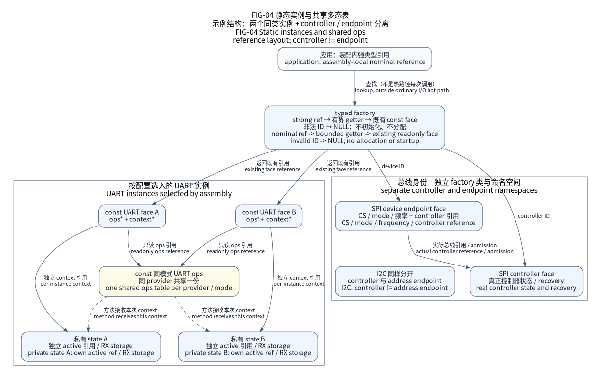

# F407 USART 线模式与冷态资源

`irq-wire` 为 STM32F407VET6／ZGT6 提供显式 USART 线模式，公共面继续使用
`nx_uart_port_t`、字节请求和事件 ring。配置选择完整收发机制、精确引脚、
IRQ 与错误退出；不会从 HAL 函数存在推导其他器件、板卡或物理资格。

`nx_uart_format_validate` 校验通用 5–9 位数据、none／even／odd 校验、
1／2 停止位与已知流控枚举；它不判断具体控制器支持。F4 provider 在任何
硬件效果前另行校验 7E/O、8N/E/O 与独立 9N word 能力。Host 配置由
`UartFormatPolicy` 的显式帧集合限制所选模式；扩大通用表达不扩大 F4
模式、路线或物理资格。

| `wire.protocol` | 精确实例 | 固定帧与执行合同 |
| --- | --- | --- |
| `asynchronous` | USART1／2／3／6 | 8N1；`flow` 可为 `none`、`rts`、`cts`、`rts-cts`，路线必须包含实际选定握手脚 |
| `synchronous` | USART1／2／3／6 | 8N1 master；显式 CPOL、CPHA、末位时钟；接收时必须提交实际或 dummy TX 来产生 CK |
| `half-duplex` | 全部六实例 | 8N1；只取得 TX，内部接收使用同一脚；先建立释放电平，再选择 open-drain AF |
| `lin` | 全部六实例 | 8N1；显式 10／11-bit break 检测，13-bit break 发送与原始字节／错误事件 |
| `irda` | 全部六实例 | 8N1 SIR、最高 115200 baud；显式非零 PSC，low-power 需要所选 APB／PSC 为 1.42–2.12 MHz |
| `smartcard` | USART1／2／3／6 | 8E1.5；open-drain TX、独立 CK、PSC 1–31、guard 0–255、可选硬件 NACK；每请求只发送一个字符 |

UART4／5 缺少 CK、Smartcard 与 RTS／CTS。C 冷态准入和 TOML 验证都拒绝这些
组合，既有私有 format／flow 入口也不能给 UART4／5 开启硬件握手。
模式不实现 LIN schedule、ISO 7816 会话、ATR、卡供电／复位或 IrDA 协议栈。

## 配置、状态与引脚

公共 `nexus/io/uart_wire.h` 保留协议模式与 LIN 请求准备；F4 冷态设置使用
SoC 私有 `nx_stm32_uart_wire_config_t`。PSC／guard 等原始参数属于显式 F4 专家
配置，不伪装成通用时间参数，普通组件不依赖该类型或厂商 Handle。
`[uart.<id>.wire]` 经不可变 `UartWireOptions` 生成私有只读配置，factory 返回
原有 UART face。`uart_wire.c` 只在选择 `irq-wire` 时选编，普通 byte/event 状态
和 `nx_uart_ops_t` 没有增加字段或方法槽。

此图沿用现有 factory／face／state 关系，不表示某块 PCB 已接入新线模式。
完整软件资源参考为 `tests/contracts/uart_wire_assembly/six-wire-ve.toml` 和
`six-wire-zg.toml`：USART1 同步、USART2 Smartcard、USART3 RTS／CTS、UART4
单线、UART5 LIN、USART6 IrDA；两个 Board package 明确为软件 fixture。

冷态记录保存实际取得的全部 pad 与 IRQ 优先级；单线不占用未使用的 RX，
Smartcard 占用 TX 与 CK，同步占用 TX／RX／CK，握手只取得所选 CTS／RTS。
原 pad latch、mode、type、pull、speed 与 AF 在完整停止后恢复。失败的回读
保留收条、时钟和同一 owner，后续 close 重试；不得清零 owner 来掩盖残留。

ES0182 Rev19 §2.11.9 要求 UE／RE 有效后才把 RTS 切到 AF。冷启动先把已授权
RTS 建立为 GPIO high，完整 USART 配置与 UE／RE 回读成立后才交给外设。
停止先撤销 RTSE 并回读，再关闭 UE／RE；RTSE 撤销失败时保留活动接收器和资源。
CTS／RTS 的电平、电压、外部上拉、peer 行为和 PCB 接线仍由 Board／产品审核。

## 收发、取消与恢复

一个未屏蔽的 Thread executor 独占 submit、cancel、service、read 与 stop；
生成 IRQ 直接绑定实例。IRQ 先记录 RX／错误，再处理 TX，保持 ES0182 §2.11.2
所需的 parity 观察顺序。ring 溢出沿用显式 loss，不能静默覆盖旧事件。

接受 TX 后，请求和 payload 借用到 acquire 观察 SETTLED。取消和 deadline
只停止加载，不撤销借用。TXEIE／TCIE 撤销失败时不能继续读 payload，也不能
结清请求；保留 QUARANTINED，service 在真实 TC 与源静止后才能释放。
完整停止排空 TX、撤销所有接收／LIN publisher，再归还引脚与时钟。
成功 close 后可以用原静态配置重新启动；失败 close 继续持有原状态。

`nx_uart_lin_break_prepare` 生成无 payload、长度为零的控制请求，只能提交给
LIN provider。SBK 尚未撤销或实际 TC 未出现时，取消／超时仍保留请求；排空
超过预算时进入 QUARANTINED。接收 break 使用 `NX_UART_EVENT_BREAK` 与
`NX_UART_EVENT_NO_BYTE`，同时保留实际 framing／overrun 等错误事实。
byte profile 不能表示 break 事件，使用 LIN 边界的调用者必须选择 events。

Smartcard 每请求只准入一个字符，TC 包含硬件 guard time；后续请求要等前一个
SETTLED。这实现 ES0182 §2.11.8 的 TC 间隔要求。发送期间观察到 PE／FE／ORE／NE
会停止后续加载、保留 RX 错误事实，并在真实 TC 后以 IO 结清。重传属于调用者，
不在 IRQ 中自动执行。

单线 TX／RX 可能观察到自身回送，线路仲裁与对端冲突处理属于产品。IrDA 在接收
期间不能抢发；产品必须提供光学收发器 settling、至少手册所述 TX／RX turnaround
以及显式 service／IRQ 延迟预算。同步接收的数据保存在原 ring，TX settlement
不代表调用者已读取全部 RX；overflow 仍是独立事实。

## 精确勘误与验证边界

依据 DS8626 Rev12 Table5／Table9、RM0090 Rev22 §30.3.8–30.3.13 与 ES0182
Rev19 §2.11。Smartcard NACK 采样窗口问题（§2.11.6）没有软件 workaround，
不能由此实现宣称 ISO 7816 认证。RTS 在 peer 违反握手时的异常（§2.11.5）仍要求
真实 IRQ 延迟与 peer 合同；有限 ring 不是自动无损背压。

LIN 不与 CTS 组合，也不会把 break 排到活动数据之后；新 break 只能在唯一 TX
槽空闲时准入，避免 §2.11.7 的活动数据／CTS／break 组合。无 workaround 的 IDLE
偏差（§2.11.1）不成为本 IRQ ring 的帧边界保证。芯片 revision 尚未实测。

GoogleTest 执行真实 C provider 与外部 MMIO／NVIC 边界，覆盖实例拒绝、完整 tuple、
RX、TX、Smartcard 错误、LIN break、取消、quarantine、RTS 启停与冷态恢复。
精确 TOML／typed IR／factory 和 VE／ZG ARM ELF 分别验证其软件与链接范围。
这些结果不建立电气波形、卡认证、光学时序或物理 HIL；当前 physical status 为
`not_executed`。既有 DMA 与 RS485 贷款合同仍见
[UART DMA 与电气适配](uart-dma-rs485.md)。
