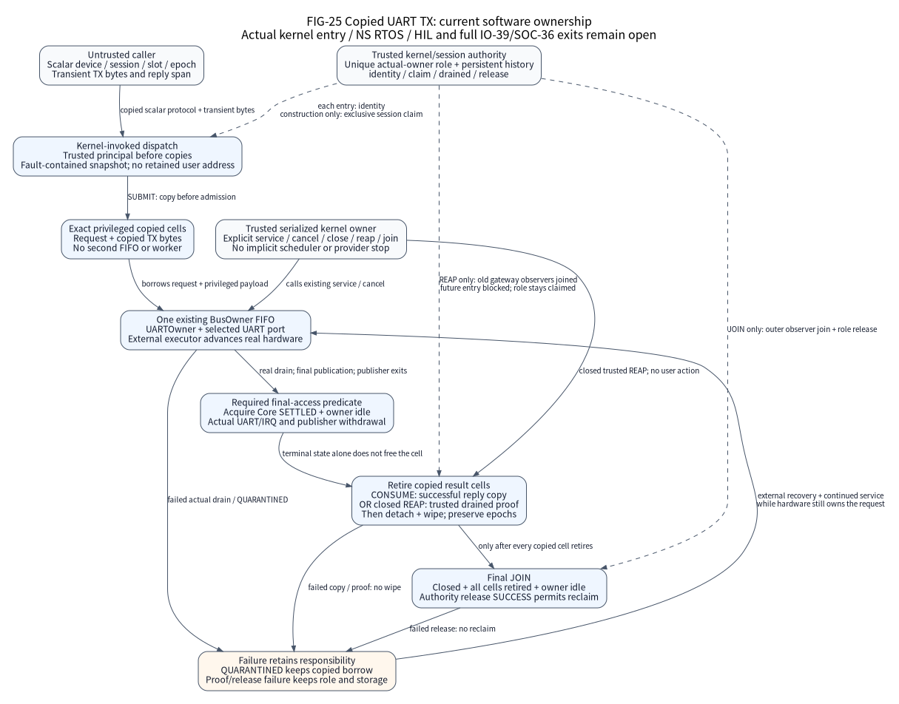

# Kernel-invoked user I/O admission

The optional `Nexus::UserIoBroker` separates untrusted messages from trusted
kernel policy. The scalar GPIO path pins user memory for one bounded typed read
or set/reset write. A separate copied UART TX path retains only privileged
request/payload cells and uses the existing BusOwner/UARTOwner. Neither path
accepts a user-supplied principal, port, MMIO address, callback or private slot
pointer. Actual kernel entry, permissions and hardware attribution remain
integration responsibilities.

## Scalar GPIO and pinned user memory

The 32-byte input and 8-byte output contain explicit `uint32_t` fields. The
trusted gateway calls the public API from privileged Thread mode with incoming
interrupt masks clear. A kernel identity callback authenticates the current
principal; the public message cannot choose it. Construction retains immutable
nonoverlapping nominal user RAM windows, exact device/mask grants, a positive
loan capacity and the kernel memory port. All known broker, policy, port-table
and private context spans stay outside those user windows.

Admission validates full-span arithmetic, alignment, access and one-window
containment before pinning. `pin` must establish the specified CPU access and
retain address-space/process/mapping lifetime until successful `unpin`. A failed
pin must leave no mapping references or residual effects. The whitelist alone
does not establish actual mapped RAM, DMA reachability, MMIO exclusion or MPU
isolation; the trusted kernel and SoC memory layout establish those facts.

The input is pinned and copied once into kernel storage. Policy checks use that
snapshot. The reply span is pinned before any GPIO operation. A final saved-mask
guard serializes revocation with the bounded scalar provider operation. Close
before this guard prohibits the effect; close after dispatch cannot undo it.
Every dispatched result copies a fully initialized reply, including provider
errors. A cancelled admission leaves the reply untouched. Pins remain held
through all copies.

`result` reports admission/device execution and `cleanup_result` reports the
most recent release attempt. `accepted` becomes true at the first successful
pin. `device_effect_possible` is set before calling the WRITE provider, even if
that provider returns an error. `retained` requires the exact kernel call slot,
user memory and address-space identity to stay alive. Cleanup tries output then
input release, records errors and preserves every failed pin independently.
`gpio_finish` retries only retained cleanup; it never rereads users, writes a
reply or repeats a device operation. Neither an operation error nor successful
cleanup authorizes replay of an earlier write.

The private generic loan mechanism retains one exact slot pointer with a
monotonic 64-bit epoch. Copied tokens and stale epochs cannot release it; epoch
exhaustion rejects reuse. Read-only spans may share bytes; any writable overlap
with a peer loan rejects. Known policy, provider, other loan and drain-control
aliases reject before mutation. Only the two exact internal GPIO child slots
may share their own call proof. A trusted drain callback must prove actual
peripheral/DMA/IRQ/deferred/copy final access and observer join. User input cannot
claim this proof. A failed proof or unpin keeps the exact pin and token retained.

One privileged serialized kernel owner controls a broker and its slots. All
memory/proof callbacks are bounded and run outside Arch guards; they may mark
close, but cannot recursively admit, release, execute or retain the cookie
output. Close inhibits admission and preserves every live loan. Quiescence is
valid only after close, with zero loans/list entries and no executor. It does
not implicitly stop providers or establish an application shutdown barrier.
There is no reopen or hidden identity registry. NMI/fault/SMP publishers and
unserialized privileged memory writers are outside this contract.

This is a component callable by an integrating privileged kernel, not an
implemented userspace transport. FreeRTOS SVC/MPU wrappers, task principal
authentication, real memory pins, fault-safe copy mechanisms and TrustZone
veneers are not connected in this slice. Generic loans provide ownership
mechanics. They do not provide asynchronous borrowed-user UART/SPI/CAN messages.
The copied UART path below is a separate contract and accepts no user-supplied
drain proof.

## Copied asynchronous UART TX

The [public protocol](../../components/user_io_broker/include/nexus/components/user_io_async.h)
and [trusted construction](../../components/user_io_broker/include/nexus/components/user_io_async_storage.h)
provide `construct`, `dispatch`, `close`, `reap` and `join`. The optional target
does not create a factory, kernel task, queue, registry or lock. The caller
supplies exact privileged cells and payload capacities, immutable policy/user
windows, complete private-context extents and an already constructed exclusive
BusOwner/UARTOwner/UART binding. The existing BusOwner remains the only FIFO.

(fig-25-user-io-copied-ownership)=

FIG-25 describes the current software mechanism, not an installed kernel gateway
or physical isolation result. The trusted kernel supplies principal identity,
fault-contained copies and an exclusive session/role authority. The external
executor advances the existing owner; no gateway call services UART implicitly.
The [implementation](../../components/user_io_broker/src/user_io_async.c),
[BusOwner](../../components/bus_owner/include/nexus/components/bus_owner.h) and
[UARTOwner](../../components/bus_owner/include/nexus/components/uart_owner.h)
define the figure's source and final-access boundaries.

Construction checks all complete span arithmetic and known aliases before any
external callback or claim. Cells, payloads, configuration, region/operation
tables, owner slots, UART executor/provider and every declared context stay
outside nominal user windows and disjoint as required. A temporary construction
reservation blocks callback reentry. The final trusted claim establishes one
exclusive role for the actual controller/owner, then initialization has no
fallible step. Another wrapper of that controller is not another role.

The authority must retain nonwrapping session history across fresh server
storage, process/device reset and reconstruction. It rejects reused or
non-increasing nonzero sessions and any second live role, including a larger
session, and fails closed when history is exhausted. The component supplies no
persistence policy or authority implementation.
Initialize-once alone is insufficient: after successful join, fresh objects need
a larger claimed session so old commands cannot become valid in new storage.

Every admitted gateway transaction authenticates the current principal before
copying users. A 48 B scalar header names device, session, slot, epoch, length and
an absolute deadline in the existing owner's clock domain. A 40 B initialized
reply contains no privileged pointer. These are local C gateway records; the
integrating kernel owns any transport serialization. The copied header is
checked once; full
read/write containment and disjoint user spans precede payload/reply copies.
The trusted copy port must establish real permission, fault containment and
mapping/process lifetime for each callback; nominal ranges alone establish none
of these properties. No user address survives return.

| Action | Ownership and result |
| --- | --- |
| `SUBMIT` | Propose the exact next nonzero slot epoch in the claimed session; copy a positive bounded payload before owner admission. Copy failure wipes the copied payload without burning the epoch. Acceptance reserves the copied cell, including a retained terminal error if BusOwner rejects. |
| `POLL` | Use the exact accepted session/slot/epoch. Only acquire-observed `SETTLED` exposes final result/count; earlier replies report `BUSY` and zero count. |
| `CANCEL` | Request the real owner's withdrawal. Cancellation, timeout and quarantine retain cells; late cancellation cannot replace the provider's observed terminal result. |
| `CONSUME` | Require acquire-observed `SETTLED` and real BusOwner idle/publication join. Copy the reply first; only success releases the exact identity and wipes copied bytes. |

A reply-copy error can follow accepted `SUBMIT`. The user already knows its
proposed session/slot/epoch and must recover with `POLL`; duplicate `SUBMIT`
cannot replay or replace the operation. A failed `CONSUME` reply copy retains
the terminal cell. Accepted TX may already have irreversible effects; no error
authorizes automatic replay. Per-slot epochs never wrap and survive consumption.

## Close, trusted reap and role join

One privileged unmasked Thread serializes gateway and management calls. Identity
and copy callbacks may synchronously request close; recursive dispatch and
in-flight management reentry reject. Close reserves its control publication,
permanently rejects new `SUBMIT` and cancels live work without wiping it or
stopping the underlying owner. The external executor must keep servicing actual
UART drain. `QUARANTINED` never grants permission to consume or reap.

If a user mapping disappears permanently, authenticated reply copy may never
recover. Trusted management can call `reap`; there is no user wire action for it.
It requires permanent close, every retained exact request acquire-observed
`SETTLED` and real owner idle. Before any wipe, a trusted `drained` callback must
prove outer gateway/transport observers joined and future entries blocked while
retaining the exclusive role. Failure or pending/quarantined work preserves all
cells and role. Success retires all cells without resetting epochs, wipes copied
payloads and latches a local fence against further dispatch. Reap abandons results;
it does not cancel an in-flight operation or undo transmitted bytes.

`join` requires permanent close, every cell consumed or reaped and real owner
idle, then the authority's successful release proves outer observers joined and
detaches role references. Failed release retains the role and all bound storage.
Keep configuration, cells, payloads, owner/provider and every context alive until
successful join. Only then may storage be reclaimed or fresh objects claim a
larger session. No local epoch or software predicate replaces the external
gateway proof or the provider's real final-access proof.

Cold validation performs pairwise checks over explicit cells/controls; copies
and wiping use the caller's exact byte budgets, and close/reap/join inspect the
explicit cell count. These are bounded software costs, not measured MCU latency
or power. SVC/CMSE entry, an actual kernel principal/copy/session authority,
MPU/TrustZone enforcement, NS RTOS, borrowed-user asynchronous SPI/CAN transports
and physical HIL remain outside this increment. The original
[IO-39](io-evolution-execution.csv) and [SOC-36](soc-refinement-execution.csv)
exits remain open; this common mechanism does not complete them.

## Software validation boundary

Google tests run the actual broker, typed GPIO wrapper, Native GPIO provider,
Core request state and Native saved-mask implementation. They model only the
external kernel identity/pin/unpin/proof boundary and privileged context.
Behavioral RED/GREEN logs, sanitizer runs, public-header probes and strict ARM
compilation are recorded in
`tools/testing/evidence/user-io-broker-iteration/manifest.json`. These establish
software behavior and compilation, not physical isolation, HIL timing or a
qualified product release. The optional archive defines no mutable globals;
default factory/source/ELF omission is verified separately by the integrating
build graph.

Copied-UART regressions exercise the real mediation, Core requests and existing
BusOwner/UARTOwner with external identity/copy/role and UART hardware ports
modeled. They include stale commands across fresh storage/session lifetimes,
copy failures, real drain/publication joins, management callback reentry and
closed reap. Execution evidence belongs to the exact source records, not to
this page or its diagram; it establishes no physical isolation or HIL result.
