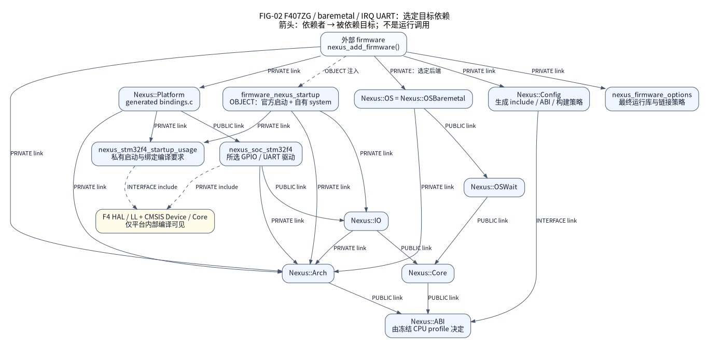

(explanation.build-model)=
# 构建模型与使用要求

应用拥有工程、工具链选择和 TOML；Nexus 提供可复用目标与显式装配。源码检出和安装 SDK 共用一份生产图，使应用不必进入平台开发工程。



## 发现、装配、镜像

`find_package(Nexus CONFIG REQUIRED)` 验证来源并加载 API；请求版本时只接受精确匹配，不解析装配或创建生产目标。`nexus_add_platform(ASSEMBLY ...)` 解析唯一 TOML、生成静态连接并建立平台。`nexus_add_firmware()` 创建镜像及其产物检查。

```cmake
cmake_minimum_required(VERSION 3.31)
project(controller LANGUAGES C ASM)
find_package(Nexus CONFIG REQUIRED)
nexus_add_platform(ASSEMBLY "${CMAKE_CURRENT_SOURCE_DIR}/assembly.toml")
nexus_add_firmware(controller SOURCES main.c)
```

这是外部应用的 CMake 入口片段，仍需完整 `assembly.toml`、`main.c` 和预先选定的工具链。首次操作见[应用教程](../tutorials/first-f407.md)。

一个构建目录只有一个工具链和装配。工具链在 `project()` 前选定；平台验证 CPU/FPU/ABI，不在启用语言后替换编译器。相同装配可有多个镜像；不同装配使用独立目录。

`nexus_add_runtime(ASSEMBLY ...)` 只创建 CPU Runtime 库，与 Platform 互斥。应用自建 executable，提供 startup、链接脚本和具体 provider，并显式调用 `nexus_apply_firmware_policy(target)`。

## 谁拥有依赖

| 位置 | 责任 |
| --- | --- |
| 根 `CMakeLists.txt` | 平台开发工程与明确选择的测试/workload |
| `cmake/Nexus.cmake` | 显式构造 API |
| `cmake/platform/` | 唯一生产图与私有装配上下文 |
| SoC package | 驱动、SDK、System 和启动使用要求 |
| 组件叶目录 | 本组件的源码与公共/私有依赖 |
| 工具链与 preset | 编译器、SDK 位置与构建目录 |
| 产品 | 应用库、最终镜像与执行策略 |

Provider target 发布 `NEXUS_STARTUP_SOURCES` 和 `NEXUS_STARTUP_USAGE_TARGET`。Platform 通过 `NEXUS_PROVIDER_TARGET` 指向实际 provider；每个镜像独立创建 startup OBJECT，私有消费厂商头、器件宏与 HAL 配置。

`Nexus::ABI` 传递必须一致的二进制使用要求，`Nexus::OS` 表示已选择的后端。运行库、`-nostartfiles`、链接脚本和资源检查附着最终镜像；应用诊断策略由应用自己决定。

## 配置、组件与裁剪

TOML、事实和配置代码先冻结为不可变 IR，再原子发布一个 bundle。生成器输出配置、对象、factory 和公共需求，不维护 C 源码列表。CMake 按模式、IP 和公共需求选择实际翻译单元。

普通组件直接使用 CMake target。需要静态绑定或厂商选择的组件共用 `components/catalog.json`，叶目录创建目标。公共生成头的 API 需求与 bindings 的私有实现需求分别传播；未选重依赖不准备、不编译。

## 增量与失败

普通 C 修改由 Ninja 和编译器依赖触发相关工作。TOML、选中事实或生成器改变重新配置；相同生成内容保留时间戳。无变化构建不应再 configure、编译或链接。

配置拒绝或中断使旧生成结果失效。链接失败或取消撤销旧 BIN/资源报告；缺少声明产物时直接构建固件目标能够恢复。预算和检查器变化复核现有 ELF，布局变化触发链接。

SDK 发现与实际构造是不同消费边界。后续构造必须检出 SDK 字节变化和来源冲突，不能靠持久“已验证”标志跳过。具体规范见[构建合同](../reference/contracts/build-system.md)。
