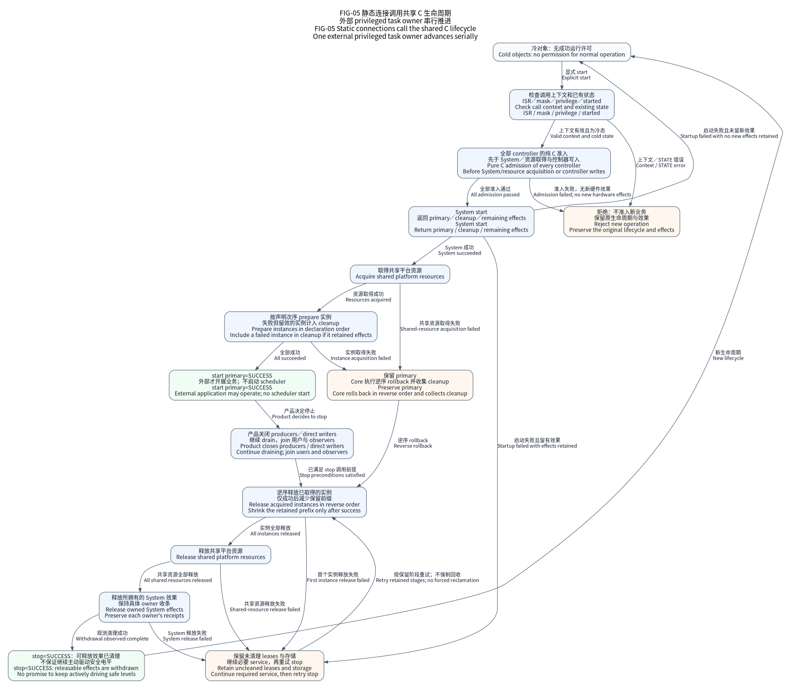

(explanation.design-principles)=
# 为什么选择静态、明确的边界

MCU 的 CPU 时间、RAM、Flash、带宽与电源都有界；外设和执行者会并发，IRQ/DMA 也可能晚于函数返回。设计首先保证正确性与硬约束，再比较已声明成本。

## 构建期决定固定事实

一个固件通常面向一种精确芯片与 PCB。CPU、路由、时钟、DMA、容量和软件选择在构建期确定，运行期维护真实操作状态。TOML 只表达产品选择；SoC/Board 拥有事实；C 实现拥有行为；CMake 拥有依赖图。

同 IP 增加料号或路线优先扩展数据。新硬件 IP 沿用已有语义时新增私有 C、binding 与局部 CMake；新的公共语义才演进相应领域合同。配置器不加入厂家名称或寄存器编码分支。

## 按实际需要承担资源

静态实例只保留选定模式的 config、runtime、request、stream 和回执。只读方法表共享，容量、字节单位、对齐与寿命可审查。未选择异步、owner 或 OS 的同步实例不预留它们的最大状态。

不以提前交还 DMA buffer、少读 volatile、遗漏屏障或省略错误退出换取性能。优化需要等价配置下的 ELF、反汇编或测量。间接调用能否消除、CPU 利用率和栈峰值都需要实际证据。

## 窄接口保持可替换

公共 face 只有领域操作和实例 context。Provider 维持相同单位、错误、借用、完成与失败责任；厂商 Handle、寄存器编码和可变状态留私有。控制器与子端点分别拥有身份，不能用第一个子设备冒充整个总线。

单一职责体现为事实、校验、C 行为、执行和产品策略分别维护。开闭原则依据真实变化点；接口隔离不要求构造统一设备基类或所有内核对象的共同表示。依赖倒置通过窄端口和显式注入实现。

## 执行和退出都明确

平台不创建默认 worker、不替产品启动 scheduler。应用指定唯一执行者，持续 service，提供绝对同域 deadline、请求和 buffer。停止先关准入，再撤回硬件引用、排空并 join；首次撤回失败保留剩余责任。

ACCEPTED 与 SETTLED 是借用边界，不是普通函数返回状态。cancel、timeout、DMA TC 或诊断 detach 均不撤销借用。QUARANTINED 状态继续拥有必要存储与恢复责任。

## 维护成本也是设计成本

一个事实只有一个作者来源。公开签名由头文件生成，示例引用维护中的真实文件；目录 README 解释自身责任。不要为了统一外观增加转发层、重复状态或第二份源码图。

同资源和工作负载下比较成本，按独立实现类保留关键回归。真实 RED–GREEN、源码和配置身份、原始失败与独立评审共同支撑维护。软件行为、ARM 链接、SDK 消费和物理 HIL 是不同范围。
