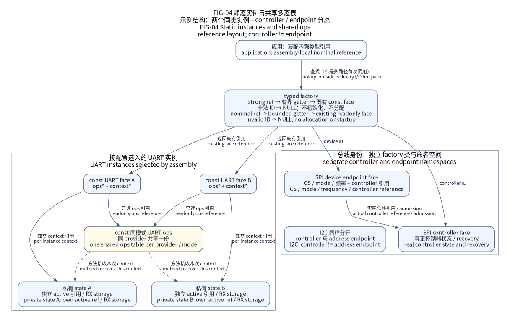

(docs-explanation-factory)=
# Typed factory, static instances and polymorphic faces

The current platform keeps typed factory lookup and C polymorphism. Configuration
generates the exact instances; factory lookup returns them without constructing,
initializing, locking or discovering anything. Hardware startup and request execution
are separate explicit actions.



FIG-04 shows the current identity structure. A controller and a child endpoint have
different interfaces and IDs even when their implementation shares a physical bus.

## What generation owns

One schema-2 TOML selects instance names, bindings, modes and exact capacities.
The strict resolver produces typed IR; emitters publish readonly faces, shared ops
references, private independent contexts, fixed IRQ wiring and compact getters.
Native assemblies receive independent model state too; a test singleton is not
the production instance-generation mechanism.

`nexus_factory.h` is generated for each Platform assembly, so its IDs are not a universal
header or persistent numbering scheme. Default IDs are compact `uint16_t` aliases
with named constants. COUNT, invalid and unselected entries return NULL.
A chip capability record does not grant Board routing or physical qualification.

## Choose strong references for new products

Every Platform assembly emits `nexus_factory_strong.h`. New products should
include it and use the class-specific `NX_*_REF_*` constants with
`nx_factory_*_ref()` getters. These wrappers return the same static faces and
add no global storage, hardware access or configuration key.

The four external starter templates and the primary public SDK consumers use
these strong references by default. `configure.py explain --assembly <input>`
shows the exact include, return type, reference constant and getter derived from
the same factory projection. Physical controller names do not determine the
public interface: word UART and enhanced bus endpoints may have distinct faces.

The wrapper introduces no persistent storage. Its final instruction cost is a
compiler and optimization observation, not a promise implied by `inline`.
Compare actual equivalent ELF images, including debugging profiles, before
claiming zero additional code. Lookup remains separate from platform start and
ordinary I/O dispatch.

Default scalar IDs remain assembly-local `uint16_t` aliases; C does not reject
mixing two such aliases. Nominal structure references let the compiler reject
that class mismatch. They do not authenticate an external value or make an
instance active. Optional capability records are separately selected by
`factory.capabilities`.

The factory header includes complete public APIs only for selected interface
classes and preserves forward declarations for unselected getters. Include a
specific public I/O header explicitly when code needs that API or its complete
face layout; an empty getter still returns NULL.

(factory-controller-diagnostics)=
## Map lifecycle diagnostics to the assembly

Generated `nexus_bindings.h` names every resolved controller position with
`NX_PLATFORM_CONTROLLER_INDEX_<kind>_<assemblyID>` and provides
`NX_PLATFORM_CONTROLLER_INDEX_COUNT`. Names use generated C symbols, for example
`NX_PLATFORM_CONTROLLER_INDEX_UART_LINK_A`. These are the zero-based controller
ordinals reported by diagnosed start/stop, not typed factory IDs, persistent
numbers or a wire ABI. `SIZE_MAX` still means no controller in a diagnostic.

When `factory.capabilities` is enabled, `nx_factory_controller_capability()`
uses that `size_t` ordinal to return the controller's existing immutable
capability object. It does not allocate a copy or introduce another metadata
table. `nx_factory_controller_label()` uses the same ordinal and an exact field:

| Field | Returned immutable fact |
| --- | --- |
| `NX_FACTORY_CONTROLLER_ID` | Authored assembly instance ID |
| `NX_FACTORY_CONTROLLER_KIND` | Selected controller kind |
| `NX_FACTORY_CONTROLLER_HARDWARE` | Selected concrete hardware controller |
| `NX_FACTORY_CONTROLLER_MODE` | Selected semantic mode |

An invalid ordinal, including COUNT, returns NULL. Label lookup also returns
NULL for an invalid field or `NX_FACTORY_CONTROLLER_FIELD_COUNT`. Text is static
and belongs to this assembly. Neither lookup accesses hardware, clocks, locks or
mutable lifecycle state; both may inspect immutable facts before start and after
stop without granting readiness, resource ownership or execution permission.

The default-disabled option emits no diagnostic text or runtime lookup objects.
Named ordinal constants alone occupy no runtime storage. See the actual
[factory emitter](../../tools/configure/factory.py),
[binding emitter](../../tools/configure/bindings.py),
[configuration regressions](../../tools/configure/test_factory_diagnostics.py)
and [generated Native factory tests](../../tests/google/native_factory_test.cpp).
These source/test locations are review entry points, not downloadable execution
receipts or new-source software qualification.

## What a call does

| Action | Work performed |
| --- | --- |
| `nx_factory_uart(id)` | Select and return an existing readonly UART face |
| `nx_platform_start()` | Execute selected setup and retain cleanup outcomes |
| Public I/O operation | Validate face, then dispatch `ops(context, ...)` |
| IRQ entry | Access the fixed concrete provider and its owned hardware |
| Explicit service/wait | Advance or observe the selected lifecycle |
| Stop | Close/drain according to contract; cannot revoke outstanding storage |

Products may retain a face for the provider-storage lifetime. Stopping hardware
does not revoke a pointer or synchronize callers. The application must quiesce
callers and publishers before reclaiming external adapter storage. No getter
changes mode or silently acquires execution ownership.

## Verify the generated design

This complete maintained assembly selects independent Native instances:

The complete [host-model assembly](../../tests/contracts/native_assembly/multi.toml)
is a test fixture, not a production Board. Resolve it explicitly:

```sh
python tools/configure/configure.py check --test-support \
  --assembly tests/contracts/native_assembly/multi.toml
```

The [async tutorial](../tutorials/async-io.md) runs the complete generated factory
binary. It verifies cold lookup, distinct contexts with shared ops, bus/endpoint
identity, invalid IDs, stop/restart and retained quarantine. The authority for
these interfaces is the [integration contract](../design/integration-contracts.md)
and generated/public headers; this page explains the design rather than duplicating
function declarations.
