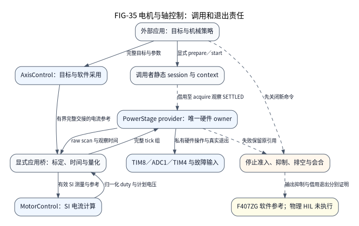

(explanation.motor-control)=
# 电机计算、轴目标与硬件执行

Nexus 将电机计算、轴目标和硬件执行分别交给可选 C11 组件、外部应用桥和唯一
provider。本文说明当前软件合同及其成本，不把软件参考配置授予任何功率板、
电机或物理控制资格。

FIG-35 表达当前可选组合：实线是显式调用或数据交付，虚线是借用和退出责任。
图不要求应用启用全部节点；精确 F407ZG 参考、源路径和边界见
{ref}`图册 <fig-35-motor-control>`。

## 由谁计算，由谁执行

| 边界 | 拥有的内容 | 外部应用仍负责 |
| --- | --- | --- |
| `Nexus::MotorControl` | 有感电流计算、坐标变换、限制、调制计划及零偏候选 | 校准后的相电流、角度来源、电机参数和硬件提交 |
| `Nexus::AxisControl` | 目标准入、速度／位置参考、参数 revision 与软件采用事实 | 执行节拍、机械侧、命令授权和机构恢复 |
| `Nexus::IOPowerStage` | session、raw 观察、完整 tick 输出和退出合同 | 完整 callback context、校准桥和有限操作预算 |
| F4 provider | TIM8、ADC1、TIM4、所选 IRQ、门钟与引脚的生命周期 | 经审核的板级授权、供电、模拟前端和功率能力 |

组件不创建堆、任务、全局时钟或电机注册表。控制数学不包含 HAL；provider 使用私有
厂商类型和经审核的硬件操作。组件 target 仅在被明确链接时进入镜像，实例状态由
调用者提供，未选模式不承担其最大缓冲与运行状态。

| 执行入口 | 合法上下文与推进 |
| --- | --- |
| Axis 命令、参数、step 与停止 | 同一个 Task 执行者；位置规划不进入 ADC IRQ |
| Motor step 与数学函数 | 单一执行者的 Task 或选定 IRQ，满足自身计算预算 |
| PowerStage prepare／start／service／stop | 同一个 privileged、未屏蔽的 Task；显式推进 |
| PowerStage compute | 仅选定 ADC IRQ；不等待 Task、不保存临时指针 |
| CANopen／CiA402 | 单个 Thread 执行者，先完成协议 step，再提供有效轴事实 |

## 一份决定不等于一个物理结果

应用分别保留原始请求、受约束参考、软件采用、输出计划和测量。Axis 的
`adopted_at` 描述其执行者采用目标的时刻；Motor 的输出是归一化 duty 和计划电压。
provider 接受完整 shadow 组，也不证明对应物理边沿已经发生。

位置、速度、电流、机械角、电角和转矩不能混用。齿比、编码器计数倍率、方向和极对数
分别有明确来源。应用桥将 Axis 选定机械侧的角度和速度换算为 Motor 要求的转子
机械侧，再由电机计算应用极对数；电流参考的单位是 A，不按齿比折算。没有核验转矩
常数与电流约定时，安培目标不能改名为转矩反馈。

## 采样、观察与计划输出分别计时

Motor 输入区分 `sample_time_us`、`angle_time_us`、`observed_at_us` 和
`apply_time_us`。角度可以在采样之后、观察之前取得，随后在明确误差预算内向采样
时刻回投影或向输出时刻预测。预测使用调用者提供的有效机械速度；软件读取时刻
不自动成为采样孔径。

F407ZG `injected-power-stage` 参考使用边沿对齐 TIM8、ADC1 四个顺序 injected
rank，以及 TIM4 编码器观察。前三 rank 是 raw 相电流，第四个是 raw 母线电压。
`sample_at` 是计划触发参考，`scan_span_us` 是声明的转换跨度；三相不是同时采样。
应用桥必须说明顺序采样近似和角度估计的适用范围，不能靠重写时间戳伪造同步。

有效窗口同时受 duty、deadtime、模拟稳定时间、转换、IRQ 延迟、compute 和提交
预算约束。调制器的数学余量不能代替 provider 的窗口检查，更不能证明真实模拟
稳定时间。当前参考不声明中心对齐、多 ADC 同时采样、单分流或无感换相。

## 三种期限保持独立

1. 外部命令有效期决定旧运动参考还能否使用，重复帧和心跳不自动续期。
2. PowerStage 用单独的 `startup_deadline` 约束启动；非阻塞长期 session 的
   `base.deadline` 为 `NX_DEADLINE_NEVER`，运行直到显式停止或故障。
3. service、清理尝试和维护使用各自有界执行；超时不能撤销借用或证明已经断能。

Task 通过显式 service 推进启动及最终排空；选定 ADC IRQ 只执行有界 callback。
任务不得逐字段改动被 IRQ 借用的算法状态。跨上下文目标与参数通过已有有界对象
交接，普通结构体复制不构成同步协议。软件只能在 callback 返回后检测其超预算，
不能用 deadline 抢占一个不返回的计算。

## 故障与退出沿着原 owner 完成

计算错误、角度过期、非法采样或完整输出失败关闭相应准入。Motor 算法故障不能
替代硬件抑制；应用仍按 PowerStage 合同 stop／service。输出关闭后，session 和
全部 context 仍保留到 acquire 观察 `SETTLED`。退出失败保持 `QUARANTINED`，
不能清零状态后复用，也不能用恢复同一个 epoch 数值伪装新会话。

受控减速依赖仍有效的反馈、供电和能量处理。硬件 stop 是输出与源撤回，不是机械
减速或功率隔离。升降承重、抱闸、机械回零和整机重新启动条件属于外部应用；电角
偏置、编码器参考和机械零位分别建立有效性。

## 软件项目提供各自范围的证据

独立示例仓库的双轮 SIL 运行实际 C 控制和独立 DC／机械模型；控制器只看模拟
传感器，验收器可以读取模型真值。轮速、里程计和地面真值分别报告。固定窗口缺样
不能填成零误差；课程参数只属于明确的教学 profile。

PMSM 数学模型、生产 C 寄存器模型、ARM 链接、安装 SDK 消费和物理测量是不同
证据。DC 模型通过不授予 PMSM 或实板能力；当前物理 HIL 保持 `not_executed`。
MCSDK 不是自有控制核的依赖，尚未接入的后端也不占位声明为已支持。

操作入口见[控制与智能器件](../guides/control-and-smart-devices.md)，权威公共声明见
[电机与轴 API](../reference/api/components/control.md)及
[耦合采样 API](../reference/api/io/analog.md)。
