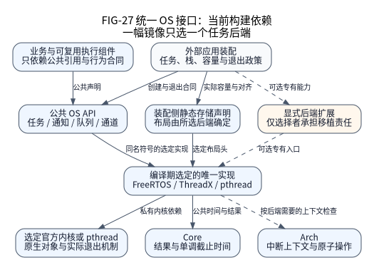
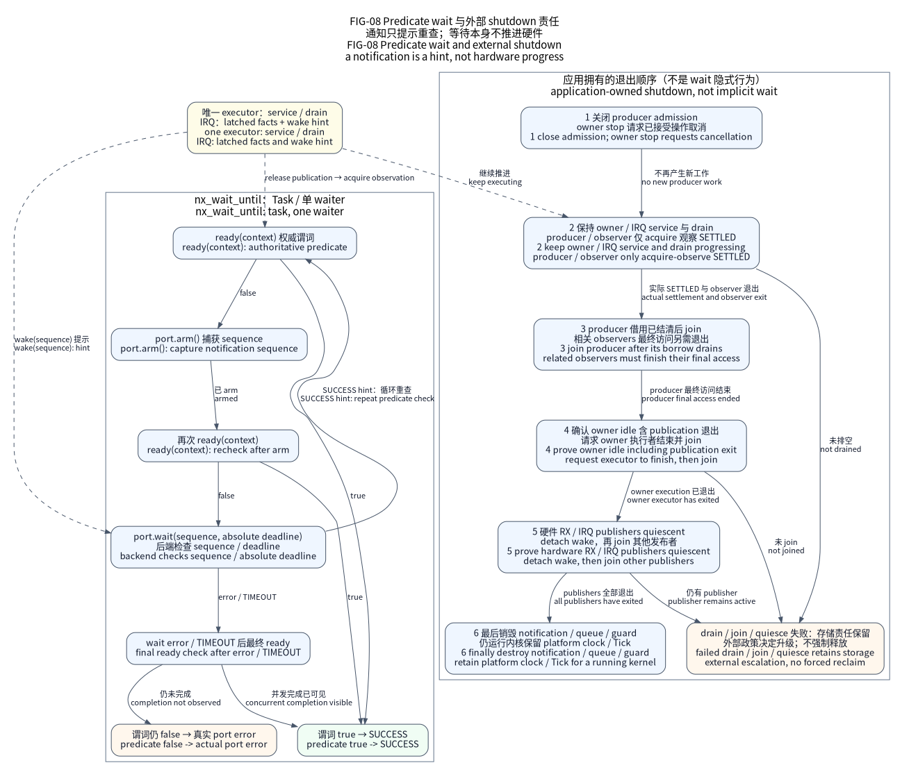

(explanation.os-portability)=
# OS 源码可移植性：现行架构

本页说明公共 OS 接口、静态内存与后端扩展如何连接。任务、通知、队列、关闭通道
和执行预算已在 FreeRTOS、ThreadX、Native 后端使用同一组公共符号；装配侧持有
选定后端的真实存储，业务只接收公共引用。实施与验收清单见
[交付清单](../development/os-portability-plan.md)，调用要求见
[OS 执行合同](../reference/contracts/os/execution.md)和
[后端接入合同](../reference/contracts/os/backend-integration.md)。

公共消费链已有真实内核与外部示例的阶段验证。最终集成、ARM、资源和 SDK 资格
仍以绑定最终源码及配置的实际报告为准。源码可移植不表示二进制 ABI、调度时序、
最小栈或所有内核特性相同；Host 执行不建立 MCU 实时性或实板资格。

## 当前接口与边界

| 边界 | 当前实现 | 使用限制 |
| --- | --- | --- |
| 等待 | 公共 `nx_wait_port_t` 和条件等待 | 保留现有合同与直接 callback 布局 |
| 任务与通信 | 公共任务、通知、队列和 channel 接口 | 专有调度与隔离仍用明确扩展 |
| 存储 | `storage.h` 完成选定后端布局 | 业务头不包含原生控制块，切换后端重新编译 |
| 后端选择 | CMake 选择并校验唯一任务后端 | 无运行期分派表或按调用判断 OS |
| 能力要求 | `nexus_require_os_capabilities` 校验目标元数据 | 不隐式链接，不将缺失能力降级为成功 |
| 裸机 | 非阻塞通知，没有任务调度器 | 只声明等待能力，不能满足任务能力要求 |

接口合同、对象布局和构建选择分别维护。业务不需要命名原生 TCB，平台也不预留
跨内核最大对象、动态句柄表或通用对象池。现有内核算法继续由对应后端执行。

## 依赖、职责与目录



FIG-27 的身份是 current，每条箭头都表示构建期依赖，包含编译依赖和链接时的实现
选择，不表示启动顺序、每次运行调用或所有权转移。图中的后端是互斥选择；
应用不会同时链接三个同名 OS 实现。
图只覆盖任务后端，不包含裸机路径。普通 I/O 不强制经过 OS，
也不新增运行期 factory、worker 或对象池。

| 层 | 拥有的责任 | 不承担的责任 |
| --- | --- | --- |
| 业务与协议 | 领域状态、输入输出和策略 | 内核类型、tick 换算、后端条件编译 |
| 可复用执行组件 | 排队、停止和进度，通过公共 OS/I/O 端口工作 | 产品线程角色和内存预算 |
| 外部装配 | 后端、对象存储、栈、优先级、容量和启动退出顺序 | 复制内核算法 |
| 公共 OS | 稳定单位、上下文、所有权、失败和生命周期合同 | 调度策略的虚假等价 |
| 后端 | 内核调用、状态转换、优先级映射与真实资源回收 | 产品恢复策略 |
| Core / Arch / SoC | 原有请求、时间、CPU 和硬件职责 | 隐式启动 scheduler |

该划分对应 SOLID：接口与存储各有单一变化原因；新增后端实现同一合同；只有满足
合同的能力才能替换；小接口分离基础与可选能力；组件依赖公共端口。它不要求为
每个函数增加接口层，也不允许以 `UNSUPPORTED` 掩盖已声明能力的缺失。

当前目录保留公共声明、选定存储布局和实际后端实现，按职责分文件。

```text
os/
  include/nexus/os/
    wait.h
    task.h
    notify.h
    queue.h
    channel.h
    storage.h
  baremetal/
  freertos/
  threadx/
  native/
```

FreeRTOS 的 `task_runtime.c` 实现内核启动、读时钟、延时与 yield，普通对象算法
保留在 `freertos.c`；ThreadX 与 Native 分别由自己的 C 实现承担。每个任务后端
通过 include 路径提供同名 `nexus/os/detail/backend_storage.h`，而不是依靠整仓
配置宏选择布局；真实 RTOS 的 Host 夹具因此也能取得正确存储。现有 MPU、Secure、
端口准备工具与锁定依赖继续归后端维护，Host 脚本不进入固件、不修改 vendor。

## 编译期选择与静态存储

公共函数在各后端具有相同符号，CMake 每次只选择一个实现。无需
`switch(os_type)`、通用 ops 表、运行期名称查找或动态对象池。保留
`nx_wait_port_t` 的 callback，是因为组件需要连接具体通知对象，与整幅镜像
选择内核是不同问题；不再包一层通知 vtable。

业务头只看到未完成类型及引用。装配文件包含选定布局头，才能定义实际存储；
同一对象直接形成业务引用，不额外分配一个只保存指针的包装对象。
原生控制块头可以成为装配文件的编译依赖，但不进入业务头。

以下片段来自三后端实际共用的 C11 消费者：两步操作共用一个绝对预算，业务不包含
内核分支。它不包含对象装配、内核启动和退出流程，不是完整 `main` 教程。

```{literalinclude} ../../tests/behavior/os/portable_consumer.c
:language: c
:start-at: nx_result_t nx_portable_queue_exchange
:end-at: }
```

装配侧用 [storage.h](../../os/include/nexus/os/storage.h) 和
`NX_OS_STACK_DEFINE` 定义实际对象与栈；业务侧只需要相应公共头。

栈容量对外以 B 表示。后端检查对齐、启动帧、容量溢出和原生单位换算；TCB、
任务上下文、同步对象和队列数据区由外部 owner 持有。布局由真实选定类型决定，
不维护另一套手写 sizeof，不预留跨内核最大 union，不把固定字节数组当通用 TCB。
选择不同内核或配置后必须重新编译，并重新核对 `sizeof`、alignment 和预算。

硬件选择沿用 TOML、typed IR 和 CMake 单一路径。软件消费者在显式建立装配后，
用 `nexus_require_os_capabilities` 校验 `Nexus::OS` 的能力，再显式链接该目标；
校验函数不创建对象、不代替链接、不复制一份 TOML 能力清单。
后端发布 `NEXUS_OS_BACKEND` 兼容身份，CMake 拒绝一幅镜像混入不同任务后端。
裸机不冒充任务实现，真实 Host 内核端口也不声明硬件 IRQ 发布能力。

这里不新增 Kconfig、缓存回退或独立 MCU 注册表。新 MCU 若复用已有 CPU/内核
合同，提供 SoC、IRQ、时钟和 Board 事实即可；新端口或新语义才修改 OS 集成。

## 通用能力与可选扩展

本页的任务能力集合覆盖 FreeRTOS、ThreadX 和 Native 公共实现，不是新增的 TOML
配置键。裸机只保留非阻塞机制；任务、关闭和优先级等需求通过实际目标能力校验。
永久任务与可返回任务、普通队列与关闭通道分别承担各自的存储成本。

| 能力 | 当前公共合同 | 选用成本与限制 |
| --- | --- | --- |
| 通知 | 单 waiter、多 publisher；提示后重查真实条件 | 保存序列与后端唤醒状态，发布域明确 |
| 可返回任务 | 入口返回后可由唯一外部 owner join | 需要完成同步与真实内核回收 |
| 永久任务 | 无 join；入口不得返回 | 省完成状态，误返回 fail-stop |
| 任务时间与让出 | `nx_sleep_until` 与 `nx_task_yield`，仅 task 使用 | 不创建 timer worker，不保证微秒精度或公平 |
| 基础队列 | 固定 item size/depth、复制、有限等待 | 控制对象和 `depth * item_size` 数据区 |
| 可关闭通道 | 关闭发送准入、广播退出、保留已有数据排空 | 额外 waiter 存储与广播成本 |

本批没有公共 mutex／semaphore 接口。OSU-21 盘点确认：现有生产组件通过窄端口
注入同步，未直接依赖跨 OS mutex 或计数 semaphore；当前消费链由通知、队列与
channel 满足。OSU-22／23 因此明确不纳入，不创建空头或宣称已支持。原生内核
已有这些功能，不等于 Nexus 已提供相应公共合同。

FreeRTOS 直接通知槽、ThreadX 抢占阈值、MPU 受限任务和 Secure 上下文属于显式
扩展。应用选择这些能力就接受对应装配的移植成本；不能让普通组件私自依赖它们。
不默认引入软件 timer daemon、事件派发线程或通用 user-object pool。

## 任务、启动与回收

任务接口统一入口签名、可返回/永久分类和结果语义。start 成功后任务可能已经
执行，甚至在 start 返回前结束；context 和必要连接必须先准备完成。
创建被拒绝时不保留 entry/context。若底层部分资源未能撤回，必须返回明确的残余
责任并保留控制对象，不能把它描述成可立即重用的干净拒绝。

可返回任务的入口返回只表示业务结束。FreeRTOS 外部删除、ThreadX 的真实删除、
pthread join 由后端实现；共同成功条件是内核与适配层已解除对应引用。
join 超时不强杀任务，不释放栈、TCB 或 context；self-join 和竞争 join 被拒绝。
不提供一个声称能安全撤销所有业务效果的通用 task-kill。

`nx_os_run` 接受明确的 bootstrap 回调，成功进入后不返回。FreeRTOS 在回调后
启动真实 scheduler；ThreadX 在实际 `tx_application_define` 范围执行回调；
Native 执行回调后停驻调用线程，保留其栈，不创建隐藏 coordinator。
各内核不伪装相同的引导状态；bootstrap 只完成声明允许的非阻塞构造与连接。
平台启动仍不启动调度器，不允许将已运行内核重新解释成冷态 bootstrap。

Native 有限 join 先尝试 `pthread_tryjoin_np`，再用
`pthread_clockjoin_np(CLOCK_MONOTONIC, ...)` 共享同一截止时间。
构建使用真实链接探针检查这两项 GNU 能力，缺失时拒绝 Native 任务配置。
只有显式 `NX_DEADLINE_NEVER` 使用无期限 join；入口完成提示不能代替 pthread
实际退出，不在有限等待后偷偷调用无界 join。

## 队列、通道和同步语义

基础队列不承担关闭广播。发送成功表示队列已复制 item，接收成功才交付 item；
超时或关闭拒绝不能偷偷消费 item，也不能在失败时改写接收输出。
排队指针只复制指针，payload 的借用与回收仍由调用者协议负责。

可关闭通道复用现有正确性要求：close 后拒绝新发送，唤醒已登记阻塞者，旧 item
仍可接收，排空后接收返回关闭结果。控制对象、每个并发 waiter 和数据区都由
调用者提供；destroy 要求 closed、drained 且 users/publishers 已退出。
close 和 destroy 不替代执行 owner 推进；不能以定期超时检查代替关闭唤醒。

通知与通道都需要等待者和发布者实际退出，才能销毁；销毁失败保留未解除的资源，
只允许受审重试。应用若明确选择原生同步扩展，仍需自行维护 owner、计数和优先级
协议，不能用普通 binary semaphore 冒充优先级继承 mutex。

## 时间、优先级与上下文

有限等待保持现有绝对单调微秒合同；后端向上换算 tick，跨唤醒重算剩余预算。
无限等待只能显式选择 `NX_DEADLINE_NEVER`；溢出不能降为无限。立即可满足的
操作可先成功，等待错误后仍按公共 Wait 合同重查真实条件。
时间域必须在等待、排空和 join 期间连续；重启 epoch 后旧 deadline 失效。

`task.h` 提供 task-only 的 `nx_sleep_until` 和 `nx_task_yield`。
`nx_sleep_until` 使用 `nx_os_now_us` 的同域绝对 deadline，过期立即返回，拒绝
`NX_DEADLINE_NEVER`，不推进设备、不保证微秒唤醒精度。Native 的 OS 时钟始终是
真实 `CLOCK_MONOTONIC`，不能混用可切换的硬件模型时钟。`nx_task_yield` 只提出
调度提示，不保证公平、指定下一任务或让低优先级任务运行，两者不隐建 timer worker。

公共逻辑优先级数值越大越高。FreeRTOS 保持同向编号，ThreadX 反向映射；可用
等级由所选存储头的 `NX_OS_PRIORITY_LEVELS` 表示。Native 只接受逻辑值 0，
其他值拒绝，不忽略参数；它不声明 `priority` 能力，也不声称普通 pthread 调度
具有 MCU 抢占保证。应用装配显式选择优先级与栈预算。

| 上下文 | 当前准入 |
| --- | --- |
| 普通 task | 已运行的正确内核、受支持权限和屏蔽状态；阻塞只在允许阶段 |
| Bootstrap | 允许受审的构造、未执行任务撤回与通知发布；队列/channel 传输仍拒绝 |
| IRQ 发布 | 独立入口，先核验 IRQ 范围、mask、分组与 syscall ceiling |
| NMI / fault / 其他安全域 | 不继承普通 IRQ 合同，未维护的组合拒绝 |
| MPU 用户任务 | 仅受审 syscall；公共名称不自动授予原生内核或 I/O 权限 |

本批不提供 ISR 队列/channel 传输；IRQ 通过明确通知入口发布提示，不调用阻塞操作。
实际 IRQ 原语继续保存/恢复 incoming mask，不用本地关中断声称获得 SMP、DMA
或跨安全域互斥。Secure companion 不增加第二个 scheduler，信任边界保持原合同。

## 结果、停止与失败责任

公共接口沿用 Core 结果类型，不另建 OS 错误枚举；准确码值及输出规则由公共头
维护。参数与上下文拒绝发生在对象和内核效果变更前；内核错误不撤销已经发布的
通知提示，调用者仍须重查真实条件，不能据错误返回提前回收借用。

| 结果类别 | 存储和后续责任 |
| --- | --- |
| 参数/上下文拒绝 | 不取得新的业务借用，不执行内核操作 |
| 必需能力不满足 | 配置失败；动态扩展另按明确接口拒绝，不偷偷选择替代模式 |
| 等待超时 | 结束本次等待；保留任务、请求和其他未结束借用 |
| 通道关闭 | 停止发送准入；继续 drain 和等待者退出 |
| 忙/尚未退出 | 保留同一存储，继续必要进度，不能重新 init |
| 部分清理失败 | 保留精确残余资源和恢复责任，不伪报 destroy 成功 |



FIG-08 表达现行等待协议与退出责任。请求 SETTLED、
任务入口完成、join 成功、通知发布者退出分别证明不同事实。应用先关准入，继续
执行 owner 的取消/排空，再会合有关任务和 IRQ 发布路径。通知和队列只在全部
相关发布者与等待者会合后销毁。平台时钟与 Tick 保留到全部消费者静默且所选内核
生命周期允许撤回；不能在内核运行时直接撤销，也不承诺当前支持 scheduler
shutdown。失败时保留尚未结清的引用，不把 timeout/cancel 当作存储释放。

## 成本、参考与验收边界

编译期共同符号避免额外后端分派，但统一合同仍可能需要完成状态、deadline
换算或上下文检查。精简对象按能力选用；未选择的 channel、trace、MPU
与 Secure 状态不得进入普通对象。报告分别列对象、栈、payload、内核全局状态、
Flash 和总保留 RAM，不用单个 `sizeof` 代表整幅镜像。

现有 [Wait 成本夹具](../../tests/integration/resources/os_wait_cost/README.md)与
[资源夹具](../../tests/integration/resources/os_resources/README.md)是当前比较入口，不能
把其旧结果标成新 API 的证据。实际 IRQ 延迟、栈峰值、FP/MVE 保留和低功耗时间
连续性仍需设备验证；本文不新增当前支持或 HIL 结论。

[CMSIS-RTOS2 官方接口](https://arm-software.github.io/CMSIS_6/latest/RTOS2/index.html)
说明共同线程/同步接口与调用者存储属性可以并存，值得借鉴术语与上下文规则。
但 CMSIS 接口存在不证明某个内核有合格实现，也不能替代 Nexus 的绝对 deadline、
外部 join、借用和关闭合同。当前没有引入 CMSIS-RTOS2 中间层，内核 pin 保持原样。

普通后端公开入口已经迁入公共接口，不保留旧 alias、兼容 wrapper 或 fallback；
明确扩展继续保留后端名称。阶段验证执行真实生产 C 路径及同一 C11 消费者，
但不代替最终完整集成、ARM、资源或独立 SDK 验收。当前工作包及退出条件由
[交付清单](../development/os-portability-plan.md)维护，未执行 HIL 仍是 `not_executed`。
