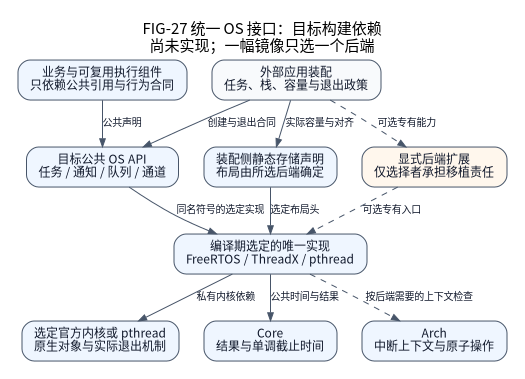

(explanation.os-portability)=
# OS 源码可移植性：目标设计

本页帮助维护者审查统一 OS 接口、静态内存和后端扩展之间的边界。它是以
`main@86f94e69` 为现状依据的目标提案，尚未改变公共头、配置合同或后端实现。
实施顺序、任务和退出条件见[实施计划](../development/os-portability-plan.md)。
当前行为仍由 [OS 执行合同](../reference/contracts/os/execution.md)和
[后端接入合同](../reference/contracts/os/backend-integration.md)维护。

目标是：常规业务与可复用执行组件更换 OS 时保持源码不变，装配侧调整后端选择、
资源预算和明确使用的专有扩展。源码可移植不表示二进制 ABI、调度时序、最小栈或
所有内核特性相同；Host 执行也不建立 MCU 实时性或物理验证资格。

## 当前限制与目标

| 边界 | 当前实现 | 目标 |
| --- | --- | --- |
| 等待 | 公共 `nx_wait_port_t` 和条件等待 | 保留现有合同与直接 callback 布局 |
| 任务与队列 | 后端专用名称、类型和调用 | 通用能力使用共同名称与语义 |
| 存储 | 调用者提供真实后端对象 | 装配侧提供选定后端布局，业务只持有 opaque 引用 |
| 后端选择 | 构建期选择 | 继续单镜像单后端，不增加运行期分派表 |
| 专有能力 | 原生类型和扩展入口 | 仅专有集成使用明确扩展，普通业务不依赖它们 |
| 裸机 | 非阻塞通知，没有任务调度器 | 保留机制；要求 task-profile 的配置直接拒绝 |

当前后端专用 API 已暴露真实成本，但把任务和队列的内核身份带入了应用。
资源透明并不要求业务使用内核类型。统一源码接口也不需要固定最大对象、动态
句柄表或每次调用检查后端；应分别解决接口合同、存储布局和编译选择。

## 依赖、职责与目录



FIG-27 的身份是 target，每条箭头都表示构建期依赖，包含编译依赖和链接时的实现
选择，不表示启动顺序、每次运行调用或所有权转移。图中的后端是互斥选择；
应用不会同时链接三个同名 OS 实现。
图只覆盖 task-profile，不包含裸机路径。目标结构不让普通 I/O 强制经过 OS，
也不新增运行期 factory、worker 或对象池。

| 层 | 拥有的责任 | 不承担的责任 |
| --- | --- | --- |
| 业务与协议 | 领域状态、输入输出和策略 | 内核类型、tick 换算、后端条件编译 |
| 可复用执行组件 | 排队、停止和进度，通过公共 OS/I/O 端口工作 | 产品线程角色和内存预算 |
| 外部装配 | 后端、对象存储、栈、优先级、容量和启动退出顺序 | 复制内核算法 |
| 公共 OS | 稳定单位、上下文、所有权、失败和生命周期合同 | 调度策略的虚假等价 |
| 后端 | 内核调用、状态转换、优先级映射与真实资源回收 | 产品恢复策略 |
| Core / Arch / SoC | 原有请求、时间、CPU 和硬件职责 | 隐式启动 scheduler |

该划分对应 SOLID：接口与存储各有单一变化原因；新增后端实现同一合同；只有满足
合同的能力才能替换；小接口分离基础与可选能力；组件依赖公共端口。它不要求为
每个函数增加接口层，也不允许以 `UNSUPPORTED` 掩盖已声明能力的缺失。

拟议目录如下；这些路径不表示文件已存在。按真实规模分文件，不创建空目录。

```text
os/
  include/nexus/os/
    wait.h
    task.h
    notify.h
    queue.h
    channel.h
    mutex.h / semaphore.h
    storage.h
  baremetal/
  freertos/
  threadx/
  native/
```

后端内部可以按 task、notify、queue 等实际职责拆分 C 单元，共享少量私有辅助。
不为了目录对称引入 forwarding 文件。现有 MPU、Secure、端口准备工具与锁定
依赖继续归后端维护；Host 准备脚本不进入固件，不修改 vendor 原件。

## 编译期选择与静态存储

拟议通用函数在各后端具有相同符号，CMake 每次只选择一个实现。无需
`switch(os_type)`、通用 ops 表、运行期名称查找或动态对象池。保留
`nx_wait_port_t` 的 callback，是因为组件需要连接具体通知对象，与整幅镜像
选择内核是不同问题；不再包一层通知 vtable。

业务头只看到未完成类型及引用。装配文件包含选定布局头，才能定义实际存储；
同一对象直接形成业务引用，不额外分配一个只保存指针的包装对象。
原生控制块头可以成为装配文件的编译依赖，但不进入业务头。

以下仅为拟议写法示意，尚无可运行教程或稳定 API；省略了初始化与失败处理：

```c
/* Assembly pseudocode: selected storage layout completes nx_task_t. */
static nx_task_t worker;
NX_OS_STACK_DEFINE(worker_stack, WORKER_STACK_BYTES);
/* Business receives an opaque nx_task_t*, not a native kernel handle. */
```

栈容量对外以 B 表示。后端检查对齐、启动帧、容量溢出和原生单位换算；TCB、
任务上下文、同步对象和队列数据区由外部 owner 持有。布局由真实选定类型决定，
不维护另一套手写 sizeof，不预留跨内核最大 union，不把固定字节数组当通用 TCB。
选择不同内核或配置后必须重新编译，并重新核对 `sizeof`、alignment 和预算。

配置沿用现有 TOML、typed IR 和 CMake 单一路径。能力要求在同一解析链校验，
不新增 Kconfig、缓存回退或第二套生成权威。新 MCU 若复用已有 CPU/内核合同，
应提供 SoC、IRQ、时钟和 Board 事实；只有新端口或新语义才修改 OS 集成。

## 通用能力与可选扩展

task-profile 指要求真实任务调度的目标能力集合，不是已存在的配置键。
它覆盖 FreeRTOS、ThreadX 和满足所选合同的 Native；裸机只保留非阻塞机制。
同步对象和关闭能力按需选择，不让全部对象承担最高成本。

| 能力 | 目标合同 | 选用成本与限制 |
| --- | --- | --- |
| 通知 | 单 waiter、多 publisher；提示后重查真实条件 | 保存序列与后端唤醒状态，发布域明确 |
| 可返回任务 | 入口返回后可由唯一外部 owner join | 需要完成同步与真实内核回收 |
| 永久任务 | 无 join；入口不得返回 | 省完成状态，误返回 fail-stop |
| 任务时间与让出 | 拟议 `sleep_until` 与 `yield`，仅 task 使用 | 不创建 timer worker，不保证微秒精度或公平 |
| 基础队列 | 固定 item size/depth、复制、有限等待 | 控制对象和 `depth * item_size` 数据区 |
| 可关闭通道 | 关闭发送准入、广播退出、保留已有数据排空 | 额外 waiter 存储与广播成本 |
| Mutex | task owner、解锁归属、明确优先级继承与递归政策 | 后端必须真实实现所选政策 |
| Semaphore | 计数上限、获取/发布、明确饱和与 IRQ 范围 | 不冒充有 owner 的 mutex |

FreeRTOS 直接通知槽、ThreadX 抢占阈值、MPU 受限任务和 Secure 上下文属于显式
扩展。应用选择这些能力就接受对应装配的移植成本；不能让普通组件私自依赖它们。
不默认引入软件 timer daemon、事件派发线程或通用 user-object pool。

## 任务、启动与回收

拟议任务接口统一入口签名、可返回/永久分类和结果语义。start 成功后任务可能已经
执行，甚至在 start 返回前结束；context 和必要连接必须先准备完成。
创建被拒绝时不保留 entry/context。若底层部分资源未能撤回，必须返回明确的残余
责任并保留控制对象，不能把它描述成可立即重用的干净拒绝。

可返回任务的入口返回只表示业务结束。FreeRTOS 外部删除、ThreadX 的真实删除、
pthread join 由后端实现；共同成功条件是内核与适配层已解除对应引用。
join 超时不强杀任务，不释放栈、TCB 或 context；self-join 和竞争 join 被拒绝。
不提供一个声称能安全撤销所有业务效果的通用 task-kill。

公共启动入口应统一外部流程，并让调用者提供明确 bootstrap 回调；不得伪装内核
已经处于同一状态。FreeRTOS 的调度器前创建、ThreadX 的真实
`tx_application_define` 引导范围，以及 Native 已运行进程内的线程创建不同。
首批任务在允许的阶段创建；bootstrap 只完成声明允许的非阻塞操作。
平台启动仍不启动调度器，不允许将已运行内核重新解释成冷态 bootstrap。

Native 当前有限 join 是实际缺口：`pthread_join` 没有 deadline，入口完成提示也
不证明 pthread 已退出。目标必须接入并验证真实单调截止时间 join 能力；不满足的
Host 组合拒绝所需 profile。受支持平台可用真实 try-join 配合同一单调 deadline
和有界等待；禁止完成标志后无界 join、反复重置预算或忽略期限的轮询。

## 队列、通道和同步语义

基础队列不承担关闭广播。发送成功表示队列已复制 item，接收成功才交付 item；
超时或关闭拒绝不能偷偷消费 item，也不能在失败时改写接收输出。
排队指针只复制指针，payload 的借用与回收仍由调用者协议负责。

可关闭通道复用现有正确性要求：close 后拒绝新发送，唤醒已登记阻塞者，旧 item
仍可接收，排空后接收返回关闭结果。控制对象、每个并发 waiter 和数据区都由
调用者提供；destroy 要求 closed、drained 且 users/publishers 已退出。
close 和 destroy 不替代执行 owner 推进；不能以定期超时检查代替关闭唤醒。

Mutex 固定 owner 与非法解锁行为，递归作为显式选择。优先级继承不得用普通
binary semaphore 代替。Semaphore 明确最大计数与满时结果；所有对象都需要先
退出等待者和发布者，再销毁。销毁失败保留尚未解除的资源，只允许受审的重试。

## 时间、优先级与上下文

有限等待保持现有绝对单调微秒合同；后端向上换算 tick，跨唤醒重算剩余预算。
无限等待只能显式选择 `NX_DEADLINE_NEVER`；溢出不能降为无限。立即可满足的
操作可先成功，等待错误后仍按公共 Wait 合同重查真实条件。
时间域必须在等待、排空和 join 期间连续；重启 epoch 后旧 deadline 失效。

目标还提供 task-only 的 `sleep_until` 和 `yield`，避免周期业务调用原生 delay。
`sleep_until` 使用同域绝对 deadline，已过期立即返回，不推进设备，也不保证微秒
唤醒精度。`yield` 只是调度提示，不保证公平、指定下一任务或让低优先级任务运行。
两者不隐建 timer worker，可归入 `task.h`，不为两个函数机械增加模块。

逻辑优先级拟议为数值越大优先级越高，具体值放装配，后端映射原生编号。
可用等级、保留等级、时间片与调度政策必须在配置中校验。Native 当前没有任务
优先级接口；普通 pthread 调度不能证明 MCU 抢占等价。若组件要求真实优先级
排序，Host 必须实现并验证对应调度能力，否则拒绝该能力要求，不忽略参数。

| 上下文 | 目标准入 |
| --- | --- |
| 普通 task | 已运行的正确内核、受支持权限和屏蔽状态；阻塞只在允许阶段 |
| Bootstrap | 只允许该内核真实阶段支持的创建与非阻塞连接，不允许等待未来任务 |
| IRQ 发布 | 独立入口，先核验 IRQ 范围、mask、分组与 syscall ceiling |
| NMI / fault / 其他安全域 | 不继承普通 IRQ 合同，未维护的组合拒绝 |
| MPU 用户任务 | 仅受审 syscall；公共名称不自动授予原生内核或 I/O 权限 |

现有后端没有的 ISR 队列不能靠重命名变为支持。Mutex 与阻塞操作不在 ISR 调用。
实际 IRQ 原语继续保存/恢复 incoming mask，不用本地关中断声称获得 SMP、DMA
或跨安全域互斥。Secure companion 不增加第二个 scheduler，信任边界保持原合同。

## 结果、停止与失败责任

目标错误归类沿用 Core 结果类型，不建立另一套 OS 错误枚举；各 API 冻结时细化
准确码值与输出规则。参数、能力与上下文错误必须在对象和内核效果变更前拒绝。

| 结果类别 | 存储和后续责任 |
| --- | --- |
| 参数/上下文拒绝 | 不取得新的业务借用，不执行内核操作 |
| 必需能力不满足 | 配置失败；动态扩展另按明确接口拒绝，不偷偷选择替代模式 |
| 等待超时 | 结束本次等待；保留任务、请求和其他未结束借用 |
| 通道关闭 | 停止发送准入；继续 drain 和等待者退出 |
| 忙/尚未退出 | 保留同一存储，继续必要进度，不能重新 init |
| 部分清理失败 | 保留精确残余资源和恢复责任，不伪报 destroy 成功 |


FIG-08 是当前合同图，目标继续保留其中的等待协议与退出责任。请求 SETTLED、
任务入口完成、join 成功、通知发布者退出分别证明不同事实。应用先关准入，继续
执行 owner 的取消/排空，再会合有关任务和 IRQ 发布路径。通知和队列只在全部
相关发布者与等待者会合后销毁。平台时钟与 Tick 保留到全部消费者静默且所选内核
生命周期允许撤回；不能在内核运行时直接撤销，也不承诺当前支持 scheduler
shutdown。失败时保留尚未结清的引用，不把 timeout/cancel 当作存储释放。

## 成本、参考与验收边界

编译期共同符号避免额外后端分派，但统一合同仍可能需要完成状态、deadline
换算或上下文检查。精简对象按能力选用；未选择的 channel、mutex、trace、MPU
与 Secure 状态不得进入普通对象。报告分别列对象、栈、payload、内核全局状态、
Flash 和总保留 RAM，不用单个 `sizeof` 代表整幅镜像。

现有 [Wait 成本夹具](../../tests/contracts/os_wait_cost/README.md)与
[资源夹具](../../tests/contracts/os_resources/README.md)是实施时的比较入口，不能
把其旧结果标成新 API 的证据。实际 IRQ 延迟、栈峰值、FP/MVE 保留和低功耗时间
连续性仍需设备验证；本文不新增当前支持或 HIL 结论。

[CMSIS-RTOS2 官方接口](https://arm-software.github.io/CMSIS_6/latest/RTOS2/index.html)
说明共同线程/同步接口与调用者存储属性可以并存，值得借鉴术语与上下文规则。
但 CMSIS 接口存在不证明目标内核有合格实现，也不能替代 Nexus 的绝对 deadline、
外部 join、借用和关闭合同。本方案不引入 CMSIS-RTOS2 中间层，不改现有内核 pin。

实施采用不兼容迁移：公共合同冻结后同步迁移平台消费者、外部示例和测试，移除
旧后端公开入口，不保留 alias、兼容 wrapper 或 fallback。后端内部可以复用真实
算法，vendor、gitlink、锁和许可记录保持原样。每次交付以真实生产 C 路径的
GoogleTest/GoogleMock RED/GREEN、精确 ARM/Host 上下文、SDK 消费和成本差值为据。
具体工作包、并行边界及退出条件由[实施计划](../development/os-portability-plan.md)维护。
