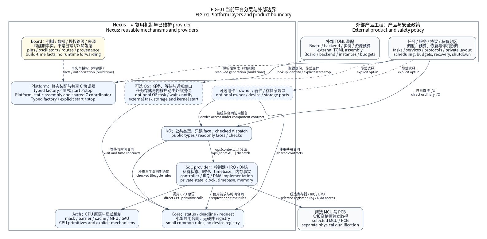
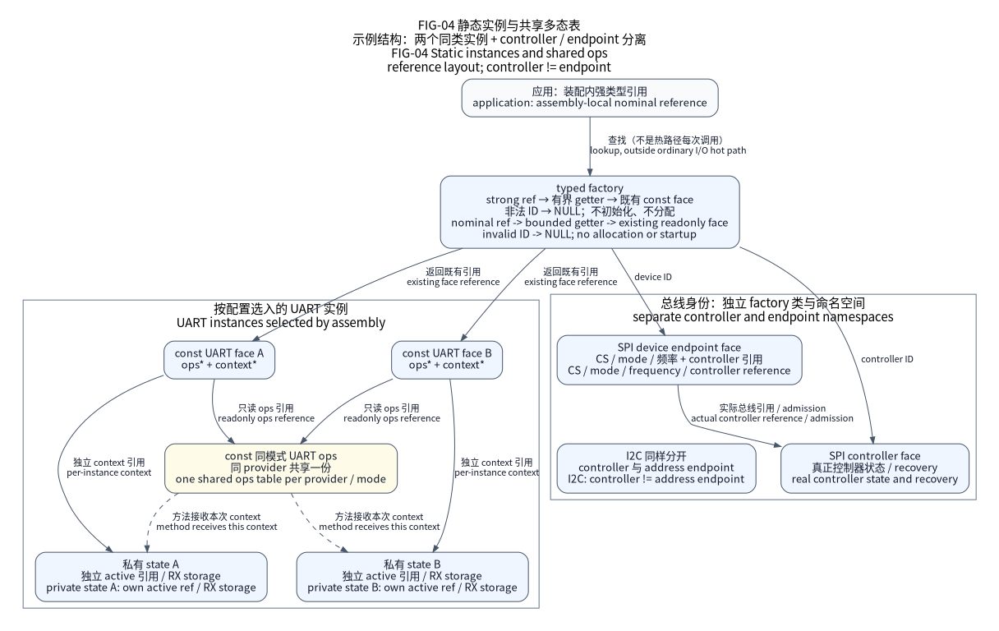
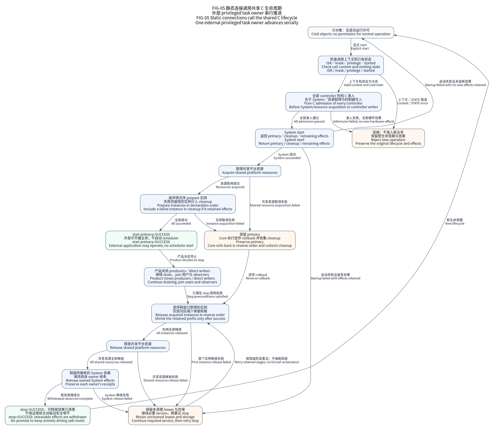

(explanation.platform-architecture)=
# 平台如何装配和运行

Nexus 是静态装配的 C11 MCU 平台。构建期选定硬件与容量，运行期保留真实设备状态和借用。应用取得只读接口后，直接调用选定实现；Platform 负责装配与生命周期。

## 职责与状态

| 层 | 负责什么 | 保持外置的内容 |
| --- | --- | --- |
| Core | 结果、单调 deadline、请求发布和稳定 epoch | 硬件、内核和产品策略 |
| Arch | IRQ 状态保存恢复、屏障、原子和显式 CPU 能力 | 外设和 scheduler |
| SoC | 精确器件、时钟、启动、内存、IRQ/DMA 与控制器 | PCB 接线与产品角色 |
| Board | 已审 PCB 路线、晶振、电气条件和安全电平 | 业务配置和未知硬件事实 |
| I/O | 公共领域类型、只读 face 与操作合同 | 厂商 Handle 和可变实现状态 |
| 可选 OS | 等待、通知及真实后端对象 | 应用任务、深度、栈与停止策略 |
| 可选组件 | 经窄端口复用的算法、设备协议和 owner | 产品协议寄存器、校准、密钥与分区 |
| 外部产品 | main、worker、预算、区域、执行与恢复 | 平台内部实现 |

Core 不依赖 Arch、SoC 或 OS；I/O 依赖 Core。Provider 依赖公共 I/O、Core、Arch 和私有厂商 SDK。组件通过公共端口访问设备，OS 不成为每次 I/O 的强制中间层。

## 构建期连接

一份 schema-2 TOML 表达应用选择，SoC 与 Board JSON 提供已审事实。解析器校验模式、时钟、pin、IRQ、DMA、内存域和预算，冻结为具名不可变 IR，再原子生成配置、静态实例、factory 和固定连接。CMake 拥有唯一翻译单元与软件依赖图。

Board 和 SoC 不包含 Python 插件。通用主机工具只做校验与静态连接；硬件顺序、等待、回读、回滚和恢复直接用 C 实现。包、binding 与导出边界见[接入合同](../reference/contracts/integration.md)。

## 运行期访问

一个 controller 行为域只有一个 live owner。endpoint、GPIO view、逻辑 signal 和可选 face 引用已有资源，不再取得一份硬件所有权。每类实现共享只读 `ops`，每实例独立持有 `context`。

factory 按生成的强类型 ID 返回已有静态 face，不分配、不初始化、不探测设备。Platform 显式启动基础设施，不启动 scheduler。应用提供请求、buffer、执行者和等待；普通同步操作不承担未选择的队列、stream 或 OS 状态。

ACCEPTED 后请求和数据持续被借用，直到 acquire 观察 SETTLED。DMA 完成、线上完成和引用撤回分别证明；取消或超时不授权提前复用。观察者、控制 handle、通知发布者和 owner 还需完成各自的 join。见[所有权](ownership.md)。

## 启动、失败与停机

Platform 先完成所选控制器的准入，再对 System、共享资源和控制器执行有序启动。
中途失败按已经产生的效果逆序撤回；撤回失败继续保留原 owner、存储和恢复责任，
错误返回不表示硬件已经静默。

应用在停机前关闭新工作、推进已接受请求结清，并退出相关任务和观察者。
Platform 再停止所选基础设施；它不替应用终止调度器或提前回收借用存储。

## Platform 与 Runtime

| 接入方式 | 平台提供 | 应用提供 |
| --- | --- | --- |
| `Nexus::Platform` | 精确 SoC/Board、选定 provider、静态 factory 和生命周期 | 应用源码、worker、区域、预算与恢复 |
| `Nexus::Runtime` | Core、Arch、公共 I/O 及明确选定的 OS 适配 | 启动、向量、时钟/内存、Board 与具体 provider |

每个构建目录只含一个工具链和装配，Runtime 与 Platform 互斥。同一装配可创建多个镜像，各镜像独立拥有 startup OBJECT。不同板卡或 CPU/安全域使用独立目录，由产品或 CI 协调。

## 当前实现位置

生产系列入口为 `soc/stm32/stm32f4/`：`facts/` 提供事实，`system/` 提供系统机制，`drivers/<domain>/` 保持 binding、实例布局与 C 实现相邻，`drivers/ip/` 复用已核验算法，`sdk/` 保持官方依赖和配置私有。Native 模型位于 `tests/support/native/`，需要显式 test support。

当前精确支持见[平台参考](../reference/platforms/support.md)，维护入口见[源码地图](../development/source-map.md)。文件或厂商库存在，不建立另一个型号、模式或实板验证结论。
