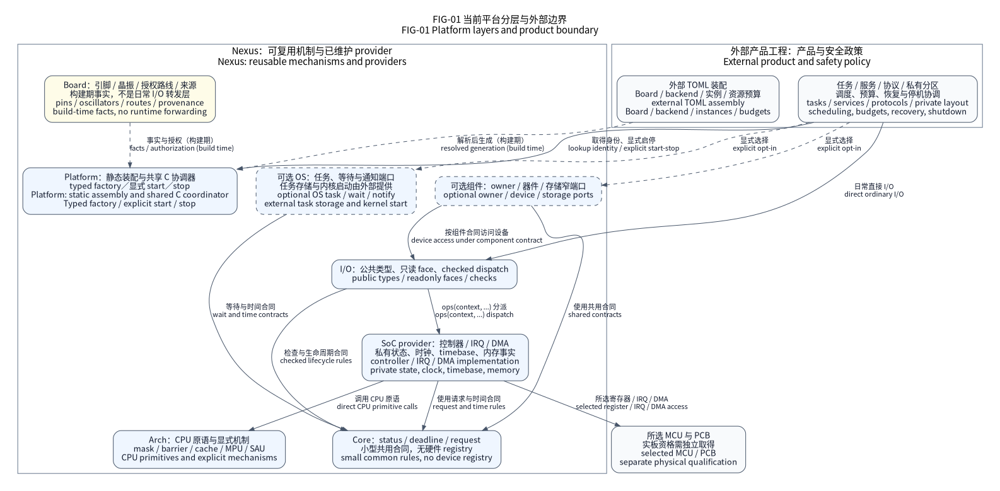
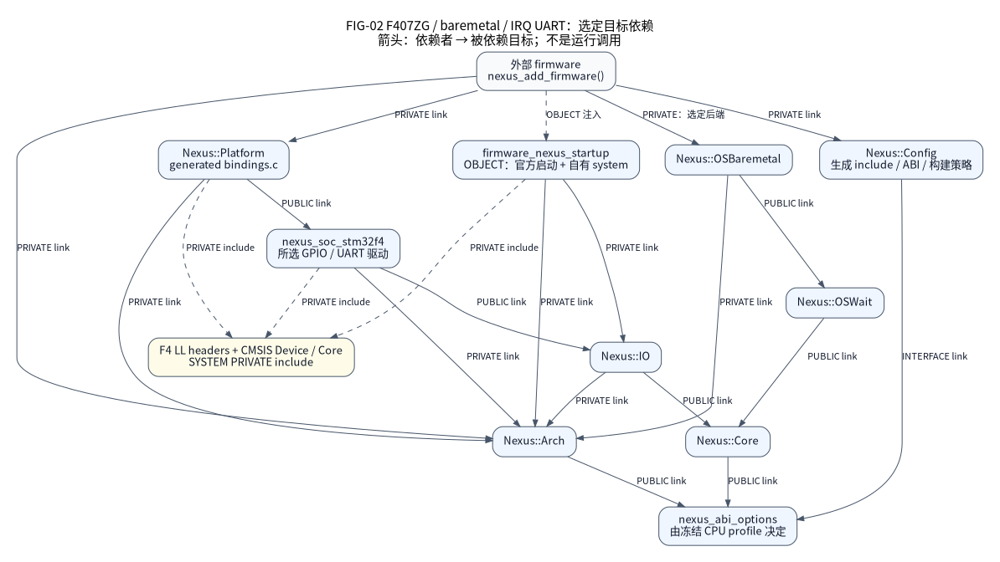
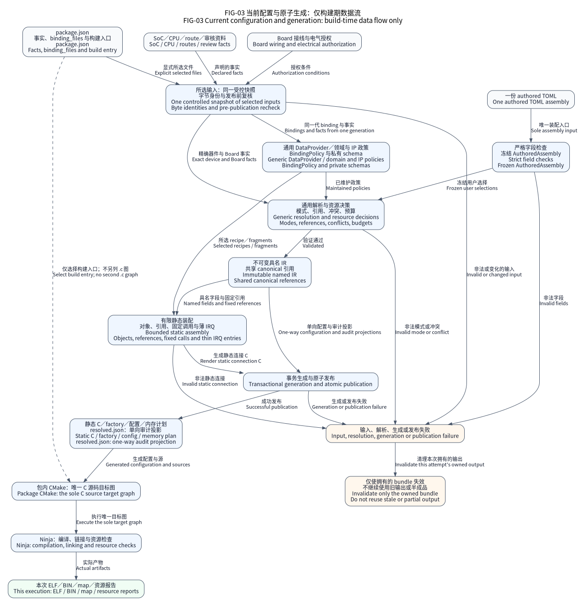
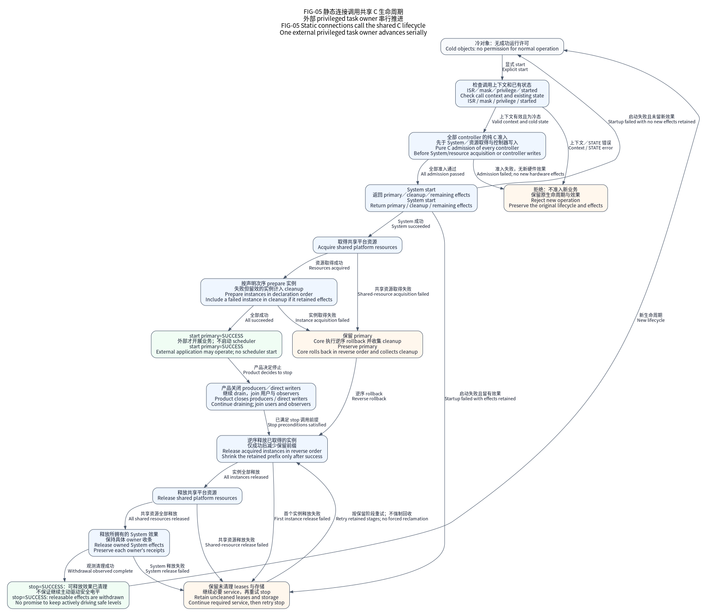

(docs-explanation-platform-architecture)=
# How the platform is assembled and executed

Nexus is a statically assembled C11 MCU platform. It separates reusable mechanisms
from external product policy. One authored TOML selects exact hardware and optional
adapters; immutable I/O faces expose the chosen private providers. The application
owns execution and recovery. These are current design boundaries, not whole-platform
physical qualification.

FIG-01 expresses current layer responsibilities. Arrows describe labeled dependencies
or access; it is not an initialization sequence.

| Layer | State and responsibility |
| --- | --- |
| Core | Results, monotonic deadline, request publication and stable epochs |
| Arch | Compile-time CPU primitives; incoming masks, barriers, optional Cache/MPU/SAU |
| SoC | Exact chip clocks, memory, startup, IRQ/DMA and controller implementation |
| Board | Reviewed PCB routes, oscillator/safe-level facts and explicit unknowns |
| I/O | Typed public faces and operation contracts; no vendor layout |
| Optional OS/owner | Explicit per-object wait, task or shared-resource execution storage |
| Optional component | Bounded algorithms through narrow ports |
| External product | Main, workers, roles, private PCB, budgets, partitions and recovery |

## Current source organization

The production MCU tree contains one series package,
`soc/stm32/stm32f4/`. Its current concrete implementations remain limited to
STM32F407VET6 and STM32F407ZGT6; a family directory or official HAL macro does
not establish support for another exact part or mode.

Private IP sources now belong to the F4 package. SoC targets select and compile
those sources directly; source ownership adds no runtime dispatch layer.
Native models live under `tests/support/native/` and require explicit
`test_support=True`, CLI `--test-support` or `NEXUS_TEST_SUPPORT=ON` in CMake.
They are test support, not a second production SoC.

The [source map](source-map.md) links authoritative layer contracts. Board and
SoC directories contain no Python plugins. The default host generator uses Python
for validation and static connections. Core's handwritten C platform coordinator
owns startup, stop, rollback and diagnostics; F4's private C coordinator owns
System and shared-resource sequencing. There is one maintained host configuration
implementation; its code is not linked into firmware.

All vendor sources, Gitlinks, locks and licenses remain available. Only selected
dependencies enter preparation, verification, compilation or Source SDK output.
An unused SDK is neither current platform support nor a required F4 build input.

## Optional network data and boot boundaries

Optional network targets keep copied RX and payload-loaned RX as distinct,
explicit stack profiles; one image selects one profile. The copied TCP byte
face copies accepted writes into bounded stack storage. A payload-loaned RX
frame instead has a copied writable prefix and immutable MAC-backed tails.
Final pbuf free marks release readiness; the serialized owner performs the
actual MAC release later. Outstanding references or failed release retain
storage and withdrawal responsibility. The
{ref}`network composition contract <lwip-loaned-rx-contract>` owns the exact
public/Storage targets, capacities and failure rules. These optional components
fit FIG-01's component boundary without adding a worker or runtime registry.

MCUboot exposes distinct control and full-boot targets. The reference links the
application and bootloader as separate images. The generic C11 control target
requests or queries trailer state; an explicit concrete Flash port uses
caller-owned regions, a valid clock and one finite deadline for each operation.
Only the separate boot image selects verification and overwrite-copy code. The
[canonical MCUboot contract and ownership diagram](../../components/mcuboot/README.md)
own those dependencies and product reset/recovery duties. The selected profile
provides permanent overwrite only; partial trailer writes leave product
recovery responsibility and imply no rollback. The
{ref}`control API <mcuboot-control-contract>` neither authenticates candidate
bytes nor starts hardware. Source documentation, software models and linked budgets do not
establish new firmware-candidate or physical HIL qualification.

## Platform and CPU-only Runtime

| Consumption entry | Provided assembly | External responsibility |
| --- | --- | --- |
| `Nexus::Platform` | Exact SoC/Board facts, selected providers, static factory and explicit lifecycle | Product sources, workers, budgets, storage regions and recovery |
| `Nexus::Runtime` | Core, Arch, public I/O faces and the explicitly selected OS adapter | Startup, vectors, memory/clock facts, Board wiring and concrete device providers |

One build directory admits one resolved assembly. Use separate build
directories for different boards or CPU/security images; a product build
coordinator or CI matrix owns their orchestration. Runtime and Platform reuse
the same production mechanisms but are separate consumption modes.

The common OS boundary is the wait/wake port. Task, queue, join and storage APIs
remain backend-specific, including the real kernel control-block types.
Products switching kernels must adapt that lifecycle explicitly; no universal
object pool or hidden scheduling task is supplied.

## Build-time decisions and runtime work

TOML schema 2 is the only authored platform input. The parser freezes user intent
as `AuthoredAssembly`; `resolve_ir()` combines it with reviewed SoC/Board facts
and validates modes, resources, clocks, IRQs, ABI, DMA reachability and budgets.
It returns `ConfigurationIR` directly. Named frozen records hold each decision
once; they do not expose a Mapping facade or a duplicate `values` store. Hardware
fact leaves and keyed indexes still use immutable mappings, and local resolver
validation drafts may use dictionaries. These are explicit data boundaries,
not a promise to assign a separate nominal type to every JSON field.

Factory and emitters consume the same typed result. `to_dict()` derives the
schema-1 `resolved.json` audit/artifact projection; it is never read back as an
authored platform input. Private typed source epoch 2 is separate from that
serialized format and from the public C factory epoch. Old JSON assemblies are
rejected. Historical evidence keeps its original bytes and read-only verification.
CMake owns the source dependency graph; resolution does not discover software
from device names or generate product workers.

Firmware execution is C11 plus necessary architecture assembly. Python runs on
the host to validate inputs and generate static C/H; the MCU has no Python
interpreter. Hardware algorithms belong in C: register access, admission, waits,
resource acquisition, rollback, stop and recovery. Generation connects immutable
configuration, exact instances, factory getters and fixed IRQ handlers. Constant
addresses and thin typed call sequences can remain generated without adding a
runtime interpreter or another dispatch layer.

F4 C owners implement admission, acquired-resource receipts, withdrawal and
readback. The default generated plan connects fixed typed callbacks and ordinals
from the resolved controller order to `nx_platform_lifecycle_start/stop`; the C
engine owns the control flow and retries only the retained prefix. The existing
`nx_lifecycle_*` reversible-resource engine remains a separate optional mechanism.
Native support is explicitly test-scoped. Actual generated factories, models and ARM images each
require validation; historical cross-family results do not qualify this refactor.

A cold receipt proves which resources this caller actually acquired. Rejection
with an empty receipt cannot stop or overwrite an existing owner. Partial
acquisition and failed restoration retain the original snapshot and unfinished
effects for retry; a public peripheral stop does not discard the enclosing
Platform lease. These checks run on the real C helpers in the register models.
Factory lookup and ordinary I/O retain their existing direct typed paths.

Generated static C and maintained C use the same firmware toolchain. Moving an
algorithm changes its maintenance and test ownership; it does not promise a
universal resource reduction. The recorded F407 I2C owner-guard comparison saves
RAM while increasing IRQ/DMA Flash. Linked costs and physical timing retain
their own source, configuration and measurement requirements.

FIG-02 is the checked compile graph. Vendor and provider includes remain private;
public consumers receive Nexus types and selected compile/link policy.

FIG-03 shows current generation. Unknown and conflicting selections fail; no
Kconfig/cache/old-header fallback repairs them. Runtime factory lookup returns an
existing face. After explicit successful platform start, ordinary operations call
its shared ops table with its instance context. IRQ dispatch is fixed to provider
instances and does not repeat factory lookup for every byte.

The explicit F4 descriptor is `tools/configure/stm32f4_descriptor.py`; the
centralized configuration adapter lives under `tools/configure/stm32f4/`. Production family enumeration contains only F4;
Native uses an explicit test-support context. Descriptors identify inputs and
selected code, without becoming a second source graph.

The constructor contract uses named immutable IR and direct calls for fixed
connections. Vendor types and mutable Handles stay private. Generated definitions
still require compiler, model and linked-image validation. The selected F407
UART `dma-tx` transport combines finite official HAL TX and disjoint LL IRQ RX
under one owner. Other modes retain their explicit implementations. See the
[official driver contract](../design/official-stm32-provider.md).

## Lifecycle and failure responsibility

FIG-05 shows explicit startup and reverse cleanup. A static face can exist before
start and after stop; its pointer is not a capability to execute cold hardware.
Partial failure can retain irreversible watchdog effects or busy borrows. Products
must inspect primary and cleanup outcomes, continue the real executor, and retain
quarantined resources. Platform start never starts a scheduler.

Physical Flash reports exact geometry and `program_flags`. An ECC fresh-erase
requirement belongs to the caller's provenance contract: all-FF readback cannot
prove unused ECC state, and a failed pulse requires another erase. All-FF source
units issue no pulse. A started pulse must settle before return; an expired
deadline prevents later pulses and never cancels hardware already programming.
Products own writable regions, voltage, execution stalls, watchdog and power loss.

Optional generated diagnosed start/stop entries write phase and controller
location to caller-owned cold-path storage. They retain no diagnostic pointer
and do not replace the primary/cleanup results or remaining-effect obligations.
See [the diagnostic contract](../design/official-stm32-provider.md) for index
meaning and failure responsibilities.
The {ref}`factory diagnostic mapping <factory-controller-diagnostics>` adds named
assembly-local ordinals and optional immutable labels; it does not create a
device-ready state machine or a second capability object.

## Costs and tradeoffs

A 32-bit face contains two pointers: eight bytes of readonly storage. Provider/mode
ops are shared; exact mutable state and selected buffers remain separate. Indirection
lets one public interface serve independent concrete providers and GoogleMock
ports. Its cost is one public dispatch and code/readonly table retention; actual
Flash/RAM and timing are measured on the selected linked image.

Static assembly rejects conflicts early and prunes unselected drivers. It deliberately
forgoes hotplug discovery, runtime string registries, arbitrary dynamic clock changes
and automatic recovery policy. Optional shared owners add explicitly budgeted slots
and synchronization; direct single-executor paths need no default OS lock or worker.

Read [factory](factory.md), [ownership](ownership.md), the
[integration contract](../design/integration-contracts.md) and
[exact support](../reference/platforms/support.md). Architecture diagrams explain
mechanisms; tests, image checks and HIL establish their separate execution scopes.
