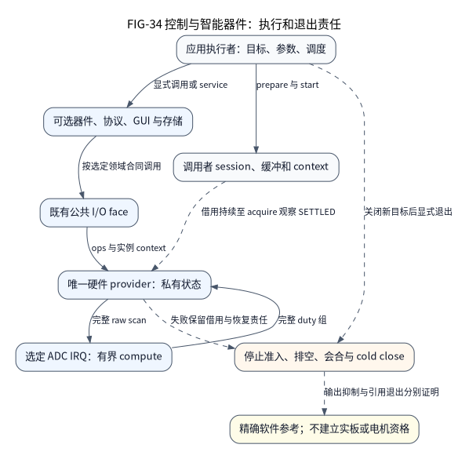

(guides.control-and-smart-devices)=
# 组合控制与智能器件

本指南帮助外部应用选择已有 I/O、算法和器件组件，明确执行者、存储、预算与退出。
当前生产 SoC 为 STM32F4；下述 PWM/ADC 路线仅是 STM32F407ZGT6 的精确软件参考。
它不替产品选择功率板、控制稳定性、私有 PCB、存储分区或调度，也不建立实板资格。

## 1. 先划分执行与资源

FIG-34 是当前软件组合图。实线表示调用／执行，虚线表示借用或退出责任；不表示
每个应用必须启用全部节点。图源与源码依据见{ref}`图册 <fig-34-control-smart-devices>`。

| 执行路径 | 放置内容 | 不得从该路径推导 |
| --- | --- | --- |
| 普通任务 | 位置环、器件采样、命令校验、参数快照、GUI、协议 service | 调用间隔就是实际采样孔径，或接口可直接从 IRQ 使用 |
| 选定 ADC IRQ | 完整 raw scan、已预算的 compute、完整 duty 组提交 | 能阻塞、写 Flash、运行网络／GUI，或并发修改借用算法状态 |
| 外部维护流程 | Settings 保存、文件耐久、镜像请求／确认、恢复 | 超时撤销持久效果、自动重放或自动重新使能输出 |

1. TOML 选择精确控制器、模式和已审 Board 路线。使用
   [应用配置](app-configuration.md)与 [I/O 执行指南](io-execution.md)，不要在业务中
   复写 SDK 初始化或重新取得同一 controller owner。
2. CMake 选择实际组件 target。依赖库只在明确选择时准备／编译；普通器件 C 库可以
   直接链接。厂商结构和 Handle 不进入业务接口。
3. 为每个实例提供独立状态、缓冲、有限 deadline、同一 domain/epoch 的时间与
   一个执行者。跨任务消息使用应用已有的有界 queue/guard，不把普通字段当原子快照。
4. 先按下面的路径完成启停，再接入遥测、GUI、网络和持久化；慢消费者不得延长硬件
   借用或在 IRQ 中调用慢路径。

## 2. 选择控制计算与硬件执行路径

`Nexus::AxisControl` 提供独立的命令准入、速度／位置参考和参数边界，
`Nexus::MotorControl` 提供纯 C11 有感电流计算。它们不读硬件、不创建任务，也不依赖
MCSDK。应用桥明确完成 raw 到 SI 的标定、角度与时间解释、duty 量化和最终限制
反馈，再通过唯一硬件 owner 提交。先阅读[控制架构](../explanation/motor-control.md)
和[公共声明](../reference/api/components/control.md)，不要把算法成功当成硬件采用。

需要可复用快慢环组合时，链接 `Nexus::CurrentControl`、`Nexus::ModulationControl`
和 `Nexus::DriveControl`。先准备固定容量参考／反馈存储、合格角度和标定身份，
再让应用组合执行 Current→Drive 电压计算→Modulation→最终电压 tracking，并把
完整脉冲和采样计划交回 provider。provider 不支持的起点、窗口或拓扑应拒绝，
不能退化成仅提交三个 duty。实际源代码消费者见本页末尾与控制 API。

Axis 的参考采用、Motor 的计划、provider 的输出暂存及机械到位分别观察。任务不得
逐字段修改 IRQ 正在使用的参数；在已有有界交接对象中传递完整目标和 revision。
Axis 的停止 policy 必须显式选择。零速 PI 保持仍需有效反馈和供电，不证明承重或
固定位置；机械交接完成后，应用才停止实际硬件并结束借用。

### 任务位置组合

任务位置环使用独立 encoder、计数展开、标定、轨迹、PID 和 PWM group。输入包含
单位、sequence、epoch、有效期及完整参数 revision。轨迹 READY 只表示命令计算
完成，不表示机构到位；新位置范围同时约束当前测量与仍在保持的目标。参数在一个
周期边界整体切换，保存只在控制源已退出后显式执行。

编码器软件观察时间不等于边沿时间。有界计数展开依赖产品证明的最大单步位移，不能
补回漏掉的完整圈数。位置环遵守公共 encoder/waveform 的任务上下文，不作为 IRQ
电流环使用。具体 API 见[算法](../reference/api/components/algorithms.md)。

### 耦合采样与电驱会话

需要统一 PWM/ADC 硬件节拍时，选择一个独立 `pwm_adc` controller，不能再分别占用
同一 TIM8、ADC 共享域或 DMA。模式的接口和状态分离：

| 模式 | 用途 | 调用者责任 |
| --- | --- | --- |
| `finite-regular-dma` | 固定 duty 的有限采样窗口 | request、duty 和 DMA 可达 samples 保持至 acquire 观察 SETTLED；显式推进 service |
| `injected-control` | 有有限生命周期的 IRQ compute session | 固定 raw scan／完整 duty 数量，独占借用 context，并证明 IRQ 与 compute 预算 |
| `injected-power-stage` | 完整输出／采样计划、两路或三路相电流及可选母线／编码器观察 | 长期 session；有限启动预算；显式共享 domain；证明标定、偏斜、命令时效与最终退出 |

`injected-control` 参考固定 timer 为 1 MHz。配置校验 trigger、conversion、最大 IRQ 延迟、compute
与 commit 窗口，并包含明确量化裕量。该校验不测量物理 WCET。ADC IRQ callback
不能保存临时 scan/output 指针，也不能调用 task-only I/O、OS、文件或网络。给快环
更新目标时，只通过另一个有独立同步合同的有界消息对象交接；不能逐字段修改已借用
的 PID／session。详细公式、精确引脚与退出见
[耦合 owner](../../soc/stm32/stm32f4/drivers/pwm_adc/README.md)。

PowerStage 的 `control.toml` 保留边沿对齐 TIM8、ADC1 四个顺序 rank 和 TIM4
参考。其他维护配置可省去必需的母线／编码器，或让两轴的独立 ADC 共享 common
和 IRQ；精确配置见[控制架构](../explanation/motor-control.md)。`sample_at` 是计划
触发参考，`angle_at`／`observed_at` 是软件观察，`planned_apply_at` 是预期更新边界。
顺序采样有明确偏斜；独立 ADC 共享域不等于单轴同时采样或同 ADC 时分。
`center.toml` 使用专用中心对齐路线与更新 IRQ，仅开放下降段采集；边沿路线不会
静默切换，规划器必须使用 provider 给出的采集槽。
`pair.toml` 选择独占共同域的 ADC1／ADC2 同时采样；`tdm.toml` 则由固定半载波
相差的 TIM8／TIM1 双会话时分使用 ADC1。它们是各自经审核的配置，不能任意
叠加；时分模式要求共同启动并拒绝运行中加入。
`dc.toml` 使用单路 DC-link 电流与每载波两个有效矢量，只开放无相移边沿对齐。
应用显式提供合法非零首计划与完整 context 内的 DC descriptor；中性首计划和
没有可观测窗口的零电压退化不被接受。不要混用该电流来源与独立母线电压。
触发、deadtime、AFE 稳定和提交预算的权威说明见
[电驱参考](../../soc/stm32/stm32f4/drivers/pwm_adc/README.md#电驱完整软件参考injected-power-stage)。

`nx_power_stage_prepare` 的 `startup_deadline` 单独约束启动；非阻塞长期 session
仍须显式 stop／service，并保持全部 context 至 acquire 观察 SETTLED。
运动命令有效期与硬件会话寿命分别管理，不能通过改写借用存储续期。尚未核验功率板、
电流比例、机械参考或电角偏置的外部工程必须拒绝激励；软件参考数值不作为实物默认值。

自有控制核不等待 MCSDK 源码包；MCSDK 后端尚未接入，也不是默认依赖。当前数值、
模型和链接结果不建立实际电机稳定性、功率保护、调参或物理性能资格。

## 3. 为每个器件保留事实边界

| 需求 | 选定组件 | 接入前必须补齐 |
| --- | --- | --- |
| 绝对角度 | `Nexus::AS5047P` | mode 1／MSB／速率与 CS setup、hold、inactive 时序；原始角度校准 |
| 电源监测 | `Nexus::INA226` | 分流电阻、量程、校准、触发与 ready；不是快速相电流 ADC |
| 六轴采样 | `Nexus::LSM6DSOX` 及 I2C/SPI adapter | 实际地址／电气、样本配对、FIFO overrun、timestamp 映射、标定与安装坐标 |
| 相对姿态 | `Nexus::Algorithms` 的 `attitude.h` | SI 单位、连续 dt、初始姿态与质量窗口；无外部参考时 yaw 会漂移 |
| 固定量化图 | `Nexus::AlgorithmsCMSISNN` | tensor、缩放、形状与执行预算；手工权重没有产品分类准确率 |
| 像素与播放控制 | `Nexus::OV2640`、`Nexus::WM8978` | capture/PCM owner、真实数据线、时钟、缓冲与带宽；启明参考只有控制连接授权 |
| 非导出签名 | `Nexus::ATECC608B`、`Nexus::IOP256Signer` | 已 provision/锁定的精确 B 器件与 slot、wake/delay 和有限操作 scope |

器件方法成功只建立各自数字合同。AS5047P 的两帧流水线不能取旧响应冒充当前角度；
普通 SPI endpoint 的存在也不证明 CS 纳秒约束。LSM6DSOX 的 DIRECT 与 FIFO 各有
数据含义，不把分离 tagged 记录强行配成同一采样。选定 P256 API 不导出私钥、不做
provisioning，也没有因此完成 TLS opaque-key 集成。精确模式、单位和失败责任见
[器件参考](../reference/api/components/devices.md)。

## 4. 接入界面、通信与持久化

从控制路径复制带有效性、时间来源和参数版本的观察，再由普通执行者处理：

- CANopen OD 是原始 staging；NMT Operational 和 SDO/PDO 写入都不是产品命令
  授权。外层检查完整命令后再交给控制 owner。协议 reset／overrun 关闭准入，不重置
  MCU，也不重放旧目标。
- ESP-AT 复用已有 UARTByteStream。显式推进 UART service 与模块 service；复制
  写入成功不等于线上完成，`SEND OK` 不等于 peer 收到。CLOSED 后先真实恢复模块／
  UART 边界，再重新 configure；TLS 信任、时间和熵保持外部策略。
- LVGL 只保留一个 live GUI owner。调用者提供私有 arena、32 KiB pool 与 RGB565
  tile，同一任务推进 UI。display/input 回调必须同步结清；任意异步 DMA flush 不能
  直接替换这个合同。上游 arena 子分配和耗尽 fail-stop 也纳入完整页面预算。
- LittleFS／FatFs 用固定块 `read_at`／`append` 处理文件，无 VFS 或全局句柄池。
  失败时的 prefix 不证明耐久，也不授权重放；close/unmount 失败保持原 volume 和
  workspace。远端 ACK、重复消除、retention 与断网队列归外部产品。
- MCUboot overwrite-only 与 scratch swap 分开选择。TEST 后由产品核对运行镜像和
  健康结果，再显式 confirm；没有确认就重启可触发选定 revert。共享布局文件拥有
  Flash 几何，不能把参考地址直接复制进已有产品分区。

详细合同见[协议与字节会话](../reference/api/components/protocols/streams.md)、
[存储服务](../reference/api/components/services.md)与
[MCUboot](../reference/api/components/protocols/boot.md)。

## 5. 按责任退出

1. 关闭新目标、UI 命令和网络准入，停止产生新的快照／请求。
2. 在各自 executor 调用 stop/service，等待真实硬件源、IRQ callback 与接受的
   request 退出。失败保持原 instance、buffer、callback 和恢复责任；不直接清零状态。
3. acquire 观察 SETTLED 后才结束对应借用；另外会合 observer、widget、协议与外部
   调用者。输出抑制和引用退出分别判断。
4. 停 capture/PCM 后再停 sensor/codec；GUI stop 后再退出显示／触摸；上层网络退出
   后再停 UART stream；最后关闭 bus 与 Platform 的 cold 资源。
5. 持久化或 Flash 操作失败可能已有效果。按原 owner 合同恢复并核对实际状态，不能
   通过重新初始化软件或延长 deadline 抹去责任。

## 维护的完整参考

完整应用源码与消费测试属于独立 `X-Gen-Lab/nexus-examples`，本页不复制另一套实现：

| 入口 | 可审查的组合 |
| --- | --- |
| `apps/axis_control` | 实际 encoder／trajectory／PID／PWM、整组参数、Settings 与 copied telemetry |
| `recipes/control/differential_drive` | 真实 Axis 控制、独立 DC／机械模型、成组目标、超时与分层验收 |
| `recipes/control/servo_axis` | Axis、真实电流 PI 与独立带载 DC 模型；软件位置／速度／电流闭环和实测驻留判据 |
| `recipes/control/dual_motor_drive` | 双独立平均 PMSM 模型、量化 ADC／编码器、实际 FOC 组合、有限目标与故障退出 |
| `recipes/control/lift_axis` | 重力／闸模型中的承重交接与有限机械回零；不授予实际承重或制动资格 |
| `recipes/control/motor_drive` | Axis／Drive／Current／Motor／Modulation 到 PowerStage 的组合；未 commissioning 时拒绝激励；可选 Task 角度／母线源 |
| `recipes/control` | 触摸／数值控制和 IMU 校准、安装旋转、姿态消费 |
| `recipes/inference` | 实际 CMSIS-NN 的固定三输入、四隐藏节点、二输出量化图 |
| `recipes/ui` | 小缓冲局部绘制与校准触摸片段；不是 LVGL recipe |
| `apps/connected_terminal` | 实际显示／触摸、route／UDP 与 Settings 组合；默认不启用 LVGL 或 TLS |
| `recipes/network/drive_host` | Python 标准库的有限 CiA 402 PV／SocketCAN 主机参考；默认仅 codec 演示，实物总线未执行 |
| `recipes/network/cia402_motor` | 真实 CANopen／CiA402 PV／绝对 PP 到 PMSM 控制组合；原始接收期限、快环确认和双 owner 退出 |
| `recipes/network`、`apps/network_gateway` | 路由与交付事实、独立传输会话、boot audit 和网关消费 |

阅读示例时使用该仓库交付记录绑定的精确提交与 Nexus 依赖，不从 `main` 的后续变化
继承资格。本仓库 `tests/contracts/f407_pwm_adc` 和 `f407_pwm_adc_loop` 提供真实
TOML、typed factory 与 ARM 链接入口；`tests/contracts/f407_power_stage` 增加电驱
软件路线。这些 cold consumer 不执行实板快环。
Native 行为、ARM 链接与实板测量分别记录；物理 HIL 仍为 `not_executed`。
