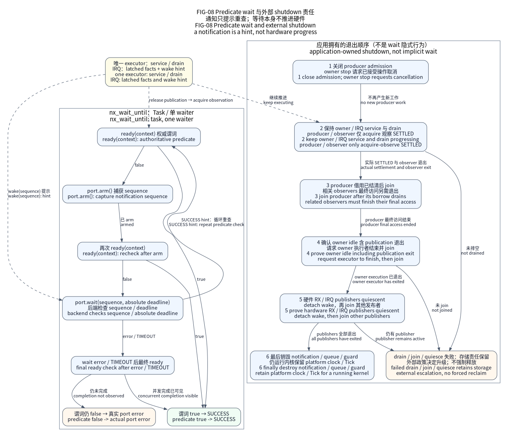

(docs-guides-os-shutdown)=
# Wait correctly and shut down an explicit owner

Use this guide for applications selecting an optional Native, FreeRTOS or ThreadX
adapter. The application owns tasks, stacks, notifications, queues and execution
progress. Baremetal has no scheduler. Platform start never starts a kernel.
The [OS contract](../reference/contracts/os/execution.md) remains authoritative.

Use the common opaque task, notification, queue and channel APIs. Include
`nexus/os/storage.h` only in files defining zero-initialized static objects and
native-word stacks; ordinary business headers do not include kernel headers.
One executable selects one backend. The current implementation does not by
itself establish final software-candidate or physical qualification.

## Avoid lost completion and unbounded waits

Use the request's latched predicate as truth. Check the completion predicate, arm the
notification sequence, recheck, wait with the same absolute monotonic deadline,
then recheck again. Wakes are hints and may be coalesced or unrelated. On timeout,
perform the contract's final predicate observation. Do not restart a relative
budget after each hint and do not block the only executor that must make progress.



FIG-08 shows the current wait/wake responsibilities. A provider IRQ sink must
respect the selected kernel syscall ceiling; an unqualified priority cannot call
an ISR kernel API. ThreadX has its own reviewed M4/Native subset and masking policy,
not the FreeRTOS port or tickless/isolation capability set.

## Shut down in dependency order

1. Close client admission and reject new work without borrowing it.
2. Keep the resource owner/executor running. Request cancellation using stable
   slots and matching epochs; cancellation does not release accepted storage.
3. Drain transfers and block loans. Acquire-observe SETTLED and read results.
   A failed drain retains QUARANTINED storage and explicit recovery responsibility.
4. Join producers and detach/join control observers before slot or request reuse.
5. Stop and join the owner. Quiesce hardware IRQ publishers before destroying
   their notification, queue, guard, stack or TCB storage.
6. Stop platform providers only when their selected lifetime and kernel clock/Tick
   ownership permit it. A running scheduler is not stopped by ordinary I/O teardown.

Task return has a backend-specific implementation:

| Backend | After the application entry returns | External owner must prove |
| --- | --- | --- |
| Native | The pthread entry returns and the host thread terminates | Successful `nx_task_join_until()` after actual pthread exit |
| FreeRTOS | The wrapper publishes its completion hint and suspends until the external joiner deletes it | Successful `nx_task_join_until()` after external kernel deletion |
| ThreadX | The wrapper publishes its return predicate and completion hint, then follows the kernel completion path | Successful `nx_task_join_until()` after real ThreadX deletion |

Returning from an entry function or observing a completion hint never authorizes
stack/TCB reclamation. Keep wrapper, stack and kernel-control storage until the
one external lifecycle owner successfully joins it. Raw queues and closable
queues have different lifecycle contracts; close is not destruction. Keep all
storage on the failure path and retry cleanup only through its real owner.
Native finite join uses the real GNU monotonic clock-join path; a completion
flag followed by unbounded `pthread_join` is not equivalent. The Native process
clock remains independent of deterministic peripheral-model clocks.

Channels require an initialized exclusive caller waiter for each simultaneous
send/receive. Close rejects sends with `CANCELLED`, wakes blockers and retains
queued items; receive reports `CANCELLED` only when closed and drained. Queue
deadline zero is an immediate try. A raw queue has no close broadcast and needs
an external protocol ensuring callers exit before destruction.

`nx_os_run` succeeds without returning. Native parks its existing bootstrap
thread to preserve caller-stack loans; process exit is explicit application
policy. Native supports only logical priority zero. The common priority order
is larger values first; do not pass ThreadX native priority numbers directly.

## Retain ownership after task-start failures

A non-successful start does not always mean clean rejection. INVALID/CONTEXT
reject the current attempt without new effects; they do not release references
held by an already live task. ThreadX may create a task successfully and then
report IO when resume fails, retaining the live control and its borrowed storage.

For a creation or cleanup failure without proof of complete withdrawal, retain
the control, stack, name and context. Use discard only when the selected phase
and actual entry state prove that the task never executed; otherwise use the
permitted cooperative-completion/join path or explicit external recovery.
If teardown cannot be proved, do not reinitialize or free the object. There is
no generic task destroy or kill that safely revokes these responsibilities.

## Execute maintained software fixtures

First prepare the [fixed source and recursive dependencies](source-checkout.md).
From that repository root, with host build tools available:

```sh
python tools/dev/dev.py configure --preset native-debug
python tools/dev/dev.py build --preset native-debug --parallel 4 \
  --target nexus_os_wait_test nexus_os_portable_native_test \
  nexus_uart_owner_mock_test
build/native-debug/bin/nexus_os_wait_test
build/native-debug/bin/nexus_os_portable_native_test
build/native-debug/bin/nexus_uart_owner_mock_test
```

All binaries must execute nonempty passing cases. This targeted development scope
does not replace the complete TDD gate. The external UART owner application in
[nexus-examples](https://github.com/X-Gen-Lab/nexus-examples) supplies product workers;
its pin/revision must be recorded before claiming consumer execution.

Physical scheduler context, IRQ ceiling, FP/MVE retention, stack peaks and wake
latency require real station evidence. Do not inherit POSIX behavior as MCU timing.
