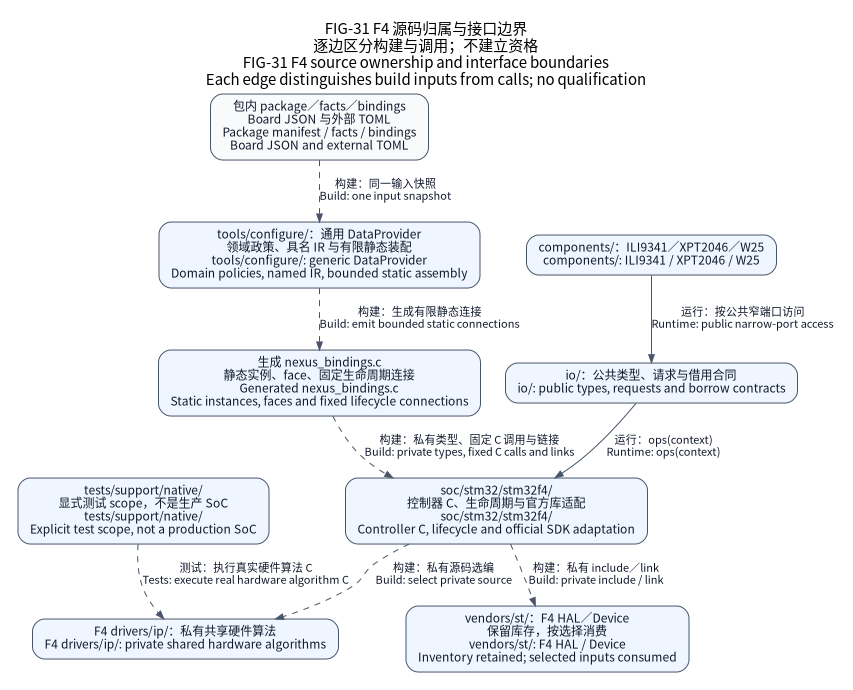

(docs-guides-provider-porting)=
# Add a provider through a built-in or external package

Use this guide to connect a concrete C11 implementation to the static factory,
configuration resolver and source SDK. Choose one source owner below, then follow
the same lifecycle and verification contract. A similar peripheral name does not
establish compatible registers, a Board route or physical qualification.

Read the [integration contract](../design/integration-contracts.md),
[provider construction contract](../design/official-stm32-provider.md#build-time-provider-contract)
and [selected assembly checks](../design/provider-assemblies.md) first.

| Owner | Responsibility |
| --- | --- |
| Arch | Exact CPU primitives, features and ABI |
| SoC/provider | Full part, memory, clocks, IRQ/DMA, startup and private C state |
| Board | Reviewed wiring, oscillators, safe levels and explicit unknowns |
| Component | Caller-owned storage, bounded algorithms and narrow typed ports |
| External product | Tasks, queues, roles, Flash reservations and recovery policy |

## Choose one integration path



FIG-31 shows maintenance decisions, not runtime calls. A shared driver requires
reviewed register layout, flags, reset ordering and errata for every selecting
chip. The exact SoC owns routes and admission even when it reuses that driver.

### Built-in implementation

1. Select an existing exact `soc/<vendor>/<family>/` or add a reviewed family
   descriptor with that canonical `source_directory`. Keep public family IDs
   independent of directory names. Add exact `soc.json` and `routes.json` facts;
   Board facts remain separate. Preserve unknown electrical and PCB information.
   Register the data-only descriptor in the existing explicit maintained map;
   an external package does not edit that map.
2. Define admitted full part numbers and modes in the family's `configure/contract.py`.
   `bindings.py` supplies typed `Construction` values; `emission.py` supplies static
   declarations and explicit typed lifecycle calls. The leaf contract must not
   import the top-level resolver or emitter. Declare configuration helpers in the
   descriptor so reconfiguration and SDK closure include them.
3. Add concrete C sources and private dependencies to the family's explicit CMake
   target. Export the selected target and the required startup/system inputs.
   Configure must reject a missing, imported or incorrectly typed provider target,
   invalid private include roots and missing MCU lifecycle inputs before building.
4. Add the exact authored TOML fixture to the maintained assembly catalogue and
   the applicable SDK consumer plan. Execute the behavior and build checks below.

Use the shared CPU resolver for ABI and feature selection. Do not duplicate CPU
flags or infer optional features from a family name. A descriptor lookup must
remain a data-only operation and must not import another family's implementation.

### External implementation

Start with the complete
[canonical external provider starter](../../cmake/package/verification/external_provider/README.md).
It is exported at `share/nexus/src/cmake/package/verification/external_provider`
in a source SDK. Checkout contracts and SDK consumers copy those same files;
there is no separate test implementation to keep synchronized.

From an external work directory, with a verified SDK already available:

```sh
cp -R "/path/to/sdk/share/nexus/src/cmake/package/verification/external_provider" \
  "provider workspace"
cd "provider workspace"
cmake -S . -B build -G Ninja \
  -DNexus_DIR=/path/to/sdk/lib/cmake/Nexus
cmake --build build --target external_lifecycle_consumer --parallel 1
./build/bin/external_lifecycle_consumer
```

A zero exit verifies the starter's Native software model: two independent GPIO
contexts, shared readonly ops, pure factory lookup, a second-prepare failure,
rollback of the first instance, withdrawn I/O and repeated recovery. It does not
establish a new MCU, PCB route or HIL result. Paths with spaces are supported.
The project uses an explicit SDK; it never searches for a checkout fallback.

1. Keep the authored assembly's `soc_package` and `board_package` explicit and
   relative to that TOML. The package family must match Board facts and cannot
   shadow a built-in family. Replace the starter's model facts only with reviewed
   facts for the actual selected implementation.
2. Maintain `nexus-soc.json` with schema/interface version 1, package identity,
   `source_directory`, `configuration_directory` and declared `inputs`. The
   [schema](../../tools/configure/soc-package.schema.json) provides editor hints;
   runtime validation remains authoritative. Every source, CMake input, private
   header and configuration helper consumed from the package must be declared.
3. Implement the package's explicit CMake target and configuration modules under
   the same construction contract as a built-in provider. Package CMake and
   Python are explicitly selected trusted host code. They define no firmware
   interpreter, discovery service or second build graph.
4. After reviewing changed source, refresh existing declared hashes and check the
   package with the SDK's tool. Run these commands from the copied starter root:

   ```sh
   python /path/to/sdk/share/nexus/src/tools/configure/integration_package.py \
     refresh-inputs --package provider
   python /path/to/sdk/share/nexus/src/tools/configure/integration_package.py \
     check --package provider --json
   python /path/to/sdk/share/nexus/src/tools/configure/configure.py \
     provider-check --assembly assembly.toml
   ```

   Refresh updates only already declared paths; add a new input deliberately
   before refreshing. It preserves the package version and rejects missing files.
   Check reads metadata and digests without executing provider code. Provider
   checking resolves and validates the selected implementation. Unsupported modes,
   unknown fields, duplicate keys, escaped paths, symlinks, stale digests and
   unsupported interface versions reject without falling back to another family.
5. Rebuild the copied project against both the checkout and the installed SDK.
   Move the SDK prefix to a path containing spaces and build a fresh consumer
   there. SDK fixture requirements, copying and identity comparisons expand the
   same verified manifest; unrelated package files are not discovered as inputs.

`interface_version` gates compatibility. The package's `version` identifies its
reviewed source; it does not express a consumer semver request. Declare external
vendor source and locks explicitly in `inputs`. `soc.source_lock` belongs to
Nexus-managed dependencies and does not validate an arbitrary external checkout.
Declared Python imports use verified source bytes; undeclared helpers and stale
bytecode cannot supply configuration behavior. SDK packaging does not import the
provider merely to enumerate its files.

### Keep facts and admission policy distinct

SoC and Board JSON describe hardware facts; the provider contract admits exact
parts and modes. The resolver constructs the sole immutable decision rather
than treating a fact file as an executable selection policy. Part density,
package pins, clock domains, IRQ/DMA reachability and mode-specific resource
ownership must agree before generation. Unknown wiring or silicon revisions
remain explicit and cannot be repaired by choosing a different mode.

`ConfigurationIR.physical_part` and `ControllerIR.integration` reference existing
physical facts and selected resource, clock, IRQ and DMA plans. Reuse those
objects; do not create another routing or register interpretation in the factory.
Vendor types and register behavior remain private C implementation details.

## Implement and verify the lifecycle

Write and execute the meaningful failing contract before changing production
behavior. Keep the actual RED command, nonzero result and contemporaneous source
and binary. Python tool behavior uses stdlib unittest; new C API/provider contracts
use host GoogleTest/GoogleMock against the real C algorithm through hardware
ports. Missing tools and compile errors are not behavioral RED evidence.

The generated factory returns existing static readonly faces by compact typed ID.
It must not allocate, initialize hardware, acquire locks or discover devices.
Instances share readonly operation tables and retain independent private context.
Callbacks receive that context. Controller and endpoint IDs remain distinct.

Keep hardware admission, register access, waits, pin/clock/IRQ/DMA acquisition,
rollback, stop and recovery in concrete C11 adapters. Host Python validates facts
and emits static declarations, exact storage and explicit typed calls. Review the
[official driver boundary](../design/official-stm32-provider.md) before duplicating
HAL/LL/SPL behavior. Do not add a runtime register script, name registry, maximum
object pool, hidden worker or mandatory OS lock.

The C prepare path must validate foreign ownership before effects. The close path
must validate its receipt before changing an existing provider; an empty alien
receipt leaves unowned state unchanged. Preserve every unfinished resource claim
after partial preparation until readback proves return. Exercise partial receipts,
stop after public shutdown, repeated failure/recovery and instance isolation.

For asynchronous modes, rejected admission retains no references or effects.
Accepted requests and buffers remain borrowed until acquire-observed SETTLED.
Cancel or deadline expiry does not revoke that borrow. Failed drain retains
QUARANTINED storage and explicit recovery responsibility. Remove IRQ, hardware and
queue references before release-publication of completion.

Keep vendor headers, handles and mutable storage private to their targets. Inspect
actual public consumer compile commands and include probes, not only target
property names. The optional host framework requires C++17; production firmware
remains C11 and never links GoogleTest or its runtime.

Execute GREEN, then refactor while retaining the contracts. Build the exact
existing STM32 and GD32 selections with the ARM toolchain, check ELF resources,
selected handlers and unselected-driver pruning, and run relocated SDK consumers.
Compare the same empty image with the added mode, reporting Flash LOAD, footprint
and each RAM domain separately. Native models establish modeled software behavior;
ARM builds establish their compile/link boundary. Real PCB, clock, DMA, cache and
electrical acceptance require physical station execution.

Application examples remain in the external private examples repository. Keep
product roles, tasks, private partitions and recovery policy there; the public
starter contains only reusable integration mechanisms and software tests.
