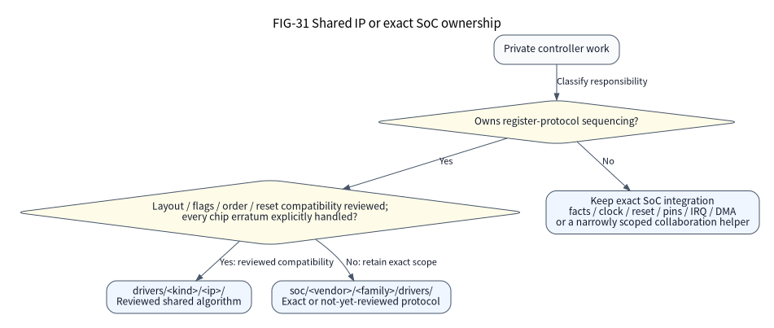

(docs-guides-provider-porting)=
# Add a SoC, provider or reusable component

Use this guide to add a maintained implementation with explicit resources and
measurable costs. A new family or mode requires behavior, configuration and build
integration together. Similar STM32/GD32 peripheral names do not prove register
compatibility.

## Keep the layer boundary narrow

| Owner | Required responsibility |
| --- | --- |
| Arch | Exact CPU primitives, feature facts and ABI; no PCB or device registry |
| SoC | Full part, memory, clocks, IRQ/DMA routes, reset/startup and private provider |
| Board | Source-reviewed wiring, oscillators, safe levels and actual unknowns |
| I/O provider | Public operation contract, private state, admission and final drain |
| Component | Caller-owned storage, bounded algorithm and explicit narrow ports |
| External product | Roles, tasks, queue depth, recovery, Flash reservations and release |

Read the [architecture](../explanation/platform-architecture.md),
[integration contract](../design/integration-contracts.md) and
[provider assembly contract](../design/provider-assemblies.md).

## Choose the source owner

FIG-31 classifies private controller work. Arrows are maintenance decisions, not
runtime calls. Sharing requires evidence for every selecting chip's register
layout, flags, ordering and reset compatibility, plus explicit handling of its
errata. Similar names or a successful compile do not establish that evidence.
Keep an unreviewed or incompatible protocol in its exact SoC implementation.

| Change | Source owner and required check |
| --- | --- |
| Public I/O contract or portable I/O rule | `io/`; preserve the public ownership and failure contract |
| Reusable register-protocol algorithm | `drivers/<kind>/<ip>/`; each SoC wrapper establishes the actual silicon contract |
| Part, memory, clock, reset, pin, IRQ or DMA integration | Exact `soc/<vendor>/<family>/`; facts, configuration policy and private C retain distinct jobs |
| Private SoC collaboration helper | Narrowest reviewed SoC scope; `soc/common/uart_control.h` is cross-vendor, while STM32 identity access is vendor-specific |
| External device, protocol or product policy | Existing component ports or the external product, according to the [integration contract](../design/integration-contracts.md) |

The SoC target selects shared sources through explicit CMake entries and private
includes. The driver directory does not choose routes, clock profiles or an ABI,
and its presence does not add a maintained mode. Never introduce a runtime
forwarder merely to match a source directory.

## Implement in a reviewable sequence

1. Prepare the [fixed source and recursive dependencies](source-checkout.md).
   Define the new behavior, supported modes, public ownership obligations and
   rejection boundaries before changing its production implementation.
2. Add and execute a meaningful RED GoogleTest/GoogleMock contract against the
   current production path. Retain the actual command, nonzero execution and
   expected failing assertion. Test MMIO/CPU/dependency ports through mocks;
   Python resolver behavior uses stdlib unittest. A missing tool or compile-only
   error is not the expected behavioral RED result.
3. Add exact `soc.json`/`routes.json` facts and documented provenance. Feed the
   shared CPU resolver; do not duplicate CPU flags or infer optional features.
   Place MCU implementations under `soc/<vendor>/<family>/` and declare that
   canonical `source_directory` in the maintained family descriptor. Public
   family identifiers stay independent of the directory. CPU implementation
   sources belong under their ISA, such as `arch/arm/cortex_m/`; reviewed
   cross-vendor register algorithms belong in `drivers/<kind>/<ip>/` only after
   checking each participating silicon contract. Cross-vendor SoC collaboration
   stays in `soc/common/`; STM32 identity helpers stay in `soc/stm32/common/`.
4. Add the family to the explicit maintained provider map in `tools/configure/`.
   Place its production configuration package in
   `soc/<vendor>/<family>/configure/` (Native uses `soc/native/configure/`) and
   its configuration tests in `tools/configure/tests/providers/<family>/`.
   Define supported modes, numerical limits, constructors, rollback and IRQ wiring.
   Return an explicit frozen `Construction` record, including the private state
   type and failed-init cleanup responsibility. Initialize and stop actions use
   `DirectCall` values under the [constructor contract](../design/official-stm32-provider.md#build-time-provider-contract);
   raw C expressions are not accepted in those fields. Do not require family-name
   inference in common generation. Unsupported modes reject; there is no runtime
   registration or plugin discovery.
5. Add explicit CMake targets and private SDK dependencies. Update declared
   resolver reconfiguration inputs and the Source SDK required-file closure.
6. Implement the smallest correct production change. Define an immutable public
   face with shared readonly ops and independent context.
   Reuse public Nexus types; keep vendor structures and concrete storage private.
   Review official HAL/LL reuse before duplicating a vendor state machine. Apply
   [the official-driver boundary](../design/official-stm32-provider.md) to time,
   callbacks, cancellation, private dependencies and mode-specific comparison.
7. Execute GREEN against the real provider. Verify rejection
   without residual effects, accepted borrow, cancel/deadline, failed drain,
   quarantine, stop/restart and instance isolation where the mode needs them.
8. Refactor while keeping contracts passing. Link exact ARM fixtures and verify
   actual resources, handler retention, vector bytes and unselected-driver pruning. Validate an
   independent relocated SDK consumer and record physical work as not executed.

For a component, pass explicit bus, GPIO, time and optional OS ports. Do not create
workers, probe devices, invent application roles or supply a maximum object pool.
Flash drivers expose physical geometry; persistence and update policy remain external.

Within each SoC's `configure/` package, `contract.py` owns mode capabilities,
ABI/limits and family admission policy. Sibling modules import that contract
directly; `__init__.py` explicitly exports it with constructors and emitters.
The leaf `providers/common.py` owns validation helpers and immutable
`Construction`; leaf contracts and common helpers do not import the top-level
resolver or emitter. `selection.py` checks cross-domain options, clocks and IRQ
policy, `ir.py` owns named immutable decisions and their one-way JSON projection,
and `matrix.py` orchestrates support catalogues.
The descriptor explicitly lists `configuration_modules`, including `contract.py`,
so edits trigger reconfiguration and remain in the Source SDK closure.

`tools/configure/contracts.py` owns immutable controller-category fields, factory
kind order and public header mappings. Authoring, selection and factory consume
that same metadata; exact SoC capabilities remain in the family contract. Memory
budgets, Flash layout and source dependencies have frozen named stage results.
One frozen device-graph result completes controller, endpoint, USB FIFO, SPI face,
ADC trigger, resource and DMA decisions before final assembly. Its local
validation builders may still use dictionaries; the stage boundary does not
claim that every normalizer is a separate typed stage.

## Keep facts and admission policy distinct

The exact `soc.json` variant supplies physical Flash origin, size, erase blocks
and RAM domains. Each family's `contract.PARTS` explicitly admits its full part
numbers through the frozen `PartPolicy`: the package and optional memory-domain
allowlist are software policy, not duplicate size tables. Unknown parts, a
different package or optional domains inconsistent with the physical facts reject.

Validation covers every maintained variant in the fact package, including parts
not selected by the current assembly. Each variant uses the same package, Flash
geometry, memory overlap, DMA reachability and `PartPolicy` checks. Selection
returns the existing selected facts; it does not repair a malformed unselected
part or copy another part's geometry.

Trace an added part or mode through these maintained inputs before adding its
constructor:

| Input or projection | Maintainer's check |
| --- | --- |
| `soc.json` variant and `routes.json` | Exact physical geometry, bonded pads, route provenance and finite mode allowlist |
| Family `PARTS` and `PartPolicy` | Explicit full part, reviewed package and optional placement domains |
| `normalize_clock` and `clock_plan` | The exact family implements the selected profile and any reviewed domain relationships |
| `i2c_timing_clock` | `I2cTimingClock` carries selected kernel and peripheral clock bounds and whether explicit timing is required; electrical assumptions remain authored |
| Selected limits, format and silicon policy | Metadata belongs to the exact selected owner; missing review remains explicit and does not admit a mode |
| `PhysicalPartIR` | Views the same frozen part, package, Flash and memory facts; it adds no JSON or configuration-identity field |
| `ControllerIntegrationIR` | Reuses canonical resource claims, DMA lanes, IRQ options/profile, clocks, pins and the exact SoC hardware binding |
| Family `UART_FORMATS`, `STREAM_GEOMETRY` and `ENDPOINT_POLICY` | Explicit reviewed formats, stream geometry and endpoint capability; a vendor alias or name prefix does not select a policy |
| Generated static C and private provider | Consume validated values and retain independent SDK/register assertions and runtime failure checks |

F407 Flash generation illustrates the boundary: its selected sector array and
readonly geometry come from validated `result.flash.erase_blocks`, origin and
size. The C SDK assertion still checks the physical base, and independent
register-model tests retain the reference geometry. Removing duplicate production
tables does not make configuration a substitute for hardware validation.

All seven maintained MCU families obtain generated readonly Flash geometry from
the validated facts through `memory.flash_geometry`. Six retain their existing
global geometry symbols; F407 emits selected static geometry. Native remains a
host model. The exact source and independently maintained test oracle still need
the applicable provider and linked-image checks.

`ConfigurationIR.physical_part` views the existing frozen Flash and memory
objects. `ControllerIR.integration` composes canonical `ResourcePlanIR` claims,
`DmaTopologyIR` lanes, IRQ options/profile, clock plan/inputs and selected pins.
It references a family `ControllerBinding` where that family declares one. Its
`clock_hz` is only the paired nominal APB input; a missing value is not guessed,
and reviewed frequency bounds come from `clock_plan`. Fixed reviewed SDK
addresses, masks and Native model facts remain explicit leaf data; they do not
independently select a route, owner or clock. The maintained-constructor
consumption audit checks these selected records and capability projections; it
does not create a new route resolver or establish final integrated qualification.

Family policy hooks remain declared configuration inputs. H743's reviewed clock
domain relationships and selected Flash linker fragments live in its `configure/`
package; generic tools still own parsing, typed IR, resource arbitration and
atomic publication. A hook must not create a second source graph or silently
choose a different part, route or profile.

The paired F407/GD470 controller bindings, DMA vector maps and concrete secondary
controller hooks live with their SoC. Common code keeps resource leases, fixed
IRQ wiring and drain ordering while consuming the selected typed integration.
Coupled personalities and named pin states likewise require explicit provider
policy. Cross-Board/backend qualification remains in its existing OS contract;
moving family mechanisms does not broaden those admitted combinations.

The read-only [work-package view](../../tools/maintenance/README.md) connects
exact maintained modes to resolver fixtures, selected ops sources and reviewed
lifecycle properties. Its entries are navigation, not executed tests or new
support declarations. Run actual applicable gates separately.

## Keep hardware behavior in C

Firmware mechanisms use C11, with necessary assembly for startup and CPU context.
Python runs on the development host: it validates authored inputs, resolves
resources and emits static C/H declarations, instances, typed factory getters,
fixed IRQ entry connections and explicit typed calls. The MCU executes compiled
firmware and contains no Python interpreter.

Maintain register reads and writes, hardware admission, waits, pin/clock/IRQ/DMA
acquisition, rollback, stop and recovery in concrete C adapters. Generated
definitions may retain constant register addresses and immutable resource data;
a fixed IRQ trampoline may directly call its selected handler. Do not move these
algorithms into a runtime action interpreter or add a registry, hidden worker or
mandatory lock. Test the production C algorithm through hardware ports using
GoogleTest/GoogleMock; Python unittest verifies configuration and static wiring.

The reviewed Native and seven MCU-family increments include their maintained
cold paths. Shared enhanced-SPI admission uses read-only C checks before resource
acquisition or failed-init markers; H743 resume checks admission before reopening
its runtime domain and acquiring its lease. Dead hardware emitters and unused default MMIO macros have
been removed. Audit the whole start/failure/stop/resume path, including shared
owners and optional retained components. A `DirectCall` in one constructor does
not prove whole-family or whole-source completion. Exact implementation and
execution scopes remain in the
[delivery-completion ledger](../design/platform-delivery-completion.csv).

Write readonly mode-specific configuration and exactly sized mutable storage.
The C prepare function validates context and foreign ownership before effects;
the C close function proves its receipt before touching an existing provider.
An empty receipt must leave unowned state unchanged. After partial preparation,
close must retain every unfinished pin, clock, IRQ or DMA claim until readback
proves return. Test both an alien empty receipt and a genuine partial receipt;
also test cleanup after the caller has already stopped the public peripheral.
Avoid duplicate persistent pin snapshots or a maximum-sized union of all modes.

Keep schema fields and numerical policy in host validation. Keep runtime MMIO
reads, clock checks, publisher joins, waits and recovery in C. Declare each new
configuration helper and private C/header input in the existing family
descriptor and explicit CMake target. A successful host model does not replace
an actual ARM link, relocated SDK consumer or physical station run.

H743 fixed-run power references the selected logical controller ID in
`power.controllers`; the ID need not be `bus4`. Renaming the controller requires
updating both endpoint and power references. This preserves the exact single
SPI4 finite-DMA, baremetal, HSI64/cache-off contract; changing a logical name does
not admit another physical controller, clock profile or backend.

## Review performance and ownership

Measure the selected empty image and the same fixture after enabling the new mode.
Report Flash LOAD, Flash footprint, each RAM domain and reserved task/IO storage
separately. Hot IRQ work should directly access its fixed provider; an interface
lookup is a cold action. Keep bounded admission and stream metadata operations
independent of queue length where their contracts require it.

A passing host register model proves its modeled software scope. New CPU, Cache,
FPU/MVE, security or low-power behavior needs its own actual execution boundary;
[platform support](../reference/platforms/support.md) does not infer it from a name.
